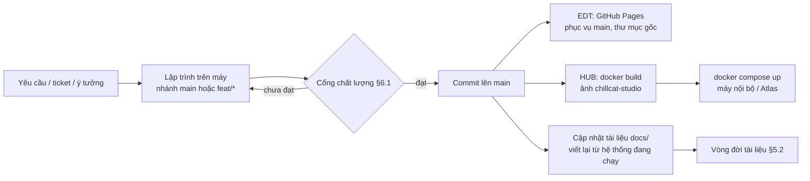
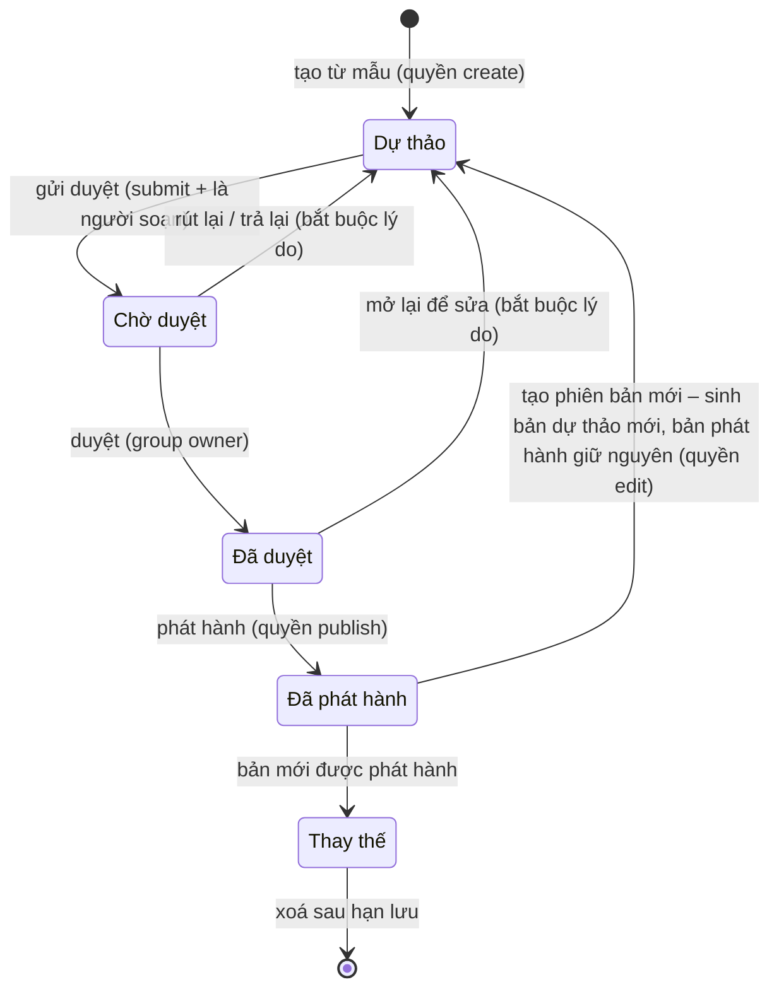

# Kế hoạch vòng đời phần mềm – CCS ChillCat Studio

| Thuộc tính | Giá trị |
|---|---|
| Mã tài liệu | CCS-LCP-000 |
| Phiên bản | 0.1 |
| Ngày | 2026-11-18 |
| Trạng thái | Dự thảo – viết từ hệ thống đang chạy |
| Quy trình ISO/IEC/IEEE 12207 | 6.2.1 Life Cycle Model Management · 6.3.1 Project Planning · 6.3.2 Project Assessment and Control · 6.3.5 Configuration Management · 6.3.6 Information Management · 6.3.7 Measurement · 6.3.8 Quality Assurance |
| Chuẩn tham chiếu | ISO/IEC/IEEE 12207:2017 (quy trình vòng đời, phụ lục điều chỉnh) · ISO/IEC/IEEE 15289:2019 (nội dung hạng mục thông tin, loại "plan") |
| Nguồn đã khảo sát | `git log` (7 commit, 2026-11-10 → 2026-11-13), `git branch -a`, `.gitignore`, `backend/.gitignore`, `README.md` (mục Triển khai), `sw.js`, `CNAME`, `.nojekyll`, `backend/Cargo.toml`, `backend/Cargo.lock`, `backend/Dockerfile`, `backend/Dockerfile.dockerignore`, `backend/deploy/docker-compose.yml`, `backend/.env.example`, `backend/README.md`, `backend/docs/DECISIONS.md`, `backend/apps/server/src/app.rs`, `backend/crates/documents/src/`, `backend/crates/audit/src/lib.rs`, `backend/scripts/`, `templates/README.md` |
| Đơn vị ban hành | Nhóm phát triển ChillCat Studio |
| Tài liệu liên quan | ↑ [CONV §3.3](CONV_Quy_uoc_tai_lieu_va_ky_hieu.md) (khai báo loại LCP) · ↓ [DOC-REG](DOC-REG_So_dang_ky_tai_lieu.md) · [STP-00](../07_Kiem_thu/STP-00_Ke_hoach_kiem_thu.md) · [DEP-00](../08_Trien_khai_van_hanh/DEP-00_Trien_khai_tong_the.md) · [OPS-00](../08_Trien_khai_van_hanh/OPS-00_So_tay_van_hanh.md) · [ASM-00](../09_Danh_gia_hien_trang/ASM-00_Danh_gia_hien_trang.md) · ⇄ [CMP-00](../09_Danh_gia_hien_trang/CMP-00_Danh_gia_tuan_thu_15289.md) · [ADR-00](../03_Kien_truc/ADR/ADR-00_So_dang_ky_quyet_dinh_nen_tang.md) · [LOG](LOG_Nhat_ky_xay_dung_tai_lieu.md) |

---

## 1. Mục đích, phạm vi và tài liệu tham chiếu

### 1.1 Mục đích

Tài liệu này là **kế hoạch vòng đời** (hạng mục thông tin loại *plan* theo ISO/IEC/IEEE 15289) của hệ thống CCS. Nó trả lời:
dự án đi theo mô hình vòng đời nào, áp dụng những quy trình nào của ISO/IEC/IEEE 12207:2017 và ở mức nào, cấu hình và
thông tin được quản lý ra sao, chất lượng được kiểm bằng gì và đo bằng chỉ số nào.

### 1.2 Phạm vi

- **Hệ thống**: CCS – ChillCat Studio, gồm hai hệ thống con: **EDT** (Bộ soạn trên trình duyệt – web tĩnh, chạy offline) và
  **HUB** (Làm việc nhóm – tab Dự án + máy chủ Rust trong `backend/`, MongoDB).
- **Sản phẩm của vòng đời**: mã nguồn, bộ mẫu `templates/`, bộ tài liệu dự án `docs/`, ảnh Docker của máy chủ, cấu hình
  triển khai.
- **Ngoài phạm vi**: hạ tầng của bên thứ ba (GitHub Pages, MongoDB Atlas, dịch vụ AI) – chỉ mô tả điểm tiếp xúc ở
  [ICD-00](../06_Giao_dien_tich_hop/ICD-00_Tong_quan_tich_hop.md).

### 1.3 Tài liệu tham chiếu

| Tài liệu | Chủ đề | Dùng ở |
|---|---|---|
| ISO/IEC/IEEE 12207:2017 | Quy trình vòng đời phần mềm; phụ lục quy trình điều chỉnh (tailoring) | §2, §3, §7 |
| ISO/IEC/IEEE 15288:2023 | Quy trình vòng đời hệ thống – chỉ tham khảo khi bàn về hệ thống (máy chủ + CSDL + hạ tầng) | §3 (6.4.6, 6.4.14) |
| ISO/IEC/IEEE 15289:2019 | Nội dung hạng mục thông tin (plan, report, description, specification, procedure, policy, request) | §5, [CMP-00](../09_Danh_gia_hien_trang/CMP-00_Danh_gia_tuan_thu_15289.md) |
| ISO/IEC/IEEE 42010:2022 | Mô tả kiến trúc | [SAD-00](../03_Kien_truc/SAD-00_Kien_truc_tong_the.md) |
| ISO/IEC/IEEE 29148:2018 | Yêu cầu | [StRS-00](../02_Yeu_cau/StRS-00_Yeu_cau_cac_ben_lien_quan.md), [SyRS-00](../02_Yeu_cau/SyRS-00_Yeu_cau_he_thong.md), SRS |
| ISO/IEC/IEEE 29119-3 | Tài liệu kiểm thử | [STP-00](../07_Kiem_thu/STP-00_Ke_hoach_kiem_thu.md) |
| IEEE 1016 | Mô tả thiết kế phần mềm (viewpoint) | [SDD-EDT](../04_Thiet_ke_chi_tiet/SDD-EDT_Bo_soan_tren_trinh_duyet.md), [SDD-HUB](../04_Thiet_ke_chi_tiet/SDD-HUB_Lam_viec_nhom.md) |
| `desc.txt` | Đặc tả gốc của HUB (vòng đời tài liệu §5, bảo mật §6, ràng buộc §7) | §5 |
| `backend/docs/DECISIONS.md` | 46 quyết định cho các điểm đặc tả còn ngỏ | §5, §7.3 |

### 1.4 Tóm tắt

- Mô hình: **phát triển tăng dần** (incremental), mỗi gia tăng là một commit lên `main`; web tĩnh phát hành qua GitHub
  Pages, máy chủ phát hành dưới dạng ảnh Docker (§2).
- Tuân thủ: **tuân thủ có điều chỉnh** (tailored conformance) với ISO/IEC/IEEE 12207:2017 – 30 quy trình: 9 Đầy đủ, 17 Rút
  gọn, 4 Không áp dụng (§3).
- Khoảng trống lớn nhất tại 2026-11-18: phần lớn mã (`backend/`, `js/api.js`, `js/hub*.js`) và `docs/` **chưa vào git**,
  đặc tả gốc `desc.txt` bị `.gitignore` loại, chưa có tag / baseline, chưa có CI (§4, §6). Hệ thống HUB chưa có loại tài
  liệu cho các quy trình quản lý – chính tài liệu này và CMP-00 chưa tạo được trong HUB (§5.1).

## 2. Mô hình vòng đời

### 2.1 Mô hình đang dùng

Dự án đi theo **mô hình tăng dần, tiến hoá** (suy luận từ `git log`): mỗi gia tăng thêm một nhóm chức năng hoàn chỉnh, được
gộp vào `main` và phát hành ngay. Không có giai đoạn yêu cầu – thiết kế riêng trước khi lập trình; tài liệu được **viết lại
từ hệ thống đang chạy** (CONV §5) sau mỗi đợt.

| Ngày | Commit | Gia tăng |
|---|---|---|
| 2026-11-10 | `4ecf2db` | Khởi tạo: tài liệu Markdown + diagram + chat AI (EDT) |
| 2026-11-11 | `628c392` | Tab Thiết kế trang, chuyển sang tên miền riêng |
| 2026-11-11 | `675e6b9` | Markdown đầy đủ, dịch PlantUML, tab Cài đặt, lịch sử chat |
| 2026-11-11 | `a96451e` | Mermaid / PlantUML chuyển thành diagram của app |
| 2026-11-12 | `a683c94` | Đổi tên ChillCat Studio, 24 mẫu tài liệu (`templates/`) |
| 2026-11-13 | `3d85091` | Nhập trang HTML (gộp từ nhánh `feat/nhap-trang-html`) |
| 2026-11-13 | `750de89` | Chat AI chọn effort / thinking; bảng, màu chữ trong Tài liệu |
| 2026-11-14 → 18 | (chưa commit) | HUB: máy chủ `backend/` + tab Dự án; kiểm thử 2026-11-17/18 |

Đặc điểm (suy luận): chu kỳ gia tăng khoảng một ngày; nhánh tính năng chỉ dùng khi thay đổi lớn (`feat/nhap-trang-html`);
không có tag phiên bản (`git tag` rỗng). Nhánh `publish` đang trỏ cùng commit với `main`, mục đích chưa ghi ở đâu
(xem *Vấn đề còn mở*).

### 2.2 Luồng một gia tăng

### 2.3 Hai đường phát hành

| Hệ thống con | Sản phẩm phát hành | Cách phát hành | Nhận diện phiên bản | Nguồn |
|---|---|---|---|---|
| EDT | File tĩnh ở gốc repo (`index.html`, `css/`, `js/`, `sw.js`, `templates/`…) | GitHub Pages "Deploy from a branch: `main`, thư mục `/`"; tên miền ở `CNAME`; `.nojekyll` để phục vụ nguyên file `.md` | commit git; `VERSION` trong `sw.js` (`v14`) – tăng khi đổi danh sách file `PRECACHE` | `README.md` mục Triển khai; `sw.js` |
| HUB | Ảnh Docker chứa `chillcat-server` + giao diện tĩnh | `docker build -f backend/Dockerfile .` rồi `docker compose up -d --build` (`backend/deploy/`) | `version` của `[workspace.package]` trong `backend/Cargo.toml` (`0.1.0`), trả ở `GET /api/v1/meta`; ảnh chỉ gắn thẻ `chillcat-studio:latest` | `backend/Dockerfile`, `backend/deploy/docker-compose.yml`, `backend/apps/server/src/app.rs` |

Bộ mẫu `templates/` là sản phẩm chung của hai đường: EDT phục vụ trực tiếp file mẫu; máy chủ **nhúng mẫu vào file chạy**
khi biên dịch (`backend/crates/documents/src/catalog.rs`, macro `tpl!` dùng `include_str!`). Đổi mẫu nghĩa là phải biên
dịch và phát hành lại máy chủ.

### 2.4 Tài liệu trong vòng đời

Bộ tài liệu `docs/` được lập theo cách **viết lại từ hệ thống đang chạy** ([CONV §5](CONV_Quy_uoc_tai_lieu_va_ky_hieu.md)):
mỗi điều dựa vào vị trí trong mã; điều tự rút ra gắn nhãn (suy luận). Thứ tự lập theo `templates/README.md` §4; tiến độ
ghi ở [LOG](LOG_Nhat_ky_xay_dung_tai_lieu.md).

## 3. Tuyên bố tuân thủ và điều chỉnh

### 3.1 Tuyên bố

Hệ thống CCS áp dụng ISO/IEC/IEEE 12207:2017 theo **tuân thủ có điều chỉnh** (tailored conformance): mỗi quy trình được
xét theo phụ lục quy trình điều chỉnh của chuẩn, ghi rõ mức áp dụng, lý do và bằng chứng ở §3.2. Không tuyên bố tuân thủ
đầy đủ (full conformance).

Quy ước cột:

- **Áp dụng** – mức dự án cam kết: *Đầy đủ* (mọi hoạt động của quy trình), *Rút gọn* (chỉ các hoạt động ghi ở cột Lý do),
  *Không áp dụng* (có lý do).
- **Bằng chứng** – tài liệu trong sổ `docs/`, file mã, script kiểm thử, cấu hình.
- **Còn thiếu** – khoảng cách giữa cam kết và bằng chứng tại 2026-11-18. Mã `CR-nn` là khuyến nghị định nghĩa ở
  [CMP-00 §6](../09_Danh_gia_hien_trang/CMP-00_Danh_gia_tuan_thu_15289.md).

### 3.2 Bảng điều chỉnh 30 quy trình

| Quy trình | Áp dụng | Lý do | Bằng chứng | Còn thiếu |
|---|---|---|---|---|
| 6.1.1 Acquisition | Không áp dụng | Dự án nội bộ, không mua sản phẩm / dịch vụ phần mềm theo hợp đồng. Thư viện mã nguồn mở chọn ở bước Implementation; dịch vụ ngoài (MongoDB Atlas, AI) dùng theo điều khoản chuẩn, người triển khai tự đăng ký | `backend/Cargo.lock`; `backend/README.md` (mục MongoDB Atlas, AI) | Xét lại khi có hợp đồng trả phí |
| 6.1.2 Supply | Không áp dụng | Không có bên mua; web tĩnh phát hành công khai miễn phí, máy chủ tự triển khai nội bộ | `CNAME`, `README.md` mục Triển khai | – |
| 6.2.1 Life cycle model management | Rút gọn | Một dự án, không có bộ quy trình cấp tổ chức; mô hình và điều chỉnh ghi ở tài liệu này | LCP-00 §2, §3 | Chưa có lịch rà soát mô hình (đặt ở §6.3) |
| 6.2.2 Infrastructure management | Rút gọn | Hạ tầng nhỏ: máy phát triển, kho git, GitHub Pages, Docker | `backend/scripts/dev-mongo.ps1`, `backend/Dockerfile`, `backend/deploy/docker-compose.yml`; [DEP-00](../08_Trien_khai_van_hanh/DEP-00_Trien_khai_tong_the.md), [OPS-00](../08_Trien_khai_van_hanh/OPS-00_So_tay_van_hanh.md) | Không có CI (repo không có `.github/`); kiểm thử chạy tay |
| 6.2.3 Portfolio management | Không áp dụng | Một sản phẩm duy nhất trong kho, không có danh mục dự án để chọn hay cân đối | – | – |
| 6.2.4 Human resource management | Không áp dụng | Nhóm nhỏ, không có hoạt động tuyển chọn / đào tạo cấp dự án; kỹ năng cần cho người mới ghi ở README | `README.md`, `backend/README.md` | – |
| 6.2.5 Quality management | Rút gọn | Chính sách chất lượng = cổng chất lượng §6.1 + đánh giá tuân thủ theo đợt | §6; [CMP-00](../09_Danh_gia_hien_trang/CMP-00_Danh_gia_tuan_thu_15289.md) | Chưa có mục tiêu chất lượng định lượng ngoài kết quả kiểm thử |
| 6.2.6 Knowledge management | Rút gọn | Tri thức dự án nằm ở mẫu, quyết định, tài liệu và tệp mô tả cho AI | `templates/`, `backend/docs/DECISIONS.md`, `llms.txt`, [GLOSSARY](GLOSSARY_Thuat_ngu.md) | `desc.txt` không vào git (CR-23) |
| 6.3.1 Project planning | Rút gọn | Kế hoạch theo gia tăng (§7.1); không lập kế hoạch dự án riêng | §7.1; `git log` | Chưa có mốc phát hành; HUB chưa có loại tài liệu kế hoạch (CR-01) |
| 6.3.2 Project assessment and control | Rút gọn | Mỗi gia tăng được kiểm bằng cổng chất lượng; tiến độ tài liệu ghi ở LOG | [LOG](LOG_Nhat_ky_xay_dung_tai_lieu.md), [ASM-00](../09_Danh_gia_hien_trang/ASM-00_Danh_gia_hien_trang.md), CMP-00 | Chưa có báo cáo trạng thái định kỳ |
| 6.3.3 Decision management | Đầy đủ | Mọi điểm đặc tả còn ngỏ có quyết định kèm vị trí trong mã; quyết định kiến trúc có lý do và phương án | `backend/docs/DECISIONS.md`; [ADR-00](../03_Kien_truc/ADR/ADR-00_So_dang_ky_quyet_dinh_nen_tang.md), [ADR-HUB](../03_Kien_truc/ADR/ADR-HUB_So_dang_ky_quyet_dinh_kien_truc.md) | DECISIONS.md không ghi phương án đã cân nhắc – bù ở ADR |
| 6.3.4 Risk management | Rút gọn | Một sổ rủi ro chung cho cả hệ thống | [ASM-00](../09_Danh_gia_hien_trang/ASM-00_Danh_gia_hien_trang.md) | Chưa có lịch rà soát rủi ro |
| 6.3.5 Configuration management | Rút gọn | git + `Cargo.lock` + số phiên bản (§4) | §4; `.gitignore`, `backend/.gitignore` | `backend/`, `js/api.js`, `js/hub*.js`, `docs/` chưa commit; `desc.txt` bị bỏ qua; không có tag / baseline (CR-23, CR-03) |
| 6.3.6 Information management | Rút gọn | Vòng đời tài liệu của HUB + CONV + DOC-REG (§5) | §5; `backend/crates/documents/` | Xem tỉ lệ đạt và CR ở CMP-00 |
| 6.3.7 Measurement | Rút gọn | Chỉ số lấy từ kết quả kiểm thử và dữ liệu HUB, ghi tay (§6.2) | §6.2 | Chưa thu thập tự động, chưa có chuỗi số liệu theo thời gian |
| 6.3.8 Quality assurance | Rút gọn | Kiểm theo cổng chất lượng; CMP-00 là một lần đánh giá tuân thủ | §6.1; CMP-00 | Người kiểm và người làm chưa tách riêng |
| 6.4.1 Business or mission analysis | Đầy đủ | – | [BMA-00](../01_Phan_tich_nghiep_vu/BMA-00_Tong_quan_nghiep_vu.md), [BPMN-00](../01_Phan_tich_nghiep_vu/BPMN-00_Tong_the_he_thong.md); `desc.txt` §1 | BPMN chi tiết chỉ cho 2 quy trình (§3.3) |
| 6.4.2 Stakeholder needs and requirements definition | Đầy đủ | – | [StRS-00](../02_Yeu_cau/StRS-00_Yeu_cau_cac_ben_lien_quan.md); `desc.txt` | Chưa có xác nhận của bên liên quan (Dự thảo) |
| 6.4.3 System/software requirements definition | Đầy đủ | – | [SyRS-00](../02_Yeu_cau/SyRS-00_Yeu_cau_he_thong.md), [SRS-EDT](../02_Yeu_cau/SRS-EDT_Bo_soan_tren_trinh_duyet.md), [SRS-HUB](../02_Yeu_cau/SRS-HUB_Lam_viec_nhom.md), [RTM-00](RTM-00_Ma_tran_truy_vet.md) | Còn Dự thảo |
| 6.4.4 Architecture definition | Đầy đủ | – | [SAD-00](../03_Kien_truc/SAD-00_Kien_truc_tong_the.md), ADR-00, ADR-HUB, [ICD-00](../06_Giao_dien_tich_hop/ICD-00_Tong_quan_tich_hop.md) | Mẫu SAD chưa đủ phần tử của 42010 (CR-18) |
| 6.4.5 Design definition | Đầy đủ | – | SDD-EDT, SDD-HUB, [DBD-00](../05_Thiet_ke_du_lieu/DBD-00_Tong_quan_du_lieu.md), [ERD-HUB](../05_Thiet_ke_du_lieu/ERD-HUB_CSDL_Lam_viec_nhom.md), [API-HUB](../06_Giao_dien_tich_hop/API-HUB_Lam_viec_nhom.md) | – |
| 6.4.6 System analysis | Rút gọn | Phân tích làm khi cần ra quyết định (vòng quan hệ ↑ giữa loại tài liệu, kích thước ảnh, thời gian khởi động) | `backend/docs/DECISIONS.md` mục 24; §6.2 | Không có báo cáo phân tích riêng |
| 6.4.7 Implementation | Đầy đủ | – | Mã nguồn; `backend/rustfmt.toml`; `[workspace.lints.clippy]` trong `backend/Cargo.toml` | EDT không có bước kiểm tra mã tự động (suy luận) |
| 6.4.8 Integration | Đầy đủ | Module ghép tại một tiến trình; tích hợp với MongoDB thật | `backend/apps/server/src/app.rs`; `backend/crates/*/tests/` | – |
| 6.4.9 Verification | Đầy đủ | – | [STP-00](../07_Kiem_thu/STP-00_Ke_hoach_kiem_thu.md); `cargo test --workspace` 49 đạt, clippy 0 cảnh báo, `backend/scripts/smoke.mjs` 26/26, `backend/scripts/e2e/ui.mjs` 25/25, `ui-team.mjs` 40/40 | Không có CI; `purge_expired_versions` chưa có kiểm thử; EDT chưa có kiểm thử tự động (suy luận); chưa có mẫu báo cáo kiểm thử (CR-21) |
| 6.4.10 Transition | Rút gọn | Web tĩnh: đẩy `main` lên GitHub Pages; máy chủ: ảnh Docker + compose | [DEP-00](../08_Trien_khai_van_hanh/DEP-00_Trien_khai_tong_the.md); `backend/Dockerfile` | Không có ghi chú phát hành, không có tag |
| 6.4.11 Validation | Rút gọn | Xác nhận bằng kịch bản luồng nhóm đầu-cuối bám `desc.txt` (mời → soạn → duyệt → phát hành → ticket) | `backend/scripts/e2e/ui-team.mjs` (40/40) | Chưa có xác nhận của người dùng thật |
| 6.4.12 Operation | Rút gọn | Vận hành một máy nội bộ hoặc Atlas | [OPS-00](../08_Trien_khai_van_hanh/OPS-00_So_tay_van_hanh.md); `/healthz`, `/readyz`; `LOG_FORMAT=json` | – |
| 6.4.13 Maintenance | Rút gọn | Gia tăng nhỏ; góp ý / báo lỗi đi qua ticket của chính HUB | `backend/crates/tickets/`; `git log` | Ticket chưa được dùng cho chính dự án (suy luận) |
| 6.4.14 Disposal | Rút gọn | Chỉ phần dữ liệu: xoá theo hạn lưu; gỡ triển khai bằng `docker compose down -v` | `backend/crates/documents/src/integration.rs#purge_expired_versions`; chỉ mục TTL ở `backend/crates/audit/src/lib.rs`; OPS-00 | Không có kế hoạch ngừng dịch vụ; xoá theo hạn không ghi nhật ký (CR-04) |

Tổng: **9 Đầy đủ** (6.3.3, 6.4.1, 6.4.2, 6.4.3, 6.4.4, 6.4.5, 6.4.7, 6.4.8, 6.4.9), **17 Rút gọn**, **4 Không áp dụng**
(6.1.1, 6.1.2, 6.2.3, 6.2.4). Các quy trình kỹ thuật cốt lõi áp dụng đầy đủ; quy trình thoả thuận và một phần quy trình tổ
chức không áp dụng vì dự án nội bộ, một sản phẩm, nhóm nhỏ.

### 3.3 Hạng mục thông tin được điều chỉnh khỏi sổ tài liệu

| Hạng mục theo bộ mẫu | Quyết định | Lý do | Nội dung nằm ở |
|---|---|---|---|
| ADR riêng của EDT | Không lập | EDT ít quyết định kiến trúc, gộp một sổ | [ADR-00](../03_Kien_truc/ADR/ADR-00_So_dang_ky_quyet_dinh_nen_tang.md) |
| ERD của EDT | Không lập | EDT không có CSDL máy chủ | Kho trình duyệt mô tả ở [DBD-00](../05_Thiet_ke_du_lieu/DBD-00_Tong_quan_du_lieu.md) |
| API của EDT | Không lập | EDT không mở API | Lời gọi ra ngoài mô tả ở [ICD-00](../06_Giao_dien_tich_hop/ICD-00_Tong_quan_tich_hop.md) |
| DEP theo từng hệ thống con | Không lập | Cả hai hệ thống con triển khai theo một tài liệu | [DEP-00](../08_Trien_khai_van_hanh/DEP-00_Trien_khai_tong_the.md) |
| BPMN cấp 1 cho các quy trình còn lại | Không lập | Chỉ vẽ hai quy trình cốt lõi: soạn – duyệt – phát hành tài liệu, xử lý ticket | Danh sách ở [BMA-00 §5](../01_Phan_tich_nghiep_vu/BMA-00_Tong_quan_nghiep_vu.md); [BPMN-22](../01_Phan_tich_nghiep_vu/BPMN-22_Soan_duyet_phat_hanh_tai_lieu.md), [BPMN-31](../01_Phan_tich_nghiep_vu/BPMN-31_Xu_ly_ticket.md) |
| Kế hoạch vòng đời (LCP), báo cáo tuân thủ (CMP) | **Thêm mới** | Bộ mẫu chỉ có loại cho quy trình kỹ thuật và một phần quy trình quản lý; 6.3.1, 6.3.5, 6.3.8 cần kế hoạch và báo cáo | LCP-00 (tài liệu này), [CMP-00](../09_Danh_gia_hien_trang/CMP-00_Danh_gia_tuan_thu_15289.md); khai báo ở [CONV §3.3](CONV_Quy_uoc_tai_lieu_va_ky_hieu.md) |

## 4. Quản lý cấu hình (6.3.5)

### 4.1 Mục cấu hình

| Mục cấu hình | Thành phần | Nhận diện phiên bản | Trong git tại 2026-11-18 |
|---|---|---|---|
| Mã EDT | `index.html`, `css/`, `js/` (trừ `api.js`, `hub*.js`), `sw.js`, `manifest.webmanifest`, `icons/` | commit; `VERSION` trong `sw.js` | Có (một số file đang sửa, chưa commit) |
| Mã HUB – giao diện | `js/api.js`, `js/hub.js`, `js/hub-docs.js`, `js/hub-tickets.js` | commit | **Chưa** (file mới, chưa theo dõi) |
| Mã HUB – máy chủ | `backend/` (Cargo workspace: `apps/server`, `crates/*`) | `version` trong `backend/Cargo.toml`; `GET /api/v1/meta` | **Chưa** |
| Khoá phụ thuộc | `backend/Cargo.lock` (build ảnh dùng `--locked`) | commit | **Chưa** |
| Bộ mẫu | `templates/` (24 mẫu + README); nhúng vào máy chủ khi biên dịch | commit; dòng Phiên bản của từng mẫu | Có |
| Tài liệu dự án | `docs/` | dòng *Phiên bản* + bảng *Lịch sử thay đổi*; DOC-REG | **Chưa** |
| Đặc tả và quyết định | `desc.txt`, `backend/docs/DECISIONS.md` | commit | `desc.txt` **bị `.gitignore` loại** (mẫu `*.txt`); DECISIONS.md chưa commit |
| Cấu hình mẫu | `backend/.env.example`, `backend/deploy/.env.example` | commit | Chưa (nằm trong `backend/`); `.env` thật không bao giờ vào git (`backend/.gitignore`) |
| Cấu hình build / triển khai | `backend/Dockerfile`, `backend/Dockerfile.dockerignore`, `backend/deploy/docker-compose.yml`, `CNAME`, `.nojekyll`, `robots.txt`, `sitemap.xml`, `llms.txt` | commit | Phần web có; phần `backend/` chưa |
| Script kiểm thử | `backend/scripts/smoke.mjs`, `backend/scripts/e2e/ui.mjs`, `ui-team.mjs`, `dev-mongo.ps1` | commit | **Chưa** |
| Ảnh Docker | `chillcat-studio` (từ `rust:1-bookworm` + `debian:bookworm-slim`); MongoDB `mongo:8.0` | thẻ ảnh | Không áp dụng (sản phẩm build); hiện chỉ có thẻ `latest`, ảnh nền dùng thẻ trôi |

### 4.2 Nhận diện phiên bản

| Đối tượng | Quy tắc | Nơi đặt |
|---|---|---|
| Web tĩnh EDT | Mỗi commit lên `main` là một bản phát hành; tăng `VERSION` (`v14` → `v15`…) khi thêm / bớt file trong `PRECACHE`; cập nhật `<lastmod>` của `sitemap.xml` khi nội dung đổi | `sw.js`, `sitemap.xml` |
| Máy chủ HUB | Phiên bản ngữ nghĩa ở `[workspace.package] version` (hiện `0.1.0`); mọi crate dùng chung | `backend/Cargo.toml` |
| Ảnh Docker (kế hoạch) | Gắn thẻ trùng phiên bản máy chủ, thêm commit ngắn: `chillcat-studio:0.1.0`, `chillcat-studio:0.1.0-<commit>` | `backend/deploy/docker-compose.yml` (`image:`) |
| Bản phát hành chung (kế hoạch) | Tag git `vX.Y.Z` trên `main` = phiên bản máy chủ | git |
| Tài liệu dự án | 0.1, 0.2… cho dự thảo; 1.0 ở lần phát hành đầu; 1.1 hoặc 2.0 sau đó – đúng quy tắc của HUB | `backend/crates/documents/src/lifecycle.rs#bump_minor`, `#next_published` |

### 4.3 Kiểm soát thay đổi

1. **Yêu cầu thay đổi** vào qua ticket của HUB (loại Góp ý tính năng hoặc Báo lỗi – `backend/crates/tickets/`) hoặc qua
   phát hiện ở [ASM-00](../09_Danh_gia_hien_trang/ASM-00_Danh_gia_hien_trang.md) / CMP-00. Hiện chưa dùng ticket cho chính
   dự án (suy luận) – xem *Vấn đề còn mở*.
2. **Thay đổi mã**: làm trên `main` cho thay đổi nhỏ, trên nhánh `feat/*` cho thay đổi lớn; qua cổng chất lượng §6.1 trước
   khi commit. Thay đổi chỉ xong khi tài liệu bị ảnh hưởng đã cập nhật cùng lúc ([CONV §9](CONV_Quy_uoc_tai_lieu_va_ky_hieu.md);
   tra ảnh hưởng ở [RTM-00](RTM-00_Ma_tran_truy_vet.md)).
3. **Thay đổi tài liệu**: đi qua vòng đời ở §5.2. Khi tài liệu tầng trên phát hành bản mới làm đổi / bỏ một mã đang được
   tham chiếu, HUB tự đánh dấu tài liệu tầng dưới **Cần rà soát**
   (`backend/crates/traceability/src/service.rs#on_published`).
4. **Thay đổi quyết định**: sửa `backend/docs/DECISIONS.md` (ghi vị trí mã cần đổi) và ADR tương ứng.

### 4.4 Baseline

HUB **chưa có** khái niệm baseline (CMP-00, CR-03). Cho tới khi có, dự án lập baseline bằng tay:

| Baseline | Gồm | Lập khi | Cách ghi |
|---|---|---|---|
| Chức năng | StRS-00, SyRS-00, SRS-EDT, SRS-HUB ở bản đã phát hành | Các tài liệu yêu cầu lên 1.0 | Tag git `docs-req-<ngày>`; ghi phiên bản từng tài liệu vào DOC-REG |
| Thiết kế | SAD-00, ADR-00, ADR-HUB, SDD-*, DBD-00, ERD-HUB, ICD-00, API-HUB | Các tài liệu thiết kế lên 1.0 | Tag git `docs-design-<ngày>` |
| Sản phẩm | Mã + `Cargo.lock` + `templates/` + ảnh Docker + bộ tài liệu đang phát hành | Mỗi bản phát hành máy chủ | Tag git `vX.Y.Z`; thẻ ảnh cùng số; bản chụp DOC-REG |

Tại 2026-11-18 chưa lập baseline nào (`git tag` rỗng).

### 4.5 Kiểm toán cấu hình và báo cáo trạng thái

Trước mỗi bản phát hành (kế hoạch – chưa thực hiện lần nào):

- `git status` sạch; mọi mục ở §4.1 đã commit; `Cargo.lock` khớp `Cargo.toml`.
- Phiên bản ở `backend/Cargo.toml`, thẻ ảnh Docker và tag git trùng nhau; `VERSION` trong `sw.js` đã tăng nếu đổi `PRECACHE`.
- DOC-REG khớp số phiên bản trong bảng *Lịch sử thay đổi* của từng tài liệu; sổ đăng ký tài liệu của HUB
  (`backend/crates/documents/src/service.rs#list`, trang Tài liệu trong `js/hub-docs.js`) khớp DOC-REG.
- Không còn cờ **Cần rà soát** đang mở cho tài liệu thuộc baseline (`GET /workspaces/{ws}/trace/flags`).

Báo cáo trạng thái cấu hình: DOC-REG (tài liệu) và `git log` (mã). Chưa có báo cáo trạng thái cấu hình riêng.

## 5. Quản lý thông tin (6.3.6)

### 5.1 Hạng mục thông tin

Danh sách đủ từng tài liệu ở [DOC-REG](DOC-REG_So_dang_ky_tai_lieu.md). Bảng dưới xếp theo nhóm, kèm loại hạng mục chung
của ISO/IEC/IEEE 15289 (cách xếp loại là của nhóm – xem *Vấn đề còn mở*).

| Nhóm hạng mục | Loại chung (15289) | Quy trình 12207 | Tạo được trong HUB? |
|---|---|---|---|
| CONV | policy · procedure | 6.3.6 | Có |
| DOC-REG, RTM-00, LOG | report (sổ, ma trận, nhật ký) | 6.3.6, 6.4.3, 6.4.9 | Có |
| GLOSSARY | description | 6.3.6 | Có |
| **LCP-00** (tài liệu này) | plan | 6.2.1, 6.3.1, 6.3.2, 6.3.5–6.3.8 | **Không** – không có trong danh mục 24 loại (`backend/crates/documents/src/catalog.rs#TYPES`) |
| BMA-00, BPMN-* | description | 6.4.1 | Có |
| StRS-00, SyRS-00, SRS-* | specification | 6.4.2, 6.4.3 | Có |
| SAD-00, ADR-*, SDD-*, DBD-00, ERD-*, ICD-00 | description | 6.4.4, 6.4.5, 6.4.8 | Có |
| API-* | specification | 6.4.4, 6.4.8 | Có |
| STP-00 | plan | 6.4.9, 6.4.11 | Có |
| DEP-00, OPS-00 | procedure | 6.4.10, 6.4.12, 6.4.13 | Có |
| ASM-00 | report | 6.3.4, 6.3.7 | Có |
| **CMP-00** | report | 6.3.6, 6.3.8 | **Không** – như LCP |
| Ticket (HUB) | request | 6.4.13 | Có, nhưng là bản ghi của module ticket, không phải tài liệu có phiên bản |

### 5.2 Quyền hạn tạo – duyệt – phát hành

Tài liệu dự án dùng **chính vòng đời tài liệu của HUB** (`desc.txt` §5; `backend/crates/documents/src/lifecycle.rs`;
quy trình chi tiết ở [BPMN-22](../01_Phan_tich_nghiep_vu/BPMN-22_Soan_duyet_phat_hanh_tai_lieu.md)). Workspace của dự án
mang mã `CCS`.

| Việc | Ai làm (trong HUB) | Ghi lại ở đâu |
|---|---|---|
| Tạo / soạn | Người có quyền `create` trong group; đúng **một** người được chỉ định sửa mỗi bản dự thảo | `versions.editor_id`; `policy.rs#capabilities` |
| Gửi duyệt | Người được chỉ định sửa có quyền `submit` | `document_reviews`; dòng *Lịch sử thay đổi* tự thêm |
| Trả lại / mở lại | Người có `approve` (hoặc `publish` khi mở lại) – bắt buộc lý do | `document_reviews`; lịch sử; thông báo |
| Duyệt | Group owner của group chứa tài liệu | `versions.approved_by`; dòng lịch sử "Duyệt" kèm tên |
| Phát hành | Người có quyền `publish`; bản trước chuyển **Thay thế** | `versions.published_by`; nhật ký `document.version.published` |

Áp vào dự án: người soạn là thành viên Nhóm phát triển phụ trách tài liệu; group owner của group "Chung" duyệt; người
phụ trách phát hành phát hành. Bản 0.1 của bộ tài liệu được viết nháp bằng cách đọc mã nguồn (có công cụ AI hỗ trợ); người
phụ trách phải đọc lại và đối chiếu trước khi gửi duyệt.

Trong lúc LCP-00 và CMP-00 chưa tạo được trong HUB, hai tài liệu này đi qua cùng các bước nhưng ghi tay: người soạn sửa
file, người duyệt ghi dòng *Lịch sử thay đổi* "Duyệt", commit git là bằng chứng phát hành.

### 5.3 Định dạng và biểu diễn

- Markdown (CommonMark + GFM), tiếng Việt, một file một tài liệu; tên file theo [CONV §3.3](CONV_Quy_uoc_tai_lieu_va_ky_hieu.md).
- Đầu tài liệu: tiêu đề H1 rồi bảng thuộc tính `| Thuộc tính | Giá trị |`. HUB kiểm bảng này khi gửi duyệt
  (`backend/crates/documents/src/template.rs#check_header`) và tự ghi *Phiên bản*, *Ngày*, *Trạng thái*
  (`#set_header_rows`). Dự án thêm dòng *Đơn vị ban hành* (tổ chức phát hành theo 15289).
- Cuối tài liệu: *Vấn đề còn mở*, *Lịch sử thay đổi*; HUB tự thêm dòng lịch sử mỗi lần chuyển trạng thái
  (`template.rs#append_history`).
- Sơ đồ: nhúng bằng ChillCat Studio (SVG + JSON trong chú thích HTML). Bản 0.x được phép dùng Mermaid ([CONV §7](CONV_Quy_uoc_tai_lieu_va_ky_hieu.md)).
- Giới hạn một phiên bản: 8 MB (`MAX_CONTENT_BYTES`, `backend/crates/documents/src/service.rs`).

### 5.4 Lưu trữ, phân phối, bảo mật

| Khía cạnh | Cách làm | Nguồn |
|---|---|---|
| Nơi lưu chính | Kho git của dự án (`docs/`); khi đã nạp vào HUB: collection `documents`, `document_versions`, `document_reviews` | `backend/crates/documents/src/service.rs` |
| Phân phối | Theo mức bảo mật của HUB: Riêng tư / Group / Workspace / Công khai; thông báo trong ứng dụng khi gửi duyệt, duyệt, phát hành | `desc.txt` §6; `policy.rs#can_view_released`; `lifecycle.rs#transition` |
| Mức cho bộ tài liệu này | **Workspace** (nội bộ nhóm). Không đặt Công khai | (quyết định của kế hoạch này) |
| Không ghi bí mật | Chỉ tên biến môi trường (`JWT_SECRET`, `MONGODB_URI`, `AI_API_KEY`…) | [CONV §5](CONV_Quy_uoc_tai_lieu_va_ky_hieu.md) |
| Lưu ý công bố | GitHub Pages phục vụ toàn bộ `main` ở thư mục gốc: nếu `docs/` (hoặc `desc.txt`) được commit lên `main`, chúng sẽ đọc được công khai trên trang web (suy luận) | `README.md` mục Triển khai |

### 5.5 Lưu giữ và huỷ

| Thông tin | Thời hạn | Tính từ | Cơ chế | Nguồn |
|---|---|---|---|---|
| Phiên bản tài liệu bị Thay thế | 10 năm (`VERSION_RETENTION_YEARS`) | Lúc bị bản mới thay thế (`superseded_at`) | Tác vụ hằng ngày xoá bản quá hạn cùng nhận xét, lượt duyệt, chỉ mục truy vết | `integration.rs#purge_expired_versions`; `lib.rs` (Job 24 giờ) |
| Bản đang phát hành, bản đang soạn | Không giới hạn | – | Không xoá; tài liệu đã từng phát hành chỉ lưu trữ được | `service.rs#delete`, `#set_archived` |
| Nhật ký | 2 năm (`AUDIT_RETENTION_DAYS=730`) | Lúc ghi từng dòng (mốc chưa chốt ở `desc.txt` §5.3) | Chỉ mục TTL của MongoDB | `audit/lib.rs` |
| Thông báo | 180 ngày | Lúc tạo | Chỉ mục TTL | `notifications/src/lib.rs` |
| Lịch sử trong nội dung | Theo phiên bản | – | Bản mới chép từ bản phát hành nên mang theo lịch sử cũ | `lifecycle.rs#new_version` |
| Bản trong git | Không xoá | – | Lịch sử git | – |

Huỷ: chỉ hệ thống xoá theo hạn; không xoá tay dữ liệu đã phát hành. Hiện **không có tạm giữ** (giữ lại vì lý do pháp lý /
kiểm toán) và việc xoá theo hạn **không ghi nhật ký** – xem CMP-00 (CR-04, CR-05).

### 5.6 Đánh giá

Mức tuân thủ ISO/IEC/IEEE 15289 và quy trình 6.3.6 của hệ thống HUB, bộ mẫu và bộ tài liệu dự án được đánh giá ở
[CMP-00](../09_Danh_gia_hien_trang/CMP-00_Danh_gia_tuan_thu_15289.md). Đánh giá lại sau mỗi bản phát hành máy chủ có đổi
module `documents` / `audit` hoặc khi bộ mẫu đổi.

## 6. Đảm bảo chất lượng (6.3.8) và đo lường (6.3.7)

### 6.1 Cổng chất lượng

Mọi gia tăng phải qua các cổng áp dụng được trước khi commit lên `main`. Hiện tất cả **chạy tay** (repo không có CI).

| Cổng | Lệnh / việc | Điều kiện đạt | Kết quả gần nhất (2026-11-17/18) |
|---|---|---|---|
| Định dạng mã | `cargo fmt --check` (`backend/rustfmt.toml`) | Không có khác biệt | Sạch |
| Phân tích tĩnh | `cargo clippy --workspace --all-targets` | 0 cảnh báo | 0 cảnh báo |
| Kiểm thử đơn vị + tích hợp | `cargo test --workspace` (cần MongoDB replica set ở `MONGODB_URI`) | 100% đạt | 49 / 49 |
| Thử đầu-cuối HTTP | `node backend/scripts/smoke.mjs <gốc>/api/v1` | 100% đạt | 26 / 26 |
| Giao diện một người | `node backend/scripts/e2e/ui.mjs` (Chrome headless, `CHROME_PATH`) | 100% đạt | 25 / 25 |
| Giao diện luồng nhóm | `node backend/scripts/e2e/ui-team.mjs` | 100% đạt | 40 / 40 |
| Docker | `docker compose up -d --build` ở `backend/deploy/`; `down` rồi `up` | Ảnh build được; `app` healthy; dữ liệu volume còn sau `down` / `up` | Ảnh 187 MB, healthy sau 16 s, dữ liệu còn |
| Web tĩnh EDT | Mở trên trình duyệt; tăng `VERSION` nếu đổi `PRECACHE` | Không lỗi console ở các tab | Chạy tay, không có kiểm thử tự động (suy luận) |
| Tài liệu | Tìm ô giữ chỗ, ngày mẫu, khối hướng dẫn còn sót; liên kết tương đối trỏ tới file có trong sổ; khi đã nạp HUB: `POST /versions/{id}/lint` và kiểm tra gửi duyệt | Không còn phần sót; không lỗi mã truy vết | Đang áp dụng cho `docs/` |

### 6.2 Chỉ số đo

| Chỉ số | Cách đo | Nguồn | Giá trị 2026-11-18 | Ngưỡng |
|---|---|---|---|---|
| Tỉ lệ kiểm thử đạt | Số bài đạt / tổng, theo từng cổng §6.1 | Đầu ra lệnh kiểm thử | 100% (49, 26, 25, 40) | 100% |
| Cảnh báo phân tích tĩnh | Số cảnh báo clippy | `cargo clippy` | 0 | 0 |
| Kích thước ảnh Docker | `docker images` | Docker | 187 MB | Theo dõi xu hướng, chưa đặt ngưỡng |
| Thời gian sẵn sàng | Từ `up` tới `healthy` | `docker compose ps` | 16 s | ≤ 20 s (`--start-period` của `HEALTHCHECK` trong `backend/Dockerfile`) |
| Tài liệu theo trạng thái | Số tài liệu Dự thảo / Chờ duyệt / Đã duyệt / Đã phát hành | Sổ đăng ký HUB (`GET /workspaces/{ws}/documents?status=…`) hoặc DOC-REG | Chưa nạp HUB | – |
| Cờ Cần rà soát đang mở | Số cờ trạng thái `open` | `GET /workspaces/{ws}/trace/flags` | Chưa nạp HUB | 0 trước khi lập baseline |
| Lỗi mã truy vết | Số vấn đề mức lỗi khi kiểm tra phát hành | `GET /versions/{id}/check/publish` | Chưa nạp HUB | 0 |
| Tuân thủ 15289 | Tỉ lệ đạt theo đối tượng | [CMP-00 §4](../09_Danh_gia_hien_trang/CMP-00_Danh_gia_tuan_thu_15289.md) | Xem CMP-00 | Tăng sau mỗi đợt |
| Nhịp gia tăng | Số commit lên `main` mỗi tuần | `git log` | 7 commit trong 4 ngày (2026-11-10 → 13) | – |
| Ticket | Số ticket theo trạng thái, thời gian xử lý | Module ticket của HUB | Chưa dùng cho dự án | – |

### 6.3 Đánh giá định kỳ

- Sau mỗi bản phát hành máy chủ: chạy đủ cổng §6.1, cập nhật §6.2, rà [ASM-00](../09_Danh_gia_hien_trang/ASM-00_Danh_gia_hien_trang.md).
- Khi bộ mẫu hoặc module `documents` / `audit` đổi: đánh giá lại CMP-00.
- Mỗi quý (kế hoạch): rà lại mô hình vòng đời và bảng điều chỉnh §3.2.

## 7. Lập kế hoạch, kiểm soát dự án, quyết định và rủi ro

### 7.1 Lập kế hoạch dự án (6.3.1)

Kế hoạch theo gia tăng: mỗi gia tăng chọn từ (1) điểm còn mở của `desc.txt`, (2) ticket, (3) khuyến nghị ở ASM-00 / CMP-00.
Không lập lịch dài hạn. Việc gần nhất (kế hoạch): đưa `backend/` và HUB giao diện vào git, lập tag `v0.1.0` cho máy chủ,
xử lý các CR mức Cao của CMP-00, nạp bộ `docs/` vào workspace CCS.

### 7.2 Đánh giá và kiểm soát dự án (6.3.2)

- Tiến độ lập tài liệu: [LOG](LOG_Nhat_ky_xay_dung_tai_lieu.md) (đợt cập nhật, trục trặc, việc còn dở).
- Tình trạng kỹ thuật: kết quả cổng chất lượng §6.1 và chỉ số §6.2.
- Hành động sửa: ghi vào ASM-00 (rủi ro, nợ kỹ thuật) hoặc CMP-00 (tuân thủ), chọn vào gia tăng sau.

### 7.3 Quản lý quyết định (6.3.3)

- Điểm đặc tả còn ngỏ: `backend/docs/DECISIONS.md` (46 quyết định, mỗi dòng ghi chỗ trong mã cần đổi khi nhóm quyết định khác).
  Nguyên tắc chung: **đặc quyền tối thiểu, không mất dữ liệu âm thầm**.
- Quyết định kiến trúc: [ADR-00](../03_Kien_truc/ADR/ADR-00_So_dang_ky_quyet_dinh_nen_tang.md) (nền tảng, gồm cả EDT),
  [ADR-HUB](../03_Kien_truc/ADR/ADR-HUB_So_dang_ky_quyet_dinh_kien_truc.md).

### 7.4 Quản lý rủi ro (6.3.4)

Rủi ro bảo mật, dữ liệu, tích hợp, vận hành và nợ kỹ thuật ghi ở
[ASM-00](../09_Danh_gia_hien_trang/ASM-00_Danh_gia_hien_trang.md). Rủi ro về quản lý cấu hình nêu ở §4.1 (mã chưa vào git,
đặc tả gốc bị loại khỏi git) là rủi ro mất bằng chứng – cần đưa vào ASM-00.

## 8. Vấn đề còn mở

- Sơ đồ đang ở dạng Mermaid – đổi sang sơ đồ nhúng bằng ChillCat Studio trước khi phát hành 1.0.
- Loại tài liệu `LCP` là loại mới của dự án, chưa có trong danh mục 24 loại của HUB (`backend/crates/documents/src/catalog.rs`)
  và chưa có mẫu trong `templates/` – cần khai báo ở [CONV §3.3](CONV_Quy_uoc_tai_lieu_va_ky_hieu.md); xem CR-01 ở CMP-00.
- Nhánh `publish` (trỏ cùng commit với `main`) dùng để làm gì chưa ghi ở đâu; `README.md` nói GitHub Pages phục vụ `main`.
  Nếu tách nhánh phát hành web, `docs/`, `backend/` và `desc.txt` có thể vào git mà không bị công bố.
- `desc.txt` bị loại bởi mẫu `*.txt` trong `.gitignore`: chưa rõ là cố ý (giữ đặc tả khỏi trang công khai) hay vô tình.
- Cách xếp loại chung theo 15289 ở §5.1 là của nhóm; cần đối chiếu bản chuẩn gốc khi đánh giá chính thức.
- Số liệu kiểm thử ở §6 lấy từ đợt chạy 2026-11-17/18; chưa có nơi lưu kết quả các lần chạy (không có CI).
- Ticket của HUB chưa được dùng làm kênh yêu cầu thay đổi cho chính dự án (suy luận) – cần chốt.
- Mức *Đầy đủ* ở §3.2 là cam kết; nhiều tài liệu làm bằng chứng còn ở Dự thảo 0.1, nên bằng chứng chỉ đủ khi chúng lên 1.0.

## 9. Lịch sử thay đổi

| Phiên bản | Ngày | Mô tả | Người thực hiện |
|---|---|---|---|
| 0.1 | 2026-11-18 | Khởi tạo từ bộ mẫu, viết lại từ hệ thống đang chạy | Nhóm phát triển ChillCat Studio |
