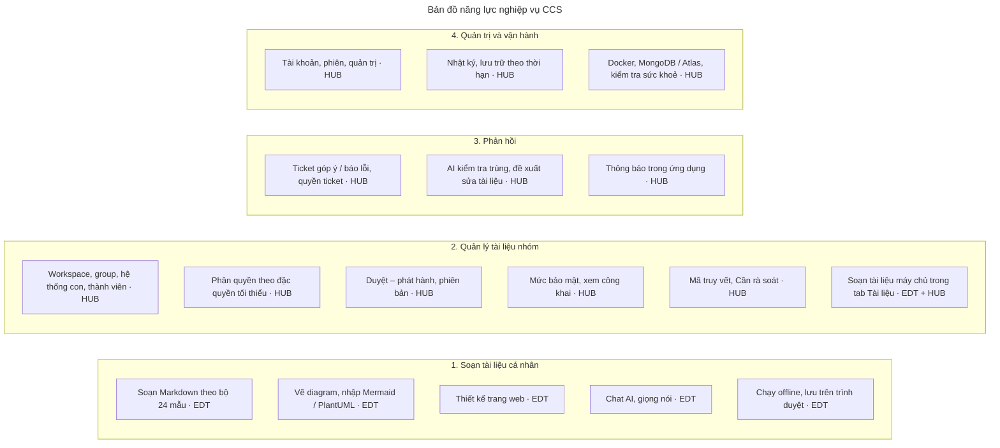
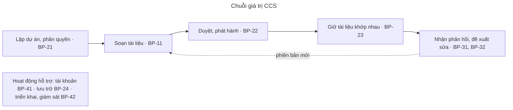

# Phân tích nghiệp vụ tổng quan – CCS ChillCat Studio

| Thuộc tính | Giá trị |
|---|---|
| Mã tài liệu | CCS-BMA-000 |
| Phiên bản | 0.1 |
| Ngày | 2026-11-18 |
| Trạng thái | Dự thảo – viết từ hệ thống đang chạy |
| Quy trình ISO/IEC/IEEE 12207 | 6.4.1 Business or Mission Analysis |
| Nguồn đã khảo sát | `desc.txt`, `README.md`, `backend/README.md`, `backend/docs/DECISIONS.md`, `templates/README.md`, `js/doc-library.js`, `js/docs.js`, `js/hub.js`, `js/hub-docs.js`, `js/hub-tickets.js`, `sw.js`, `backend/crates/workspaces/`, `backend/crates/documents/`, `backend/crates/traceability/`, `backend/crates/tickets/`, `backend/crates/identity/`, `backend/crates/audit/`, `backend/apps/server/src/app.rs`, `backend/deploy/docker-compose.yml` |
| Đơn vị ban hành | Nhóm phát triển ChillCat Studio |
| Tài liệu liên quan | ↓ [BPMN-00](BPMN-00_Tong_the_he_thong.md) · [BPMN-22](BPMN-22_Soan_duyet_phat_hanh_tai_lieu.md) · [BPMN-31](BPMN-31_Xu_ly_ticket.md) · [StRS-00](../02_Yeu_cau/StRS-00_Yeu_cau_cac_ben_lien_quan.md) · ⇄ [RTM-00](../00_Quan_ly_tai_lieu/RTM-00_Ma_tran_truy_vet.md) · [GLOSSARY](../00_Quan_ly_tai_lieu/GLOSSARY_Thuat_ngu.md) |

---

## 1. Mục tiêu

Giúp người mới hiểu nhanh hệ thống CCS phục vụ ai, làm được những gì và gồm những quy trình nào. Quy trình được vẽ ở hai cấp:

- **Cấp 0:** [BPMN-00 Tổng thể hệ thống](BPMN-00_Tong_the_he_thong.md).
- **Cấp 1:** quy trình có nhiều vai trò và rẽ nhánh được vẽ riêng – [BPMN-22](BPMN-22_Soan_duyet_phat_hanh_tai_lieu.md) và [BPMN-31](BPMN-31_Xu_ly_ticket.md). Các quy trình còn lại chỉ mô tả ở §5.1 (cắt giảm, lý do ở §5).

## 2. Bối cảnh

Người và nhóm làm phần mềm cần một bộ tài liệu thiết kế theo chuẩn: nhiều loại tài liệu, các tài liệu phải khớp mã với nhau, có sơ đồ, được duyệt trước khi dùng. Làm bằng trình soạn văn bản thông thường thì sơ đồ nằm rời ở công cụ khác, mã giữa các tài liệu dễ lệch, việc duyệt và phân quyền làm tay qua thư mục chia sẻ, còn phản hồi của người dùng phần mềm không nối được với tài liệu cần sửa.

ChillCat Studio giải quyết việc đó ở hai mức:

1. **Cá nhân** – mở trang web (hoặc bản đã cài), soạn theo bộ 24 mẫu, vẽ sơ đồ ngay trong tài liệu, nhờ AI viết, không cần tài khoản hay máy chủ (`README.md`).
2. **Nhóm** – thêm máy chủ chạy nội bộ: dự án, phân quyền theo phạm vi, vòng đời duyệt – phát hành, truy vết mã giữa các tài liệu, ticket góp ý / báo lỗi có AI kiểm tra trùng (`desc.txt` §1, `backend/README.md`).

| Sản phẩm / hệ thống con | Mang lại gì | Dành cho | Mã nguồn | Chạy trên |
|---|---|---|---|---|
| **CCS** – ChillCat Studio, phần **EDT** (Bộ soạn trên trình duyệt) | Soạn tài liệu theo bộ mẫu, diagram, thiết kế trang, Chat AI, giọng nói; chạy offline | SH-SOLO, SH-MEM | `index.html`, `css/`, `js/` (trừ `js/api.js`, `js/hub*.js`), `sw.js`, `templates/` | Trình duyệt Chrome / Edge / Firefox; bản công khai trên GitHub Pages `design.trungctr.com`; hoặc do máy chủ HUB phục vụ |
| **CCS** – ChillCat Studio, phần **HUB** (Làm việc nhóm) | Dự án, phân quyền, duyệt – phát hành, truy vết, ticket và AI, thông báo, nhật ký | SH-OWN, SH-GOW, SH-MEM, SH-EXT, SH-PUB, SH-ADM, SH-OPS | `js/api.js`, `js/hub.js`, `js/hub-docs.js`, `js/hub-tickets.js`, `backend/` | Máy chủ nội bộ (file chạy `chillcat-server` hoặc Docker) + MongoDB replica set tự quản hoặc MongoDB Atlas |

**Cách thu tiền:** không có. Bản EDT công khai dùng miễn phí, không cần tài khoản; bản HUB do tổ chức tự cài (`README.md` §Triển khai). Giọng đọc online dùng ResponsiveVoice bản phi thương mại (StC-13), nên việc thu phí sau này sẽ chạm tới ràng buộc giấy phép đó **(suy luận)**.

## 3. Những ai liên quan

Mã bên liên quan (`SH-…`) được định nghĩa ở [StRS-00 §2](../02_Yeu_cau/StRS-00_Yeu_cau_cac_ben_lien_quan.md).

| Mã | Ai | Làm gì | Quan tâm nhất tới | Dùng hệ thống con |
|---|---|---|---|---|
| SH-SOLO | Người dùng bộ soạn cá nhân | Soạn tài liệu, vẽ sơ đồ, dựng trang một mình | Dùng ngay, chạy offline, AI miễn phí, dữ liệu ở máy mình | EDT |
| SH-MEM | Thành viên soạn tài liệu | Soạn tài liệu của dự án, gửi duyệt, nhận xét, xử lý cờ Cần rà soát | Soạn trong trình soạn quen thuộc, biết tài liệu của mình bị ảnh hưởng khi tầng trên đổi | EDT, HUB |
| SH-GOW | Group owner – người duyệt | Quản lý thành viên trong group, duyệt tài liệu, thường phát hành | Chỉ bản đã xem xét mới được phát hành; quyền trong group nằm trong tay mình | EDT, HUB |
| SH-OWN | Workspace owner – trưởng dự án | Lập dự án, chỉ định group owner, mời người, quyết định quyền ticket | Kiểm soát ai thấy gì; theo dõi được mọi thay đổi | HUB |
| SH-EXT | Người gửi ticket ngoài workspace | Gửi góp ý / báo lỗi, theo dõi ticket của mình | Gửi được mà không cần là thành viên; biết ticket được xử lý tới đâu | HUB |
| SH-PUB | Người đọc bản công khai | Đọc tài liệu được công bố qua đường link | Mở được không cần tài khoản | HUB |
| SH-ADM | Quản trị hệ thống | Khoá / mở tài khoản, cấp vai trò quản trị, xem nhật ký hệ thống | Quản lý tài khoản mà không chạm vào dữ liệu dự án | HUB |
| SH-OPS | Vận hành | Cài, cấu hình, theo dõi máy chủ và CSDL | Cài nhanh bằng Docker, đổi được giữa CSDL nội bộ và Atlas, biết khi nào hỏng | HUB (EDT: GitHub Pages) |
| SH-DEV | Đội phát triển | Viết và kiểm thử ChillCat Studio | Module tách được, kiểm thử tự động được | EDT, HUB |
| SH-AUD | Người đánh giá tuân thủ ISO | Rà soát bộ tài liệu và quy trình theo ISO/IEC/IEEE 12207, 15289 | Đủ hạng mục thông tin, truy vết hai chiều | – (đọc bộ tài liệu) |

Nhu cầu của từng nhóm: [StRS-00 §3](../02_Yeu_cau/StRS-00_Yeu_cau_cac_ben_lien_quan.md).

## 4. Hệ thống làm được gì

Dự án chỉ có một sản phẩm nên không dùng nhãn phạm vi sản phẩm ([CONV §3.2](../00_Quan_ly_tai_lieu/CONV_Quy_uoc_tai_lieu_va_ky_hieu.md)); nhãn sau mỗi năng lực là hệ thống con đảm nhận.

Bốn nhóm năng lực ứng với bốn nhóm quy trình ở §5.

## 5. Danh sách quy trình

Cột **Trạng thái**: **Chạy** (đang dùng thật) · **Một phần** · **Chưa dùng** (đã làm nhưng chưa ai dùng) · **Kế hoạch** (chưa làm). Quy trình của HUB ghi "Chưa dùng": đã làm và đã qua kiểm thử đầu-cuối, chưa có bản triển khai đang dùng thật **(suy luận)**.

Nhóm và dải mã: 10–19 Soạn tài liệu cá nhân · 20–29 Quản lý tài liệu nhóm · 30–39 Phản hồi · 40–49 Quản trị và vận hành ([CONV §3.5](../00_Quan_ly_tai_lieu/CONV_Quy_uoc_tai_lieu_va_ky_hieu.md)).

**Cắt giảm:** chỉ hai quy trình có nhiều vai trò cùng tham gia và nhiều nhánh – BP-22 và BP-31 – được vẽ thành tài liệu BPMN riêng. Các quy trình còn lại do một vai trò làm, hoặc do hệ thống tự chạy, nên **chỉ mô tả ở đây** (§5.1); lý do cắt giảm ghi thêm ở [LCP-00](../00_Quan_ly_tai_lieu/LCP-00_Ke_hoach_vong_doi_phan_mem.md) và [DOC-REG](../00_Quan_ly_tai_lieu/DOC-REG_So_dang_ky_tai_lieu.md).

| Mã | Quy trình | Nhóm | Người chịu trách nhiệm | Hệ thống con | Nhu cầu | Trạng thái | Tài liệu |
|---|---|---|---|---|---|---|---|
| BP-00 | Tổng thể hệ thống (cấp 0) | – | SH-OWN | EDT, HUB | – | – | [BPMN-00](BPMN-00_Tong_the_he_thong.md) |
| BP-11 | Soạn tài liệu thiết kế bằng bộ mẫu (cá nhân, offline) | 1 – Soạn tài liệu cá nhân | SH-SOLO | EDT | StR-01, StR-02, StR-03, StR-04, StR-05, StR-06, StR-07, StR-08 | Chạy | Chỉ mô tả ở đây (§5.1) |
| BP-21 | Lập dự án và phân quyền (workspace, group, hệ thống con, mời thành viên) | 2 – Quản lý tài liệu nhóm | SH-OWN | HUB | StR-09, StR-10, StR-23 | Chưa dùng | Chỉ mô tả ở đây (§5.1) |
| BP-22 | Soạn – duyệt – phát hành tài liệu | 2 – Quản lý tài liệu nhóm | SH-GOW | HUB (EDT: trình soạn) | StR-11, StR-12, StR-13, StR-14, StR-15, StR-16, StR-18, StR-22 | Chưa dùng | [BPMN-22](BPMN-22_Soan_duyet_phat_hanh_tai_lieu.md) |
| BP-23 | Rà soát khi mã truy vết thay đổi | 2 – Quản lý tài liệu nhóm | SH-MEM (người phụ trách tài liệu bị đánh dấu) | HUB | StR-16, StR-17, StR-22 | Chưa dùng | Chỉ mô tả ở đây (§5.1) |
| BP-24 | Lưu trữ và xoá theo thời hạn | 2 – Quản lý tài liệu nhóm | SH-OWN (hệ thống tự chạy phần xoá) | HUB | StR-24 | Chưa dùng | Chỉ mô tả ở đây (§5.1) |
| BP-31 | Tiếp nhận và xử lý ticket | 3 – Phản hồi | SH-OWN (cấp quyền ticket); người được cấp quyền xử lý | HUB | StR-19, StR-20, StR-22, StR-23 | Chưa dùng | [BPMN-31](BPMN-31_Xu_ly_ticket.md) |
| BP-32 | AI kiểm tra trùng và đề xuất sửa tài liệu | 3 – Phản hồi | Người có cả quyền xem và xử lý ticket (người được AI thay mặt) | HUB | StR-21, StR-30 | Chưa dùng | Chỉ mô tả ở đây (§5.1) |
| BP-41 | Quản trị tài khoản | 4 – Quản trị và vận hành | SH-ADM | HUB | StR-25, StR-26 | Chưa dùng | Chỉ mô tả ở đây (§5.1) |
| BP-42 | Triển khai, sao lưu và giám sát | 4 – Quản trị và vận hành | SH-OPS | HUB (EDT: GitHub Pages) | StR-27, StR-28, StR-29 | Một phần (chưa có sao lưu) | Chỉ mô tả ở đây (§5.1) |

### 5.1 Mô tả các quy trình không có tài liệu BPMN riêng

#### BP-11 – Soạn tài liệu thiết kế bằng bộ mẫu

- **Kích hoạt:** một người cần lập hoặc sửa một tài liệu thiết kế.
- **Các bước:**
  1. Mở app (bản web hoặc bản đã cài), tab **Tài liệu** → nút **Mẫu** hoặc **Tài liệu mới**; hộp chọn gợi ý mẫu nên mở tiếp theo thứ tự lập tài liệu.
  2. Lần đầu: nhập mã dự án, hệ thống con, module, số quy trình. App điền vào nội dung, tên file, liên kết và ngày; nhớ bộ mã cho các mẫu mở sau.
  3. Soạn trực quan hoặc ở chế độ developer; vẽ sơ đồ ở tab **Diagram** rồi chèn vào tài liệu; dùng **Chat AI** hoặc giọng nói nếu muốn.
  4. Tài liệu tự lưu vào trình duyệt; `Ctrl+S` ghi ra file `.md`; có thể xuất HTML.
  5. `Ctrl` + bấm liên kết tới tài liệu khác để mở mẫu đích, lặp lại cho tài liệu kế tiếp.
- **Kết quả:** file `.md` theo mẫu, sơ đồ nhúng bên trong, mã khớp với các tài liệu khác của dự án.
- **Nguồn:** `js/doc-library.js#fillDialog`, `#fill`, `#suggestions`; `js/docs.js`; `js/main.js`; `sw.js`.

#### BP-21 – Lập dự án và phân quyền

- **Kích hoạt:** nhóm bắt đầu một dự án mới.
- **Các bước:**
  1. Người đã đăng nhập tạo workspace với mã dự án và tên (nếu `WORKSPACE_CREATION=admin` thì chỉ quản trị hệ thống tạo được). Hệ thống tự tạo group **Chung**; người tạo là workspace owner và là group owner của group này.
  2. Workspace owner khai báo hệ thống con, tạo thêm group, chỉ định group owner cho từng group.
  3. Workspace owner hoặc group owner mời thành viên theo e-mail vào phạm vi của mình và đặt quyền ban đầu – không vượt quyền chính mình đang có.
  4. Người được mời thấy lời mời ở tab Dự án, nhận hoặc từ chối; lời mời hết hạn sau `INVITATION_TTL_DAYS` ngày (mặc định 14).
  5. Owner điều chỉnh quyền, loại thành viên, chuyển quyền owner khi cần. Người bị loại khỏi phạm vi: tài liệu họ phụ trách chuyển cho group owner của group chứa tài liệu (không thì cho workspace owner).
  6. Theo nguyên tắc đặc quyền tối thiểu, workspace owner mặc định chỉ **xem + nhận xét** tài liệu ở mọi nơi và **chưa có quyền ticket**; muốn xử lý ticket thì tự cấp ở trang Quyền ticket (bước đầu của BP-31). Mọi thay đổi quyền, thành viên đều vào nhật ký.
- **Kết quả:** workspace có group, hệ thống con, thành viên với quyền tối thiểu cần thiết.
- **Nguồn:** `backend/crates/workspaces/src/service.rs#create`, `#create_group`, `#assign_group_owner`, `#create_subsystem`, `#transfer`; `backend/crates/workspaces/src/members.rs#create_invitation`, `#accept_invitation`, `#update_membership`, `#remove_membership`; `backend/crates/documents/src/integration.rs#on_member_removed`; quyết định #2, #3, #4, #7, #10 ở `backend/docs/DECISIONS.md`.

#### BP-23 – Rà soát khi mã truy vết thay đổi

- **Kích hoạt:** một tài liệu tầng trên được phát hành bản mới (sự kiện `document.version.published`).
- **Các bước:**
  1. HUB đọc mã truy vết trong bản mới, cập nhật sổ mã; so nội dung định nghĩa của từng mã với lần trước (SHA-256).
  2. Mã bị **đổi** hoặc **bỏ** ⇒ hệ thống đánh dấu **Cần rà soát** mọi tài liệu đang tham chiếu mã đó.
  3. Người phụ trách tài liệu bị đánh dấu nhận thông báo trong ứng dụng.
  4. Người có quyền sửa tài liệu đó xem lại; nếu cần sửa thì tạo phiên bản mới và đi theo BP-22.
  5. Người có quyền sửa gỡ cờ Cần rà soát.
- **Kết quả:** tài liệu tầng dưới được xem lại mỗi khi tầng trên đổi mã mà nó dùng.
- **Nguồn:** `backend/crates/traceability/src/service.rs#on_published`, `#list_flags`, `#resolve_flag`; `backend/crates/documents/src/integration.rs#on_review_flags`; `backend/crates/notifications/src/lib.rs`; quyết định #36, #37, #38.

#### BP-24 – Lưu trữ và xoá theo thời hạn

- **Kích hoạt:** người dùng không dùng một tài liệu nữa; hoặc tới lịch chạy của tác vụ nền / chỉ mục TTL.
- **Các bước:**
  1. Group owner hoặc người có quyền `publish` **lưu trữ** tài liệu không dùng nữa. Chỉ xoá được tài liệu chưa từng phát hành và không bị quan hệ thêm tay trỏ tới (người tạo hoặc group owner xoá); còn lại chỉ lưu trữ.
  2. Tác vụ `documents.purge_expired_versions` (24 giờ một lần) xoá bản **Thay thế** đã quá 10 năm (`VERSION_RETENTION_YEARS`) kể từ lúc bị thay thế, cùng nhận xét, lượt duyệt, chỉ mục truy vết của bản đó.
  3. Chỉ mục TTL của MongoDB tự xoá nhật ký quá 730 ngày tính từ lúc ghi (`AUDIT_RETENTION_DAYS`), thông báo quá 180 ngày; tác vụ `identity.purge_sessions` (6 giờ) xoá phiên đã thu hồi quá 7 ngày.
- **Kết quả:** dữ liệu được giữ đúng thời hạn đã chốt rồi tự xoá.
- **Nguồn:** `backend/crates/documents/src/service.rs#set_archived`, `#delete`; `backend/crates/documents/src/integration.rs#purge_expired_versions`; `backend/crates/audit/src/lib.rs`; `backend/crates/notifications/src/lib.rs`; `backend/crates/identity/src/service.rs#purge_revoked_sessions`; quyết định #26, #29, #30.

#### BP-32 – AI kiểm tra trùng và đề xuất sửa tài liệu

Quy trình con, được gọi từ BP-31.

- **Kích hoạt:** có ticket mới và workspace có người uỷ quyền AI còn đủ quyền (tự động); hoặc người có cả quyền xem và xử lý ticket bấm nút kiểm tra (thủ công).
- **Các bước:**
  1. Hệ thống tạo một lần kiểm tra gắn với **người được AI thay mặt**; ticket sang **Đang kiểm tra trùng**.
  2. Lấy các ticket cùng workspace mà người đó được xem (kể cả đã xử lý) rồi so bằng Claude (`AI_PROVIDER=anthropic`) hoặc so khớp từ khoá (`none`).
  3. Ghi ứng viên trùng kèm lý do và phạm vi đã kiểm tra. Thất bại hoặc thiếu quyền được ghi rõ và ticket trở về trạng thái trước – không coi là "không trùng". Lần chạy treo quá 15 phút bị đánh dấu thất bại.
  4. Người xử lý **xác nhận** trùng (ticket → **Trùng**, trỏ tới ticket gốc) hoặc **bác bỏ**.
  5. Với ticket tiếp tục được xem xét: AI tìm tài liệu và mã truy vết liên quan mà người đó được xem, lập **đề xuất sửa tài liệu** (tài liệu, phiên bản căn cứ, mục, nội dung đổi, lý do).
  6. Người có quyền chấp nhận hoặc từ chối từng đề xuất. Chấp nhận thì tạo dự thảo mới hoặc gắn vào dự thảo đang có (đi tiếp theo BP-22) – đề xuất thành **Đã đưa vào dự thảo**; khi bản dự thảo đó được phát hành – **Đã áp dụng**.
- **Quy tắc:** AI không tự đóng hay gộp ticket, không sửa hay phát hành tài liệu; kết quả ngoài quyền xem của người đang xem bị ẩn (chỉ ghi số lượng ẩn).
- **Kết quả:** người xử lý có gợi ý trùng và gợi ý sửa tài liệu, đã lọc theo quyền.
- **Nguồn:** `backend/crates/tickets/src/runs.rs#trigger`, `#run`, `#run_duplicates`, `#run_proposals`, `#decide_proposal`, `#link_draft`, `#on_ticket_created`, `#fail_stuck_checks`; `backend/crates/tickets/src/service.rs#decide_candidate`, `#on_version_published`; `backend/crates/tickets/src/ai.rs`; quyết định #41–#46.

#### BP-41 – Quản trị tài khoản

- **Kích hoạt:** người mới cần tài khoản; người dùng đổi thông tin; quản trị viên cần khoá tài khoản hay đổi vai trò.
- **Các bước:**
  1. Người dùng tự đăng ký (khi `AUTH_ALLOW_REGISTRATION=true`). Người đăng ký đầu tiên trên hệ thống trống – hoặc tài khoản `BOOTSTRAP_ADMIN_EMAIL` – là quản trị hệ thống.
  2. Đăng nhập: access token 15 phút, refresh token xoay vòng; 5 lần sai mật khẩu liên tiếp ⇒ khoá đăng nhập 5 phút. Đổi hồ sơ, đổi mật khẩu (các phiên khác bị thu hồi).
  3. Quản trị viên xem danh sách tài khoản, khoá / mở khoá (khoá ⇒ mọi phiên của người đó bị thu hồi), cấp / bỏ vai trò quản trị; không tự khoá hay tự hạ vai trò của mình.
  4. Quản trị viên xem nhật ký hệ thống. Quản trị viên **không** mặc nhiên xem tài liệu hay ticket của dự án.
- **Kết quả:** tài khoản được quản lý mà quyền dự án vẫn theo nguyên tắc đặc quyền tối thiểu.
- **Nguồn:** `backend/crates/identity/src/service.rs#register`, `#login`, `#refresh`, `#change_password`, `#admin_list`, `#admin_update`, `#bootstrap_admin`; `backend/crates/audit/src/lib.rs#system_log`; `js/hub.js`; quyết định #11.

#### BP-42 – Triển khai, sao lưu và giám sát

- **Kích hoạt:** cài mới, phát hành bản mới, theo dõi hằng ngày.
- **Các bước:**
  1. **EDT công khai:** đẩy nhánh `main` lên GitHub Pages; khi thêm / bớt file thì cập nhật `PRECACHE` và tăng `VERSION` trong `sw.js`.
  2. **HUB:** chuẩn bị biến môi trường (`JWT_SECRET` ít nhất 32 ký tự, `MONGODB_URI`, `PUBLIC_BASE_URL`, `AI_PROVIDER`…) rồi `docker compose up -d --build` trong `backend/deploy/`, hoặc chạy file `chillcat-server` cạnh thư mục giao diện. Dùng Atlas: đặt `MONGODB_URI=mongodb+srv://…`.
  3. **Giám sát:** `GET /healthz`, `GET /readyz` (ping MongoDB), `HEALTHCHECK` của ảnh Docker, log JSON (`LOG_FORMAT=json`).
  4. **Sao lưu:** hệ thống **không có** chức năng sao lưu. Dữ liệu nằm trong volume Docker `chillcat_mongo-data` hoặc trên Atlas; cách sao lưu và khôi phục thuộc [OPS-00](../08_Trien_khai_van_hanh/OPS-00_So_tay_van_hanh.md).
- **Kết quả:** hệ thống chạy, theo dõi được; dữ liệu tồn tại qua `docker compose down` / `up`.
- **Nguồn:** `README.md` §Triển khai; `backend/README.md` §Triển khai; `backend/Dockerfile`; `backend/deploy/docker-compose.yml`; `backend/apps/server/src/app.rs#readyz`; `backend/crates/platform/src/config.rs#from_env`.

## 6. Chuỗi giá trị

Giá trị cuối cùng là **bộ tài liệu đã phát hành, nhất quán và truy vết được**. Người dùng cá nhân chỉ đi qua bước "Soạn tài liệu" (BP-11); nhóm đi trọn chuỗi. Phản hồi từ ticket quay lại thành phiên bản mới của tài liệu, khép vòng.

## 7. Năng lực có nhiều bản cài đặt (khi có nhiều sản phẩm)

Dự án chỉ có một sản phẩm, nhưng một số năng lực được **hai hệ thống con** cài đặt riêng. Bảng dưới so bản ở EDT với bản ở HUB.

| Năng lực | Bản của EDT | Bản của HUB | Dùng chung hay riêng | Ảnh hưởng |
|---|---|---|---|---|
| Điền mẫu tài liệu (thay mã dự án, hệ thống con, module, số quy trình, ngày) | `DOC` – `js/doc-library.js#fill` | `DOC` – `backend/crates/documents/src/template.rs#instantiate` | TRÙNG LẶP – cùng nguồn mẫu `templates/`, hai bộ quy tắc thay thế viết riêng | Tài liệu tạo theo hai đường có thể khác nhau ở chi tiết **(suy luận)**; đổi quy tắc phải sửa hai nơi |
| Danh mục loại tài liệu | `DOC` – danh mục mẫu trong `js/doc-library.js` (hộp chọn mẫu, danh mục cho AI) | `DOC` – `backend/crates/documents/src/catalog.rs` (24 loại, số bản, quan hệ mặc định) | TRÙNG LẶP | Thêm loại mới (như LCP, CMP của dự án này) phải sửa hai nơi |
| Gọi AI | `AIC` – `js/ai.js`: nhiều nhà cung cấp, gọi từ trình duyệt bằng khoá của người dùng | `TKT` – `backend/crates/tickets/src/ai.rs`: Claude, gọi từ máy chủ bằng `AI_API_KEY` | Riêng – hai mục đích (soạn nội dung / phân tích ticket), hai cấu hình | Hai nơi cấu hình mô hình, khoá và cách xử lý lỗi của Claude |
| Lưu tài liệu | `PWA` / `DOC` – `localStorage` của trình duyệt và file `.md` trên máy | `DOC` – collection `document_versions` trên MongoDB | Riêng, nối bằng thanh máy chủ trong cùng trình soạn (`js/hub-docs.js#HUB.saveServerDoc`) | Tài liệu cá nhân muốn đưa vào dự án phải tạo tài liệu trên máy chủ rồi chép nội dung sang **(suy luận)** |

Đề xuất hợp nhất (nếu có) ghi ở [ASM-00 §5](../09_Danh_gia_hien_trang/ASM-00_Danh_gia_hien_trang.md).

## 8. Điểm nghẽn nghiệp vụ

1. **Chưa có sao lưu trong hệ thống:** BP-42 dựa hoàn toàn vào hạ tầng (volume Docker, Atlas); chưa có lịch sao lưu hay lần khôi phục thử. Liên quan StR-29; rủi ro đánh giá ở [ASM-00](../09_Danh_gia_hien_trang/ASM-00_Danh_gia_hien_trang.md).
2. **Chuyển tài liệu cá nhân thành tài liệu dự án:** giữa BP-11 và BP-22 không có bước chuyển thẳng; thanh máy chủ chỉ lưu vào phiên bản đã mở từ tab Dự án (`js/hub-docs.js#HUB.saveServerDoc`) **(suy luận)**.
3. **Bộ tài liệu của chính dự án chưa đưa trọn lên HUB được:** hai loại LCP, CMP chưa có trong danh mục của HUB ([CONV §3.3](../00_Quan_ly_tai_lieu/CONV_Quy_uoc_tai_lieu_va_ky_hieu.md)), nên BP-22 chưa áp dụng được cho hai tài liệu đó.
4. **Quan hệ SRS ↑ BPMN không tự nối** (quyết định #25): ở BP-22 người soạn phải thêm tay; nếu quên, kiểm tra "tài liệu ↑ chưa phát hành" khi phát hành SRS không xét tới tài liệu BPMN của quy trình liên quan.
5. **Chất lượng kiểm tra trùng phụ thuộc cấu hình:** khi `AI_PROVIDER=none`, BP-32 chỉ so khớp từ khoá.
6. **Thông báo không tức thời:** giao diện hỏi số thông báo chưa đọc mỗi 60 giây (180 giây khi tab bị ẩn) (`js/hub.js#poll`), nên người duyệt ở BP-22 hay người xử lý ở BP-31 có thể biết việc chậm tới vài phút.

## 9. Vấn đề còn mở

- Người chịu trách nhiệm chính thức cho từng quy trình chưa được chỉ định; bảng §5 ghi theo vai trò (mã `SH`).
- Trạng thái "Chưa dùng" của các quy trình HUB là **(suy luận)**: mã HUB chưa nằm trong lịch sử git và chưa thấy bản triển khai đang dùng thật.
- BP-42: chưa chốt ai chịu trách nhiệm sao lưu và khôi phục.
- Mốc tính thời hạn lưu nhật ký 2 năm chưa được chốt (`desc.txt` §5.3); BP-24 mô tả cách máy chủ đang làm.
- Mô hình kinh doanh chưa có; ràng buộc giấy phép phi thương mại của giọng đọc online (StC-13) cần xem lại nếu thu phí.
- Sơ đồ đang ở dạng Mermaid – đổi sang sơ đồ nhúng bằng ChillCat Studio trước khi phát hành 1.0.

## 10. Lịch sử thay đổi

| Phiên bản | Ngày | Mô tả | Người thực hiện |
|---|---|---|---|
| 0.1 | 2026-11-18 | Khởi tạo từ bộ mẫu, viết lại từ hệ thống đang chạy | Nhóm phát triển ChillCat Studio |
