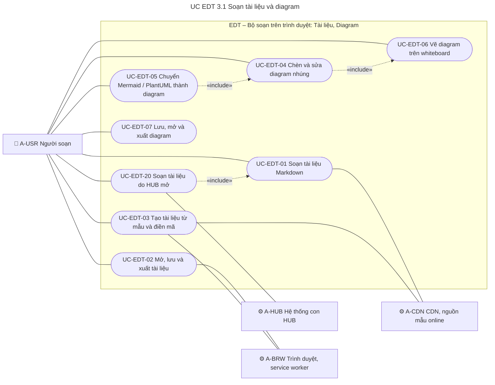
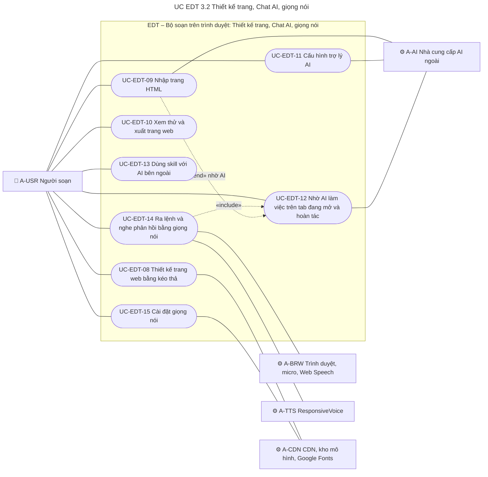
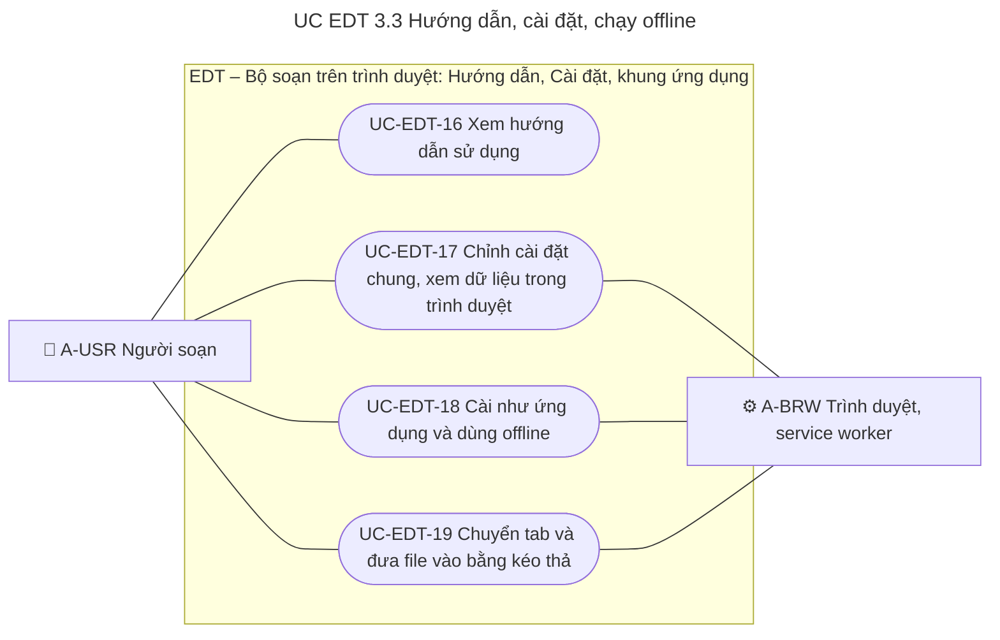

# Đặc tả yêu cầu phần mềm – Bộ soạn trên trình duyệt

| Thuộc tính | Giá trị |
|---|---|
| Mã tài liệu | CCS-SRS-EDT-001 |
| Phiên bản | 0.1 |
| Ngày | 2026-11-18 |
| Trạng thái | Dự thảo – viết từ hệ thống đang chạy |
| Quy trình ISO/IEC/IEEE 12207 | 6.4.3 System/Software Requirements Definition |
| Chuẩn tham chiếu | ISO/IEC/IEEE 29148 §9.5 (nội dung SRS, theo cách đánh số của bộ mẫu) |
| Hệ thống con | EDT – Bộ soạn trên trình duyệt |
| Nguồn đã khảo sát | `README.md`, `templates/README.md`, `index.html`, `manifest.webmanifest`, `sw.js`, `css/styles.css`, `js/main.js`, `js/util.js`, `js/docs.js`, `js/markdown.js`, `js/md-rich.js`, `js/doc-library.js`, `js/editor.js`, `js/shapes.js`, `js/render.js`, `js/store.js`, `js/templates.js`, `js/help.js`, `js/export.js`, `js/plantuml.js`, `js/ui.js`, `js/page-kit.js`, `js/page-editor.js`, `js/page-import.js`, `js/ai.js`, `js/skill.js`, `js/voice.js`, `js/guide.js`, `js/settings.js`; lời gọi từ `js/hub-docs.js` vào trình soạn |
| Đơn vị ban hành | Nhóm phát triển ChillCat Studio |
| Tài liệu liên quan | ↑ [StRS-00](StRS-00_Yeu_cau_cac_ben_lien_quan.md) · [SyRS-00](SyRS-00_Yeu_cau_he_thong.md) · [BMA-00 §5.1](../01_Phan_tich_nghiep_vu/BMA-00_Tong_quan_nghiep_vu.md) · [BPMN-22](../01_Phan_tich_nghiep_vu/BPMN-22_Soan_duyet_phat_hanh_tai_lieu.md) · ↓ [SDD-EDT](../04_Thiet_ke_chi_tiet/SDD-EDT_Bo_soan_tren_trinh_duyet.md) · [DBD-00](../05_Thiet_ke_du_lieu/DBD-00_Tong_quan_du_lieu.md) · [ICD-00](../06_Giao_dien_tich_hop/ICD-00_Tong_quan_tich_hop.md) · [STP-00](../07_Kiem_thu/STP-00_Ke_hoach_kiem_thu.md) · ⇄ [RTM-00](../00_Quan_ly_tai_lieu/RTM-00_Ma_tran_truy_vet.md) · [SRS-HUB](SRS-HUB_Lam_viec_nhom.md) · [GLOSSARY](../00_Quan_ly_tai_lieu/GLOSSARY_Thuat_ngu.md) |

---

## 1. Giới thiệu

### 1.1 Mục đích

Liệt kê những gì hệ thống con EDT – Bộ soạn trên trình duyệt phải làm, đủ chi tiết để thiết kế ([SDD-EDT](../04_Thiet_ke_chi_tiet/SDD-EDT_Bo_soan_tren_trinh_duyet.md)) và kiểm thử ([STP-00](../07_Kiem_thu/STP-00_Ke_hoach_kiem_thu.md)).

Tài liệu được **viết lại từ hệ thống đang chạy** ([CONV §5](../00_Quan_ly_tai_lieu/CONV_Quy_uoc_tai_lieu_va_ky_hieu.md)): mỗi yêu cầu kèm vị trí trong mã (`đường/dẫn#hàm`, tính từ gốc repo); điều tự rút ra gắn nhãn **(suy luận)**; điều chưa kiểm được nằm ở §8. Mức chi tiết là **theo tính năng** – người dùng làm được gì, hệ thống phải bảo đảm gì – không liệt kê từng nút. Cột **Ưu tiên** ở §5 là đánh giá của nhóm phát triển **(suy luận)**, theo ưu tiên của nhu cầu gốc ở [StRS-00 §3](StRS-00_Yeu_cau_cac_ben_lien_quan.md).

### 1.2 Phạm vi

EDT là một trang web tĩnh chạy hoàn toàn trên trình duyệt, không có cổng mạng riêng (cột **Cổng** ghi `–`).

| Mã module | Thành phần | Cổng | Chức năng chính | Chức năng hệ thống |
|---|---|---|---|---|
| `DOC` | Tab **Tài liệu** – `js/docs.js`, `js/markdown.js`, `js/md-rich.js`, `js/doc-library.js`, `templates/` | – | Soạn Markdown trực quan / chế độ developer, mở – lưu – xuất `.md` và HTML, mẫu tài liệu và điền mã, nhúng – sửa diagram, hiển thị cú pháp mở rộng | SYS-F01, SYS-F02; tham gia SYS-F15 |
| `DGM` | Tab **Diagram** – `js/editor.js`, `js/shapes.js`, `js/render.js`, `js/store.js`, `js/templates.js`, `js/help.js`, `js/export.js`, `js/plantuml.js`, phần whiteboard của `js/ui.js` | – | Whiteboard Flowchart / BPMN / UML / ERD, mẫu diagram, tab JSON, xuất JSON / SVG / PNG, nhúng Markdown, dịch Mermaid / PlantUML | SYS-F03, SYS-F04 |
| `DSG` | Tab **Thiết kế trang** – `js/page-kit.js`, `js/page-editor.js`, `js/page-import.js` | – | Dựng trang web bằng kéo thả, nhập trang HTML, xem thử, xuất file HTML / JSON | SYS-F05 |
| `AIC` | **Chat AI** – `js/ai.js`, `js/skill.js`, khung chat trong `js/ui.js` | – | Nhà cung cấp, mô hình, effort / thinking, gửi yêu cầu theo tab, áp dụng kết quả, hoàn tác, Copy context | SYS-F06 |
| `GDE` | Tab **Hướng dẫn** – `js/guide.js` | – | Hướng dẫn sử dụng có mục lục, tìm kiếm, ví dụ gửi vào chat | SYS-F09 |
| `SET` | Tab **Cài đặt** – `js/settings.js` | – | Giao diện sáng / tối, trợ lý AI, giọng nói, ứng dụng & dữ liệu | SYS-F09 |
| `VOI` | **Giọng nói** – `js/voice.js` | – | Nhận dạng (Web Speech / Moonshine offline), lệnh giọng nói, đọc phản hồi, rảnh tay | SYS-F07 |
| `PWA` | Khung ứng dụng, offline, lưu trữ – `index.html`, `js/main.js`, `js/util.js`, `sw.js`, `manifest.webmanifest`, `css/styles.css`, `icons/`; chuyển tab và kéo thả trong `js/docs.js` | – | Khởi động, khôi phục, chuyển tab, kéo thả file, service worker, cài như ứng dụng | SYS-F08 |

Không thuộc tài liệu này: tab **Dự án** (`js/api.js`, `js/hub.js`, `js/hub-docs.js`, `js/hub-tickets.js`), thanh máy chủ và việc đọc / ghi phiên bản tài liệu trên máy chủ, máy chủ `backend/` – xem [SRS-HUB](SRS-HUB_Lam_viec_nhom.md). Tài liệu này chỉ nêu điều trình soạn của EDT phải bảo đảm khi HUB gắn một phiên bản máy chủ vào nó (UC-EDT-20). EDT không có CSDL máy chủ và không mở API: kho dữ liệu trong trình duyệt mô tả ở [DBD-00](../05_Thiet_ke_du_lieu/DBD-00_Tong_quan_du_lieu.md), các lời gọi ra ngoài ở [ICD-00](../06_Giao_dien_tich_hop/ICD-00_Tong_quan_tich_hop.md).

### 1.3 Định nghĩa

| Thuật ngữ | Nghĩa |
|---|---|
| Phiên nhúng | Khoảng thời gian người soạn vẽ / sửa một diagram cho tài liệu ở tab Diagram. Diagram đang vẽ dở ở tab Diagram được cất lại kèm lịch sử hoàn tác và trả về khi bấm ✓ hoặc Huỷ; phiên được ghi vào trình duyệt để khôi phục khi tải lại trang (`js/docs.js#startSession`, `#persistSession`) |
| Dòng diagram thu gọn | Dòng `[[diagram:<id>\|<tên>]]` thay cho khối diagram nhúng trong trình soạn; khi lưu ra file được thay lại bằng khối JSON + SVG (`js/docs.js#expand`, `#collapse`) |
| Chế độ diagram | Một trong ba chế độ của whiteboard: Flowchart, BPMN, UML (gồm ERD). Mỗi chế độ chỉ hiện ký hiệu, đường nối và mẫu của mình (`js/shapes.js#DE.MODES`) |
| Bộ mã (mẫu tài liệu) | Mã dự án, hệ thống con, module, số quy trình cùng tên đi kèm mà người soạn nhập khi mở mẫu; được nhớ trong khoá `diagram-editor:doc-lib:v1` để các mẫu mở sau dùng lại (`js/doc-library.js#profile`) |
| Mở nguyên mẫu | Mở một mẫu mà không thay các ký hiệu thay thế của bộ mẫu (mã dự án, `HTC`, `MOD`, `NN` – `templates/README.md` §3) |
| Khối mở rộng | Khối trong tài liệu không sửa trực tiếp ở chế độ trực quan: công thức, Mermaid, PlantUML, front matter, chú thích cuối trang, mục lục, khối HTML có sẵn. Trình soạn giữ mã gốc của khối (`data-raw`) và mở hộp thoại để sửa |
| Chuẩn hoá (dễ dãi) | Đọc JSON diagram hoặc dự án trang theo kiểu chấp nhận: giá trị sai đưa về mặc định, phần tử không hiểu được bị bỏ, kèm danh sách đã sửa / đã bỏ (`js/store.js#DE.normalizeDoc`, `js/page-kit.js#PK.normalize`) |
| Kiểm tra nghiêm ngặt | Kiểm tra file diagram `.json` mở từ máy: sai một chỗ là từ chối cả file, kèm danh sách lỗi (`js/store.js#DE.validateDocStrict`) |
| Dự án trang | Dữ liệu tab Thiết kế trang dạng JSON `{ "kind": "de-page", "version": 1, … }`: tên, chủ đề, các trang, mỗi trang là cây **thành phần**; `props` chỉ chứa giá trị khác mặc định (`js/page-kit.js`) |
| Khung soạn trang / Xem thử | Khung soạn: `iframe` không chạy script, có lớp phủ nhận thao tác chuột. Xem thử: `iframe` chạy được script nhưng ở origin riêng |
| Phương án tham số AI | Một cách đặt effort / thinking cho một nhà cung cấp. Mỗi lời gọi có danh sách phương án từ đầy đủ tới mặc định của mô hình; gặp lỗi 400 thì lùi sang phương án kế tiếp (`js/ai.js#tryVariants`) |
| Lệnh toàn cục (giọng nói) | Lệnh giọng nói chạy được ở mọi tab: giao diện tối / sáng, trợ giúp, cuộc trò chuyện mới, bật / tắt rảnh tay, dừng, cài đặt giọng nói. Các lệnh còn lại chỉ chạy ở tab Diagram (`js/voice.js#handleUtterance`) |

Thuật ngữ dùng chung (soạn trực quan / chế độ developer, sơ đồ nhúng, thanh máy chủ, skill, Copy context, effort / thinking, lệnh giọng nói / rảnh tay, PWA, service worker, SRI, iframe sandbox, Mermaid / PlantUML, Web Speech API / Moonshine): [GLOSSARY](../00_Quan_ly_tai_lieu/GLOSSARY_Thuat_ngu.md).

### 1.4 Tài liệu tham chiếu

[CONV](../00_Quan_ly_tai_lieu/CONV_Quy_uoc_tai_lieu_va_ky_hieu.md), [SDD-EDT](../04_Thiet_ke_chi_tiet/SDD-EDT_Bo_soan_tren_trinh_duyet.md) (thiết kế), [DBD-00](../05_Thiet_ke_du_lieu/DBD-00_Tong_quan_du_lieu.md) (dữ liệu – thay cho ERD-EDT, không lập vì EDT không có CSDL máy chủ), [ICD-00](../06_Giao_dien_tich_hop/ICD-00_Tong_quan_tich_hop.md) (giao diện – thay cho API-EDT, không lập vì EDT không mở API), [SRS-HUB](SRS-HUB_Lam_viec_nhom.md) (phần máy chủ của tài liệu mở trong tab Tài liệu), [LCP-00](../00_Quan_ly_tai_lieu/LCP-00_Ke_hoach_vong_doi_phan_mem.md) (lý do cắt giảm).

---

## 2. Mô tả tổng quan

### 2.1 Bối cảnh sản phẩm

EDT là một trang web tĩnh: `index.html` nạp lần lượt các file `js/*.js` bằng thẻ `<script>`, không có bước build; mọi tab chạy trong cùng một trang và trao đổi qua đối tượng toàn cục `DE`. Trang được phục vụ bởi GitHub Pages (`design.trungctr.com`, SYS-I05), bởi máy chủ HUB (biến `STATIC_DIR`), bởi một web server tĩnh bất kỳ, hoặc mở thẳng bằng `file://`. Dữ liệu nằm trong `localStorage` (khoá `diagram-editor:…`) và Cache Storage của trình duyệt (SYS-I07); EDT chỉ gọi ra ngoài tới nhà cung cấp AI (SYS-I03), ResponsiveVoice (SYS-I04), nguồn mẫu online (SYS-I05) và CDN / kho mô hình (SYS-I06). Khung ứng dụng còn chứa tab Dự án của HUB; bảng dưới ghi các thành phần EDT dùng chung với HUB hoặc bị cài đặt hai lần ([BMA-00 §7](../01_Phan_tich_nghiep_vu/BMA-00_Tong_quan_nghiep_vu.md)).

| Thành phần | Dùng cho | Dùng chung hay riêng | Căn cứ |
|---|---|---|---|
| Trình soạn tab Tài liệu | CHUNG (EDT + HUB) | Một bản dùng chung: HUB mở, lấy nội dung, cập nhật trạng thái gắn của phiên bản máy chủ qua `DE.docs.openServerDoc`, `serialize`, `updateServer`, `reloadServer`, `detachServer`, `serverBinding`, `isDirty`, `show` | `js/docs.js`, `js/hub-docs.js#HUB.saveServerDoc` |
| Bộ dựng và làm sạch Markdown | CHUNG (EDT + HUB) | Một bản: HUB dùng `DE.md.render`, `DE.md.sanitizeFragment` để hiện bản công khai | `js/markdown.js`, `js/hub-docs.js#HUB.showPublic` |
| Khung ứng dụng: thanh tab, thông báo nhanh, hộp xác nhận, service worker | CHUNG (EDT + HUB) | Một bản: tab Dự án nằm trong cùng trang, dùng `DE.ui.toast`, `DE.ui.confirm`; service worker không cache `/api/` | `index.html`, `js/ui.js#UI.toast`, `#UI.confirm`, `sw.js` |
| Bộ mẫu `templates/` | CHUNG (EDT + HUB) | Một nguồn: EDT tải bằng `fetch`, HUB nhúng vào file chạy lúc build | `js/doc-library.js#fetchTemplate`, `backend/crates/documents/src/catalog.rs` |
| Điền mẫu (thay ký hiệu mã dự án, `HTC`, `MOD`, `NN`, ngày) | TRÙNG LẶP | Có bản riêng ở HUB: `backend/crates/documents/src/template.rs#instantiate` | `js/doc-library.js#fill` |
| Danh mục loại tài liệu | TRÙNG LẶP | Có bản riêng ở HUB: `backend/crates/documents/src/catalog.rs` | `js/doc-library.js` (`CATALOG`) |
| Gọi AI | EDT | Riêng: EDT gọi từ trình duyệt bằng khoá của người dùng; HUB gọi Claude từ máy chủ cho ticket | `js/ai.js`, `backend/crates/tickets/src/ai.rs` |
| Lưu tài liệu | EDT | Riêng: `localStorage` và file `.md` trên máy; HUB lưu phiên bản trên MongoDB | `js/docs.js#saveLocalNow`, `#saveDoc` |

### 2.2 Tác nhân

| Mã | Tác nhân | Mô tả | Ứng với |
|---|---|---|---|
| A-USR | Người soạn | Người dùng EDT trên trình duyệt hoặc bản đã cài. Không cần tài khoản; mọi dữ liệu là của trình duyệt đang dùng | SH-SOLO, SH-MEM (cả SH-GOW, SH-OWN khi soạn trong tab Tài liệu) |
| A-AI | Nhà cung cấp AI ngoài | Dịch vụ mô hình ngôn ngữ người soạn chọn (Gemini, OpenAI, Anthropic, OpenRouter, Groq, Cerebras, Mistral, Hugging Face, Ollama, LM Studio, máy chủ kiểu OpenAI tuỳ chỉnh), gọi thẳng từ trình duyệt | Hệ thống ngoài – SYS-I03 |
| A-BRW | Trình duyệt và service worker | `localStorage`, Cache Storage, service worker `sw.js`, File System Access, Web Speech API, micro, `speechSynthesis`, cài đặt PWA | Hệ thống ngoài – SYS-I07 |
| A-TTS | Dịch vụ giọng đọc ResponsiveVoice | Đọc phản hồi khi máy không có giọng tiếng Việt; SDK tải khi cần | Hệ thống ngoài – SYS-I04 |
| A-CDN | CDN, kho mô hình và nguồn mẫu online | jsDelivr (Mermaid, KaTeX, highlight.js, emoji, transformers.js), Hugging Face (mô hình Moonshine), Google Fonts, `https://design.trungctr.com/templates/` khi mở bằng `file://` | Hệ thống ngoài – SYS-I05, SYS-I06 |
| A-HUB | Hệ thống con HUB (giao diện tab Dự án) | Mở một phiên bản tài liệu máy chủ vào trình soạn, lấy nội dung để lưu, báo trạng thái khoá / đã lưu | Hệ thống con – [SRS-HUB](SRS-HUB_Lam_viec_nhom.md) |

### 2.3 Ràng buộc

- HTML + CSS + JavaScript thuần, không bước build, không thư viện bắt buộc; thư viện CDN chỉ tải khi tài liệu cần; mở được bằng `file://` (StC-05).
- Giao diện, thông báo, hướng dẫn bằng tiếng Việt; tên trong mã giữ nguyên (StC-06).
- Khoá API AI chỉ lưu ở trình duyệt của người dùng và gửi thẳng tới nhà cung cấp đã chọn, không qua máy chủ trung gian (StC-14).
- Bản công khai chạy trên GitHub Pages với tên miền `design.trungctr.com`; không xoá `CNAME`, `.nojekyll` (StC-12).
- Giọng đọc online dùng ResponsiveVoice bản phi thương mại; khoá (`RV_KEY` trong `js/voice.js`) chỉ chạy trên tên miền đã khai báo (StC-13).
- Mẫu tài liệu theo bộ mẫu dựa trên ISO/IEC/IEEE 12207, 15289, 29148, 42010 (StC-10).
- Nhà cung cấp AI phải cho phép CORS vì lời gọi đi thẳng từ trình duyệt; GitHub Models, NVIDIA NIM, SambaNova không có trong danh sách vì không cho phép (`README.md` §Chat AI).

### 2.4 Giả định và phụ thuộc

- Trình duyệt Chrome / Edge / Firefox bản hiện hành, bật JavaScript, cho phép `localStorage` (A-BRW). Chế độ riêng tư chặn bộ nhớ thì dữ liệu mất khi đóng tab.
- Service worker, cài như ứng dụng và tải mẫu từ cùng origin chỉ có khi trang được mở qua `http(s)://`; mở bằng `file://` thì mẫu tải từ bản online (cần mạng).
- Thư viện vẽ (Mermaid, KaTeX, highlight.js, bảng emoji), transformers.js và mô hình Moonshine tải từ A-CDN ở lần dùng đầu; sau đó nằm trong cache của trình duyệt.
- Chat AI cần mạng tới A-AI, trừ Ollama / LM Studio chạy trên máy; Ollama phải đặt `OLLAMA_ORIGINS` cho origin của trang.
- Nhận dạng Web Speech của Chrome / Edge gửi âm thanh tới máy chủ của hãng trình duyệt (cần mạng); bộ Moonshine chạy trên máy.
- EDT không phụ thuộc HUB: thiếu máy chủ thì mọi tab trừ Dự án vẫn chạy. Ngược lại, giao diện HUB phụ thuộc các hàm `DE.docs.*`, `DE.md.*`, `DE.ui.*` của EDT (§2.1).

---

## 3. Sơ đồ Use Case

Ba sơ đồ dưới chia theo nhóm module. Biên hệ thống là khung EDT; tác nhân phụ nối bằng nét liền tới use case dùng tới nó.

### 3.1 Nhóm `DOC`, `DGM` – soạn tài liệu và diagram



### 3.2 Nhóm `DSG`, `AIC`, `VOI` – thiết kế trang, AI, giọng nói



### 3.3 Nhóm `GDE`, `SET`, `PWA` – hướng dẫn, cài đặt, chạy offline



---

## 4. Đặc tả Use Case chính

### UC-EDT-01 Soạn tài liệu Markdown

| Mục | Nội dung |
|---|---|
| Tác nhân | A-USR. Phụ: A-CDN (thư viện vẽ công thức, Mermaid, tô màu code – tải khi cần) |
| Quy trình | [BP-11](../01_Phan_tich_nghiep_vu/BMA-00_Tong_quan_nghiep_vu.md) bước 3 |
| Tiền điều kiện | Tab Tài liệu (`Alt+1`) đang có một tài liệu: trang chào, tài liệu tự lưu lần trước, file vừa mở hoặc mẫu vừa mở. Tài liệu sửa được (BR-EDT-005) |
| Luồng chính | 1. Người soạn gõ thẳng vào trang ở chế độ trực quan. 2. Định dạng bằng thanh công cụ hoặc phím tắt: tiêu đề, chữ, màu, danh sách, việc cần làm, trích dẫn / hộp ghi chú, bảng, liên kết, ảnh, khối code, đường kẻ. 3. Chèn công thức, chú thích, mục lục qua hộp thoại có xem trước. 4. App chuyển nội dung trang thành Markdown, vẽ lại phần xem và tự lưu vào trình duyệt. |
| Luồng thay thế | A1. Bật chế độ developer: chọn Mã / Chia đôi / Trực quan và sửa thẳng mã Markdown; **Xem file thật** hiện đúng nội dung sẽ lưu. A2. Dán từ Word / trang web, dán văn bản trông giống Markdown, dán câu trả lời của AI bên ngoài hoặc mã PlantUML thô. A3. Nhấn đúp khối mở rộng (công thức, front matter, chú thích, khối HTML) để sửa mã trong hộp thoại. |
| Ngoại lệ | Thư viện CDN chưa tải được (lần đầu, mất mạng) → phần đó hiện mã gốc, nội dung không mất. Không ghi được vào trình duyệt (hết dung lượng) → thanh trạng thái báo, nhắc lưu ra file. |
| Hậu điều kiện | Nội dung mới nằm trong khoá `diagram-editor:md:v1`; dấu ● cạnh tên file cho biết chưa lưu ra file |
| Yêu cầu | FR-EDT-DOC-001 … FR-EDT-DOC-010, FR-EDT-DOC-013 |
| Thiết kế | [SDD-EDT §5](../04_Thiet_ke_chi_tiet/SDD-EDT_Bo_soan_tren_trinh_duyet.md) |
| Nguồn | `js/docs.js#onVisualInput`, `#flushVisual`, `#renderPreview`; `js/markdown.js#MD.render`, `#MD.fromHTML` |

### UC-EDT-02 Mở, lưu và xuất tài liệu

| Mục | Nội dung |
|---|---|
| Tác nhân | A-USR. Phụ: A-BRW (File System Access, tải xuống) |
| Quy trình | [BP-11](../01_Phan_tich_nghiep_vu/BMA-00_Tong_quan_nghiep_vu.md) bước 4 |
| Tiền điều kiện | Tab Tài liệu đang mở |
| Luồng chính | 1. Người soạn mở file `.md` (nút Mở / `Ctrl+O`, kéo thả, hoặc mở từ hệ điều hành khi đã cài app). 2. App kiểm tra loại file (BR-EDT-009), hỏi nếu tài liệu hiện tại có thay đổi chưa lưu (BR-EDT-008), đọc các khối diagram nhúng thành diagram sửa được (BR-EDT-002). 3. Người soạn soạn (UC-EDT-01). 4. `Ctrl+S`: app ghi thẳng vào file đang mở (Chrome / Edge); không được thì hỏi nơi lưu hoặc tải xuống; giữ nguyên kiểu xuống dòng của file gốc. 5. Tuỳ chọn: xuất HTML độc lập. |
| Luồng thay thế | `Ctrl+Shift+S` lưu thành file khác; **Tải xuống** `.md`. |
| Ngoại lệ | File không phải Markdown → từ chối, báo lý do. Không được cấp quyền ghi → báo và cho chọn nơi lưu khác. |
| Hậu điều kiện | File `.md` (hoặc `.html`) trên máy; thanh trạng thái ghi "Đã lưu ra file lúc …" |
| Yêu cầu | FR-EDT-DOC-011 … FR-EDT-DOC-014 |
| Thiết kế | [SDD-EDT §5](../04_Thiet_ke_chi_tiet/SDD-EDT_Bo_soan_tren_trinh_duyet.md) |
| Nguồn | `js/docs.js#DOCS.openFile`, `#openDoc`, `#saveDoc`, `#writeHandle`, `#exportHTML` |

### UC-EDT-03 Tạo tài liệu từ mẫu và điền mã

| Mục | Nội dung |
|---|---|
| Tác nhân | A-USR. Phụ: A-CDN (bản mẫu online khi mở bằng `file://`), A-BRW (cache mẫu để dùng offline) |
| Quy trình | [BP-11](../01_Phan_tich_nghiep_vu/BMA-00_Tong_quan_nghiep_vu.md) bước 1, 2, 5 |
| Tiền điều kiện | Có mạng, hoặc mẫu đã nằm trong cache của service worker |
| Luồng chính | 1. Người soạn bấm **Mẫu** hoặc **Tài liệu mới** → hộp chọn 24 mẫu theo nhóm thư mục, có tìm kiếm và mục Gợi ý (BR-EDT-007). 2. Chọn một mẫu. 3. App hỏi các mã theo loại mẫu (mã dự án, hệ thống con, module, số quy trình và tên đi kèm), điền sẵn bộ mã đang nhớ. 4. Kiểm tra BR-EDT-006. 5. App tải mẫu, thay ký hiệu vào nội dung, tên file, liên kết, ngày; giữ nguyên các khối hướng dẫn điền (TIP). 6. App hỏi nếu tài liệu đang mở có thay đổi chưa lưu, mở mẫu ở tab Tài liệu (đánh dấu chưa lưu ra file), ghi mẫu vào danh sách đã mở. |
| Luồng thay thế | A1. **Mở nguyên mẫu**: giữ các ký hiệu. A2. `Ctrl` + bấm liên kết `.md` trong tài liệu mở từ mẫu → mở mẫu đích bằng bộ mã đã nhớ, không hỏi lại. A3. Thẻ **Tài liệu trống** (từ nút Tài liệu mới) → trang trắng. |
| Ngoại lệ | Không tải được mẫu → báo cần mạng hoặc mở app qua `http(s)`. Số quy trình không đúng hai chữ số → báo lỗi ngay tại ô, không đóng hộp thoại. |
| Hậu điều kiện | Tài liệu theo mẫu ở tab Tài liệu; bộ mã và danh sách mẫu đã mở nằm trong `diagram-editor:doc-lib:v1` |
| Yêu cầu | FR-EDT-DOC-015 … FR-EDT-DOC-018 |
| Thiết kế | [SDD-EDT §5](../04_Thiet_ke_chi_tiet/SDD-EDT_Bo_soan_tren_trinh_duyet.md) |
| Nguồn | `js/doc-library.js#LIB.gallery`, `#fillDialog`, `#LIB.open`, `#fill`, `#LIB.follow`; `js/docs.js#DOCS.openLibraryDoc` |

### UC-EDT-04 Chèn và sửa diagram nhúng

| Mục | Nội dung |
|---|---|
| Tác nhân | A-USR |
| Quy trình | [BP-11](../01_Phan_tich_nghiep_vu/BMA-00_Tong_quan_nghiep_vu.md) bước 3 |
| Tiền điều kiện | Tab Tài liệu, tài liệu sửa được (BR-EDT-005) |
| Luồng chính | 1. Người soạn đặt con trỏ, bấm **◆ Diagram mới**. 2. App mở phiên nhúng: cất diagram đang vẽ dở ở tab Diagram kèm lịch sử hoàn tác, chuyển sang tab Diagram với whiteboard trống. 3. Người soạn vẽ (UC-EDT-06). 4. Bấm **✓ Chèn vào tài liệu** → app chèn dòng diagram thu gọn tại vị trí con trỏ đã ghi, trả diagram dở dang về tab Diagram, chuyển về tab Tài liệu và làm nổi diagram vừa chèn. |
| Luồng thay thế | A1. Sửa: nhấn đúp hoặc **✎ Sửa** trên diagram → phiên sửa → **✓ Cập nhật vào tài liệu**. A2. **Vào tài liệu** trên thanh công cụ Diagram → chèn bản sao diagram đang vẽ. A3. Kéo thả file `.json` vào tab Tài liệu → nhúng sau khi kiểm tra nghiêm ngặt. A4. **Huỷ** → hỏi nếu diagram đã đổi, tài liệu giữ nguyên. A5. Tải lại trang giữa phiên → phiên được khôi phục ở tab Diagram. A6. Trên mỗi diagram: **Mã** (tới dòng thu gọn), **SVG** (tải ảnh), **Xoá** (có hỏi, `Ctrl+Z` lấy lại). |
| Ngoại lệ | Diagram trống → không chèn, báo. File `.json` sai định dạng → từ chối kèm lỗi (BR-EDT-009). |
| Hậu điều kiện | Tài liệu có dòng `[[diagram:…]]`; khi lưu ra file thành khối nhúng (BR-EDT-002, BR-EDT-003) |
| Yêu cầu | FR-EDT-DOC-019 … FR-EDT-DOC-021 |
| Thiết kế | [SDD-EDT §5, §6](../04_Thiet_ke_chi_tiet/SDD-EDT_Bo_soan_tren_trinh_duyet.md) |
| Nguồn | `js/docs.js#startSession`, `#DOCS.commitDiagram`, `#cancelSession`, `#endSession`, `#removeDiagram`, `#insertDiagramFile` |

### UC-EDT-05 Chuyển Mermaid / PlantUML thành diagram

| Mục | Nội dung |
|---|---|
| Tác nhân | A-USR. Phụ: A-CDN (thư viện Mermaid để hiển thị) |
| Quy trình | [BP-11](../01_Phan_tich_nghiep_vu/BMA-00_Tong_quan_nghiep_vu.md) bước 3 |
| Tiền điều kiện | Tài liệu có khối ```` ```mermaid ```` hoặc ```` ```plantuml ```` / ```` ```puml ```` (từ file mở vào, dán, AI viết, kéo thả file `.puml`) |
| Luồng chính | 1. App vẽ khối: Mermaid bằng thư viện Mermaid, PlantUML bằng bộ dịch của app (không gửi mã ra ngoài). 2. Người soạn nhấn đúp hoặc bấm **◆ Sửa trên whiteboard**. 3. App dịch khối sang JSON diagram, hỏi xác nhận, báo số chi tiết bị bỏ qua. 4. App thay khối mã bằng diagram nhúng và mở phiên sửa (UC-EDT-04 A1). |
| Luồng thay thế | A1. Loại không dịch được (BR-EDT-004) → hộp thoại sửa mã (**✎ Sửa mã**). A2. Ở tab Diagram: mở file `.puml` / `.plantuml` / `.pu` / `.iuml` / `.wsd`, hoặc dán mã PlantUML vào ô JSON → dịch thẳng thành diagram. |
| Ngoại lệ | Dịch lỗi → báo lý do, khối giữ nguyên. |
| Hậu điều kiện | Khối mã được thay bằng diagram của app; `Ctrl+Z` hoàn tác được |
| Yêu cầu | FR-EDT-DOC-009, FR-EDT-DOC-022, FR-EDT-DGM-012, FR-EDT-DGM-013 |
| Thiết kế | [SDD-EDT §7](../04_Thiet_ke_chi_tiet/SDD-EDT_Bo_soan_tren_trinh_duyet.md) |
| Nguồn | `js/docs.js#richToDiagram`, `#richConvert`, `#editRich`; `js/plantuml.js#PU.convert`, `#MM.convert` |

### UC-EDT-06 Vẽ diagram trên whiteboard

| Mục | Nội dung |
|---|---|
| Tác nhân | A-USR |
| Quy trình | [BP-11](../01_Phan_tich_nghiep_vu/BMA-00_Tong_quan_nghiep_vu.md) bước 3 |
| Tiền điều kiện | Tab Diagram (`Alt+2`) đang mở |
| Luồng chính | 1. Người soạn chọn chế độ Flowchart / BPMN / UML. 2. Kéo hình từ thư viện vào whiteboard hoặc mở một mẫu diagram. 3. Nối hình, sửa chữ, đổi màu / nét / kiểu mũi tên ở bảng Thuộc tính; xem ý nghĩa ký hiệu ở tab Trợ giúp. 4. App ghi lịch sử hoàn tác và tự lưu diagram. |
| Luồng thay thế | A1. Sửa toàn bộ ở tab JSON → **Áp dụng** (BR-EDT-009). A2. Chuyển chế độ (BR-EDT-017). |
| Ngoại lệ | JSON sai cú pháp → không áp dụng gì, báo lỗi. |
| Hậu điều kiện | Diagram nằm trong `diagram-editor:doc:v1`, hoặc trong phiên nhúng nếu đang vẽ cho tài liệu |
| Yêu cầu | FR-EDT-DGM-001 … FR-EDT-DGM-008, FR-EDT-DGM-014 |
| Thiết kế | [SDD-EDT §5](../04_Thiet_ke_chi_tiet/SDD-EDT_Bo_soan_tren_trinh_duyet.md) |
| Nguồn | `js/editor.js`, `js/ui.js#setMode`, `#applyJson`, `js/store.js#store.mutate` |

### UC-EDT-07 Lưu, mở và xuất diagram

| Mục | Nội dung |
|---|---|
| Tác nhân | A-USR. Phụ: A-BRW (tải xuống, mở file từ hệ điều hành) |
| Quy trình | [BP-11](../01_Phan_tich_nghiep_vu/BMA-00_Tong_quan_nghiep_vu.md) bước 4 **(suy luận: diagram dùng riêng ngoài tài liệu)** |
| Luồng chính | 1. Người soạn tải xuống JSON (định dạng gốc), SVG hoặc PNG. 2. Hoặc **Nhúng SVG**: chọn dạng SVG inline hay ảnh PNG nhúng, tuỳ chọn chỉ các hình đang chọn, sao chép mã. 3. Mở lại file `.json` / `.puml` bằng nút Mở, kéo thả hoặc từ hệ điều hành. |
| Ngoại lệ | File sai định dạng → từ chối cả file, liệt kê tối đa 8 lỗi (BR-EDT-009). |
| Hậu điều kiện | File ảnh / JSON trên máy, hoặc đoạn mã nhúng trong clipboard |
| Yêu cầu | FR-EDT-DGM-009 … FR-EDT-DGM-011 |
| Thiết kế | [SDD-EDT §5](../04_Thiet_ke_chi_tiet/SDD-EDT_Bo_soan_tren_trinh_duyet.md) |
| Nguồn | `js/ui.js#UI.saveJSON`, `#UI.openDiagramFile`, `#embedDialog`; `js/export.js#DE.exportSVG`, `#DE.exportPNG` |

### UC-EDT-08 Thiết kế trang web bằng kéo thả

| Mục | Nội dung |
|---|---|
| Tác nhân | A-USR. Phụ: A-CDN (Google Fonts khi chọn font web) |
| Quy trình | [BP-11](../01_Phan_tich_nghiep_vu/BMA-00_Tong_quan_nghiep_vu.md) (nhu cầu StR-04; BMA-00 §5.1 chưa ghi bước riêng) |
| Tiền điều kiện | Tab Thiết kế trang (`Alt+3`) đang mở; lần đầu có sẵn dự án mẫu 3 trang |
| Luồng chính | 1. Người soạn kéo thành phần vào trang (vạch xanh lá chỉ chỗ thả) hoặc bấm để thêm sau thành phần đang chọn. 2. Chỉnh thuộc tính ở bảng bên phải; nhấn đúp để sửa chữ ngay trên trang. 3. Thêm trang; xem ở cỡ máy tính, máy tính bảng, điện thoại. 4. App chuẩn hoá mọi giá trị, vẽ lại khung soạn và tự lưu dự án. |
| Luồng thay thế | A1. Sắp xếp ở tab Lớp (kéo đổi chỗ / đổi khung chứa, đặt tên). A2. **Mới**: dự án mẫu hoặc trang trống. A3. `Ctrl+Z` / `Ctrl+Y`. |
| Ngoại lệ | Giá trị không hợp lệ (màu, URL…) → bị bỏ, báo số giá trị đã sửa / bỏ. |
| Hậu điều kiện | Dự án trang nằm trong `diagram-editor:page:v1` |
| Yêu cầu | FR-EDT-DSG-001 … FR-EDT-DSG-010 |
| Thiết kế | [SDD-EDT §5](../04_Thiet_ke_chi_tiet/SDD-EDT_Bo_soan_tren_trinh_duyet.md) |
| Nguồn | `js/page-editor.js#insertNodes`, `#moveNode`, `#startEdit`, `#renderInspector`, `#addPage`, `#setDevice`; `js/page-kit.js#PK.normalize` |

### UC-EDT-09 Nhập trang HTML

| Mục | Nội dung |
|---|---|
| Tác nhân | A-USR. Phụ: A-AI (khi chọn nhờ AI), A-CDN (CSS / font từ CDN mà trang dùng) |
| Quy trình | [BP-11](../01_Phan_tich_nghiep_vu/BMA-00_Tong_quan_nghiep_vu.md) (nhu cầu StR-04) |
| Tiền điều kiện | Tab Thiết kế trang đang mở |
| Luồng chính | 1. Người soạn bấm **Nhập HTML**, kéo thả file `.html` hoặc cả thư mục trang web, hoặc dán mã. 2. App hỏi: thêm trang mới / thay cả dự án / chèn vào trang đang mở; file còn thiếu (ảnh, CSS, font – chọn thêm); có chạy JavaScript của trang không; chuyển tự động hay nhờ AI. 3. App dựng trang trong khung cách ly, đo ở bề rộng 1280 px rồi 390 px. 4. App chuyển cây phần tử thành thành phần. 5. App hiện bảng **Kết quả chuyển đổi**, hỏi font không có nguồn và ảnh thiếu. 6. Áp dụng vào dự án. |
| Luồng thay thế | A1. Nhờ AI: app đếm token, cảnh báo theo BR-EDT-016; người soạn chọn vẫn gửi, dùng kết quả tự động hoặc huỷ. A2. Câu trả lời của AI bị cắt → đề nghị dùng kết quả tự động. |
| Ngoại lệ | Không đọc được file thả vào → báo lỗi, dự án giữ nguyên. |
| Hậu điều kiện | Dự án thay đổi; `Ctrl+Z` hoàn tác được |
| Yêu cầu | FR-EDT-DSG-011 … FR-EDT-DSG-014 |
| Thiết kế | [SDD-EDT §5, §7](../04_Thiet_ke_chi_tiet/SDD-EDT_Bo_soan_tren_trinh_duyet.md) |
| Nguồn | `js/page-import.js#IMP.open`, `#IMP.openText`, `#prescan`, `#snapshot`, `#convertAll`, `#runAI`; `js/page-editor.js#PG.applyImport` |

### UC-EDT-10 Xem thử và xuất trang web

| Mục | Nội dung |
|---|---|
| Tác nhân | A-USR |
| Quy trình | [BP-11](../01_Phan_tich_nghiep_vu/BMA-00_Tong_quan_nghiep_vu.md) (nhu cầu StR-04) |
| Luồng chính | 1. **▶ Xem thử**: trang chạy như thật ở cỡ máy tính, máy tính bảng hoặc điện thoại. 2. **Tải xuống HTML**: một file chứa mọi trang. 3. **Tải xuống JSON** (`Ctrl+S`) / Mở (`Ctrl+O`, kéo thả) để sửa tiếp. |
| Ngoại lệ | File `.json` mở vào là diagram → đề nghị mở ở tab Diagram. File không phải JSON → báo lỗi. |
| Hậu điều kiện | File `.html` / `.json` trên máy |
| Yêu cầu | FR-EDT-DSG-015 … FR-EDT-DSG-017 |
| Thiết kế | [SDD-EDT §5](../04_Thiet_ke_chi_tiet/SDD-EDT_Bo_soan_tren_trinh_duyet.md) |
| Nguồn | `js/page-editor.js#openPreview`, `#exportHTML`, `#saveJSON`, `#PG.openFile`; `js/page-kit.js#PK.exportHTML` |

### UC-EDT-11 Cấu hình trợ lý AI

| Mục | Nội dung |
|---|---|
| Tác nhân | A-USR. Phụ: A-AI (trả danh sách mô hình) |
| Quy trình | [BP-11](../01_Phan_tich_nghiep_vu/BMA-00_Tong_quan_nghiep_vu.md) bước 3 |
| Tiền điều kiện | Có khoá API của một nhà cung cấp, hoặc một máy chủ mô hình chạy trên máy (Ollama, LM Studio, máy chủ kiểu OpenAI) |
| Luồng chính | 1. Người soạn mở **Cài đặt → Trợ lý AI** (hoặc nút ⚙ ở khung chat, mục "⚙ Cài đặt AI…" trong danh sách mô hình; hộp thoại tự mở khi gửi chat mà chưa có khoá). 2. Chọn nhà cung cấp; dán khoá hoặc nhập địa chỉ máy chủ. 3. App tải danh sách mô hình từ tài khoản / máy chủ. 4. Chọn mô hình, bấm **Lưu cài đặt AI**. 5. Chọn effort và bật / tắt thinking (lưu ngay). |
| Luồng thay thế | A1. Đổi nhanh mô hình, effort, thinking ngay trên khung chat. A2. Mô hình luôn suy luận → công tắc thinking bị khoá ở "bật" (BR-EDT-014). |
| Ngoại lệ | Không tải được danh sách mô hình → dùng gợi ý dự phòng hoặc tự nhập tên ("Khác…"). |
| Hậu điều kiện | Cấu hình nằm trong `diagram-editor:ai` (NFR-EDT-004) |
| Yêu cầu | FR-EDT-AIC-001 … FR-EDT-AIC-003, FR-EDT-SET-003 |
| Thiết kế | [SDD-EDT §5](../04_Thiet_ke_chi_tiet/SDD-EDT_Bo_soan_tren_trinh_duyet.md) |
| Nguồn | `js/ui.js#mountAiForm`, `#renderQuickControls`, `#initEffortThink`; `js/ai.js#DE.ai.listModels`, `#thinkingCaps` |

### UC-EDT-12 Nhờ AI làm việc trên tab đang mở và hoàn tác

| Mục | Nội dung |
|---|---|
| Tác nhân | A-USR. Phụ: A-AI |
| Quy trình | [BP-11](../01_Phan_tich_nghiep_vu/BMA-00_Tong_quan_nghiep_vu.md) bước 3 |
| Tiền điều kiện | UC-EDT-11 đã xong (có nhà cung cấp, mô hình và khoá / địa chỉ máy chủ) |
| Luồng chính | 1. Người soạn gõ yêu cầu, bấm **Gửi** hoặc `Ctrl+Enter`. 2. App ghép skill (đặt một lần cho cả cuộc trò chuyện), lịch sử ngắn (BR-EDT-013) và ngữ cảnh của tab đang mở. 3. App gọi nhà cung cấp, hiện trạng thái chờ có đếm giây; nút Gửi thành **Dừng**. 4. App áp dụng câu trả lời theo tab: Tài liệu → thay tài liệu và nhúng diagram (BR-EDT-012); Diagram → áp dụng JSON; Thiết kế trang → thay dự án; tab khác → hiện câu trả lời dạng chữ. 5. Khung tin nhắn hiện kết quả, kèm nút **↶ Hoàn tác thay đổi của AI** cho tài liệu và trang. |
| Luồng thay thế | A1. **Dừng** → tin vừa gửi bị bỏ khỏi khung, nội dung vẫn ở ô nhập. A2. **Hoàn tác** → nội dung về như trước lần AI sửa (BR-EDT-011); diagram dùng `Ctrl+Z`. A3. **Xoá hội thoại** → AI quên các lượt trước. A4. AI trả diagram khi đang ở tab Tài liệu → nhúng tại con trỏ. |
| Ngoại lệ | Chưa có khoá → mở cài đặt AI tại chỗ. Lỗi mạng / khoá sai / hết hạn mức → tin bị đánh dấu chưa gửi, lỗi hiện trong khung chat. Tài liệu đang khoá (BR-EDT-005) → không ghi đè. JSON không áp dụng được → giữ ở tab JSON để sửa. Mô hình từ chối tham số effort / thinking → lùi phương án và ghi chú (BR-EDT-014). |
| Hậu điều kiện | Nội dung tab đã cập nhật; khung chat ghi cấu hình thật đã dùng |
| Yêu cầu | FR-EDT-AIC-004 … FR-EDT-AIC-011 |
| Thiết kế | [SDD-EDT §5](../04_Thiet_ke_chi_tiet/SDD-EDT_Bo_soan_tren_trinh_duyet.md) |
| Nguồn | `js/ui.js#chatSend`, `#setBusy`, `#addMsg`; `js/docs.js#DOCS.applyAIMarkdown`, `#DOCS.undoAI`; `js/page-editor.js#PG.applyAIText`, `#PG.undoAI`; `js/ai.js#DE.ai.chat` |

### UC-EDT-13 Dùng skill với AI bên ngoài

| Mục | Nội dung |
|---|---|
| Tác nhân | A-USR |
| Quy trình | [BP-11](../01_Phan_tich_nghiep_vu/BMA-00_Tong_quan_nghiep_vu.md) bước 3 |
| Luồng chính | 1. Người soạn bấm **Copy context**. 2. Chọn phạm vi skill: chế độ diagram hiện tại, cả 3 chế độ, Tài liệu Markdown hoặc Thiết kế trang. 3. Sao chép hoặc tải `.md`. 4. Dán vào AI bên ngoài kèm yêu cầu. 5. Dán câu trả lời vào tab Tài liệu (diagram trong câu trả lời thành diagram sửa được) hoặc vào tab JSON → **Áp dụng**. |
| Hậu điều kiện | Như khi người soạn tự dán nội dung (UC-EDT-01 A2, UC-EDT-06 A1) |
| Yêu cầu | FR-EDT-AIC-012 |
| Nguồn | `js/ui.js#skillDialog`; `js/skill.js#DE.buildSkillPrompt`, `#DE.buildDocSkill` |

### UC-EDT-14 Ra lệnh và nghe phản hồi bằng giọng nói

| Mục | Nội dung |
|---|---|
| Tác nhân | A-USR. Phụ: A-BRW (micro, Web Speech, `speechSynthesis`), A-TTS, A-AI |
| Quy trình | [BP-11](../01_Phan_tich_nghiep_vu/BMA-00_Tong_quan_nghiep_vu.md) bước 3 |
| Tiền điều kiện | Micro được trình duyệt cho phép; có một bộ nhận dạng dùng được (UC-EDT-15) |
| Luồng chính | 1. Người soạn bấm 🎤 hoặc `Ctrl+M` rồi nói. 2. App chọn bộ nhận dạng, nghe, hiện chữ dần trong ô chat. 3. Im lặng đủ lâu → coi như nói xong (BR-EDT-015). 4. Câu khớp một lệnh ngắn → chạy ngay, không gọi AI, đọc câu xác nhận. 5. Câu còn lại → đọc câu báo đã nghe, gửi cho AI (UC-EDT-12), đọc kết quả. |
| Luồng thay thế | A1. Rảnh tay (`Ctrl+Shift+M` / 🎧): nghe → gửi → đọc → nghe tiếp. A2. App đang hỏi xác nhận → đọc câu hỏi, nghe "đồng ý" / "huỷ". A3. `Esc` khi đang nghe → huỷ, trả lại nội dung đang gõ dở. |
| Ngoại lệ | Không cho phép micro, không có micro, mất mạng với Web Speech → thông báo hướng dẫn cụ thể. Nghe xong không có chữ → chẩn đoán micro, đề nghị chuyển bộ offline. AI đang bận → đọc câu báo bận. Chưa có khoá AI → mở cài đặt AI, tắt rảnh tay. |
| Hậu điều kiện | Lệnh đã chạy hoặc yêu cầu đã gửi AI |
| Yêu cầu | FR-EDT-VOI-001 … FR-EDT-VOI-005 |
| Thiết kế | [SDD-EDT §5, §6](../04_Thiet_ke_chi_tiet/SDD-EDT_Bo_soan_tren_trinh_duyet.md) |
| Nguồn | `js/voice.js#listen`, `#handleUtterance`, `#runCommand`, `#handleConfirm`, `#setHandsFree` |

### UC-EDT-15 Cài đặt giọng nói

| Mục | Nội dung |
|---|---|
| Tác nhân | A-USR. Phụ: A-CDN (tải mô hình Moonshine), A-TTS, A-BRW |
| Quy trình | [BP-11](../01_Phan_tich_nghiep_vu/BMA-00_Tong_quan_nghiep_vu.md) bước 3 |
| Luồng chính | 1. Người soạn mở **Cài đặt → Giọng nói** (hoặc chuột phải vào 🎤, lệnh "cài đặt giọng nói"). 2. Chọn bộ nhận dạng (Tự động / Web Speech / Offline), micro, ngôn ngữ, bật / tắt lệnh giọng nói và phản hồi bằng giọng nói, xưng hô, giọng đọc. 3. **Thử micro**, **Nghe thử**. 4. App lưu ngay mỗi thay đổi. |
| Luồng thay thế | Chọn bộ Offline lần đầu → app hỏi rồi tải mô hình (~45 MB), hiện tiến độ. |
| Ngoại lệ | Trình duyệt thiếu micro / Web Worker / WebAssembly → báo không hỗ trợ nhận dạng. Không tải được mô hình → báo lỗi. |
| Hậu điều kiện | Cài đặt nằm trong `diagram-editor:voice`; mô hình offline nằm trong cache của trình duyệt |
| Yêu cầu | FR-EDT-VOI-006 … FR-EDT-VOI-008 |
| Nguồn | `js/voice.js#mountForm`, `#resolveEngine`, `#V.loadLocal`, `#V.listMics`, `#speakNow` |

### UC-EDT-16 Xem hướng dẫn sử dụng

| Mục | Nội dung |
|---|---|
| Tác nhân | A-USR |
| Quy trình | [BP-11](../01_Phan_tich_nghiep_vu/BMA-00_Tong_quan_nghiep_vu.md) (nhu cầu StR-08; BMA-00 §5.1 chưa ghi bước riêng) |
| Luồng chính | 1. Người soạn mở tab Hướng dẫn (`Alt+5`). 2. Dùng mục lục bên trái hoặc ô tìm kiếm. 3. Bấm **Thử ↗** ở một ví dụ → app chuyển sang tab tương ứng và đưa câu ví dụ vào ô chat (chưa gửi). 4. Bấm liên kết trong hướng dẫn để chuyển tab, mở đúng nhóm cài đặt hoặc mở hộp chọn mẫu. |
| Luồng thay thế | Hỏi AI cách dùng ngay ở tab này (UC-EDT-12). |
| Hậu điều kiện | Không đổi dữ liệu |
| Yêu cầu | FR-EDT-GDE-001 … FR-EDT-GDE-004 |
| Nguồn | `js/guide.js#G.render`, `#tryPrompt` |

### UC-EDT-17 Chỉnh cài đặt chung, xem dữ liệu trong trình duyệt

| Mục | Nội dung |
|---|---|
| Tác nhân | A-USR. Phụ: A-BRW |
| Quy trình | [BP-11](../01_Phan_tich_nghiep_vu/BMA-00_Tong_quan_nghiep_vu.md) (nhu cầu StR-07, StR-08) |
| Luồng chính | 1. Người soạn mở tab Cài đặt (`Alt+6`); app mở lại nhóm xem lần trước, ẩn khung chat. 2. Nhóm **Giao diện**: chọn sáng / tối / theo hệ thống. 3. Nhóm **Ứng dụng & dữ liệu**: xem trạng thái cài, trạng thái chạy offline, dung lượng `localStorage` đã dùng theo từng loại dữ liệu, phím tắt chung. 4. **← Quay lại** về tab đang làm. |
| Luồng thay thế | Sao lưu dữ liệu = lưu từng thứ ra file ở tab tương ứng (`.md`, `.json`); xoá dữ liệu = dùng chức năng xoá dữ liệu trang web của trình duyệt. App không có nút sao lưu gộp hay xoá dữ liệu (§8). |
| Ngoại lệ | Trình duyệt chặn bộ nhớ (chế độ riêng tư) → báo dữ liệu sẽ mất khi đóng tab. |
| Hậu điều kiện | Lựa chọn giao diện và nhóm vừa xem được nhớ |
| Yêu cầu | FR-EDT-SET-001, FR-EDT-SET-002, FR-EDT-SET-004, FR-EDT-PWA-007 |
| Nguồn | `js/settings.js#ST.open`, `#renderLook`, `#renderApp`, `#storageRows` |

### UC-EDT-18 Cài như ứng dụng và dùng offline

| Mục | Nội dung |
|---|---|
| Tác nhân | A-USR. Phụ: A-BRW |
| Quy trình | [BP-11](../01_Phan_tich_nghiep_vu/BMA-00_Tong_quan_nghiep_vu.md) bước 1, 4 |
| Tiền điều kiện | App được mở qua `http(s)://` |
| Luồng chính | 1. Lần mở đầu: app đăng ký service worker, service worker lưu sẵn các file của app. 2. Người soạn bấm **⬇ Cài đặt ứng dụng** ở Cài đặt → Ứng dụng & dữ liệu (hoặc biểu tượng cài trên thanh địa chỉ). 3. Mở app từ màn hình chính / menu ứng dụng; mở file `.md` / `.json` từ hệ điều hành bằng app. 4. Khi mất mạng: app vẫn mở, soạn và tự lưu được (NFR-EDT-002). |
| Ngoại lệ | Mở bằng `file://` → không có service worker, không cài được, Cài đặt ghi rõ lý do. Dịch vụ ngoài (AI, giọng đọc online, thư viện chưa tải) báo lỗi khi offline. |
| Hậu điều kiện | App có trong Cache Storage (`diagram-editor-<VERSION>`), thư viện CDN trong `diagram-editor-cdn-v1` |
| Yêu cầu | FR-EDT-PWA-001 … FR-EDT-PWA-004 |
| Thiết kế | [SDD-EDT §5](../04_Thiet_ke_chi_tiet/SDD-EDT_Bo_soan_tren_trinh_duyet.md) |
| Nguồn | `sw.js`; `js/main.js#initPWA`, `#start`; `manifest.webmanifest` |

### UC-EDT-19 Chuyển tab và đưa file vào bằng kéo thả

| Mục | Nội dung |
|---|---|
| Tác nhân | A-USR. Phụ: A-BRW |
| Quy trình | [BP-11](../01_Phan_tich_nghiep_vu/BMA-00_Tong_quan_nghiep_vu.md) bước 3 **(suy luận: thao tác chung của mọi bước soạn)** |
| Luồng chính | 1. Người soạn bấm tab, dùng `←` `→` trên thanh tab, hoặc nhấn `Alt+1` … `Alt+6` (BR-EDT-001). 2. App lưu dở nội dung tab đang rời (chữ đang sửa trên whiteboard, khung trực quan), mở tab mới, đổi gợi ý ô chat theo tab, nhớ tab. 3. Người soạn kéo một hoặc nhiều file vào bất kỳ đâu trong cửa sổ → lớp phủ ghi tab hiện tại nhận loại file nào → app đưa file tới đúng chỗ (BR-EDT-018). |
| Ngoại lệ | Đang mở hộp thoại → phím tắt tab và thả file bị bỏ qua. Loại file không nhận → báo. |
| Hậu điều kiện | Tab mới đang mở; tab được nhớ trong `diagram-editor:workspace` |
| Yêu cầu | FR-EDT-PWA-005, FR-EDT-PWA-006 |
| Nguồn | `js/docs.js#show`, `#onGlobalKey`, `#initDrop` |

### UC-EDT-20 Soạn tài liệu do HUB mở

| Mục | Nội dung |
|---|---|
| Tác nhân | A-USR. Phụ: A-HUB |
| Quy trình | [BP-22](../01_Phan_tich_nghiep_vu/BPMN-22_Soan_duyet_phat_hanh_tai_lieu.md) (bước soạn; id bước chưa có vì BPMN-22 đang lập) |
| Tiền điều kiện | A-HUB đã lấy nội dung và thông tin một phiên bản tài liệu từ máy chủ (SRS-HUB) |
| Luồng chính | 1. A-HUB gọi trình soạn mở phiên bản đó; app chuyển sang tab Tài liệu, hỏi nếu tài liệu hiện có thay đổi chưa lưu. 2. Trình soạn đọc khối diagram nhúng, đặt tên file `<mã tài liệu>.md`, hiện thanh máy chủ (A-HUB vẽ) và áp quyền sửa theo BR-EDT-005. 3. Người soạn sửa như UC-EDT-01, UC-EDT-04. 4. `Ctrl+S` hoặc nút Lưu → trình soạn giao cho A-HUB lưu, cung cấp nội dung file. 5. A-HUB báo đã lưu / đổi trạng thái → trình soạn cập nhật thông tin gắn, bỏ dấu chưa lưu. |
| Luồng thay thế | A1. `Ctrl+Shift+S` → lưu bản sao ra file trên máy. A2. A-HUB bỏ gắn → tài liệu thành file thường trên máy. A3. A-HUB nạp lại bản mới nhất → trình soạn thay nội dung không hỏi. |
| Ngoại lệ | Phiên bản không sửa được → trình soạn chỉ đọc, AI không ghi đè. Xung đột khi lưu, kiểm tra mã → do A-HUB xử lý (SRS-HUB). |
| Hậu điều kiện | Phía EDT chỉ ghi thông tin gắn vào `diagram-editor:md-server:v1` và nội dung vào `diagram-editor:md:v1` |
| Yêu cầu | FR-EDT-DOC-023 |
| Thiết kế | [SDD-EDT §5](../04_Thiet_ke_chi_tiet/SDD-EDT_Bo_soan_tren_trinh_duyet.md); phần máy chủ: [SRS-HUB §4](SRS-HUB_Lam_viec_nhom.md) |
| Nguồn | `js/docs.js#DOCS.openServerDoc`, `#setServer`, `#applyServer`, `#saveDoc`, `#DOCS.updateServer`, `#DOCS.reloadServer`, `#DOCS.detachServer` |

---

## 5. Yêu cầu chức năng

Ưu tiên: Cao · Trung bình · Thấp – đánh giá của nhóm phát triển **(suy luận)**, theo ưu tiên của nhu cầu gốc.

### 5.1 `DOC` – Tài liệu

| ID | Mô tả | UC | SYS | Ưu tiên | Nguồn |
|---|---|---|---|---|---|
| FR-EDT-DOC-001 | Hệ thống cho soạn trực quan mặc định: người soạn gõ thẳng vào trang như trình soạn văn bản, app chuyển trang thành Markdown (CommonMark + GFM) và chuyển ngược không mất nội dung; khối HTML có sẵn trong file được giữ nguyên | UC-EDT-01 | SYS-F01 | Cao | `js/docs.js#flushVisual`, `#onVisualInput`; `js/markdown.js#MD.fromHTML` |
| FR-EDT-DOC-002 | Hệ thống cho định dạng bằng thanh công cụ (nhóm tự xuống hàng khi cửa sổ hẹp) và phím tắt: tiêu đề H1–H3, đậm, nghiêng, gạch, code, liên kết, danh sách, danh sách số, việc cần làm (bấm ô để đánh dấu), khối code, đường kẻ; `Ctrl+B` / `Ctrl+I` / `Ctrl+K` / `Ctrl+E`, `Tab` / `Shift+Tab` thụt lề danh sách | UC-EDT-01 | SYS-F01 | Cao | `js/docs.js#VFORMATS`, `#FORMATS`, `#onVisualKey`, `#linkDialog` |
| FR-EDT-DOC-003 | Hệ thống cho tô màu chữ / màu nền cho đoạn chữ đang chọn (bảng màu, "Màu khác…", Bỏ màu); file lưu thành `<span style="color:…">` | UC-EDT-01 | SYS-F01 | Thấp | `js/docs.js#colorPicker`, `#applyColor` |
| FR-EDT-DOC-004 | Hệ thống cho chèn trích dẫn thường hoặc hộp ghi chú màu (Ghi chú, Mẹo, Quan trọng, Cảnh báo, Thận trọng – cú pháp `> [!NOTE]`…), đổi kiểu hoặc bỏ trích dẫn | UC-EDT-01 | SYS-F01 | Trung bình | `js/docs.js#quoteMenu`, `#setQuoteVisual`, `#setQuoteCode` |
| FR-EDT-DOC-005 | Hệ thống cho chèn bảng bằng cách chọn số cột × hàng (hàng đầu là hàng tiêu đề); khi con trỏ trong bảng hiện thanh sửa bảng: thêm hàng trên / dưới, thêm cột trái / phải, căn cả cột, xoá hàng, xoá cột, xoá bảng | UC-EDT-01 | SYS-F01 | Cao | `js/docs.js#tablePicker`, `#insertTable`, `#updateTableBar`, `#tableOp` |
| FR-EDT-DOC-006 | Hệ thống cho chèn ảnh bằng địa chỉ, chọn từ máy, dán hoặc kéo thả; ảnh từ máy được nhúng thẳng vào file theo BR-EDT-010 | UC-EDT-01 | SYS-F01 | Trung bình | `js/docs.js#imageDialog`, `#insertImageFile` |
| FR-EDT-DOC-007 | Hệ thống xử lý nội dung dán: từ Word / trang web giữ cấu trúc (tiêu đề, danh sách, bảng, chữ đậm), bỏ style; văn bản trông giống Markdown được định dạng; câu trả lời của AI bên ngoài có khối ```` ```diagram ```` / ````` ````markdown ````` / Mermaid / công thức được đưa qua Markdown và khối diagram thành diagram nhúng; mã PlantUML thô (`@startuml … @enduml`) được bọc thành khối ```` ```plantuml ```` | UC-EDT-01, UC-EDT-13 | SYS-F01 | Trung bình | `js/docs.js#onVisualPaste`, `#cleanPaste`, `#importDiagramFences` |
| FR-EDT-DOC-008 | Hệ thống có chế độ developer (bật / tắt, được nhớ): ba cách xem Mã · Chia đôi (cuộn đồng bộ hai chiều, sửa bên nào bên kia cập nhật) · Trực quan; **Xem file thật** hiện đúng nội dung sẽ được lưu; thanh trạng thái ghi dòng, cột, số từ, số dòng, số diagram | UC-EDT-01 | SYS-F01 | Trung bình | `js/docs.js#setDev`, `#setView`, `#syncFromEditor`, `#syncFromPreview`, `#showFileSource`, `#updateStatus` |
| FR-EDT-DOC-009 | Hệ thống hiển thị cú pháp mở rộng như GitHub / VS Code / Obsidian / Typora: công thức LaTeX, sơ đồ Mermaid, tô màu cú pháp code, emoji `:shortcode:`, chú thích `[^1]`, mục lục `[TOC]`, front matter YAML, hộp ghi chú GitHub và callout Obsidian, `==tô sáng==`, PlantUML (vẽ bằng bộ dịch của app); thư viện CDN chỉ tải khi tài liệu cần, chưa tải được thì hiện mã gốc | UC-EDT-01, UC-EDT-05 | SYS-F01 | Cao | `js/markdown.js#MD.render`; `js/md-rich.js#R.enhance`, `#R.renderMermaid`, `#R.plantumlDoc` |
| FR-EDT-DOC-010 | Hệ thống không cho sửa trực tiếp khối mở rộng ở chế độ trực quan; nhấn đúp hoặc dùng nút ∑ (công thức), [1] (chú thích), mục lục để mở hộp thoại sửa có xem trước; mục lục tự cập nhật theo tiêu đề | UC-EDT-01 | SYS-F01 | Trung bình | `js/docs.js#editRich`, `#insertMath`, `#insertFootnote`, `#insertToc`; `js/md-rich.js#R.editDialog` |
| FR-EDT-DOC-011 | Hệ thống cho mở file Markdown bằng nút Mở / `Ctrl+O` (hộp chọn file của hệ điều hành, hoặc ô chọn file khi trình duyệt không hỗ trợ File System Access), kéo thả, hoặc mở từ hệ điều hành khi đã cài app; kiểm tra BR-EDT-009 và BR-EDT-008; đọc khối diagram nhúng thành diagram sửa được và báo số diagram | UC-EDT-02 | SYS-F01 | Cao | `js/docs.js#DOCS.openFile`, `#openDoc`, `#collapse` |
| FR-EDT-DOC-012 | Hệ thống cho lưu: `Ctrl+S` ghi thẳng vào file đang mở khi trình duyệt cho phép, không thì hỏi nơi lưu, không được nữa thì tải xuống; `Ctrl+Shift+S` lưu thành file khác; tên file được làm sạch ký tự cấm và thêm đuôi `.md`; giữ nguyên kiểu xuống dòng CRLF / LF của file gốc | UC-EDT-02 | SYS-F01 | Cao | `js/docs.js#saveDoc`, `#writeHandle`, `#download`, `#flushName`, `#serialize` |
| FR-EDT-DOC-013 | Hệ thống tự lưu tài liệu (văn bản, các diagram còn được dùng, tên file, trạng thái) vào `localStorage` 400 ms sau lần sửa cuối và ngay khi trang bị ẩn / đóng; không ghi được thì báo trên thanh trạng thái; thanh trạng thái phân biệt "đã tự lưu vào trình duyệt" và "đã lưu ra file" | UC-EDT-01, UC-EDT-02 | SYS-F01, SYS-F08 | Cao | `js/docs.js#saveLocal`, `#saveLocalNow`, `#usedDiagrams`, `#loadLocal`, `#updateStatus` |
| FR-EDT-DOC-014 | Hệ thống xuất tài liệu thành một trang HTML độc lập: diagram dạng SVG, Mermaid dạng ảnh SVG, công thức dạng MathML, code đã tô màu, bỏ các thuộc tính dùng riêng cho trình soạn; mở được không cần mạng, in ra PDF bằng trình duyệt | UC-EDT-02 | SYS-F01 | Trung bình | `js/docs.js#exportHTML`; `js/md-rich.js#R.enhance` |
| FR-EDT-DOC-015 | Hệ thống có hộp chọn mẫu (nút **Mẫu**; nút **Tài liệu mới** thêm thẻ Tài liệu trống): 24 mẫu theo nhóm thư mục, mỗi thẻ ghi mã, tên, mô tả, mã được định nghĩa, thứ tự nên lập; tìm kiếm không phân biệt dấu theo tên, mã, từ khoá; mục Gợi ý theo BR-EDT-007; chân hộp hiện bộ mã đang nhớ | UC-EDT-03 | SYS-F02 | Cao | `js/doc-library.js#LIB.gallery`, `#suggestions`, `#card`; `js/docs.js#newDoc` |
| FR-EDT-DOC-016 | Hệ thống điền mã khi mở mẫu theo BR-EDT-006: hỏi mã theo loại mẫu (điền sẵn bộ mã đã nhớ), thay vào nội dung, tên file, liên kết, ngày; ghi nhớ bộ mã và danh sách mẫu đã mở; cho **Mở nguyên mẫu** | UC-EDT-03 | SYS-F02 | Cao | `js/doc-library.js#fillDialog`, `#rules`, `#fill`, `#fileName`, `#LIB.open` |
| FR-EDT-DOC-017 | Hệ thống tải mẫu bằng `fetch` từ `templates/` cùng origin; mở bằng `file://` (hoặc cùng origin lỗi) thì tải từ `https://design.trungctr.com/templates/`; từ chối phản hồi là HTML thay vì Markdown; khi mở hộp chọn mẫu qua `http(s)` và có mạng, tải trước toàn bộ mẫu lúc rảnh để service worker giữ lại dùng offline | UC-EDT-03 | SYS-F02 | Cao | `js/doc-library.js#fetchTemplate`, `#warmCache` |
| FR-EDT-DOC-018 | Hệ thống xử lý liên kết trong trang soạn: bấm để sửa chữ; `Ctrl` + bấm: liên kết `#…` cuộn tới mục, `http(s)` / `mailto` mở tab mới, liên kết `.md` trong tài liệu mở từ mẫu mở mẫu đích bằng bộ mã đã nhớ (nhận cả tên file đã điền mã), liên kết `.md` khác báo cách mở file | UC-EDT-03 | SYS-F02 | Trung bình | `js/docs.js#DOCS.init` (xử lý bấm ở khung xem); `js/doc-library.js#LIB.resolve`, `#LIB.follow` |
| FR-EDT-DOC-019 | Hệ thống cho vẽ diagram mới hoặc sửa diagram đã nhúng qua phiên nhúng: cất diagram dở dang ở tab Diagram kèm lịch sử hoàn tác, mở tab Diagram, ✓ chèn tại vị trí con trỏ đã ghi / cập nhật đúng diagram đang sửa, Huỷ (hỏi khi có thay đổi) trả mọi thứ về như cũ, khôi phục phiên dở khi tải lại trang; không chèn diagram trống | UC-EDT-04 | SYS-F01, SYS-F03 | Cao | `js/docs.js#startSession`, `#DOCS.commitDiagram`, `#cancelSession`, `#endSession`, `#persistSession`, `#DOCS.onDiagramChange` |
| FR-EDT-DOC-020 | Hệ thống cho thao tác trên mỗi diagram nhúng ở khung xem: Sửa (hoặc nhấn đúp), Mã (tới dòng thu gọn ở chế độ developer), SVG (tải ảnh), Xoá (có hỏi, `Ctrl+Z` lấy lại); cho đưa bản sao diagram đang vẽ ở tab Diagram vào tài liệu (**Vào tài liệu**) và nhúng file `.json` kéo thả vào tab Tài liệu sau kiểm tra nghiêm ngặt | UC-EDT-04 | SYS-F01, SYS-F03 | Cao | `js/docs.js#renderPreview`, `#removeDiagram`, `#jumpToLine`, `#insertDiagramFile`, `DOC_ACTIONS['insert-current']` |
| FR-EDT-DOC-021 | Hệ thống lưu diagram trong tài liệu theo BR-EDT-002 và BR-EDT-003: khi lưu / xuất thay dòng thu gọn bằng khối nhúng, khi mở thay khối nhúng bằng dòng thu gọn; dòng trỏ tới diagram không có thì giữ nguyên và hiện cảnh báo | UC-EDT-04 | SYS-F01, SYS-F03 | Cao | `js/docs.js#expand`, `#collapse`, `#commentJSON`, `#renderPreview` |
| FR-EDT-DOC-022 | Hệ thống cho chuyển khối Mermaid / PlantUML trong tài liệu thành diagram nhúng (nhấn đúp hoặc **◆ Sửa trên whiteboard**, có hỏi, báo chi tiết bỏ qua) rồi mở phiên sửa; loại không chuyển được thì sửa bằng mã (**✎ Sửa mã**); tải SVG của khối; kéo thả file `.puml` vào tab Tài liệu chèn khối ```` ```plantuml ```` | UC-EDT-05 | SYS-F01, SYS-F04 | Trung bình | `js/docs.js#richToDiagram`, `#richConvert`, `#editRich`, `#initDrop` |
| FR-EDT-DOC-023 | Hệ thống cung cấp cho A-HUB các hàm mở một phiên bản máy chủ vào trình soạn, lấy nội dung file, cập nhật / nạp lại / bỏ gắn, hỏi trạng thái chưa lưu; khi tài liệu đang gắn: áp BR-EDT-005, `Ctrl+S` giao cho A-HUB lưu, `Ctrl+Shift+S` lưu ra file, giữ liên kết qua lần tải lại trang | UC-EDT-20 | SYS-F15 | Cao | `js/docs.js#DOCS.openServerDoc`, `#DOCS.serialize`, `#DOCS.updateServer`, `#DOCS.reloadServer`, `#DOCS.detachServer`, `#DOCS.serverBinding`, `#DOCS.isDirty`, `#setServer`, `#applyServer`, `#saveDoc` |

### 5.2 `DGM` – Diagram

| ID | Mô tả | UC | SYS | Ưu tiên | Nguồn |
|---|---|---|---|---|---|
| FR-EDT-DGM-001 | Hệ thống có ba chế độ Flowchart, BPMN, UML (gồm ERD); thư viện, kiểu đường nối và trợ giúp chỉ hiện của chế độ đang chọn, nhóm Chung (sticky, text, tiêu đề, frame, cloud) có ở mọi chế độ; chế độ lưu ở `meta.mode` hoặc suy ra từ loại hình chiếm đa số khi mở file cũ; chuyển chế độ theo BR-EDT-017 | UC-EDT-06 | SYS-F03 | Cao | `js/ui.js#setMode`, `#requestMode`, `#inferMode`; `js/shapes.js#DE.MODES` |
| FR-EDT-DGM-002 | Hệ thống cung cấp 99 ký hiệu chuẩn và 27 kiểu đường nối (Flowchart theo ISO 5807, BPMN 2.0, UML 2.5, ERD chân chim); thêm hình bằng kéo từ thư viện hoặc bấm; tìm trong thư viện | UC-EDT-06 | SYS-F03 | Cao | `js/shapes.js`; `js/ui.js#renderPalette`, `#applyPaletteSearch` |
| FR-EDT-DGM-003 | Hệ thống cho thao tác whiteboard: canvas vô hạn, zoom / kéo canvas, lưới và bắt dính, chọn nhiều, căn chỉnh và dàn đều, nhân bản, copy / cắt / dán (JSON, dùng được giữa các tab), thứ tự lớp, sửa chữ tại chỗ, thêm chữ tự do, nối nhanh bằng chấm xanh (thả ra chỗ trống tạo hình mới đã nối), kéo đầu mút nối lại, dời đoạn giữa đường vuông góc, container kéo theo hình bên trong, message sequence gắn tự do theo trục lifeline, thu gọn panel (`Ctrl+B` / `Ctrl+Alt+B`) | UC-EDT-06 | SYS-F03 | Cao | `js/editor.js`; `js/ui.js#UI.togglePanel` |
| FR-EDT-DGM-004 | Hệ thống ghi lịch sử hoàn tác / làm lại tối đa 300 bước; các thay đổi liên tiếp cùng loại trong 1,5 giây gộp thành một bước | UC-EDT-06 | SYS-F03 | Cao | `js/store.js#store.mutate`, `#pushUndo` |
| FR-EDT-DGM-005 | Hệ thống định tuyến đường nối vuông góc, thẳng hoặc cong; ước lượng đường vuông góc và vòng ra cạnh bên khi đường đi xuyên qua hình khác | UC-EDT-06 | SYS-F03 | Trung bình | `js/render.js#DE.edgeGeom`, `#ortho`, `#DE.resolveEnd` |
| FR-EDT-DGM-006 | Hệ thống có bảng Thuộc tính (màu, nét, kiểu mũi tên, nhãn, định tuyến, JSON của đối tượng đang chọn, ý nghĩa của ký hiệu đang chọn) và tab Trợ giúp (quy ước của chế độ, ý nghĩa từng ký hiệu và mũi tên, danh sách mẫu, phím tắt, có tìm kiếm) | UC-EDT-06 | SYS-F03 | Trung bình | `js/ui.js#renderProps`, `#nodeForm`, `#edgeForm`, `#renderHelp`; `js/help.js#DE.HELP` |
| FR-EDT-DGM-007 | Hệ thống có 17 mẫu diagram (Flowchart, BPMN và 13 mẫu UML nhóm theo quá trình kỹ thuật ISO/IEC/IEEE 12207) trong hộp chọn có ảnh xem trước, tìm kiếm; chọn mẫu ở chế độ khác thì tự chuyển chế độ; hỏi trước khi thay diagram (BR-EDT-008) | UC-EDT-06 | SYS-F03 | Trung bình | `js/ui.js#templateGallery`, `#loadTemplate`; `js/templates.js#DE.templates` |
| FR-EDT-DGM-008 | Hệ thống có tab JSON để xem / sửa toàn bộ diagram; **Áp dụng** đọc cả câu trả lời dán nguyên từ AI (có lời dẫn, khối ```` ```json ````), dịch mã PlantUML dán vào, chuẩn hoá theo BR-EDT-009 và liệt kê phần sẽ bị xoá / đưa về mặc định để xác nhận hoặc huỷ | UC-EDT-06 | SYS-F03 | Trung bình | `js/ui.js#applyJson`, `#parseLooseJSON`, `#refreshJson`; `js/store.js#DE.normalizeDoc` |
| FR-EDT-DGM-009 | Hệ thống cho mở diagram từ file: `.json` chỉ nhận khi qua kiểm tra nghiêm ngặt (sai thì từ chối, liệt kê tối đa 8 lỗi); `.puml` / `.plantuml` / `.pu` / `.iuml` / `.wsd` được dịch thành diagram (chế độ UML) và báo chi tiết bỏ qua; `.md` chuyển sang tab Tài liệu | UC-EDT-07, UC-EDT-05 | SYS-F03, SYS-F04 | Cao | `js/ui.js#UI.openDiagramFile`; `js/store.js#DE.validateDocStrict` |
| FR-EDT-DGM-010 | Hệ thống cho tải xuống JSON (định dạng gốc), SVG, PNG; file xuất luôn nền trắng | UC-EDT-07 | SYS-F03 | Cao | `js/ui.js#UI.saveJSON`; `js/export.js#DE.exportSVG`, `#DE.exportPNG` |
| FR-EDT-DGM-011 | Hệ thống sinh mã nhúng Markdown: SVG inline một dòng (id duy nhất, tự co theo bề rộng) hoặc ảnh PNG `data:` URI; tuỳ chọn chỉ các hình đang chọn và đường nối giữa chúng; có xem trước và nút sao chép | UC-EDT-07 | SYS-F03 | Trung bình | `js/ui.js#embedDialog`; `js/export.js#DE.inlineSVG`, `#DE.markdownEmbed` |
| FR-EDT-DGM-012 | Hệ thống dịch PlantUML (sequence, use case, class, activity cú pháp mới và cũ, state, component / deployment, ER) thành JSON diagram ngay trên trình duyệt, tự dàn trang (sequence theo hàng, activity theo khối lồng nhau, loại khác theo tầng có giảm cắt chéo); bỏ qua `skinparam`, màu, `!include`… và liệt kê thành cảnh báo; loại chưa hỗ trợ trả thông báo rõ | UC-EDT-05 | SYS-F04 | Trung bình | `js/plantuml.js#PU.convert` |
| FR-EDT-DGM-013 | Hệ thống dịch Mermaid flowchart / graph (sang hình chế độ Flowchart, giữ màu `classDef` / `style`, `subgraph` thành khung), sequenceDiagram, classDiagram, stateDiagram, erDiagram (sang UML / ERD), dùng chung bộ dàn trang với PlantUML; loại khác báo không chuyển được | UC-EDT-05 | SYS-F04 | Trung bình | `js/plantuml.js#MM.convert`, `#MM.canConvert` |
| FR-EDT-DGM-014 | Hệ thống tự lưu diagram của whiteboard vào `localStorage` 400 ms sau mỗi thay đổi (trừ khi đang trong phiên nhúng – phiên được lưu riêng) và nạp lại khi mở app; chưa có thì nạp mẫu lưu đồ | UC-EDT-06 | SYS-F03, SYS-F08 | Cao | `js/main.js#autosave`, `#loadSaved`, `#start` |

### 5.3 `DSG` – Thiết kế trang

| ID | Mô tả | UC | SYS | Ưu tiên | Nguồn |
|---|---|---|---|---|---|
| FR-EDT-DSG-001 | Hệ thống quản lý dự án trang gồm nhiều trang (tab phía trên khung soạn); trang mới chép sẵn phần đầu và chân của trang chủ; lần đầu có dự án mẫu 3 trang; **Mới** cho chọn dự án mẫu hoặc trang trống (có hỏi, hoàn tác được) | UC-EDT-08 | SYS-F05 | Trung bình | `js/page-editor.js#addPage`, `#switchPage`, `#newProject`; `js/page-kit.js#PK.sample`, `#PK.blank` |
| FR-EDT-DSG-002 | Hệ thống có thư viện thành phần theo nhóm (Bố cục, Nội dung, Điều hướng, Biểu mẫu, Dữ liệu, Ngăn cách, Trang trí, Mẫu dựng sẵn); kéo thả có vạch chỉ vị trí thả hoặc bấm để thêm sau thành phần đang chọn; tab Lớp hiện cây thành phần để chọn, kéo đổi chỗ / đổi khung chứa, đặt tên | UC-EDT-08 | SYS-F05 | Trung bình | `js/page-editor.js#computeDrop`, `#insertNodes`, `#moveNode`; `js/page-kit.js#PK.TYPES` |
| FR-EDT-DSG-003 | Hệ thống hiện trang trong khung soạn không chạy script, có lớp phủ nhận chọn / rê / kéo thả; nhấn đúp (hoặc `Enter`, `F2`) để sửa chữ ngay trên trang – tiêu đề, đoạn văn, nút, mục danh sách, ô bảng (`Tab` sang ô kế); nhãn trên thành phần đang chọn có chọn khung chứa, kéo di chuyển, đổi thứ tự, nhân bản, xoá | UC-EDT-08 | SYS-F05 | Trung bình | `js/page-editor.js#startEdit`, `#finishEdit`, `#hit`; `index.html` (`#pg-frame`) |
| FR-EDT-DSG-004 | Hệ thống có bảng thuộc tính chia nhóm, đặt tên theo cách nói thông thường ("Khi di chuột qua", "Đệm trong", "Bo góc"…), mỗi giá trị đã đổi có nút ↺ về mặc định; khi không chọn gì là thiết lập trang (tên, đường dẫn, nền) và dự án (font chung, cỡ chữ, màu chữ, màu chủ đạo, mã JavaScript, font riêng); tab JSON cho người rành kỹ thuật | UC-EDT-08 | SYS-F05 | Trung bình | `js/page-editor.js#renderInspector`, `#setValue`; `js/page-kit.js#PK.FIELDS`, `#PK.PAGE_FIELDS`, `#PK.THEME_FIELDS` |
| FR-EDT-DSG-005 | Hệ thống cho cấu hình nút bấm (định dạng, loại khi bấm: chuyển trang / mở menu / gửi biểu mẫu – hiện thông báo – gọi hàm JavaScript, hiệu ứng khi di chuột qua / khi bấm có xem trước), menu bảng nhỏ / toàn trang, biểu mẫu (lời cảm ơn, gửi tới URL bằng POST / GET, gọi hàm), bảng (dán từ Excel) | UC-EDT-08 | SYS-F05 | Trung bình | `js/page-kit.js#PK.TYPES`, `#PK.FIELDS` |
| FR-EDT-DSG-006 | Hệ thống cho xem khung soạn ở ba cỡ thiết bị (máy tính, 768 px, 390 px); Hàng tự xếp chồng trên điện thoại (tắt được); mọi thành phần có ẩn trên điện thoại / ẩn trên máy tính & máy tính bảng theo điểm ngắt 640 px | UC-EDT-08 | SYS-F05 | Trung bình | `js/page-editor.js#setDevice` (`DEVICES`); `js/page-kit.js#PK.MOBILE` |
| FR-EDT-DSG-007 | Hệ thống nhận chữ có định dạng ở tiêu đề, đoạn văn, mục danh sách, ô bảng, hình trang trí (cú pháp gọn: đậm, nghiêng, gạch chân, gạch ngang, tô sáng, mã, liên kết trang / web / mã neo, màu chữ, màu nền, font riêng); mọi ký tự khác được thoát nên không chèn được HTML; sửa trên trang có phím tắt và thanh định dạng nổi; dán giữ đậm / nghiêng / liên kết | UC-EDT-08 | SYS-F05 | Thấp | `js/page-kit.js#PK.inline`, `#PK.domToInline`, `#PK.escInline` |
| FR-EDT-DSG-008 | Hệ thống hỗ trợ màu chuyển sắc (thẳng / toả tròn / xoay vòng), vị trí tự do trong khung hoặc cố định trên màn hình, lớp chồng, dịch, xoay, mã neo, chuyển động (14 kiểu có sẵn hoặc tuỳ chỉnh từng khung hình, bắt đầu khi mở trang hoặc khi cuộn tới; khung soạn chỉ chạy khi bấm "Xem chuyển động"), font riêng của dự án (Google Fonts theo tên và độ đậm, file `.woff2` / `.woff` / `.ttf` / `.otf` nhúng `data:`, hoặc địa chỉ https) | UC-EDT-08 | SYS-F05 | Thấp | `js/page-kit.js#PK.gradCss`, `#PK.cleanFonts`, `#PK.fontAssets`, `#PK.fontFamily` |
| FR-EDT-DSG-009 | Hệ thống cho thêm ảnh bằng địa chỉ, tải từ máy hoặc kéo thả vào trang; ảnh từ máy nhúng `data:` và thu nhỏ theo BR-EDT-010 | UC-EDT-08 | SYS-F05 | Trung bình | `js/page-editor.js#PG.insertImageFiles` |
| FR-EDT-DSG-010 | Hệ thống chuẩn hoá dự án trang mỗi khi mở file, áp dụng JSON, nhận từ AI hoặc nhập HTML: kiểm tra từng thuộc tính theo kiểu (màu, số có giới hạn, danh sách cố định, URL chỉ `http(s)` / `mailto` / `tel` / tương đối, ảnh thêm `data:image/…;base64`), bỏ phần không hợp lệ và báo; tham chiếu trang / menu nhận id, đường dẫn hoặc tên rồi đổi về id | UC-EDT-08 | SYS-F05 | Cao | `js/page-kit.js#PK.normalize`, `#PK.cleanValue`, `#PK.safeUrl`, `#PK.safeImage`; `js/page-editor.js#reportFixes` |
| FR-EDT-DSG-011 | Hệ thống cho nhập trang HTML từ nút **Nhập HTML**, kéo thả file `.html` hoặc cả thư mục, hoặc dán mã; trước khi chuyển hỏi cách đưa vào (thêm trang / thay dự án / chèn vào trang đang mở), file còn thiếu (chọn thêm file / thư mục), có chạy JavaScript của trang không (tự gợi ý bật với trang React / Vue / Tailwind CDN), chuyển tự động hay nhờ AI | UC-EDT-09 | SYS-F05 | Trung bình | `js/page-import.js#IMP.open`, `#IMP.openText`, `#IMP.entriesFromDrop`, `#IMP.dropHasHtml`, `#prescan` |
| FR-EDT-DSG-012 | Hệ thống dựng trang nhập trong khung cách ly (BR-EDT-019), nhúng CSS / ảnh / font trên máy thành `data:`, đo style thật ở 1280 px rồi 390 px, rồi chuyển thành thành phần: khối toàn trang → khối trang, flex / grid → hàng / cột, chữ trong dòng → chữ có định dạng, phần ẩn trên điện thoại → cờ ẩn, menu ☰ → menu + nút mở menu, `::before` / `::after` → hình trang trí, `@keyframes` / AOS / animate.css → chuyển động, liên kết giữa các file → liên kết trang, `#id` → mã neo | UC-EDT-09 | SYS-F05 | Trung bình | `js/page-import.js#snapshot`, `#convertAll` |
| FR-EDT-DSG-013 | Hệ thống cho nhập bằng AI: gửi trọn HTML + CSS (kèm CSS tải từ CDN và bản chuyển tự động), thay ảnh / font nhúng bằng mã ngắn `@data:N` rồi khôi phục; đếm token bằng API của nhà cung cấp (Claude `count_tokens`, Gemini `countTokens`) hoặc ước lượng; so với độ dài ngữ cảnh lấy từ danh sách mô hình và cảnh báo theo BR-EDT-016; Claude trả lời dài dùng streaming | UC-EDT-09 | SYS-F05, SYS-F06 | Thấp | `js/page-import.js#runAI`, `#buildAiRequest`, `#tokenizeData`, `#restoreData`; `js/ai.js#DE.ai.countTokens`, `#DE.ai.modelInfo` |
| FR-EDT-DSG-014 | Hệ thống hiện bảng **Kết quả chuyển đổi** (phần giữ được, phần gần đúng), hỏi font không có nguồn (lấy từ Google Fonts hay dùng font gần nhất), cho chọn ảnh thiếu từ máy; áp dụng vào dự án và hoàn tác được bằng `Ctrl+Z` | UC-EDT-09 | SYS-F05 | Trung bình | `js/page-import.js#review`; `js/page-editor.js#PG.applyImport` |
| FR-EDT-DSG-015 | Hệ thống cho **▶ Xem thử** trang chạy như thật (bấm nút, mở menu, chuyển trang, gửi biểu mẫu, chạy "Mã JavaScript của dự án") trong khung cách ly theo BR-EDT-019, ở ba cỡ thiết bị, có tải lại và tải HTML | UC-EDT-10 | SYS-F05 | Trung bình | `js/page-editor.js#openPreview` |
| FR-EDT-DSG-016 | Hệ thống xuất một file `.html` độc lập chứa mọi trang (`<div data-page="…">`), CSS sinh từ thuộc tính, một đoạn JS nhỏ (chuyển trang theo `#/duong-dan`, mở / đóng menu với `aria-expanded` và `Esc`, gửi biểu mẫu); font web chỉ nạp khi được chọn | UC-EDT-10 | SYS-F05 | Trung bình | `js/page-kit.js#PK.exportHTML`; `js/page-editor.js#exportHTML` |
| FR-EDT-DSG-017 | Hệ thống cho tải xuống / mở dự án `.json` (`Ctrl+S` / `Ctrl+O`, kéo thả); file mở vào là diagram thì đề nghị mở ở tab Diagram; tự lưu dự án vào `localStorage`; hoàn tác / làm lại và phím tắt của tab (`Esc` chọn khung chứa, `↑` `↓` chọn trước / sau, `Alt+↑` / `Alt+↓` đổi thứ tự, `Ctrl+C` / `X` / `V` / `D`, `Delete`) | UC-EDT-10, UC-EDT-08 | SYS-F05 | Trung bình | `js/page-editor.js#saveJSON`, `#openFile`, `#PG.openFile`, `#persist`, `#undo`, `#redo` |

### 5.4 `AIC` – Chat AI

| ID | Mô tả | UC | SYS | Ưu tiên | Nguồn |
|---|---|---|---|---|---|
| FR-EDT-AIC-001 | Hệ thống cho chọn nhà cung cấp trong 11 lựa chọn (có liên kết lấy khoá / tải phần mềm), nhập khoá API (luôn hiển thị che bớt, khoá đã lưu có Đổi / Xoá) hoặc địa chỉ máy chủ cho Ollama, LM Studio, máy chủ tuỳ chỉnh; tải danh sách mô hình trực tiếp từ tài khoản / máy chủ (OpenRouter tải được cả khi chưa có khoá, mô hình miễn phí xếp đầu), có gợi ý dự phòng và "Khác…"; **Lưu cài đặt AI** có báo "chưa lưu" và **Bỏ thay đổi**; với Ollama hiện sẵn lệnh đặt `OLLAMA_ORIGINS` đúng địa chỉ trang | UC-EDT-11 | SYS-F06 | Cao | `js/ui.js#mountAiForm`, `#loadModels`, `#renderKeyBox`; `js/ai.js#PROVIDERS`, `#DE.ai.listModels`, `#mask` |
| FR-EDT-AIC-002 | Hệ thống cho đổi nhanh trên khung chat: danh sách mô hình đã tải, thanh effort (6 mức, chọn bằng bảng hoặc `←` `→`), bóng đèn bật / tắt thinking (khoá ở "bật" khi mô hình không tắt được); chấm trên nút cài đặt cho biết đã có / chưa có khoá | UC-EDT-11 | SYS-F06 | Trung bình | `js/ui.js#renderQuickControls`, `#initQuickControls`, `#initEffortThink`, `#updateApiChip` |
| FR-EDT-AIC-003 | Hệ thống chuyển effort / thinking sang tham số riêng của từng nhà cung cấp (Claude `output_config.effort` và `thinking`; OpenAI và API kiểu OpenAI `reasoning_effort`; Gemini `thinkingLevel` / `thinkingBudget`; Ollama `think`) theo BR-EDT-014 và ghi chú trong khung chat khi phải dùng phương án khác | UC-EDT-11, UC-EDT-12 | SYS-F06 | Trung bình | `js/ai.js#tryVariants`, `#thinkingCaps`, `CHAT.gemini`, `CHAT.anthropic`, `CHAT.compat`, `CHAT.ollama` |
| FR-EDT-AIC-004 | Hệ thống có khung chat nổi ở góc dưới phải, có ở mọi tab trừ Cài đặt; hàng trên có **Xoá hội thoại** kèm số lượt, thu gọn khung tin nhắn, thu nhỏ thành nút "Chat AI"; khung tin nhắn giữ các lượt hỏi – đáp (tối đa 80 tin), tự cuộn tới tin mới; gợi ý trong ô nhập đổi theo tab | UC-EDT-12 | SYS-F06 | Cao | `js/ui.js#addMsg`, `#chatReset`, `#setFold`, `#updateTurns`; `js/docs.js#show` (`CHAT_PLACEHOLDER`) |
| FR-EDT-AIC-005 | Hệ thống gửi yêu cầu bằng nút Gửi / `Ctrl+Enter` kèm ngữ cảnh của tab đang mở (Tài liệu: văn bản và JSON các diagram nhúng; Diagram: JSON đang mở; Thiết kế trang: dự án, trang và thành phần đang chọn; Hướng dẫn / Cài đặt / Dự án: tên tab); chưa có khoá thì mở hộp thoại cài đặt AI tại chỗ; trong lúc chờ hiện trạng thái xoay và đếm giây, nút **Dừng** huỷ yêu cầu; gửi lỗi thì đánh dấu tin chưa gửi và hiện lỗi | UC-EDT-12 | SYS-F06 | Cao | `js/ui.js#chatSend`, `#setBusy`; `js/docs.js#DOCS.contextForAI`; `js/page-editor.js#PG.contextForAI` |
| FR-EDT-AIC-006 | Hệ thống đặt skill ở system instruction một lần cho cả cuộc trò chuyện (skill tài liệu kèm danh mục 24 mẫu và skill diagram của cả 3 chế độ; thêm skill thiết kế trang khi chat ở tab Thiết kế trang mà không xoá lịch sử); bật cache prompt với Claude; lịch sử gửi kèm theo BR-EDT-013 | UC-EDT-12 | SYS-F06 | Cao | `js/ui.js#chatSend`; `js/skill.js#DE.buildDocSkill`, `#DE.buildSkillPrompt`; `js/page-kit.js#DE.buildPageSkill`; `js/doc-library.js#LIB.skillText` |
| FR-EDT-AIC-007 | Hệ thống áp dụng câu trả lời ở tab Tài liệu theo BR-EDT-012: khối ````` ````markdown ````` thay toàn bộ tài liệu, khối ```` ```diagram ```` thành diagram nhúng (có `"embedId"` thì thay diagram đó); câu trả lời chỉ có JSON diagram thì nhúng tại con trỏ; lưu bản trước để hoàn tác | UC-EDT-12 | SYS-F06 | Cao | `js/docs.js#DOCS.extractMarkdown`, `#importDiagramFences`, `#DOCS.applyAIMarkdown`, `#DOCS.insertDiagramDoc` |
| FR-EDT-AIC-008 | Hệ thống áp dụng câu trả lời ở tab Diagram: đưa JSON vào tab JSON và áp dụng ngay qua bước chuẩn hoá (có hỏi khi phải bỏ / sửa phần tử), vừa màn hình, nhắc hoàn tác bằng nút ↶ (nhấp nháy) hoặc `Ctrl+Z` | UC-EDT-12 | SYS-F06 | Cao | `js/ui.js#chatSend`, `#applyJson` |
| FR-EDT-AIC-009 | Hệ thống áp dụng câu trả lời ở tab Thiết kế trang: khối JSON có `"pages"` thay cả dự án, đối tượng có `"children"` thay trang đang xem; ảnh đã tải lên được thay bằng `@img:n` khi gửi và khôi phục khi nhận; giữ chủ đề, mã JavaScript và tên dự án khi AI không trả; báo số trang, số thành phần, số giá trị đã sửa / bỏ | UC-EDT-12 | SYS-F06 | Trung bình | `js/page-editor.js#PG.applyAIText`, `#PG.contextForAI`, `#extractJSON` |
| FR-EDT-AIC-010 | Hệ thống gắn nút **↶ Hoàn tác thay đổi của AI** vào lời đáp đã sửa tài liệu hoặc trang và trả nội dung về bản trước theo BR-EDT-011 | UC-EDT-12 | SYS-F06 | Cao | `js/ui.js#undoAction`, `#addMsg`; `js/docs.js#DOCS.undoAI`; `js/page-editor.js#PG.undoAI` |
| FR-EDT-AIC-011 | Hệ thống bỏ phần suy luận `<think>…</think>` mà mô hình mở chèn vào trước khi đọc kết quả; báo khi câu trả lời có thể bị cắt do quá dài; câu trả lời không có dữ liệu áp dụng được thì hiện dạng chữ | UC-EDT-12 | SYS-F06 | Trung bình | `js/ai.js#stripThink`; `js/ui.js#chatSend` |
| FR-EDT-AIC-012 | Hệ thống sinh skill prompt để dùng với AI bên ngoài (**Copy context**): chỉ chế độ diagram hiện tại, cả 3 chế độ, Tài liệu Markdown hoặc Thiết kế trang (mặc định theo tab đang mở), tuỳ chọn kèm diagram hiện tại; hướng dẫn từng bước dán kết quả; sao chép hoặc tải `.md`; nội dung sinh từ thư viện hình nên khớp phiên bản app | UC-EDT-13 | SYS-F06 | Trung bình | `js/ui.js#skillDialog`, `#copyText`; `js/skill.js#DE.buildSkillPrompt` |

### 5.5 `GDE` – Hướng dẫn

| ID | Mô tả | UC | SYS | Ưu tiên | Nguồn |
|---|---|---|---|---|---|
| FR-EDT-GDE-001 | Hệ thống hiển thị hướng dẫn sử dụng viết bằng Markdown (bắt đầu nhanh, giao diện, soạn tài liệu, mẫu, diagram, thiết kế trang, Dự án, Chat AI, giọng nói, phím tắt, câu hỏi thường gặp), dựng một lần khi mở tab lần đầu và làm sạch như tài liệu thường | UC-EDT-16 | SYS-F09 | Trung bình | `js/guide.js#DE.GUIDE_MD`, `#G.render` |
| FR-EDT-GDE-002 | Hệ thống tự sinh mục lục từ tiêu đề cấp 2–3, cuộn mượt tới mục được bấm và làm nổi mục đang đọc | UC-EDT-16 | SYS-F09 | Thấp | `js/guide.js#G.render` |
| FR-EDT-GDE-003 | Hệ thống lọc hướng dẫn theo từ khoá (không phân biệt hoa thường và dấu tiếng Việt), chỉ hiện các mục chứa từ khoá cùng mục lục tương ứng, báo khi không có kết quả | UC-EDT-16 | SYS-F09 | Trung bình | `js/guide.js#G.render`, `#plain` |
| FR-EDT-GDE-004 | Hệ thống thêm nút **Thử ↗** vào mỗi dòng ví dụ "💬 Tài liệu / Diagram / Trang: …" để chuyển sang tab tương ứng và đưa câu vào ô chat (không tự gửi, nhắc thêm khoá nếu chưa có); liên kết nội bộ của hướng dẫn chuyển tab, mở đúng nhóm cài đặt hoặc mở hộp chọn mẫu | UC-EDT-16 | SYS-F09 | Thấp | `js/guide.js#tryPrompt`, `#G.render` |

### 5.6 `SET` – Cài đặt

| ID | Mô tả | UC | SYS | Ưu tiên | Nguồn |
|---|---|---|---|---|---|
| FR-EDT-SET-001 | Hệ thống gom cài đặt chung vào tab Cài đặt với 4 nhóm (Giao diện, Trợ lý AI, Giọng nói, Ứng dụng & dữ liệu), nhớ nhóm vừa xem, có **← Quay lại** tab trước đó, ẩn khung chat; các lối tắt (nút ⚙ ở khung chat, mục cài đặt trong danh sách mô hình, chuột phải vào 🎤, lệnh giọng nói, liên kết trong hướng dẫn) mở thẳng đúng nhóm; form được vẽ lại theo cấu hình mới nhất mỗi lần mở | UC-EDT-17 | SYS-F09 | Trung bình | `js/settings.js#ST.open`, `#ST.onShow`, `#ST.onHide`, `#renderNav` |
| FR-EDT-SET-002 | Hệ thống cho chọn giao diện sáng / tối / theo hệ thống (theo `prefers-color-scheme`, tự đổi khi máy đổi), lưu ngay; ở chế độ tối whiteboard chỉ dịu bớt độ trắng, file xuất (SVG, PNG, HTML) luôn nền trắng | UC-EDT-17 | SYS-F09 | Thấp | `js/settings.js#renderLook`, `#syncLook`; `js/ui.js#UI.setThemePref`, `#UI.setTheme` |
| FR-EDT-SET-003 | Hệ thống có nhóm Trợ lý AI: trạng thái đang dùng (nhà cung cấp, mô hình, khoá che bớt), form nhà cung cấp (FR-EDT-AIC-001), effort và thinking lưu ngay khi đổi, ghi chú khi mô hình không tắt được thinking | UC-EDT-11 | SYS-F09, SYS-F06 | Trung bình | `js/settings.js#renderAI`, `#syncAI` |
| FR-EDT-SET-004 | Hệ thống có nhóm Ứng dụng & dữ liệu: trạng thái cài như ứng dụng (đang chạy như ứng dụng / cài được / chưa cài được kèm lý do), trạng thái chạy offline, dung lượng `localStorage` đã dùng theo từng loại dữ liệu so với khoảng 5 MB, bảng phím tắt chung; báo khi trình duyệt chặn bộ nhớ | UC-EDT-17 | SYS-F09, SYS-F08 | Trung bình | `js/settings.js#renderApp`, `#storageRows` (`STORE_LABEL`) |

### 5.7 `VOI` – Giọng nói

| ID | Mô tả | UC | SYS | Ưu tiên | Nguồn |
|---|---|---|---|---|---|
| FR-EDT-VOI-001 | Hệ thống nghe khi bấm 🎤 / `Ctrl+M` (mở khung chat nếu đang thu nhỏ), hiện chữ dần trong ô chat, tự kết thúc theo BR-EDT-015; `Esc` khi đang nghe huỷ và trả lại nội dung đang gõ dở | UC-EDT-14 | SYS-F07 | Thấp | `js/voice.js#listen`, `#webListen`, `#localListen`, `#restoreDraft`, `#V.cancel` |
| FR-EDT-VOI-002 | Hệ thống nhận lệnh giọng nói theo BR-EDT-015 và chạy ngay, không gọi AI: hoàn tác, làm lại, vừa màn hình, phóng to / thu nhỏ / về 100%, chọn tất cả, bỏ chọn, xoá, nhân bản, bật / tắt lưới, giao diện tối / sáng, tải JSON / PNG / SVG, nhúng SVG, tài liệu mới, chuyển sang Flowchart / BPMN / UML, trợ giúp, cuộc trò chuyện mới, bật / tắt rảnh tay, dừng, cài đặt giọng nói | UC-EDT-14 | SYS-F07 | Thấp | `js/voice.js#V.COMMANDS`, `#V.matchCommand`, `#runCommand` |
| FR-EDT-VOI-003 | Hệ thống gửi câu nói không khớp lệnh làm yêu cầu cho AI; đọc câu phản hồi ngay khi gửi (đổi câu ngẫu nhiên) và khi xong (lần đầu nhắc nói "hoàn tác"); AI trả lời chữ ngắn thì đọc câu trả lời; AI đang bận thì đọc câu báo bận; xưng hô chọn được (em – anh, em – chị, tôi – bạn, mình – bạn) | UC-EDT-14 | SYS-F07 | Thấp | `js/voice.js#handleUtterance`, `#outcomePhrase`, `#phrase` |
| FR-EDT-VOI-004 | Hệ thống đọc câu hỏi xác nhận (tài liệu mới, chuyển chế độ, JSON cần sửa…) và nhận câu trả lời "đồng ý" / "huỷ" bằng giọng nói | UC-EDT-14 | SYS-F07 | Thấp | `js/voice.js#V.matchYesNo`, `#handleConfirm`, `#confirmRetry` |
| FR-EDT-VOI-005 | Hệ thống có chế độ rảnh tay (🎧 / `Ctrl+Shift+M` / lệnh): nghe → gửi → đọc kết quả → nghe tiếp; tắt bằng lệnh, `Esc` hoặc tự tắt theo BR-EDT-015 | UC-EDT-14 | SYS-F07 | Thấp | `js/voice.js#setHandsFree`, `#next`, `#V.toggleHandsFree` |
| FR-EDT-VOI-006 | Hệ thống có ba lựa chọn bộ nhận dạng: Tự động (Web Speech nếu có, không thì bộ offline), Web Speech API của trình duyệt (dùng gói nhận dạng trên máy khi trình duyệt có), Offline – Moonshine (tiếng Việt / tiếng Anh + Silero VAD, transformers.js trong Web Worker, khoảng 45 MB, hỏi trước khi tải lần đầu, hiện tiến độ, âm thanh không rời máy) | UC-EDT-15 | SYS-F07 | Thấp | `js/voice.js#resolveEngine`, `#probeOnDevice`, `#V.loadLocal`, `#V.localCached`, `#ensureWorker` |
| FR-EDT-VOI-007 | Hệ thống liệt kê micro trên máy, cho chọn và **Thử micro** (thanh âm lượng); nghe xong không có chữ thì chẩn đoán: micro có tiếng → đề nghị chuyển bộ offline; micro im lặng → báo chọn micro khác; lỗi quyền / mạng / ngôn ngữ có thông báo hướng dẫn riêng | UC-EDT-15, UC-EDT-14 | SYS-F07 | Thấp | `js/voice.js#V.listMics`, `#getMicStream`, `#levelMeter`, `#suggestOffline` (`ERR`) |
| FR-EDT-VOI-008 | Hệ thống đọc phản hồi bằng ResponsiveVoice (SDK nạp khi cần, quá 15 giây thì bỏ) rồi lùi về `speechSynthesis` của trình duyệt, không có giọng nào thì hiện thành chữ; cho chọn giọng ResponsiveVoice hoặc giọng của máy và **Nghe thử** (cho biết nguồn đã đọc); mọi cài đặt giọng nói lưu ngay vào `diagram-editor:voice` | UC-EDT-15, UC-EDT-14 | SYS-F07 | Thấp | `js/voice.js#loadRV`, `#speakRV`, `#speakSys`, `#speakNow`, `#mountForm`, `#V.save` |

### 5.8 `PWA` – Khung ứng dụng, offline, lưu trữ

| ID | Mô tả | UC | SYS | Ưu tiên | Nguồn |
|---|---|---|---|---|---|
| FR-EDT-PWA-001 | Hệ thống đăng ký service worker khi chạy qua `http(s)`; service worker lưu sẵn danh sách file của app, phục vụ file cùng origin theo network-first (luôn hỏi lại máy chủ, mất mạng thì dùng bản đã lưu, điều hướng trả `index.html`), thư viện jsDelivr có số phiên bản theo cache-first trong cache riêng, theo BR-EDT-020 | UC-EDT-18 | SYS-F08 | Cao | `js/main.js#initPWA`; `sw.js` (`install`, `activate`, `fetch`) |
| FR-EDT-PWA-002 | Hệ thống cho cài như ứng dụng: bắt sự kiện cài của trình duyệt, hiện nút cài ở Cài đặt → Ứng dụng & dữ liệu, báo khi đã cài; manifest khai báo tên, biểu tượng, chế độ `standalone`, ngôn ngữ `vi` | UC-EDT-18 | SYS-F08 | Cao | `js/main.js#initPWA` (`DE.pwa.install`, `DE.pwa.state`); `manifest.webmanifest` |
| FR-EDT-PWA-003 | Hệ thống cho mở file `.json` / `.md` / `.markdown` từ hệ điều hành bằng app đã cài: file Markdown mở ở tab Tài liệu (giữ quyền ghi lại vào file), file khác mở ở tab Diagram | UC-EDT-18 | SYS-F08 | Trung bình | `js/main.js#initPWA` (`launchQueue`); `manifest.webmanifest` (`file_handlers`) |
| FR-EDT-PWA-004 | Hệ thống khởi động bằng cách nạp diagram đã lưu (hoặc mẫu lưu đồ), dự án trang, tài liệu đã lưu (hoặc trang chào có diagram mẫu), liên kết với phiên bản máy chủ (nếu còn hợp lệ), phiên nhúng dở dang; mở lại tab dùng lần trước, lần đầu mở tab Diagram, có phiên nhúng dở thì mở tab Diagram và nhắc | UC-EDT-18 | SYS-F08 | Cao | `js/main.js#start`; `js/docs.js#DOCS.init`, `#loadLocal`, `#welcome` |
| FR-EDT-PWA-005 | Hệ thống cho chuyển tab bằng chuột, `←` `→` trên thanh tab và `Alt+1` … `Alt+6` theo BR-EDT-001; khi rời tab thì ghi nốt chữ đang sửa, đóng các bảng nổi, báo tab cũ / mới cho module tương ứng (Thiết kế trang, Cài đặt, Dự án); vô hiệu hoá thao tác bàn phím của whiteboard khi nó bị che; nhớ tab đang mở | UC-EDT-19 | SYS-F01, SYS-F03, SYS-F05, SYS-F09 | Cao | `js/docs.js#show`, `#onGlobalKey`, `#DOCS.init` (`#ws-tabs`) |
| FR-EDT-PWA-006 | Hệ thống nhận file kéo thả ở bất kỳ đâu trong cửa sổ, hiện lớp phủ ghi tab hiện tại nhận loại file nào và đưa file tới đúng chỗ theo BR-EDT-018; không nhận khi đang mở hộp thoại; loại file không nhận thì báo | UC-EDT-19 | SYS-F01, SYS-F03, SYS-F05 | Trung bình | `js/docs.js#initDrop` |
| FR-EDT-PWA-007 | Hệ thống giữ mọi dữ liệu trình duyệt dưới các khoá tiền tố `diagram-editor:`; mọi lần đọc / ghi `localStorage` được bọc để trình duyệt chặn bộ nhớ hoặc hết dung lượng không làm hỏng app; dữ liệu hỏng được bỏ qua (diagram hỏng) hoặc thay bằng mặc định (cấu hình) | UC-EDT-17 | SYS-F08 | Cao | `js/docs.js#lsGet`, `#lsSet`; `js/ai.js#load`; `js/voice.js#V.load`; `js/page-editor.js#lsSet`; `js/settings.js#storageRows` |

Truy vết xuống thiết kế, dữ liệu, giao diện và kiểm thử: [RTM-00 §3](../00_Quan_ly_tai_lieu/RTM-00_Ma_tran_truy_vet.md).

---

## 6. Yêu cầu phi chức năng

| ID | Yêu cầu | Chỉ tiêu | SYS | Nguồn |
|---|---|---|---|---|
| NFR-EDT-001 | Không bước build: giao diện là file tĩnh HTML / CSS / JavaScript thuần, nạp bằng thẻ `<script>` theo thứ tự cố định, không thư viện bắt buộc | Mở `index.html` trực tiếp (`file://`) hoặc qua bất kỳ web server tĩnh nào là chạy; repo không có cấu hình build hay gói phụ thuộc cho EDT. Ở `file://`: không có service worker, không cài được, mẫu tải từ bản online | SYS-N15 | `index.html` (danh sách `<script>`); `README.md` §Chạy trên máy; `js/doc-library.js#fetchTemplate` |
| NFR-EDT-002 | Chạy offline sau lần mở đầu qua `http(s)` | Tắt mạng rồi tải lại trang: mọi tab trừ Dự án mở được, soạn và tự lưu được. Mẫu tài liệu chỉ offline khi đã được tải trước (FR-EDT-DOC-017); thư viện CDN chỉ offline sau lần dùng đầu; AI (trừ Ollama / LM Studio), giọng đọc online, Web Speech báo lỗi rõ khi mất mạng | SYS-N13 | `sw.js`; `js/doc-library.js#warmCache`; `js/settings.js#renderApp` |
| NFR-EDT-003 | Dữ liệu ở lại máy người dùng: tài liệu, diagram, dự án trang, cài đặt chỉ nằm trong trình duyệt và trong file người dùng tự lưu; không có máy chủ của EDT nhận dữ liệu | Nội dung chỉ rời máy trong bốn trường hợp người dùng chủ động: gửi cho A-AI khi chat / nhập HTML bằng AI; mở / lưu ở tab Dự án (A-HUB); nói khi dùng Web Speech (âm thanh tới máy chủ của hãng trình duyệt); câu cần đọc khi dùng ResponsiveVoice (A-TTS) | SYS-N04 | `js/guide.js#DE.GUIDE_MD` (câu hỏi thường gặp); `js/settings.js#renderApp`; `js/ai.js`; `js/voice.js` |
| NFR-EDT-004 | Khoá API AI chỉ lưu ở `localStorage` của trình duyệt (khoá `diagram-editor:ai`, riêng cho từng nhà cung cấp) và chỉ gửi thẳng tới nhà cung cấp đã chọn, không qua máy chủ trung gian | Giao diện luôn hiện khoá dạng che bớt (4 ký tự đầu + 4 ký tự cuối); khoá có nút Xoá; không có lời gọi nào mang khoá tới địa chỉ khác địa chỉ của nhà cung cấp; Claude được gọi với tiêu đề cho phép gọi thẳng từ trình duyệt | SYS-N04 | `js/ai.js#save`, `#load`, `#mask`, `ANTHROPIC_HEADERS`, `#DE.ai.chat`; `js/ui.js#renderKeyBox` |
| NFR-EDT-005 | Làm sạch HTML trước khi hiển thị (trang giữ khoá API trong `localStorage`): bỏ thẻ nguy hiểm (`script`, `style`, `iframe`, `object`, `form`, thẻ hoạt hình SVG…), thuộc tính `on…`, URL `javascript:`, `data:` không phải ảnh trong `srcset`, style nguy hiểm, chú thích HTML; chèn bằng DocumentFragment (không phân tích lại chuỗi); id thêm tiền tố `md-`; liên kết ngoài mở tab mới với `noopener noreferrer`; HTML dán vào cũng đi qua bước này | Mọi nội dung Markdown (file mở vào, dán, AI viết, hướng dẫn, bản công khai của HUB) đều qua `cleanTree` trước khi vào trang | SYS-N04 | `js/markdown.js#cleanTree`, `#MD.sanitizeFragment`, `#MD.sanitize`, `#isolate`; `js/docs.js#cleanPaste` |
| NFR-EDT-006 | Cô lập nội dung có thể chạy mã: khung soạn trang `sandbox="allow-same-origin"` (không chạy script); xem thử và nhập HTML trong `iframe` có `allow-scripts` nhưng **không** `allow-same-origin`; Mermaid `securityLevel: 'strict'` và chèn dạng ảnh `data:image/svg+xml`; KaTeX `trust: false`; SVG của diagram do app vẽ từ JSON, mọi chữ được thoát; dữ liệu trang chuẩn hoá trước khi sinh HTML / CSS | Script của trang thiết kế / trang nhập (kể cả "Mã JavaScript của dự án") không đọc được `localStorage` của app | SYS-N04 | `index.html` (`#pg-frame`); `js/page-editor.js#openPreview`; `js/page-import.js#snapshot`; `js/md-rich.js` (`securityLevel`, `KATEX_OPT`); `js/page-kit.js#PK.normalize` |
| NFR-EDT-007 | Thư viện bên ngoài tải khi cần, có số phiên bản cố định; thư viện dựng tài liệu có mã toàn vẹn (SRI) | Mermaid 11.4.1, KaTeX 0.16.11, highlight.js 11.10.0, emojibase-data 15.3.2: URL có phiên bản và `integrity` sha384. transformers.js 4.3.1: có phiên bản, nạp bằng `import` trong Web Worker, không có SRI. SDK ResponsiveVoice: đường dẫn `latest`, không phiên bản, không SRI (§8) | SYS-N04, SYS-N07 | `js/md-rich.js#LIB`; `js/voice.js` (`TF_URL`, `RV_SRC`) |
| NFR-EDT-008 | Chạy trên trình duyệt phổ biến | Chrome / Edge / Firefox bản hiện hành. Khác biệt đã xử lý: không có File System Access (Firefox) → hỏi nơi lưu hoặc tải xuống; không có Web Speech (Firefox) → bộ offline; trình duyệt chặn dịch vụ nhận dạng (Cốc Cốc, Brave, Opera) → đề nghị bộ offline; Safari chặn trang `https` gọi `http://localhost` → Ollama / LM Studio dùng Chrome / Edge / Firefox. Chưa có danh sách phiên bản tối thiểu (§8) | SYS-N15 | `js/docs.js#saveDoc`, `#openDoc`; `js/voice.js#resolveEngine`, `#suggestOffline`; `README.md` §Chat AI |
| NFR-EDT-009 | Tiếng Việt: giao diện, thông báo lỗi, hộp xác nhận, hướng dẫn, câu đọc phản hồi bằng tiếng Việt; trang khai báo `lang="vi"` | Mọi chuỗi giao diện trong `js/*.js` và `index.html` là tiếng Việt; tìm kiếm mẫu và hướng dẫn không phân biệt dấu; giọng nói hỗ trợ `vi-VN` (mặc định) và `en-US` | SYS-N12 | `index.html`; `js/guide.js#plain`; `js/doc-library.js#plain`; `js/voice.js#V.LANGS` |
| NFR-EDT-010 | Hiệu năng | **Chưa có chỉ tiêu đo được** (thời gian mở app, thời gian vẽ tài liệu lớn, kích thước tài liệu tối đa). Hiện có: tự lưu sau 400 ms, vẽ lại khung xem sau 140 ms, giữ 80 SVG diagram đã vẽ, thư viện CDN chỉ tải khi cần, nhận dạng offline chạy trong Web Worker (chữ hiện khoảng 1–2 giây sau khi nói xong – `README.md`), giới hạn thực tế của `localStorage` khoảng 5 MB | SYS-N07 | `js/docs.js#saveLocal`, `#scheduleRender`, `#diagramSVG`; `js/voice.js#ensureWorker`; `js/settings.js#renderApp` (`QUOTA`) |
| NFR-EDT-011 | Chịu lỗi lưu trữ: app vẫn chạy khi trình duyệt chặn bộ nhớ, hết dung lượng hoặc dữ liệu đã lưu bị hỏng | Không thao tác nào ném lỗi ra ngoài vì `localStorage`; người dùng được báo khi tài liệu không tự lưu được hoặc bộ nhớ bị chặn | SYS-N13 | FR-EDT-PWA-007; `js/docs.js#saveLocalNow`; `js/settings.js#renderApp` |
| NFR-EDT-012 | File tài liệu dùng được ngoài EDT: `.md` lưu theo CommonMark + GFM và cú pháp mở rộng phổ biến; diagram nhúng hiển thị ở mọi trình xem Markdown cho phép HTML | Mở file đã lưu bằng VS Code (xem trước), Typora, Obsidian thấy đủ nội dung và diagram; GitHub lọc bỏ SVG nhúng (đã nêu trong hướng dẫn) | – (nhu cầu StR-02) | `js/docs.js#expand`; `README.md` §Định dạng trong file `.md` |
| NFR-EDT-013 | Khả năng tiếp cận cơ bản | Thanh tab và danh sách nhóm cài đặt dùng `role="tablist"` / `tab`, `aria-selected`, điều khiển bằng phím mũi tên; hộp thoại có `role="dialog"` `aria-modal`; SVG diagram có `role="img"` và `aria-label`; trang xuất tôn trọng `prefers-reduced-motion`. Chưa đánh giá theo WCAG (§8) | – | `index.html` (`#ws-tabs`); `js/settings.js#renderNav`; `js/export.js#DE.inlineSVG`; `js/page-kit.js` |

---

## 7. Quy tắc nghiệp vụ

| ID | Quy tắc | Áp dụng tại | Nguồn |
|---|---|---|---|
| BR-EDT-001 | Thứ tự tab cố định: `Alt+1` Tài liệu, `Alt+2` Diagram, `Alt+3` Thiết kế trang, `Alt+4` Dự án, `Alt+5` Hướng dẫn, `Alt+6` Cài đặt; `←` `→` trên thanh tab đi vòng theo cùng thứ tự. Phím tắt không có tác dụng khi đang mở hộp thoại. `Ctrl+S` / `Ctrl+O` thuộc tab đang mở ở Diagram, Thiết kế trang, Dự án; ở Tài liệu, Hướng dẫn, Cài đặt chúng thao tác trên tài liệu | FR-EDT-PWA-005, UC-EDT-19 | `js/docs.js` (`WS_ORDER`), `#onGlobalKey` |
| BR-EDT-002 | Diagram trong file `.md` là một khối tự chứa ba dòng: `<!-- de-diagram:<id> <JSON> -->`, `<div align="center"><svg …>…</svg></div>`, `<!-- /de-diagram:<id> -->`, có dòng trống bao quanh. JSON là nguồn để mở lại và sửa; SVG chỉ để xem, được vẽ lại từ JSON mỗi lần lưu. Trong JSON, `<` `>` được thoát thành `<` `>` để không bao giờ làm vỡ chú thích HTML | FR-EDT-DOC-021, FR-EDT-DOC-016, UC-EDT-02, UC-EDT-04, BP-11 | `js/docs.js#expand`, `#commentJSON`, `BLOCK_RE`; `js/doc-library.js#fill` |
| BR-EDT-003 | Trong trình soạn, mỗi diagram là một dòng riêng `[[diagram:<id>\|<tên>]]` (tên tối đa 80 ký tự); id dạng `dg-` + 6 ký tự. Khi mở file, hai khối cùng id nhưng khác nội dung thì khối sau được cấp id mới; dòng trỏ tới id không có thì giữ nguyên khi lưu. Chỉ diagram còn được tham chiếu (và diagram của phiên nhúng đang mở) được giữ khi tự lưu | FR-EDT-DOC-021, FR-EDT-DOC-013, UC-EDT-04 | `js/docs.js#collapse`, `#newId`, `#placeholder`, `#usedDiagrams`, `#renderPreview` |
| BR-EDT-004 | Mermaid / PlantUML chỉ để hiển thị và phác: khối có sẵn được vẽ nguyên bản; khi sửa, khối được dịch sang diagram của app và mã gốc bị thay (hoàn tác được); loại không có hình tương ứng (Mermaid Gantt, pie, mindmap, timeline, gitGraph…; PlantUML mindmap, gantt, wireframe…) sửa bằng mã. Không có nút chèn Mermaid mới – diagram mới vẽ bằng **◆ Diagram mới**. Mã PlantUML không bao giờ được gửi ra máy chủ ngoài | FR-EDT-DOC-022, FR-EDT-DGM-012, FR-EDT-DGM-013, UC-EDT-05 | `js/docs.js#editRich`, `#richToDiagram`; `js/plantuml.js` (`UNSUPPORTED`, `#MM.convert`) |
| BR-EDT-005 | Tài liệu đang gắn với một phiên bản máy chủ mà A-HUB báo không sửa được (`editable = false`, ví dụ bản chờ duyệt / đã phát hành) thì không được sửa: khung mã chỉ đọc, khung trực quan tắt soạn, AI không được ghi đè tài liệu. Khi đang gắn, `Ctrl+S` lưu lên máy chủ qua A-HUB, `Ctrl+Shift+S` lưu ra file. Liên kết chỉ được khôi phục khi tải lại trang nếu tên file vẫn là `<mã tài liệu>.md` | FR-EDT-DOC-023, FR-EDT-AIC-007, UC-EDT-20, UC-EDT-01, UC-EDT-04, BP-22 | `js/docs.js#applyServer`, `#DOCS.applyAIMarkdown`, `#saveDoc`, `#DOCS.init` |
| BR-EDT-006 | Điền mẫu: loại mẫu quyết định ký hiệu được thay – hướng dẫn: không thay; mẫu dự án: ký hiệu mã dự án, tên dự án; mẫu hệ thống con: thêm `HTC`, `MOD`, tên hệ thống con (cả `Ten_he_thong_con` trong tên file); mẫu quy trình: thêm `NN`, `-0NN`, tên quy trình. Không thay trong khối hướng dẫn điền (TIP) và dòng SVG; ô để trống thì giữ ký hiệu; mã chỉ nhận chữ in hoa và số; `NN` đúng hai chữ số; ngày hôm nay (năm-tháng-ngày) điền vào dòng Ngày của bảng thuộc tính và dòng 0.1 của lịch sử thay đổi | FR-EDT-DOC-016, UC-EDT-03, BP-11 bước 2 | `js/doc-library.js#rules`, `#fill`, `#fillDialog`, `#fileName` (`KIND_FIELDS`) |
| BR-EDT-007 | Gợi ý mẫu: khi chưa mở mẫu nào, gợi ý CONV, StRS-00, BMA-00; sau đó gợi ý tối đa 3 mẫu chưa mở theo thứ tự lập tài liệu (bỏ các mẫu cấp dự án ở bước đầu) | FR-EDT-DOC-015, UC-EDT-03, BP-11 bước 1 | `js/doc-library.js#suggestions` |
| BR-EDT-008 | Không thay nội dung chưa lưu mà không hỏi: tài liệu có thay đổi chưa lưu ra file → hỏi Bỏ thay đổi / Lưu rồi tiếp tục / Huỷ trước khi mở file, mẫu, tài liệu mới hoặc phiên bản máy chủ; diagram không trống → hỏi kèm "Tải JSON rồi tiếp tục" trước khi tạo mới, chuyển chế độ, mở mẫu; dự án trang có thay đổi chưa tải xuống → hỏi trước khi mở dự án khác. Mọi thay thế trên whiteboard và thiết kế trang vẫn hoàn tác được bằng `Ctrl+Z` | FR-EDT-DOC-011, FR-EDT-DOC-016, FR-EDT-DGM-007, FR-EDT-DSG-017, UC-EDT-02, UC-EDT-03 | `js/docs.js#confirmDiscard`; `js/ui.js#confirmReplace`; `js/page-editor.js#PG.openFile`, `#newProject` |
| BR-EDT-009 | Kiểm tra dữ liệu diagram theo nguồn: file `.json` mở từ máy phải qua kiểm tra nghiêm ngặt (`version` = 1, `meta.mode` hợp lệ, id không rỗng và không trùng, `type` có trong thư viện, toạ độ và kích thước là số, `w` / `h` > 0, `source` / `target` trỏ tới node có thật, cổng, neo, định tuyến đúng miền giá trị) – sai là từ chối cả file; JSON dán vào tab JSON, do AI trả về hoặc nằm trong tài liệu thì chuẩn hoá dễ dãi và phải hỏi xác nhận khi có phần bị xoá / đưa về mặc định. File Markdown chỉ nhận đuôi `.md`, `.markdown`, `.mdx`, `.txt` (hoặc kiểu `text/*`) | FR-EDT-DGM-008, FR-EDT-DGM-009, FR-EDT-DOC-011, FR-EDT-DOC-020, FR-EDT-AIC-008 | `js/store.js#DE.validateDocStrict`, `#DE.normalizeDoc`; `js/ui.js#applyJson`; `js/docs.js#DOCS.openFile` |
| BR-EDT-010 | Ảnh nhúng: ảnh vào tài liệu chỉ nhận PNG, JPEG, GIF, WebP, AVIF và được nhúng `data:` vào file; ảnh trên 2 MB vẫn nhúng nhưng có cảnh báo file `.md` sẽ nặng. Ảnh vào thiết kế trang được thu nhỏ để cạnh dài không quá 1600 px | FR-EDT-DOC-006, FR-EDT-DSG-009 | `js/docs.js#insertImageFile`; `js/page-editor.js#PG.insertImageFiles` |
| BR-EDT-011 | Hoàn tác thay đổi của AI: mỗi loại nội dung (tài liệu, dự án trang) chỉ hoàn tác được lần AI áp dụng gần nhất – nút của lần trước bị khoá; Xoá hội thoại bỏ mọi nút hoàn tác; thay đổi của AI trên whiteboard hoàn tác bằng `Ctrl+Z` | FR-EDT-AIC-010, UC-EDT-12 | `js/ui.js#addMsg` (`lastUndo`), `#chatReset`; `js/docs.js#DOCS.undoAI`; `js/page-editor.js#PG.undoAI` |
| BR-EDT-012 | Ở tab Tài liệu, AI phải trả **toàn bộ** tài liệu trong khối ````` ````markdown `````, giữ nguyên các dòng `[[diagram:…]]` không cần sửa; diagram mới viết trong khối ```` ```diagram ````; sửa diagram cũ thì thêm `"embedId"`; tài liệu mở từ mẫu phải giữ cấu trúc mục, bảng thuộc tính, dòng Tài liệu liên quan và mã truy vết. JSON các diagram đang nhúng chỉ gửi kèm khi tổng dài dưới 40 000 ký tự | FR-EDT-AIC-007, FR-EDT-AIC-005, UC-EDT-12 | `js/docs.js#DOCS.contextForAI`, `#importDiagramFences` |
| BR-EDT-013 | Trí nhớ của chat: skill gửi ở system instruction một lần mỗi cuộc trò chuyện; mỗi yêu cầu gửi kèm tối đa 8 tin cũ, chỉ gồm lời người dùng và phần giải thích của AI (bỏ khối JSON / tài liệu); nội dung hiện tại của tab luôn gửi kèm lượt mới nhất; khung tin nhắn giữ tối đa 80 tin; Xoá hội thoại xoá cả trí nhớ | FR-EDT-AIC-006, FR-EDT-AIC-004, UC-EDT-12 | `js/ui.js#chatSend` (`HISTORY_MAX`, `LOG_MAX`), `#chatReset` |
| BR-EDT-014 | Effort có 6 mức: mặc định của mô hình, thấp, trung bình, cao, rất cao, tối đa; thinking bật mặc định. Mô hình trả lỗi 400 vì không hiểu tham số thì thử phương án kế tiếp, cuối cùng là mặc định của mô hình, và ghi chú cấu hình thật đã dùng. Claude Opus 5.5 / Fable / Mythos không tắt được thinking; Claude Sonnet 5.5 / Opus 5 / Haiku 5.5 khi tắt thinking chỉ nhận effort tối đa "cao" – app tự hạ và báo | FR-EDT-AIC-002, FR-EDT-AIC-003, UC-EDT-11 | `js/ai.js#thinkingCaps`, `#tryVariants`, `EFFORTS`, `CHAT.anthropic` |
| BR-EDT-015 | Giọng nói: im lặng 1,2 giây là nói xong; 8 giây không nghe thấy gì thì dừng; rảnh tay tự tắt sau 90 giây im lặng. Câu là lệnh khi khớp nguyên câu với danh sách lệnh sau khi bỏ dấu, dấu câu và từ đệm ở đầu / cuối, và không quá 6 từ; câu dài hơn hoặc không khớp được gửi cho AI. Ngoài tab Diagram chỉ lệnh toàn cục chạy được, lệnh thao tác whiteboard thành yêu cầu gửi AI | FR-EDT-VOI-001, FR-EDT-VOI-002, FR-EDT-VOI-005, UC-EDT-14 | `js/voice.js` (`SILENCE_MS`, `NO_SPEECH_MS`, `HANDSFREE_IDLE_MS`), `#V.matchCommand`, `#variants`, `#handleUtterance` |
| BR-EDT-016 | Nhập HTML bằng AI: trước khi gửi, nếu số token vượt 80 % độ dài ngữ cảnh của mô hình (hoặc vượt 100 000 khi không biết độ dài ngữ cảnh) thì phải cảnh báo; vượt hẳn ngữ cảnh thì cảnh báo mạnh rằng mô hình sẽ từ chối. Người dùng chọn: vẫn gửi, dùng kết quả chuyển tự động, hoặc huỷ | FR-EDT-DSG-013, UC-EDT-09 | `js/page-import.js#runAI` |
| BR-EDT-017 | Chuyển chế độ diagram nghĩa là bắt đầu một diagram mới của chế độ đó (hỏi trước khi bỏ diagram hiện có, hoàn tác được); whiteboard trống thì chỉ đổi chế độ. Chọn mẫu của chế độ khác thì tự chuyển chế độ | FR-EDT-DGM-001, FR-EDT-DGM-007, UC-EDT-06 | `js/ui.js#requestMode`, `#loadTemplate` |
| BR-EDT-018 | File kéo thả được đưa tới đúng chỗ theo thứ tự: (1) ở tab Thiết kế trang, file `.html` hoặc thư mục trang web → nhập HTML; (2) file `.md` / `.markdown` / `.mdx` / `.txt` → mở ở tab Tài liệu, mỗi lần một file; (3) file PlantUML → ở tab Tài liệu chèn khối, tab khác mở thành diagram; (4) file `.json` → tab Thiết kế trang: mở dự án, tab Tài liệu: nhúng diagram, tab khác: mở diagram; (5) ảnh → tab Thiết kế trang: thêm thành phần ảnh, tab Tài liệu: chèn tại điểm thả | FR-EDT-PWA-006, FR-EDT-DOC-020, FR-EDT-DOC-022, UC-EDT-19 | `js/docs.js#initDrop` |
| BR-EDT-019 | Trang do người dùng dựng hoặc nhập chỉ được chạy script trong khung cách ly không cùng origin với app (`sandbox` có `allow-scripts`, không có `allow-same-origin`); khung soạn trang không chạy script. Script của trang nhập chỉ chạy khi người dùng cho phép | FR-EDT-DSG-012, FR-EDT-DSG-015, FR-EDT-DSG-003, UC-EDT-09, UC-EDT-10 | `js/page-import.js#snapshot`; `js/page-editor.js#openPreview`; `index.html` (`#pg-frame`) |
| BR-EDT-020 | Service worker chỉ chạy khi app mở qua `http(s)`; không bao giờ cache `/api/`, `/healthz`, `/readyz` (dữ liệu riêng của từng người dùng HUB); chỉ cache-first các URL jsDelivr có số phiên bản; khi phát hành bản có thêm / bớt file phải cập nhật `PRECACHE` và tăng `VERSION` – cache cũ bị xoá khi bản mới kích hoạt | FR-EDT-PWA-001, UC-EDT-18 | `sw.js`; `js/main.js#initPWA`; `README.md` §Triển khai |

---

## 8. Vấn đề còn mở

1. **Không có chức năng sao lưu gộp hay xoá dữ liệu trình duyệt trong app.** Cài đặt → Ứng dụng & dữ liệu chỉ hiện dung lượng đã dùng và khuyên lưu ra file; sao lưu phải làm từng thứ (`.md`, `.json`), xoá phải dùng trình duyệt (UC-EDT-17). Cần chủ dự án xác nhận đây là phạm vi mong muốn; nếu cần làm thêm thì ghi ở [ASM-00](../09_Danh_gia_hien_trang/ASM-00_Danh_gia_hien_trang.md).
2. **Tab mở mặc định lần đầu là Diagram** (`js/docs.js#DOCS.init`), trong khi hướng dẫn và BP-11 bắt đầu từ tab Tài liệu và trang chào nằm ở tab Tài liệu – chưa rõ là cố ý hay sót lại từ khi app chỉ có whiteboard.
3. **`README.md` ghi lệch phím tắt tab Cài đặt:** §Tính năng / Tab Cài đặt ghi `Alt+5`, trong khi mã (`WS_ORDER`), §Phím tắt, `js/guide.js` và `js/settings.js` đều là `Alt+6` (BR-EDT-001). Cần sửa README.
4. **SyRS-00 chưa có việc lớn cho khung ứng dụng** (chuyển tab, kéo thả file toàn cửa sổ): FR-EDT-PWA-005, FR-EDT-PWA-006 tạm trỏ tới SYS-F của các tab mà chúng phục vụ. Tương tự, **chưa có SYS-N** cho khả năng dùng file ngoài EDT (NFR-EDT-012) và khả năng tiếp cận (NFR-EDT-013) – cột SYS ghi `–`.
5. **BP-11 (BMA-00 §5.1) chưa có bước cho thiết kế trang, hướng dẫn, cài đặt;** UC-EDT-08 … UC-EDT-10, UC-EDT-16, UC-EDT-17 trỏ tới BP-11 qua nhu cầu StR-04, StR-07, StR-08. UC-EDT-20 trỏ BP-22 nhưng chưa có id bước vì BPMN-22 đang lập.
6. **SRI chưa phủ hết thư viện ngoài:** transformers.js (nạp trong Web Worker) không có mã toàn vẹn; SDK ResponsiveVoice tải từ đường dẫn `latest`, không phiên bản, không SRI (NFR-EDT-007). SyRS-00 SYS-N04 ghi "thư viện CDN có mã toàn vẹn (SRI)" – đúng một phần. Trang cũng chưa đặt Content-Security-Policy. Đánh giá rủi ro ở [ASM-00](../09_Danh_gia_hien_trang/ASM-00_Danh_gia_hien_trang.md).
7. **Chưa có chỉ tiêu hiệu năng** (NFR-EDT-010): thời gian mở app, kích thước tài liệu / số diagram tối đa trước khi chạm giới hạn khoảng 5 MB của `localStorage`, thời gian phản hồi khi soạn tài liệu dài.
8. **Chưa có danh sách phiên bản trình duyệt tối thiểu** được hỗ trợ và chưa kiểm thử tự động riêng cho EDT ngoài các bước giao diện trong `backend/scripts/e2e/` (STP-00 xác định phạm vi). Khả năng tiếp cận chưa đánh giá theo WCAG.
9. **Mẫu tài liệu chỉ dùng offline khi đã được tải trước** (khi mở hộp chọn mẫu lúc có mạng qua `http(s)`); `templates/` không nằm trong `PRECACHE` của `sw.js`. Chưa rõ người dùng có được báo điều này không.
10. **Điền mẫu cài đặt hai lần** (EDT `js/doc-library.js#fill`, HUB `template.rs#instantiate`) và danh mục loại tài liệu hai nơi – đã nêu ở BMA-00 §7; tài liệu tạo theo hai đường có thể khác nhau ở chi tiết **(suy luận)**, chưa đối chiếu.
11. **Khoá API trong `localStorage`** đọc được bởi bất kỳ script nào chạy cùng origin; biện pháp hiện có là làm sạch HTML và cô lập iframe (NFR-EDT-005, NFR-EDT-006). Rủi ro đánh giá ở ASM-00 (như SyRS-00 SYS-N04 đã ghi).
12. **Số điều khoản ISO/IEC/IEEE 29148** ở bảng thuộc tính (§9.5) giữ theo bộ mẫu; chưa đối chiếu với bản chuẩn đang áp dụng – xem [CMP-00](../09_Danh_gia_hien_trang/CMP-00_Danh_gia_tuan_thu_15289.md).
13. Sơ đồ đang ở dạng Mermaid – đổi sang sơ đồ nhúng bằng ChillCat Studio trước khi phát hành 1.0.

## 9. Lịch sử thay đổi

| Phiên bản | Ngày | Mô tả | Người thực hiện |
|---|---|---|---|
| 0.1 | 2026-11-18 | Khởi tạo từ bộ mẫu, viết lại từ hệ thống đang chạy | Nhóm phát triển ChillCat Studio |
