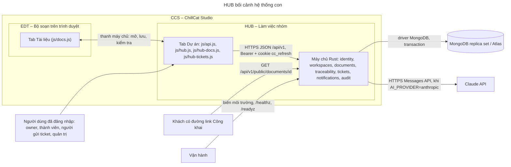
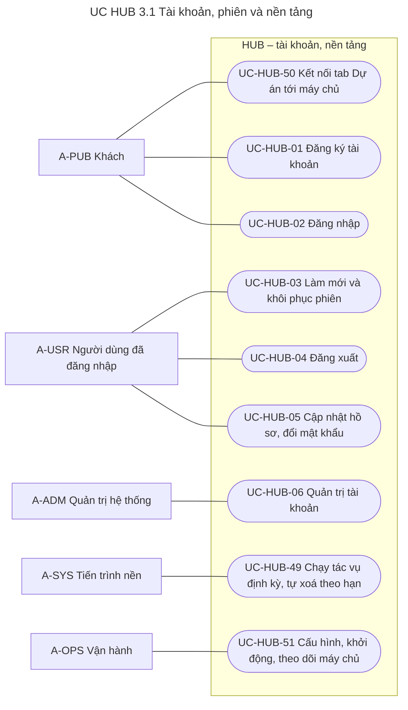
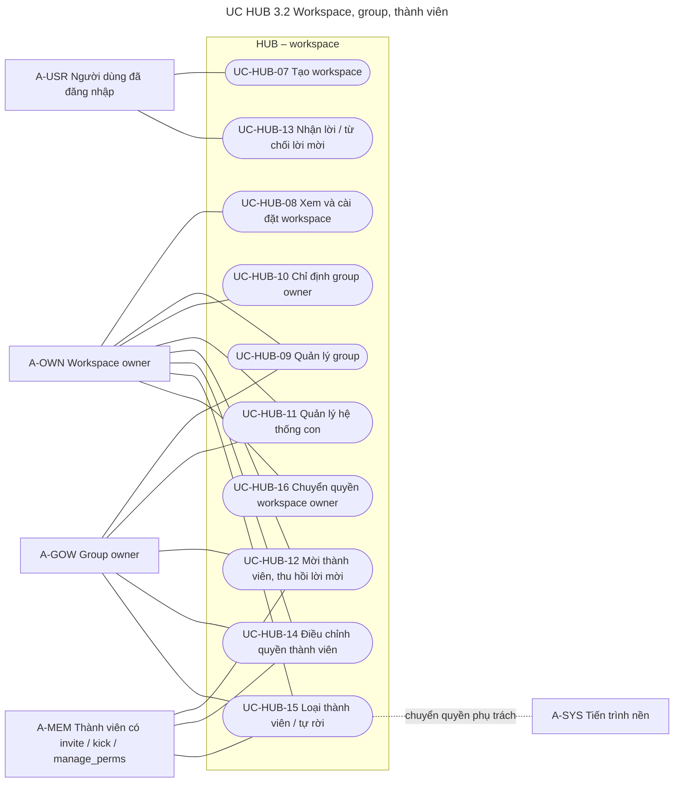
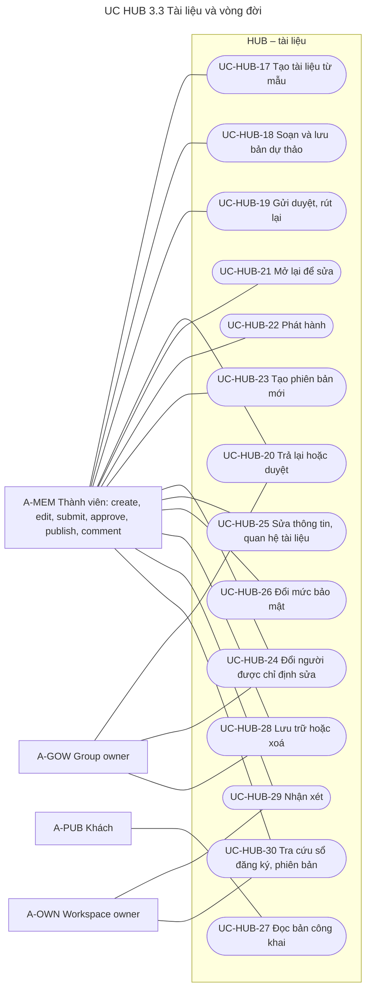
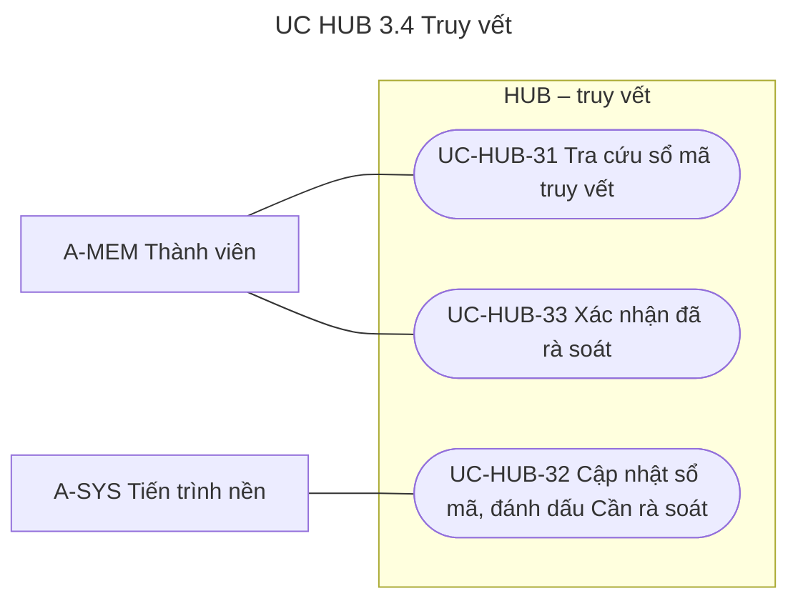
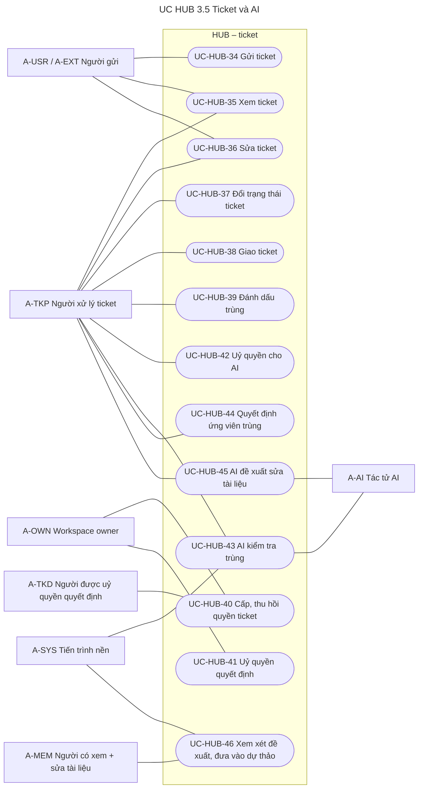
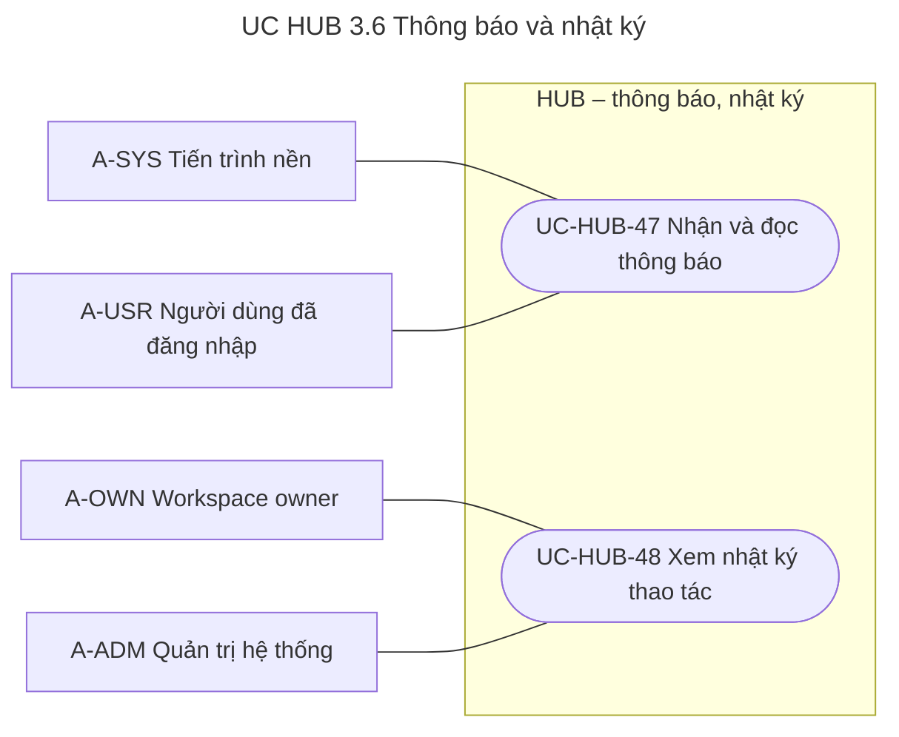

# Đặc tả yêu cầu phần mềm – Làm việc nhóm

| Thuộc tính | Giá trị |
|---|---|
| Mã tài liệu | CCS-SRS-HUB-001 |
| Phiên bản | 0.1 |
| Ngày | 2026-11-18 |
| Trạng thái | Dự thảo – viết từ hệ thống đang chạy |
| Quy trình ISO/IEC/IEEE 12207 | 6.4.3 System/Software Requirements Definition |
| Chuẩn tham chiếu | ISO/IEC/IEEE 29148 §9.5 |
| Hệ thống con | HUB – Làm việc nhóm |
| Nguồn đã khảo sát | `desc.txt`, `backend/README.md`, `backend/docs/DECISIONS.md`, `backend/.env.example`, `backend/apps/server/src/app.rs`, `backend/crates/kernel/src/`, `backend/crates/platform/src/`, `backend/crates/identity/src/`, `backend/crates/workspaces/src/`, `backend/crates/documents/src/`, `backend/crates/traceability/src/`, `backend/crates/tickets/src/`, `backend/crates/notifications/src/lib.rs`, `backend/crates/audit/src/lib.rs`, `backend/crates/*/tests/`, `js/api.js`, `js/hub.js`, `js/hub-docs.js`, `js/hub-tickets.js`, `js/docs.js` |
| Đơn vị ban hành | Nhóm phát triển ChillCat Studio |
| Tài liệu liên quan | ↑ [StRS-00](StRS-00_Yeu_cau_cac_ben_lien_quan.md) · [SyRS-00](SyRS-00_Yeu_cau_he_thong.md) · [BMA-00 §5](../01_Phan_tich_nghiep_vu/BMA-00_Tong_quan_nghiep_vu.md) · [BPMN-22](../01_Phan_tich_nghiep_vu/BPMN-22_Soan_duyet_phat_hanh_tai_lieu.md) · [BPMN-31](../01_Phan_tich_nghiep_vu/BPMN-31_Xu_ly_ticket.md) · ↓ [SDD-HUB](../04_Thiet_ke_chi_tiet/SDD-HUB_Lam_viec_nhom.md) · [ERD-HUB](../05_Thiet_ke_du_lieu/ERD-HUB_CSDL_Lam_viec_nhom.md) · [API-HUB](../06_Giao_dien_tich_hop/API-HUB_Lam_viec_nhom.md) · [STP-00](../07_Kiem_thu/STP-00_Ke_hoach_kiem_thu.md) · ⇄ [RTM-00](../00_Quan_ly_tai_lieu/RTM-00_Ma_tran_truy_vet.md) · [GLOSSARY](../00_Quan_ly_tai_lieu/GLOSSARY_Thuat_ngu.md) |

---

## 1. Giới thiệu

### 1.1 Mục đích

Liệt kê những gì hệ thống con HUB – Làm việc nhóm phải làm, đủ chi tiết để thiết kế và kiểm thử: tác nhân, use case, yêu cầu chức năng (FR), yêu cầu phi chức năng (NFR) và quy tắc nghiệp vụ (BR), theo ISO/IEC/IEEE 29148 (đặc tả yêu cầu phần mềm).

Tài liệu được **viết lại từ hệ thống đang chạy** ([CONV §5](../00_Quan_ly_tai_lieu/CONV_Quy_uoc_tai_lieu_va_ky_hieu.md)): mỗi yêu cầu ghi vị trí trong mã ở cột **Nguồn** (đường dẫn tính từ gốc repo, `#tên hàm`; nhiều hàm cùng file thì chỉ ghi `#tên hàm` cho các hàm sau). Đặc tả gốc là `desc.txt`; ở những điểm đặc tả còn ngỏ, yêu cầu ghi theo cách máy chủ đang làm và dẫn "quyết định #n" của `backend/docs/DECISIONS.md`. Chỗ hệ thống làm khác `desc.txt` được ghi rõ ở cột Nguồn của §7. Cột **Ưu tiên** là đánh giá của nhóm phát triển **(suy luận)**.

Mọi yêu cầu ở đây đã được hiện thực. Bằng chứng kiểm thử ngày 2026-11-17/18 (49 bài `cargo test`, smoke 26/26, giao diện 25/25 và 40/40) nằm ở [STP-00](../07_Kiem_thu/STP-00_Ke_hoach_kiem_thu.md).

### 1.2 Phạm vi

Một tiến trình phục vụ toàn bộ: API dưới tiền tố `/api/v1`, giao diện tĩnh, `/healthz`, `/readyz`, nghe ở `HTTP_ADDR` (mặc định `127.0.0.1:8080`; trong Docker cổng `8080`). Cột **Cổng** ghi nhóm đường dẫn của module.

| Mã module | Thành phần | Cổng | Chức năng chính | Chức năng hệ thống |
|---|---|---|---|---|
| `IDN` | Crate `identity`; `js/api.js`; trang Tài khoản, Quản trị ở `js/hub.js` | `/api/v1/auth/*`, `/api/v1/me`, `/api/v1/users/lookup`, `/api/v1/admin/users` | Đăng ký, đăng nhập, phiên, hồ sơ, mật khẩu, quản trị tài khoản | SYS-F10, SYS-F24 |
| `WSP` | Crate `workspaces`; `backend/crates/kernel/src/perms.rs`, `backend/crates/kernel/src/contracts/access.rs`; trang Thành viên, Cài đặt workspace, Lời mời ở `js/hub.js` | `/api/v1/workspaces`, `/groups`, `/subsystems`, `/memberships`, `/invitations`, `/me/invitations` | Workspace, group, hệ thống con, thành viên, lời mời, phép tính quyền, danh bạ dự án | SYS-F11, SYS-F12 |
| `DOC` | Crate `documents`; `js/hub-docs.js`; thanh máy chủ trong `js/docs.js` | `/api/v1/document-types`, `/workspaces/{ws}/documents`, `/documents`, `/versions`, `/comments`, `/links`, `/public/documents` | 24 loại tài liệu, tài liệu, phiên bản, vòng đời, mức bảo mật, quan hệ, nhận xét, trang công khai, soạn ở tab Tài liệu | SYS-F02, SYS-F13, SYS-F14, SYS-F15, SYS-F16, SYS-F17, SYS-F23 |
| `TRC` | Crate `traceability`; trang Truy vết ở `js/hub-docs.js` | `/api/v1/workspaces/{ws}/trace/*`, `/trace/flags` | Đọc mã truy vết, sổ mã, cờ Cần rà soát | SYS-F18 |
| `TKT` | Crate `tickets`; `js/hub-tickets.js` | `/api/v1/workspaces/{ws}/tickets`, `/tickets`, `/me/tickets`, `/ticket-*`, `/workspaces/{ws}/ticket-*` | Ticket, quyền ticket, uỷ quyền, AI kiểm tra trùng, đề xuất sửa tài liệu | SYS-F19, SYS-F20 |
| `NTF` | Crate `notifications`; trang Thông báo, hàm hỏi định kỳ ở `js/hub.js` | `/api/v1/me/notifications*` | Thông báo trong ứng dụng | SYS-F21 |
| `AUD` | Crate `audit`; trang Nhật ký ở `js/hub.js` | `/api/v1/workspaces/{ws}/audit`, `/admin/audit` | Nhật ký thao tác | SYS-F22, SYS-F23 |
| `PLT` | Crate `kernel`, `platform`, ứng dụng `backend/apps/server`; phần kết nối máy chủ ở `js/api.js`, `js/hub.js` | `/api/v1/meta`, `/healthz`, `/readyz`, giao diện tĩnh `STATIC_DIR` | Cấu hình, MongoDB, outbox, ghép module, tác vụ định kỳ, sức khoẻ | SYS-F25, SYS-F23 |

Không thuộc tài liệu này: các tab Tài liệu (phần soạn Markdown), Diagram, Thiết kế trang, Chat AI, giọng nói, offline của EDT – xem [SRS-EDT](SRS-EDT_Bo_soan_tren_trinh_duyet.md); chỉ nhắc tới ở chỗ HUB dùng trình soạn của tab Tài liệu (thanh máy chủ) và bộ hiển thị Markdown của EDT (trang công khai). Triển khai và vận hành: [DEP-00](../08_Trien_khai_van_hanh/DEP-00_Trien_khai_tong_the.md), [OPS-00](../08_Trien_khai_van_hanh/OPS-00_So_tay_van_hanh.md).

### 1.3 Định nghĩa

| Thuật ngữ | Nghĩa |
|---|---|
| Hạng phạm vi (`rank`) | Độ "rộng" của một người khi xét thao tác trên thành viên: 3 = workspace owner; 2 = có ít nhất một quyền người dùng ở cấp workspace; 1 = group owner của group đang xét; 0 = còn lại (`backend/crates/workspaces/src/members.rs#rank`) |
| Quyền cấp được (`grantable`) | Tập quyền tài liệu và quyền người dùng mà một người được phép cấp hoặc thu hồi trong một phạm vi (`backend/crates/workspaces/src/members.rs#grantable`) |
| Khả năng thao tác (`capabilities`) | Danh sách thao tác người gọi được làm với một tài liệu / phiên bản / ticket, máy chủ trả kèm dữ liệu để giao diện chỉ hiện nút hợp lệ; máy chủ vẫn kiểm tra lại khi thực hiện |
| `revision` | Số đếm tăng mỗi lần nội dung một phiên bản thay đổi; dùng cho khoá lạc quan |
| Lượt duyệt | Một dòng `document_reviews`: tạo, gửi duyệt, rút lại, trả lại, duyệt, mở lại, phát hành, đổi người sửa |
| Lần chạy AI (`check`) | Một lần kiểm tra trùng hoặc lập đề xuất sửa tài liệu cho một ticket, gắn với người được AI thay mặt, cách kích hoạt (`automatic` / `manual`), bộ so (`ai` / `keyword`), trạng thái và phạm vi đã kiểm tra |
| Đề xuất có căn cứ cũ (`stale`) | Đề xuất sửa tài liệu mà tài liệu đó đã có bản phát hành khác bản làm căn cứ |
| Dòng thời gian ticket | Các dòng `ticket_activity` ghi mọi thao tác trên một ticket; ai xem được ticket thì thấy |
| Số ticket | Số thứ tự tăng dần trong một workspace (`#12`) |
| Uỷ quyền AI | Bản ghi `ticket_ai_delegations`: một người cho phép AI tự chạy kiểm tra trùng thay mặt mình ở một workspace |

Thuật ngữ dùng chung: [GLOSSARY](../00_Quan_ly_tai_lieu/GLOSSARY_Thuat_ngu.md).

### 1.4 Tài liệu tham chiếu

[CONV](../00_Quan_ly_tai_lieu/CONV_Quy_uoc_tai_lieu_va_ky_hieu.md), [SDD-HUB](../04_Thiet_ke_chi_tiet/SDD-HUB_Lam_viec_nhom.md) (thiết kế), [ERD-HUB](../05_Thiet_ke_du_lieu/ERD-HUB_CSDL_Lam_viec_nhom.md) (dữ liệu), [API-HUB](../06_Giao_dien_tich_hop/API-HUB_Lam_viec_nhom.md) (giao diện), [ICD-00](../06_Giao_dien_tich_hop/ICD-00_Tong_quan_tich_hop.md) (tích hợp ra ngoài), [STP-00](../07_Kiem_thu/STP-00_Ke_hoach_kiem_thu.md) (kiểm thử). Nguồn gốc: `desc.txt`, `backend/README.md`, `backend/docs/DECISIONS.md`.

---

## 2. Mô tả tổng quan

### 2.1 Bối cảnh sản phẩm

| Thành phần | Dùng cho | Dùng chung hay riêng | Căn cứ |
|---|---|---|---|
| Tab Dự án (giao diện HUB) | HUB | Riêng | `js/hub.js`, `js/hub-docs.js`, `js/hub-tickets.js` |
| Trình soạn tab Tài liệu, thanh máy chủ | EDT + HUB | CHUNG – một trình soạn; khi gắn phiên bản máy chủ thì `Ctrl+S` lưu lên máy chủ | `js/docs.js#DOCS.openServerDoc`, `js/hub-docs.js#HUB.saveServerDoc` |
| Bộ hiển thị Markdown (trang công khai, xem phiên bản) | EDT + HUB | CHUNG – HUB gọi `DE.md.render`, `DE.md.sanitizeFragment` của EDT | `js/hub-docs.js#HUB.showPublic` |
| Bộ mẫu `templates/` | EDT + HUB | CHUNG nguồn, hai cách nạp: EDT tải bằng `fetch`, HUB nhúng lúc build | `backend/crates/documents/src/catalog.rs` |
| Điền mẫu tài liệu | EDT + HUB | TRÙNG LẶP – hai bộ quy tắc thay thế viết riêng ([BMA-00 §7](../01_Phan_tich_nghiep_vu/BMA-00_Tong_quan_nghiep_vu.md)) | `backend/crates/documents/src/template.rs#instantiate`, `js/doc-library.js#fill` |
| Danh mục loại tài liệu | EDT + HUB | TRÙNG LẶP ([BMA-00 §7](../01_Phan_tich_nghiep_vu/BMA-00_Tong_quan_nghiep_vu.md)) | `backend/crates/documents/src/catalog.rs`, `js/doc-library.js` |
| Gọi AI | HUB (ticket) | Riêng – máy chủ gọi Claude bằng `AI_API_KEY`; khác Chat AI của EDT | `backend/crates/tickets/src/ai.rs` |
| MongoDB / Atlas | HUB | Riêng – mỗi module sở hữu collection của mình (SYS-I01) | `backend/crates/platform/src/mongo.rs` |

### 2.2 Tác nhân

Mã tác nhân là duy nhất trong hệ thống con HUB ([CONV §3.5](../00_Quan_ly_tai_lieu/CONV_Quy_uoc_tai_lieu_va_ky_hieu.md)). Vai trò trong dự án không phải thuộc tính của tài khoản mà suy ra từ `memberships`, `groups.owner_id`, `workspaces.owner_id` và quyền ticket; một người có thể đóng nhiều tác nhân.

| Mã | Tác nhân | Mô tả | Bên liên quan |
|---|---|---|---|
| A-PUB | Khách chưa đăng nhập | Người mở tab Dự án hoặc đường link mà chưa có phiên: đọc bản phát hành mức Công khai, kết nối máy chủ, đăng ký, đăng nhập | SH-PUB; mọi nhóm trước khi đăng nhập |
| A-USR | Người dùng đã đăng nhập | Bất kỳ tài khoản nào đang có phiên, chưa xét vai trò trong dự án: tạo workspace, xem danh bạ dự án, gửi ticket, nhận lời mời, nhận thông báo. A-ADM, A-OWN, A-GOW, A-MEM, A-EXT là trường hợp riêng của A-USR | SH-MEM, SH-OWN, SH-GOW, SH-EXT, SH-ADM |
| A-ADM | Quản trị hệ thống | Tài khoản `system_role = admin`. Quản lý tài khoản, xem nhật ký hệ thống; **không** có quyền mặc định với workspace, tài liệu, ticket | SH-ADM |
| A-OWN | Workspace owner | `workspaces.owner_id` của workspace đang xét. Mọi quyền người dùng trong workspace; về tài liệu chỉ có xem + nhận xét ở mọi nơi; **không** có quyền ticket cho tới khi tự cấp | SH-OWN |
| A-GOW | Group owner | Owner của group chứa tài liệu / phạm vi đang xét. Mọi quyền tài liệu và mời, loại, phân quyền trong group; là người duy nhất bấm Duyệt | SH-GOW |
| A-MEM | Thành viên | Người có membership ở workspace hoặc group, quyền theo membership: có thể là người được chỉ định sửa, người có `approve`, `publish`, `invite`, `kick`, `manage_perms`… – mỗi use case ghi quyền cần có | SH-MEM |
| A-EXT | Người gửi ticket ngoài workspace | A-USR không là thành viên workspace: gửi ticket, xem và sửa (khi còn Mới) ticket do mình gửi | SH-EXT |
| A-TKP | Người xử lý ticket | Người có cả quyền xem và quyền xử lý với ticket đang xét (cấp cho cá nhân hoặc qua group). Có thể là A-OWN sau khi tự cấp | SH-OWN, SH-GOW, SH-MEM |
| A-TKD | Người được uỷ quyền quyết định quyền ticket | Thành viên được workspace owner uỷ quyền quyết định cấp quyền xem và / hoặc xử lý ticket; không vì thế mà có các quyền đó | SH-MEM, SH-GOW |
| A-AI | Tác tử AI | Hệ thống ngoài: Claude qua Messages API (SYS-I02) khi `AI_PROVIDER=anthropic`, hoặc bộ so khớp từ khoá trong máy chủ khi `AI_PROVIDER=none`. Luôn chạy thay mặt một người (A-TKP), không tự quyết định | – (hệ thống ngoài) |
| A-SYS | Bộ hẹn giờ và tiến trình nền của máy chủ | Relay outbox phát sự kiện cho các module, tác vụ định kỳ, chỉ mục TTL của MongoDB | – (hệ thống) |
| A-OPS | Vận hành | Người cấu hình, khởi động và theo dõi máy chủ | SH-OPS |

### 2.3 Ràng buộc

- Máy chủ viết bằng Rust 1.85+ (axum, tokio) – StC-01; CSDL MongoDB replica set tự quản hoặc MongoDB Atlas, cần transaction – StC-02.
- Monolith chia module: mỗi crate nghiệp vụ chỉ phụ thuộc `kernel` và `platform`, gọi nhau qua trait trong `kernel::contracts`, phản ứng qua sự kiện + outbox – StC-03.
- Chạy nội bộ, một tiến trình phục vụ cả API lẫn giao diện – StC-04; giao diện HTML/CSS/JS thuần, không bước build – StC-05.
- Tiếng Việt cho giao diện và thông báo lỗi; mã lỗi máy đọc giữ tiếng Anh – StC-06.
- Được gửi mọi loại dữ liệu tới AI bên ngoài không cần phê duyệt, nhưng AI không thấy quá quyền của người được thay mặt – StC-07.
- Phiên bản Thay thế giữ 10 năm, nhật ký 2 năm – StC-08.
- Đặc quyền tối thiểu là chủ đích an ninh; không nới quyền mặc định cho tiện – StC-09.
- Đóng gói Docker, chạy bằng người dùng không phải root – StC-11.

### 2.4 Giả định và phụ thuộc

- MongoDB là replica set (Atlas luôn là replica set) – SYS-I01. Không có replica set thì transaction và máy chủ không chạy.
- Claude API (SYS-I02) là tuỳ chọn; không cấu hình thì kiểm tra trùng và đề xuất chạy bằng so khớp từ khoá trong máy chủ.
- Giao diện chạy trong trình duyệt Chrome / Edge / Firefox (SYS-I07); khi khác origin với API cần `CORS_ALLOWED_ORIGINS` và refresh token nằm trong `localStorage`.
- Trình soạn và bộ hiển thị Markdown là của EDT ([SRS-EDT](SRS-EDT_Bo_soan_tren_trinh_duyet.md)); HUB chỉ gắn thêm thanh máy chủ.
- Ngày ghi vào bảng thuộc tính và Lịch sử thay đổi lấy theo giờ máy chủ (đặt `TZ`) – quyết định #22.
- Không gửi e-mail: lời mời và thông báo chỉ hiện trong ứng dụng ([SyRS-00 §2.3](SyRS-00_Yeu_cau_he_thong.md)).
- Đồng hồ máy chủ đúng: thời hạn phiên, lời mời, khoá đăng nhập, thời hạn lưu đều tính theo giờ máy chủ **(suy luận)**.

---

## 3. Sơ đồ Use Case

Hình người là tác nhân (§2.2), hình bo tròn là use case (§4). Một use case có thể thuộc nhiều tác nhân.

### 3.1 Nhóm `IDN` và `PLT`

### 3.2 Nhóm `WSP`

### 3.3 Nhóm `DOC`

A-GOW có mọi quyền tài liệu trong group của mình nên cũng làm được mọi use case của A-MEM ở §3.3; sơ đồ chỉ nối những use case mà group owner có quyền riêng.

### 3.4 Nhóm `TRC`

### 3.5 Nhóm `TKT`

### 3.6 Nhóm `NTF` và `AUD`

---

## 4. Đặc tả Use Case chính

Dòng **Quy trình** dẫn tới quy trình ở [BMA-00 §5](../01_Phan_tich_nghiep_vu/BMA-00_Tong_quan_nghiep_vu.md); số bước của quy trình không có tài liệu BPMN riêng lấy theo BMA-00 §5.1. Mã bước của BP-22, BP-31 sẽ ghi khi BPMN-22, BPMN-31 được lập (§8). Dòng **Thiết kế** dẫn tới SDD-HUB, nơi cấp mã luồng tương tác và máy trạng thái. Mọi lỗi trả theo khuôn `{ "error": { "code", "message", "details" } }` (NFR-HUB-018); "404" nghĩa là không có **hoặc** người gọi không được biết là có (NFR-HUB-002).

### UC-HUB-01 Đăng ký tài khoản

| Mục | Nội dung |
|---|---|
| Tác nhân | A-PUB |
| Quy trình | [BP-41](../01_Phan_tich_nghiep_vu/BMA-00_Tong_quan_nghiep_vu.md) bước 1 |
| Chức năng hệ thống | SYS-F10 |
| Tiền điều kiện | Giao diện đã kết nối máy chủ (UC-HUB-50); máy chủ cho tự đăng ký (`AUTH_ALLOW_REGISTRATION`, mặc định bật) |
| Luồng chính | 1. Khách chọn **Tạo tài khoản**, nhập e-mail, tên, họ, mật khẩu, mã nhân viên (tuỳ chọn). 2. Máy chủ chuẩn hoá và kiểm tra dữ liệu. 3. Nếu hệ thống chưa có tài khoản nào, tài khoản mới là quản trị hệ thống; còn lại là người dùng thường. 4. Ghi `users`, phát `user.registered`. 5. Mở phiên đăng nhập như UC-HUB-02 bước 4. |
| Luồng thay thế | 3a. Đã đặt `BOOTSTRAP_ADMIN_EMAIL` / `BOOTSTRAP_ADMIN_PASSWORD`: quản trị viên đầu tiên được tạo sẵn lúc khởi động (UC-HUB-51), người đăng ký đầu tiên vẫn là người dùng thường nếu hệ thống đã có tài khoản đó |
| Ngoại lệ | Tự đăng ký đã tắt ⇒ 403 `auth.registration_disabled`. E-mail sai dạng ⇒ 422 `user.invalid_email`; tên / họ trống hoặc quá 100 ký tự ⇒ 422 `user.invalid_name`; mật khẩu ngoài 8–128 ký tự ⇒ 422 `user.weak_password`; mã nhân viên sai dạng ⇒ 422 `user.invalid_employee_code`. E-mail / mã nhân viên đã có ⇒ 409 `user.email_taken` / `user.employee_code_taken` |
| Hậu điều kiện | Có tài khoản và một phiên đăng nhập; người dùng thành A-USR |
| Yêu cầu | FR-HUB-IDN-001, FR-HUB-IDN-002, FR-HUB-IDN-004, FR-HUB-IDN-015; NFR-HUB-005 |
| Thiết kế | [SDD-HUB §5](../04_Thiet_ke_chi_tiet/SDD-HUB_Lam_viec_nhom.md) |
| Nguồn | `backend/crates/identity/src/service.rs#register`, `#new_user`; `js/hub.js#renderAuth`; `js/api.js#API.register` |

### UC-HUB-02 Đăng nhập

| Mục | Nội dung |
|---|---|
| Tác nhân | A-PUB |
| Quy trình | [BP-41](../01_Phan_tich_nghiep_vu/BMA-00_Tong_quan_nghiep_vu.md) bước 2 |
| Chức năng hệ thống | SYS-F10 |
| Tiền điều kiện | Có tài khoản; giao diện đã kết nối máy chủ |
| Luồng chính | 1. Nhập e-mail, mật khẩu. 2. Máy chủ kiểm tra khoá đăng nhập tạm (NFR-HUB-005). 3. So mật khẩu với bản băm Argon2id; đúng thì đặt lại bộ đếm sai. 4. Tạo phiên (`sessions`), trả access token và refresh token, đặt cookie `cc_refresh`. 5. Giao diện tải danh sách workspace và bắt đầu hỏi số thông báo chưa đọc. |
| Luồng thay thế | 3a. Sai mật khẩu: tăng bộ đếm; tới lần thứ 5 liên tiếp thì khoá đăng nhập 5 phút |
| Ngoại lệ | Sai e-mail hoặc mật khẩu ⇒ 401 `auth.invalid_credentials` (cùng một lỗi cho hai trường hợp). Đang bị khoá tạm ⇒ 429 `auth.locked`. Tài khoản bị quản trị khoá ⇒ 403 `auth.disabled` |
| Hậu điều kiện | Có phiên còn hạn; người dùng thành A-USR |
| Yêu cầu | FR-HUB-IDN-003, FR-HUB-IDN-004, FR-HUB-IDN-015; NFR-HUB-003, NFR-HUB-004, NFR-HUB-005 |
| Thiết kế | [SDD-HUB §5](../04_Thiet_ke_chi_tiet/SDD-HUB_Lam_viec_nhom.md) |
| Nguồn | `backend/crates/identity/src/service.rs#login`, `#start_session`, `#issue`; `backend/crates/identity/src/http.rs#login`, `#set_cookie`; `js/api.js#API.login`; `js/hub.js#afterAuth` |

### UC-HUB-03 Làm mới và khôi phục phiên

| Mục | Nội dung |
|---|---|
| Tác nhân | A-USR (giao diện tự làm thay người dùng) |
| Quy trình | [BP-41](../01_Phan_tich_nghiep_vu/BMA-00_Tong_quan_nghiep_vu.md) bước 2 |
| Chức năng hệ thống | SYS-F10 |
| Tiền điều kiện | Trình duyệt còn refresh token (cookie HttpOnly khi cùng origin, `localStorage` khi khác origin) |
| Luồng chính | 1. Mở app, hoặc access token sắp hết hạn, hoặc một lời gọi API nhận 401. 2. Giao diện gọi `POST /auth/refresh`. 3. Máy chủ đổi secret của phiên một cách nguyên tử (xoay vòng) và cấp access token mới. 4. Giao diện gửi lại lời gọi bị 401 một lần. |
| Luồng thay thế | 1a. Lần đầu mở app ở trình duyệt chưa từng đăng nhập: không gọi làm mới |
| Ngoại lệ | Refresh token sai hoặc đã dùng cho một phiên còn sống ⇒ thu hồi cả phiên, 401 `auth.refresh_invalid`, giao diện về màn đăng nhập. Phiên hết hạn / đã thu hồi ⇒ 401. Tài khoản bị khoá ⇒ thu hồi phiên, 403 `auth.disabled` |
| Hậu điều kiện | Có access token mới; refresh token cũ hết hiệu lực |
| Yêu cầu | FR-HUB-IDN-005, FR-HUB-IDN-006; NFR-HUB-003, NFR-HUB-004 |
| Thiết kế | [SDD-HUB §5](../04_Thiet_ke_chi_tiet/SDD-HUB_Lam_viec_nhom.md) |
| Nguồn | `backend/crates/identity/src/service.rs#refresh`; `backend/crates/identity/src/http.rs#refresh`; `js/api.js#API.refresh`, `#API.call`, `#API.restore` |

### UC-HUB-04 Đăng xuất

| Mục | Nội dung |
|---|---|
| Tác nhân | A-USR |
| Quy trình | [BP-41](../01_Phan_tich_nghiep_vu/BMA-00_Tong_quan_nghiep_vu.md) bước 2 |
| Chức năng hệ thống | SYS-F10 |
| Tiền điều kiện | Đang đăng nhập |
| Luồng chính | 1. Bấm **Đăng xuất**. 2. Máy chủ thu hồi phiên ứng với refresh token, xoá cookie. 3. Giao diện xoá token cục bộ, về màn đăng nhập. |
| Luồng thay thế | 2a. Máy chủ không trả lời: giao diện vẫn xoá phiên phía trình duyệt |
| Ngoại lệ | – |
| Hậu điều kiện | Phiên đã thu hồi; access token đang giữ trong bộ nhớ bị bỏ |
| Yêu cầu | FR-HUB-IDN-007 |
| Thiết kế | [SDD-HUB §5](../04_Thiet_ke_chi_tiet/SDD-HUB_Lam_viec_nhom.md) |
| Nguồn | `backend/crates/identity/src/service.rs#logout_token`; `backend/crates/identity/src/http.rs#logout`; `js/api.js#API.logout` |

### UC-HUB-05 Cập nhật hồ sơ và đổi mật khẩu

| Mục | Nội dung |
|---|---|
| Tác nhân | A-USR |
| Quy trình | [BP-41](../01_Phan_tich_nghiep_vu/BMA-00_Tong_quan_nghiep_vu.md) bước 2 |
| Chức năng hệ thống | SYS-F10 |
| Tiền điều kiện | Đang đăng nhập |
| Luồng chính | 1. Mở trang **Tài khoản**. 2. Sửa tên, họ, ảnh đại diện, mã nhân viên rồi lưu. 3. Đổi mật khẩu: nhập mật khẩu hiện tại và mật khẩu mới. 4. Máy chủ kiểm tra, lưu bản băm mới, thu hồi mọi phiên khác của người đó. |
| Luồng thay thế | – |
| Ngoại lệ | Mật khẩu hiện tại sai ⇒ 422 `user.wrong_password`; mật khẩu mới sai độ dài ⇒ 422 `user.weak_password`; ảnh không phải địa chỉ http(s) ⇒ 422 `user.invalid_avatar`; mã nhân viên đã dùng ⇒ 409 |
| Hậu điều kiện | Hồ sơ / mật khẩu đã đổi; phiên hiện tại giữ nguyên |
| Yêu cầu | FR-HUB-IDN-008, FR-HUB-IDN-009, FR-HUB-IDN-015 |
| Thiết kế | [SDD-HUB §5](../04_Thiet_ke_chi_tiet/SDD-HUB_Lam_viec_nhom.md) |
| Nguồn | `backend/crates/identity/src/service.rs#me`, `#update_profile`, `#change_password`; `js/hub.js#PAGES.account` |

### UC-HUB-06 Quản trị tài khoản

| Mục | Nội dung |
|---|---|
| Tác nhân | A-ADM |
| Quy trình | [BP-41](../01_Phan_tich_nghiep_vu/BMA-00_Tong_quan_nghiep_vu.md) bước 3 |
| Chức năng hệ thống | SYS-F24 |
| Tiền điều kiện | Người gọi có `system_role = admin` |
| Luồng chính | 1. Mở trang **Quản trị hệ thống**, tìm tài khoản theo e-mail, tên, mã nhân viên. 2. Khoá / mở khoá một tài khoản hoặc đổi vai trò (quản trị / người dùng). 3. Kiểm tra BR-HUB-013. 4. Khoá ⇒ thu hồi mọi phiên của người đó. 5. Ghi nhật ký hệ thống. |
| Luồng thay thế | – |
| Ngoại lệ | Không phải quản trị ⇒ 403 `auth.admin_only`. Tự khoá / tự bỏ vai trò quản trị ⇒ 422 `user.self_demote`. Không có tài khoản ⇒ 404 `user.not_found` |
| Hậu điều kiện | Trạng thái / vai trò tài khoản đã đổi; quản trị viên vẫn không có quyền gì với workspace, tài liệu, ticket |
| Yêu cầu | FR-HUB-IDN-011, FR-HUB-IDN-012, FR-HUB-IDN-013, FR-HUB-IDN-015 |
| Thiết kế | [SDD-HUB §5](../04_Thiet_ke_chi_tiet/SDD-HUB_Lam_viec_nhom.md) |
| Nguồn | `backend/crates/identity/src/service.rs#admin_list`, `#admin_update`; `js/hub.js#PAGES.admin` |

### UC-HUB-07 Tạo workspace

| Mục | Nội dung |
|---|---|
| Tác nhân | A-USR (A-ADM khi `WORKSPACE_CREATION=admin`) |
| Quy trình | [BP-21](../01_Phan_tich_nghiep_vu/BMA-00_Tong_quan_nghiep_vu.md) bước 1 |
| Chức năng hệ thống | SYS-F11 |
| Tiền điều kiện | Đang đăng nhập |
| Luồng chính | 1. Bấm **Tạo workspace**, nhập mã dự án, tên, mô tả, tên group mặc định (để trống = "Chung"). 2. Kiểm tra BR-HUB-001, BR-HUB-002. 3. Trong một transaction: ghi `workspaces`, `groups`, hai `memberships` owner (cấp workspace và group mặc định) cho người tạo, sự kiện `workspace.created`. 4. Giao diện chọn workspace mới, mở trang Tổng quan. |
| Luồng thay thế | – |
| Ngoại lệ | `WORKSPACE_CREATION=admin` mà người gọi không phải quản trị ⇒ 403 `workspace.create_admin_only`. Mã sai dạng ⇒ 422 `workspace.invalid_code`; trùng ký hiệu dành riêng ⇒ 422 `workspace.reserved_code`; mã đã có ⇒ 409 `workspace.code_taken`; tên trống / quá dài ⇒ 422 `input.invalid` |
| Hậu điều kiện | Người tạo là workspace owner và group owner của group mặc định, với quyền mặc định tối thiểu (BR-HUB-005) |
| Yêu cầu | FR-HUB-WSP-001, FR-HUB-WSP-002, FR-HUB-WSP-003, FR-HUB-WSP-021 |
| Thiết kế | [SDD-HUB §5](../04_Thiet_ke_chi_tiet/SDD-HUB_Lam_viec_nhom.md) |
| Nguồn | `backend/crates/workspaces/src/service.rs#create`, `#owner_membership`; `backend/crates/kernel/src/codes.rs#workspace_code`; `js/hub.js#newWorkspace` |

### UC-HUB-08 Xem và cài đặt workspace

| Mục | Nội dung |
|---|---|
| Tác nhân | A-OWN (sửa); A-MEM (xem) |
| Quy trình | [BP-21](../01_Phan_tich_nghiep_vu/BMA-00_Tong_quan_nghiep_vu.md) bước 2 |
| Chức năng hệ thống | SYS-F11 |
| Tiền điều kiện | Là thành viên workspace |
| Luồng chính | 1. Chọn workspace trong danh sách workspace của mình; giao diện hiện quyền của mình. 2. Workspace owner mở **Cài đặt workspace**, sửa tên, mô tả, bật / tắt mức Công khai. 3. Máy chủ lưu, ghi nhật ký `workspace.updated`. |
| Luồng thay thế | 2a. Không phải owner: ô cài đặt chỉ đọc |
| Ngoại lệ | Không phải thành viên ⇒ 404 `workspace.not_found`. Không phải owner mà gửi sửa ⇒ 403 `workspace.owner_only` |
| Hậu điều kiện | Thông tin workspace đã đổi; mã dự án không đổi |
| Yêu cầu | FR-HUB-WSP-004, FR-HUB-WSP-005, FR-HUB-WSP-022 |
| Thiết kế | [SDD-HUB §5](../04_Thiet_ke_chi_tiet/SDD-HUB_Lam_viec_nhom.md) |
| Nguồn | `backend/crates/workspaces/src/service.rs#list_mine`, `#get`, `#update`; `js/hub.js#loadWorkspaces`, `PAGES['ws-settings']` |

### UC-HUB-09 Quản lý group

| Mục | Nội dung |
|---|---|
| Tác nhân | A-OWN (tạo, xoá, sửa); A-GOW (sửa group của mình) |
| Quy trình | [BP-21](../01_Phan_tich_nghiep_vu/BMA-00_Tong_quan_nghiep_vu.md) bước 2 |
| Chức năng hệ thống | SYS-F11 |
| Tiền điều kiện | Là thành viên workspace |
| Luồng chính | 1. Workspace owner tạo group: tên, mô tả, group owner (mặc định chính mình). 2. Máy chủ kiểm tra quyền, tên duy nhất, group owner là thành viên; tạo group và membership owner trong một transaction; thông báo group owner. 3. Sửa tên / mô tả. 4. Xoá group: kiểm tra BR-HUB-004, xoá membership của group, thu hồi lời mời chờ vào group; module tickets bỏ gắn group khỏi ticket và thu hồi quyền ticket liên quan. |
| Luồng thay thế | – |
| Ngoại lệ | Không phải workspace owner tạo / xoá ⇒ 403 `group.create_forbidden` / `workspace.owner_only`; sửa mà không phải workspace owner hay group owner ⇒ 403 `group.update_forbidden`. Tên trùng ⇒ 409 `group.name_taken`. Group owner chưa là thành viên ⇒ 422 `group.owner_not_member`. Group còn tài liệu ⇒ 409 `group.has_documents`; group cuối cùng ⇒ 409 `group.last_group` |
| Hậu điều kiện | Group được tạo / sửa / xoá; nhật ký `group.*` |
| Yêu cầu | FR-HUB-WSP-007, FR-HUB-WSP-008, FR-HUB-WSP-009, FR-HUB-WSP-022 |
| Thiết kế | [SDD-HUB §5](../04_Thiet_ke_chi_tiet/SDD-HUB_Lam_viec_nhom.md) |
| Nguồn | `backend/crates/workspaces/src/service.rs#create_group`, `#update_group`, `#delete_group`; `backend/crates/tickets/src/service.rs#on_group_deleted`; `js/hub.js#groupDialog` |

### UC-HUB-10 Chỉ định group owner

| Mục | Nội dung |
|---|---|
| Tác nhân | A-OWN |
| Quy trình | [BP-21](../01_Phan_tich_nghiep_vu/BMA-00_Tong_quan_nghiep_vu.md) bước 2 |
| Chức năng hệ thống | SYS-F11, SYS-F12 |
| Tiền điều kiện | Người làm có `assign_owner` ở cấp workspace; người nhận là thành viên workspace |
| Luồng chính | 1. Chọn group, chọn owner mới. 2. Trong một transaction: owner cũ về quyền thành viên mặc định, owner mới có membership owner của group, `groups.owner_id` đổi. 3. Thông báo owner cũ và owner mới; nhật ký `group.owner_assigned`. |
| Luồng thay thế | 1a. Chọn đúng owner hiện tại: không đổi gì. 1b. "Bỏ group owner" được làm bằng chỉ định người khác (BR-HUB-004) |
| Ngoại lệ | Không có `assign_owner` ⇒ 403 `group.assign_owner_forbidden`. Người nhận chưa là thành viên ⇒ 422 `group.owner_not_member` |
| Hậu điều kiện | Group có đúng một owner mới |
| Yêu cầu | FR-HUB-WSP-010, FR-HUB-WSP-021, FR-HUB-WSP-022 |
| Thiết kế | [SDD-HUB §5](../04_Thiet_ke_chi_tiet/SDD-HUB_Lam_viec_nhom.md) |
| Nguồn | `backend/crates/workspaces/src/service.rs#assign_group_owner`; `js/hub.js#groupOwnerDialog` |

### UC-HUB-11 Quản lý hệ thống con

| Mục | Nội dung |
|---|---|
| Tác nhân | A-OWN; A-GOW (thêm, sửa) |
| Quy trình | [BP-21](../01_Phan_tich_nghiep_vu/BMA-00_Tong_quan_nghiep_vu.md) bước 2 |
| Chức năng hệ thống | SYS-F11 |
| Tiền điều kiện | Là workspace owner hoặc owner của ít nhất một group |
| Luồng chính | 1. Thêm hệ thống con: mã, tên, mô tả. 2. Kiểm tra BR-HUB-001. 3. Sửa tên, mô tả. 4. Workspace owner xoá hệ thống con chưa có tài liệu. |
| Luồng thay thế | – |
| Ngoại lệ | Không đủ vai trò ⇒ 403 `subsystem.forbidden`; xoá mà không phải workspace owner ⇒ 403 `workspace.owner_only`. Mã sai / dành riêng ⇒ 422 `subsystem.invalid_code` / `subsystem.reserved_code`; trùng ⇒ 409 `subsystem.code_taken`. Còn tài liệu ⇒ 409 `subsystem.in_use` |
| Hậu điều kiện | Danh mục hệ thống con của workspace đã đổi; nhật ký `subsystem.*` |
| Yêu cầu | FR-HUB-WSP-011, FR-HUB-WSP-022 |
| Thiết kế | [SDD-HUB §5](../04_Thiet_ke_chi_tiet/SDD-HUB_Lam_viec_nhom.md) |
| Nguồn | `backend/crates/workspaces/src/service.rs#create_subsystem`, `#update_subsystem`, `#delete_subsystem`; `js/hub.js#subsystemDialog` |

### UC-HUB-12 Mời thành viên và thu hồi lời mời

| Mục | Nội dung |
|---|---|
| Tác nhân | A-OWN, A-GOW, A-MEM có `invite` |
| Quy trình | [BP-21](../01_Phan_tich_nghiep_vu/BMA-00_Tong_quan_nghiep_vu.md) bước 3 |
| Chức năng hệ thống | SYS-F11, SYS-F12 |
| Tiền điều kiện | Người mời có `invite` ở phạm vi muốn mời (workspace hoặc một group) |
| Luồng chính | 1. Bấm **Mời**, chọn phạm vi, nhập e-mail, chọn quyền dự kiến; hộp mời chỉ hiện các quyền người mời cấp được. 2. Kiểm tra BR-HUB-008, BR-HUB-012. 3. Ghi `invitations` (trạng thái chờ, hạn theo `INVITATION_TTL_DAYS`), nhật ký `invitation.created`; thông báo cho người được mời nếu e-mail đã có tài khoản. 4. Danh sách lời mời đang chờ của workspace hiện các lời mời vào phạm vi người xem có `invite`. 5. Thu hồi một lời mời đang chờ. |
| Luồng thay thế | 1a. Không chọn quyền: quyền tài liệu mặc định = quyền thành viên mới giao với quyền người mời cấp được (BR-HUB-005) |
| Ngoại lệ | Không có `invite` ⇒ 403 `invitation.forbidden`. Cấp quá quyền mình có ⇒ 403 `membership.exceeds_own_perms` (kèm danh sách quyền thiếu). Đã là thành viên phạm vi ⇒ 409 `invitation.already_member`; đã có lời mời chờ ⇒ 409 `invitation.pending_exists`. Thu hồi lời mời không còn chờ ⇒ 409 `invitation.not_pending` |
| Hậu điều kiện | Lời mời chờ người được mời xử lý (UC-HUB-13), hoặc đã thu hồi |
| Yêu cầu | FR-HUB-WSP-012, FR-HUB-WSP-013, FR-HUB-WSP-014, FR-HUB-WSP-021, FR-HUB-WSP-022, FR-HUB-IDN-010 |
| Thiết kế | [SDD-HUB §5](../04_Thiet_ke_chi_tiet/SDD-HUB_Lam_viec_nhom.md) |
| Nguồn | `backend/crates/workspaces/src/members.rs#create_invitation`, `#invitations`, `#revoke_invitation`, `#grantable`, `#check_change`; `js/hub.js#invite`, `#grantable` |

### UC-HUB-13 Nhận lời hoặc từ chối lời mời

| Mục | Nội dung |
|---|---|
| Tác nhân | A-USR (người có e-mail được mời) |
| Quy trình | [BP-21](../01_Phan_tich_nghiep_vu/BMA-00_Tong_quan_nghiep_vu.md) bước 4 |
| Chức năng hệ thống | SYS-F11 |
| Tiền điều kiện | Đăng nhập bằng tài khoản có đúng e-mail của lời mời; lời mời còn chờ và chưa hết hạn |
| Luồng chính | 1. Mở **Lời mời** (hoặc bấm thông báo). 2. Bấm **Nhận lời**. 3. Trong một transaction: lời mời thành `accepted`, tạo membership với quyền dự kiến, sự kiện `invitation.accepted`, `membership.added`. 4. Thông báo người mời; giao diện mở workspace. |
| Luồng thay thế | 2a. Bấm **Từ chối**: lời mời thành `declined` |
| Ngoại lệ | Lời mời không dành cho e-mail của mình ⇒ 404 `invitation.not_found`. Hết hạn / đã xử lý ⇒ 409 `invitation.not_pending`. Đã là thành viên phạm vi đó ⇒ 409 `invitation.already_member` |
| Hậu điều kiện | Người dùng là thành viên phạm vi (A-MEM), hoặc lời mời đã bị từ chối |
| Yêu cầu | FR-HUB-WSP-015, FR-HUB-WSP-022 |
| Thiết kế | [SDD-HUB §5](../04_Thiet_ke_chi_tiet/SDD-HUB_Lam_viec_nhom.md) |
| Nguồn | `backend/crates/workspaces/src/members.rs#my_invitations`, `#accept_invitation`, `#decline_invitation`; `js/hub.js#PAGES.invitations`, `#invitationList` |

### UC-HUB-14 Điều chỉnh quyền thành viên

| Mục | Nội dung |
|---|---|
| Tác nhân | A-OWN, A-GOW, A-MEM có `manage_perms` |
| Quy trình | [BP-21](../01_Phan_tich_nghiep_vu/BMA-00_Tong_quan_nghiep_vu.md) bước 5 |
| Chức năng hệ thống | SYS-F11, SYS-F12 |
| Tiền điều kiện | Người làm có `manage_perms` trong phạm vi của membership cần sửa |
| Luồng chính | 1. Mở **Thành viên**, chọn một membership, sửa quyền tài liệu / quyền người dùng. 2. Kiểm tra BR-HUB-009, BR-HUB-008. 3. Lưu quyền (lấy bao đóng kéo theo), thông báo người bị đổi quyền, nhật ký `membership.perms_changed` kèm quyền trước / sau. |
| Luồng thay thế | 2a. Giữ nguyên quyền do người khác cấp mà mình không có: hợp lệ, vì chỉ quyền bị thay đổi mới phải nằm trong quyền của mình |
| Ngoại lệ | Tự sửa mình ⇒ 403 `membership.self`. Membership của owner ⇒ 403 `membership.owner_fixed`. Không có `manage_perms` ⇒ 403 `membership.manage_forbidden`. Người có hạng ngang / cao hơn ⇒ 403 `membership.wider_scope`. Đổi quyền mình không có ⇒ 403 `membership.exceeds_own_perms` |
| Hậu điều kiện | Quyền hiệu lực của người đó đổi ngay ở lời gọi kế tiếp |
| Yêu cầu | FR-HUB-WSP-016, FR-HUB-WSP-017, FR-HUB-WSP-020, FR-HUB-WSP-022 |
| Thiết kế | [SDD-HUB §5](../04_Thiet_ke_chi_tiet/SDD-HUB_Lam_viec_nhom.md) |
| Nguồn | `backend/crates/workspaces/src/members.rs#members`, `#update_membership`, `#rank`, `#check_change`; `js/hub.js#editMembership` |

### UC-HUB-15 Loại thành viên hoặc tự rời phạm vi

| Mục | Nội dung |
|---|---|
| Tác nhân | A-OWN, A-GOW, A-MEM có `kick` (loại); A-MEM (tự rời). Phụ: A-SYS chuyển quyền phụ trách |
| Quy trình | [BP-21](../01_Phan_tich_nghiep_vu/BMA-00_Tong_quan_nghiep_vu.md) bước 5 |
| Chức năng hệ thống | SYS-F11, SYS-F12 |
| Tiền điều kiện | Loại: người làm có `kick` trong phạm vi và hạng cao hơn người bị loại |
| Luồng chính | 1. Chọn membership, bấm **Loại** (hoặc **Rời** với membership của mình). 2. Kiểm tra BR-HUB-010, BR-HUB-009. 3. Trong một transaction: xoá membership (cấp workspace ⇒ xoá mọi membership của người đó trong workspace), phát `membership.removed` cho từng membership, có người kế nhiệm. 4. A-SYS: module documents chuyển quyền phụ trách tài liệu và bản dự thảo người đó đang sửa theo BR-HUB-011. |
| Luồng thay thế | 1a. Tự rời: không cần `kick`; người rời không nhận thông báo |
| Ngoại lệ | Loại / rời workspace owner ⇒ 403 `membership.owner_cannot_leave`. Người đang là group owner ⇒ 403 `membership.group_owner`. Không có `kick` ⇒ 403 `membership.kick_forbidden`. Hạng ngang / cao hơn ⇒ 403 `membership.wider_scope` |
| Hậu điều kiện | Người đó mất quyền ở phạm vi; tài liệu họ tạo vẫn còn, có người phụ trách mới; nhật ký `membership.removed`, `document.owner_changed`, `document.version.editor_changed` |
| Yêu cầu | FR-HUB-WSP-018, FR-HUB-DOC-022, FR-HUB-WSP-022 |
| Thiết kế | [SDD-HUB §5](../04_Thiet_ke_chi_tiet/SDD-HUB_Lam_viec_nhom.md) |
| Nguồn | `backend/crates/workspaces/src/members.rs#remove_membership`; `backend/crates/documents/src/integration.rs#on_member_removed` |

### UC-HUB-16 Chuyển quyền workspace owner

| Mục | Nội dung |
|---|---|
| Tác nhân | A-OWN |
| Quy trình | [BP-21](../01_Phan_tich_nghiep_vu/BMA-00_Tong_quan_nghiep_vu.md) bước 5 |
| Chức năng hệ thống | SYS-F11 |
| Tiền điều kiện | Người làm là workspace owner; người nhận là thành viên workspace |
| Luồng chính | 1. Mở **Cài đặt workspace** → **Chuyển quyền owner**, chọn người nhận, xác nhận. 2. Trong một transaction: đổi `owner_id`; membership cấp workspace của owner cũ bỏ cờ owner và mọi quyền người dùng; người nhận có membership owner cấp workspace. 3. Thông báo owner mới; nhật ký `workspace.ownership_transferred`. |
| Luồng thay thế | – |
| Ngoại lệ | Không phải owner ⇒ 403 `workspace.owner_only`. Người nhận là chính owner ⇒ 422 `workspace.same_owner`; chưa là thành viên ⇒ 422 `workspace.transfer_not_member` |
| Hậu điều kiện | Workspace có owner chính mới; owner cũ ở lại với quyền tài liệu xem + nhận xét (BR-HUB-003) |
| Yêu cầu | FR-HUB-WSP-019, FR-HUB-WSP-022 |
| Thiết kế | [SDD-HUB §5](../04_Thiet_ke_chi_tiet/SDD-HUB_Lam_viec_nhom.md) |
| Nguồn | `backend/crates/workspaces/src/service.rs#transfer`; `js/hub.js#onSubmit` (form `transfer`) |

### UC-HUB-17 Tạo tài liệu từ mẫu

| Mục | Nội dung |
|---|---|
| Tác nhân | A-MEM có `create` trong group; A-GOW |
| Quy trình | [BP-22](../01_Phan_tich_nghiep_vu/BPMN-22_Soan_duyet_phat_hanh_tai_lieu.md) (bước khởi tạo tài liệu) |
| Chức năng hệ thống | SYS-F02, SYS-F13 |
| Tiền điều kiện | Là thành viên workspace; có `create` trong group sẽ chứa tài liệu |
| Luồng chính | 1. Bấm **Tài liệu mới**, chọn loại (24 loại), group, hệ thống con (loại theo hệ thống con), số và tên quy trình (loại theo quy trình), mã module (tuỳ chọn), người được chỉ định sửa, mức bảo mật. 2. Kiểm tra BR-HUB-014, BR-HUB-015. 3. Sinh mã tài liệu, điền mẫu thành nội dung bản 0.1. 4. Gắn quan hệ ↑ ⇄ mặc định với các tài liệu đã có. 5. Trong một transaction ghi `documents`, `document_versions` (Dự thảo 0.1), lượt `create`, quan hệ, sự kiện `document.created`. 6. Đọc mã truy vết của bản 0.1; thông báo người được chỉ định sửa. |
| Luồng thay thế | 3a. Gửi kèm nội dung: dùng nội dung đó thay cho mẫu. 1a. Không nhập tên: lấy tiêu đề H1 của nội dung |
| Ngoại lệ | Không có `create` ⇒ 403 `document.create_forbidden`. Group / hệ thống con không thuộc workspace ⇒ 422 `document.invalid_group` / `document.invalid_subsystem`. Thiếu hệ thống con / số quy trình ⇒ 422 `document.subsystem_required` / `document.process_required`. Chọn Công khai ⇒ 422 `document.public_on_create`. Người được chỉ định sửa không có `edit` ⇒ 422 `document.editor_no_edit`. Mã module sai ⇒ 422 `document.invalid_module`. Đã có tài liệu cùng loại / hệ thống con / quy trình ⇒ 409 `document.duplicate`. Nội dung quá 8 MB ⇒ 422 `document.too_large` |
| Hậu điều kiện | Tài liệu có bản Dự thảo 0.1, một người được chỉ định sửa; người tạo là người phụ trách |
| Yêu cầu | FR-HUB-DOC-001, FR-HUB-DOC-002, FR-HUB-DOC-003, FR-HUB-DOC-004, FR-HUB-DOC-005, FR-HUB-DOC-006, FR-HUB-DOC-031, FR-HUB-WSP-020 |
| Thiết kế | [SDD-HUB §5](../04_Thiet_ke_chi_tiet/SDD-HUB_Lam_viec_nhom.md) |
| Nguồn | `backend/crates/documents/src/service.rs#create`, `#default_links`; `backend/crates/documents/src/catalog.rs`; `backend/crates/documents/src/template.rs#instantiate`; `js/hub-docs.js#HUB.actions['new-doc']` |

### UC-HUB-18 Soạn và lưu bản dự thảo ở tab Tài liệu

| Mục | Nội dung |
|---|---|
| Tác nhân | A-MEM là người được chỉ định sửa bản dự thảo, có `edit` |
| Quy trình | [BP-22](../01_Phan_tich_nghiep_vu/BPMN-22_Soan_duyet_phat_hanh_tai_lieu.md) (bước soạn) |
| Chức năng hệ thống | SYS-F15, SYS-F18 |
| Tiền điều kiện | Bản đang là Dự thảo, tài liệu không lưu trữ; người dùng là người được chỉ định sửa |
| Luồng chính | 1. Ở trang tài liệu bấm **Mở để soạn**: giao diện chuyển sang tab Tài liệu, nạp nội dung và hiện thanh máy chủ (mã, số bản, trạng thái). 2. Soạn như tài liệu thường. 3. Bấm **Kiểm tra** (tuỳ chọn): máy chủ kiểm tra bảng thuộc tính, phần sót của mẫu, mã truy vết mà không lưu. 4. `Ctrl+S` hoặc **Lưu lên máy chủ**: gửi nội dung kèm `revision` đã đọc. 5. Máy chủ lưu nếu `revision` khớp, tăng `revision`, đọc lại mã truy vết và trả kết quả kiểm tra. 6. Thanh máy chủ báo đã lưu và số lỗi / cảnh báo về mã. |
| Luồng thay thế | 1a. Không phải người được chỉ định sửa hoặc bản đã khoá: trình soạn chỉ đọc; `Ctrl+S` báo "chỉ đọc"; AI không ghi đè được. 4a. `Ctrl+Shift+S`: lưu ra file trên máy, không lên máy chủ. 4b. **Tách khỏi máy chủ**: tài liệu thành file thường, phiên bản trên máy chủ giữ nguyên |
| Ngoại lệ | `revision` không khớp ⇒ 409 `document.stale_revision`: giao diện hỏi tải bản mới nhất (bỏ thay đổi chưa lưu) hoặc giữ để lưu ra file. Bản vừa được gửi duyệt ⇒ 409 `document.not_draft`; không phải người sửa ⇒ 403 `document.not_editor` – giao diện chuyển sang chỉ đọc. Quá 8 MB ⇒ 422. Hết phiên ⇒ nhắc đăng nhập lại |
| Hậu điều kiện | Nội dung bản dự thảo trên máy chủ là bản vừa lưu; chỉ mục mã truy vết của bản cập nhật |
| Yêu cầu | FR-HUB-DOC-010, FR-HUB-DOC-011, FR-HUB-DOC-012, FR-HUB-TRC-001, FR-HUB-TRC-002, FR-HUB-TRC-003, FR-HUB-TRC-004 |
| Thiết kế | [SDD-HUB §5](../04_Thiet_ke_chi_tiet/SDD-HUB_Lam_viec_nhom.md) |
| Nguồn | `backend/crates/documents/src/service.rs#save_content`, `#lint`; `js/hub-docs.js#openInEditor`, `#HUB.saveServerDoc`, `#lintCurrent`, `#HUB.renderDocBar`; `js/docs.js#DOCS.openServerDoc`, `#applyServer`, `#saveDoc` |

### UC-HUB-19 Gửi duyệt và rút lại

| Mục | Nội dung |
|---|---|
| Tác nhân | A-MEM có `submit` và là người được chỉ định sửa; A-GOW |
| Quy trình | [BP-22](../01_Phan_tich_nghiep_vu/BPMN-22_Soan_duyet_phat_hanh_tai_lieu.md) (gửi duyệt, rút lại) |
| Chức năng hệ thống | SYS-F14 |
| Tiền điều kiện | Bản là bản đang soạn của tài liệu, ở Dự thảo; tài liệu không lưu trữ |
| Luồng chính | 1. Bấm **Gửi duyệt**. 2. Giao diện gọi xem trước kiểm tra gửi duyệt (BR-HUB-026) và hiện danh sách. 3. Có cảnh báo: người dùng bấm **Vẫn gửi duyệt** để xác nhận. 4. Kiểm tra BR-HUB-023. 5. Máy chủ ghi Phiên bản / Ngày / Trạng thái vào bảng thuộc tính, thêm dòng Lịch sử thay đổi, chuyển bản sang Chờ duyệt, tăng vòng gửi duyệt, ghi lượt `submit`, nhật ký. 6. Thông báo những người có `approve` với tài liệu. |
| Luồng thay thế | 7. Rút lại: người đã gửi duyệt bấm **Rút lại** khi bản đang Chờ duyệt ⇒ về Dự thảo, số bản tăng phần lẻ nếu tài liệu chưa từng phát hành (BR-HUB-024), lượt duyệt cũ bị xoá (BR-HUB-025) |
| Ngoại lệ | Bảng thuộc tính thiếu / sai ⇒ 422 `document.check_failed` kèm danh sách. Còn cảnh báo chưa xác nhận ⇒ 409 `document.check_warnings`. Không đủ quyền ⇒ 403 `document.action_forbidden`. Sai trạng thái ⇒ 409 `document.wrong_status`. Có người vừa đổi bản ⇒ 409 `document.concurrent_change` |
| Hậu điều kiện | Bản ở Chờ duyệt, nội dung khoá; hoặc về Dự thảo sau khi rút lại |
| Yêu cầu | FR-HUB-DOC-013, FR-HUB-DOC-015, FR-HUB-DOC-016, FR-HUB-DOC-017, FR-HUB-DOC-019, FR-HUB-TRC-003, FR-HUB-DOC-031 |
| Thiết kế | [SDD-HUB §5, §6](../04_Thiet_ke_chi_tiet/SDD-HUB_Lam_viec_nhom.md) |
| Nguồn | `backend/crates/documents/src/lifecycle.rs#transition`, `#checks`, `#preview_checks`; `backend/crates/documents/src/template.rs#check_header`, `#append_history`; `js/hub-docs.js#HUB.actions['doc-act']` |

### UC-HUB-20 Trả lại hoặc duyệt bản chờ duyệt

| Mục | Nội dung |
|---|---|
| Tác nhân | A-GOW (duyệt, trả lại); A-MEM có `approve` (trả lại) |
| Quy trình | [BP-22](../01_Phan_tich_nghiep_vu/BPMN-22_Soan_duyet_phat_hanh_tai_lieu.md) (xem xét, duyệt) |
| Chức năng hệ thống | SYS-F14 |
| Tiền điều kiện | Bản đang Chờ duyệt; người làm xem được bản (BR-HUB-017) |
| Luồng chính | 1. Mở bản chờ duyệt, đọc, nhận xét nếu cần. 2. Group owner bấm **Duyệt** (ghi chú tuỳ chọn). 3. Kiểm tra BR-HUB-023. 4. Bản sang Đã duyệt, ghi người duyệt / lúc duyệt, lượt `approve`, Lịch sử thay đổi, nhật ký. 5. Thông báo những người có `publish` và người đã gửi duyệt. |
| Luồng thay thế | 2a. Bấm **Trả lại** và ghi lý do: bản về Dự thảo, số bản tăng phần lẻ nếu chưa từng phát hành, lượt duyệt cũ bị xoá, thông báo người được chỉ định sửa và người gửi duyệt |
| Ngoại lệ | Người có `approve` nhưng không là group owner bấm Duyệt ⇒ 403 `document.action_forbidden`. Trả lại không có lý do ⇒ 422 `document.reason_required`. Sai trạng thái ⇒ 409 `document.wrong_status` |
| Hậu điều kiện | Bản ở Đã duyệt, hoặc về Dự thảo |
| Yêu cầu | FR-HUB-DOC-013, FR-HUB-DOC-014, FR-HUB-DOC-016, FR-HUB-DOC-017, FR-HUB-DOC-019, FR-HUB-DOC-031 |
| Thiết kế | [SDD-HUB §5, §6](../04_Thiet_ke_chi_tiet/SDD-HUB_Lam_viec_nhom.md) |
| Nguồn | `backend/crates/documents/src/lifecycle.rs#transition`; `backend/crates/documents/src/policy.rs#capabilities`; `js/hub-docs.js#HUB.actions['doc-act']` |

### UC-HUB-21 Mở lại bản đã duyệt để sửa

| Mục | Nội dung |
|---|---|
| Tác nhân | A-MEM có `approve` hoặc `publish`; A-GOW |
| Quy trình | [BP-22](../01_Phan_tich_nghiep_vu/BPMN-22_Soan_duyet_phat_hanh_tai_lieu.md) (mở lại) |
| Chức năng hệ thống | SYS-F14 |
| Tiền điều kiện | Bản đang Đã duyệt |
| Luồng chính | 1. Bấm **Mở lại để sửa**, ghi lý do. 2. Kiểm tra BR-HUB-023. 3. Bản về Dự thảo, số bản tăng phần lẻ nếu tài liệu chưa từng phát hành, xoá người gửi / người duyệt (BR-HUB-025), ghi Lịch sử thay đổi, lượt `reopen`, nhật ký. 4. Thông báo người được chỉ định sửa và người đã gửi duyệt. |
| Luồng thay thế | – |
| Ngoại lệ | Không có lý do ⇒ 422 `document.reason_required`. Không đủ quyền ⇒ 403 `document.action_forbidden` |
| Hậu điều kiện | Bản về Dự thảo, phải gửi duyệt và duyệt lại |
| Yêu cầu | FR-HUB-DOC-013, FR-HUB-DOC-014, FR-HUB-DOC-016, FR-HUB-DOC-017, FR-HUB-DOC-019, FR-HUB-DOC-031 |
| Thiết kế | [SDD-HUB §6](../04_Thiet_ke_chi_tiet/SDD-HUB_Lam_viec_nhom.md) |
| Nguồn | `backend/crates/documents/src/lifecycle.rs#transition` |

### UC-HUB-22 Phát hành phiên bản

| Mục | Nội dung |
|---|---|
| Tác nhân | A-MEM có `publish`; A-GOW |
| Quy trình | [BP-22](../01_Phan_tich_nghiep_vu/BPMN-22_Soan_duyet_phat_hanh_tai_lieu.md) (phát hành); kích hoạt [BP-23](../01_Phan_tich_nghiep_vu/BMA-00_Tong_quan_nghiep_vu.md) |
| Chức năng hệ thống | SYS-F14, SYS-F18 |
| Tiền điều kiện | Bản đang Đã duyệt; tài liệu không lưu trữ |
| Luồng chính | 1. Bấm **Phát hành**. 2. Giao diện xem trước kiểm tra phát hành (BR-HUB-027), hiện số bản sẽ phát hành và tuỳ chọn **Thay đổi lớn** (khi đã có bản phát hành trước). 3. Người dùng xác nhận các cảnh báo. 4. Kiểm tra BR-HUB-023, BR-HUB-024. 5. Trong một transaction: bản thành Đã phát hành với số mới; bản phát hành trước thành Thay thế (ghi `superseded_at`); tài liệu ghi bản phát hành; lượt `publish`, Lịch sử thay đổi, sự kiện `document.version.published`. 6. Thông báo người tạo, người phụ trách, người được chỉ định sửa. 7. A-SYS: cập nhật sổ mã và cờ Cần rà soát (UC-HUB-32); đề xuất ticket gắn bản này thành Đã áp dụng (UC-HUB-46). |
| Luồng thay thế | – |
| Ngoại lệ | Tài liệu ↑ chưa phát hành, mã định nghĩa trùng, dùng lại mã đã bỏ, tài liệu Công khai trong workspace đã tắt Công khai ⇒ 422 `document.check_failed`. Cảnh báo chưa xác nhận ⇒ 409 `document.check_warnings`. Không có `publish` ⇒ 403 `document.action_forbidden` |
| Hậu điều kiện | Người đọc theo mức bảo mật thấy bản mới; tài liệu không còn bản đang soạn |
| Yêu cầu | FR-HUB-DOC-013, FR-HUB-DOC-015, FR-HUB-DOC-016, FR-HUB-DOC-017, FR-HUB-DOC-018, FR-HUB-DOC-019, FR-HUB-TRC-003, FR-HUB-DOC-031 |
| Thiết kế | [SDD-HUB §5, §6](../04_Thiet_ke_chi_tiet/SDD-HUB_Lam_viec_nhom.md) |
| Nguồn | `backend/crates/documents/src/lifecycle.rs#transition`, `#checks`, `#next_published`; `js/hub-docs.js#HUB.actions['doc-act']` |

### UC-HUB-23 Tạo phiên bản mới

| Mục | Nội dung |
|---|---|
| Tác nhân | A-MEM có `edit`; A-GOW |
| Quy trình | [BP-22](../01_Phan_tich_nghiep_vu/BPMN-22_Soan_duyet_phat_hanh_tai_lieu.md) (sửa tài liệu đã phát hành); [BP-23](../01_Phan_tich_nghiep_vu/BMA-00_Tong_quan_nghiep_vu.md) bước 4; [BP-32](../01_Phan_tich_nghiep_vu/BMA-00_Tong_quan_nghiep_vu.md) bước 6 |
| Chức năng hệ thống | SYS-F14 |
| Tiền điều kiện | Tài liệu đã phát hành, không lưu trữ, chưa có bản đang soạn |
| Luồng chính | 1. Bấm **Tạo phiên bản mới**, chọn người được chỉ định sửa (mặc định chính mình), ghi chú thay đổi. 2. Kiểm tra BR-HUB-021, BR-HUB-022. 3. Tạo bản Dự thảo chép nội dung bản đang phát hành, số M.(m+1) (BR-HUB-024), ghi bản căn cứ, bảng thuộc tính và Lịch sử thay đổi. 4. Lượt `create`, nhật ký, thông báo người được chỉ định sửa; đọc mã truy vết bản mới. |
| Luồng thay thế | – |
| Ngoại lệ | Đã có bản đang soạn ⇒ 409 `document.working_exists`. Không có `edit` ⇒ 403 `document.new_version_forbidden`. Người được chỉ định không có `edit` ⇒ 422 `document.editor_no_edit` |
| Hậu điều kiện | Tài liệu có bản phát hành M.m và bản Dự thảo M.(m+1) song song |
| Yêu cầu | FR-HUB-DOC-020, FR-HUB-TRC-004, FR-HUB-DOC-031 |
| Thiết kế | [SDD-HUB §5](../04_Thiet_ke_chi_tiet/SDD-HUB_Lam_viec_nhom.md) |
| Nguồn | `backend/crates/documents/src/lifecycle.rs#new_version`, `#require_editor_perm`; `js/hub-docs.js#HUB.actions['doc-newver']` |

### UC-HUB-24 Đổi người được chỉ định sửa

| Mục | Nội dung |
|---|---|
| Tác nhân | A-MEM là người đang được chỉ định sửa; A-GOW |
| Quy trình | [BP-22](../01_Phan_tich_nghiep_vu/BPMN-22_Soan_duyet_phat_hanh_tai_lieu.md) (soạn) |
| Chức năng hệ thống | SYS-F14 |
| Tiền điều kiện | Bản đang soạn ở Dự thảo; tài liệu không lưu trữ |
| Luồng chính | 1. Bấm **Đổi người soạn**, chọn thành viên. 2. Kiểm tra BR-HUB-022. 3. Ghi người sửa mới vào phiên bản và tài liệu, lượt `editor_changed`, nhật ký, thông báo người nhận. |
| Luồng thay thế | – |
| Ngoại lệ | Bản không còn Dự thảo ⇒ 409 `document.not_draft`. Không phải người sửa hay group owner ⇒ 403 `document.change_editor_forbidden`. Người nhận không có `edit` ⇒ 422 `document.editor_no_edit` |
| Hậu điều kiện | Chỉ người nhận sửa được nội dung bản dự thảo |
| Yêu cầu | FR-HUB-DOC-021, FR-HUB-DOC-031 |
| Thiết kế | [SDD-HUB §5](../04_Thiet_ke_chi_tiet/SDD-HUB_Lam_viec_nhom.md) |
| Nguồn | `backend/crates/documents/src/lifecycle.rs#change_editor`; `js/hub-docs.js#changeEditor` |

### UC-HUB-25 Sửa thông tin và quan hệ tài liệu

| Mục | Nội dung |
|---|---|
| Tác nhân | A-MEM có `edit`; A-GOW |
| Quy trình | [BP-22](../01_Phan_tich_nghiep_vu/BPMN-22_Soan_duyet_phat_hanh_tai_lieu.md) (soạn) |
| Chức năng hệ thống | SYS-F13 |
| Tiền điều kiện | Tài liệu không lưu trữ; người làm thấy tài liệu |
| Luồng chính | 1. Sửa tên tài liệu. 2. **Thêm quan hệ**: chọn tài liệu đích và hướng ↑ hoặc ⇄. 3. Kiểm tra BR-HUB-028. 4. Ghi `document_links` (không mặc định). 5. Xoá một quan hệ. |
| Luồng thay thế | – |
| Ngoại lệ | Không đủ quyền ⇒ 403 `document.edit_forbidden` / `document.links_forbidden`. Tên trống hoặc quá 200 ký tự ⇒ 422 `document.invalid_title`. Đích khác workspace, chính nó hoặc không thấy được ⇒ 422 `document.invalid_link`. Tạo vòng ↑ ⇒ 422 `document.link_cycle`. Quan hệ đã có ⇒ 409 `document.link_exists` |
| Hậu điều kiện | Kiểm tra gửi duyệt / phát hành sau đó dùng quan hệ mới |
| Yêu cầu | FR-HUB-DOC-023, FR-HUB-DOC-024, FR-HUB-DOC-031 |
| Thiết kế | [SDD-HUB §5](../04_Thiet_ke_chi_tiet/SDD-HUB_Lam_viec_nhom.md) |
| Nguồn | `backend/crates/documents/src/service.rs#update`, `#add_link`, `#reaches_up`, `#remove_link`; `js/hub-docs.js#HUB.actions['link-add']`, `['doc-more']` |

### UC-HUB-26 Đổi mức bảo mật

| Mục | Nội dung |
|---|---|
| Tác nhân | A-MEM có `publish`; A-GOW |
| Quy trình | [BP-22](../01_Phan_tich_nghiep_vu/BPMN-22_Soan_duyet_phat_hanh_tai_lieu.md) (sau phát hành) |
| Chức năng hệ thống | SYS-F16 |
| Tiền điều kiện | Tài liệu không lưu trữ |
| Luồng chính | 1. Mở **Thêm** → chọn mức Riêng tư / Group / Workspace / Công khai. 2. Kiểm tra BR-HUB-029. 3. Chọn Công khai: đánh dấu ô xác nhận "mọi người có đường link đều xem được". 4. Lưu, nhật ký `document.security_changed` (từ, sang). |
| Luồng thay thế | – |
| Ngoại lệ | Không có `publish` ⇒ 403 `document.security_forbidden`. Workspace tắt Công khai ⇒ 403 `document.public_disabled`. Chưa xác nhận ⇒ 409 `document.confirm_public` |
| Hậu điều kiện | Người xem bản phát hành tính lại theo mức mới (BR-HUB-019) |
| Yêu cầu | FR-HUB-DOC-025, FR-HUB-DOC-031 |
| Thiết kế | [SDD-HUB §5](../04_Thiet_ke_chi_tiet/SDD-HUB_Lam_viec_nhom.md) |
| Nguồn | `backend/crates/documents/src/service.rs#update`; `js/hub-docs.js#HUB.actions['doc-more']` |

### UC-HUB-27 Đọc bản công khai qua đường link

| Mục | Nội dung |
|---|---|
| Tác nhân | A-PUB (cả A-USR) |
| Quy trình | [BP-22](../01_Phan_tich_nghiep_vu/BPMN-22_Soan_duyet_phat_hanh_tai_lieu.md) (đọc bản phát hành) |
| Chức năng hệ thống | SYS-F16 |
| Tiền điều kiện | Có đường link tới tài liệu |
| Luồng chính | 1. Mở đường link. 2. Giao diện gọi `GET /public/documents/{id}` không kèm đăng nhập. 3. Máy chủ trả mã, tên, số bản, ngày phát hành và nội dung bản đang phát hành. 4. Giao diện hiển thị Markdown đã làm sạch. |
| Luồng thay thế | – |
| Ngoại lệ | Tài liệu không Công khai, workspace đã tắt Công khai, chưa có bản phát hành hoặc không tồn tại ⇒ 404 "Tài liệu không công khai hoặc không còn tồn tại" |
| Hậu điều kiện | Không có thay đổi dữ liệu |
| Yêu cầu | FR-HUB-DOC-026; NFR-HUB-010 |
| Thiết kế | [SDD-HUB §5](../04_Thiet_ke_chi_tiet/SDD-HUB_Lam_viec_nhom.md) |
| Nguồn | `backend/crates/documents/src/integration.rs#public_document`; `js/hub-docs.js#HUB.showPublic` |

### UC-HUB-28 Lưu trữ hoặc xoá tài liệu

| Mục | Nội dung |
|---|---|
| Tác nhân | A-GOW, A-MEM có `publish` (lưu trữ); người tạo tài liệu, A-GOW (xoá) |
| Quy trình | [BP-24](../01_Phan_tich_nghiep_vu/BMA-00_Tong_quan_nghiep_vu.md) bước 1 |
| Chức năng hệ thống | SYS-F13 |
| Tiền điều kiện | Người làm thấy tài liệu |
| Luồng chính | 1. Mở **Thêm** → **Lưu trữ**. 2. Kiểm tra BR-HUB-030. 3. Ghi `archived_at`, nhật ký `document.archived`; tài liệu ẩn khỏi sổ đăng ký mặc định. |
| Luồng thay thế | 1a. **Bỏ lưu trữ**: xoá `archived_at`, nhật ký `document.unarchived`. 1b. **Xoá**: tài liệu chưa từng phát hành và không có quan hệ thêm tay trỏ tới ⇒ trong một transaction xoá tài liệu, mọi phiên bản, lượt duyệt, nhận xét, quan hệ; xoá chỉ mục mã truy vết; nhật ký `document.deleted` |
| Ngoại lệ | Không đủ quyền lưu trữ ⇒ 403 `document.archive_forbidden`. Đã từng phát hành ⇒ 409 `document.published_cannot_delete`. Có quan hệ thêm tay trỏ tới ⇒ 409 `document.referenced`. Không phải người tạo hay group owner ⇒ 403 `document.delete_forbidden` |
| Hậu điều kiện | Tài liệu lưu trữ (không sửa thông tin, không tạo phiên bản, không gửi duyệt / phát hành), hoặc đã xoá hẳn |
| Yêu cầu | FR-HUB-DOC-027, FR-HUB-DOC-028, FR-HUB-TRC-004, FR-HUB-DOC-031 |
| Thiết kế | [SDD-HUB §5](../04_Thiet_ke_chi_tiet/SDD-HUB_Lam_viec_nhom.md) |
| Nguồn | `backend/crates/documents/src/service.rs#set_archived`, `#delete`; `js/hub-docs.js#HUB.actions['doc-more']` |

### UC-HUB-29 Nhận xét trên phiên bản

| Mục | Nội dung |
|---|---|
| Tác nhân | A-MEM có `comment`; A-OWN; A-GOW |
| Quy trình | [BP-22](../01_Phan_tich_nghiep_vu/BPMN-22_Soan_duyet_phat_hanh_tai_lieu.md) (xem xét) |
| Chức năng hệ thống | SYS-F17 |
| Tiền điều kiện | Xem được phiên bản (BR-HUB-016 – BR-HUB-019) |
| Luồng chính | 1. Mở phiên bản, chọn đoạn / mục (neo, tuỳ chọn), viết nhận xét. 2. Kiểm tra BR-HUB-020. 3. Ghi `comments`, thông báo người phụ trách, người được chỉ định sửa (và người viết nhận xét gốc khi là trả lời). 4. Người có quyền bấm **Đã xử lý** / **Mở lại** trên nhận xét gốc. |
| Luồng thay thế | 1a. Trả lời một nhận xét gốc. 4a. Người viết sửa nội dung; người viết hoặc group owner xoá (ẩn) nhận xét |
| Ngoại lệ | Không có quyền nhận xét ⇒ 403 `comment.forbidden`. Trống hoặc quá 10 000 ký tự ⇒ 422 `comment.invalid`. Trả lời một câu trả lời ⇒ 422 `comment.nested`; nhận xét cha không thuộc bản ⇒ 422 `comment.invalid_parent`. Sửa / xoá không phải của mình ⇒ 403 `comment.not_author`. Không đủ quyền đánh dấu ⇒ 403 `comment.resolve_forbidden` |
| Hậu điều kiện | Nhận xét gắn với phiên bản; nội dung phiên bản không đổi |
| Yêu cầu | FR-HUB-DOC-029, FR-HUB-DOC-031 |
| Thiết kế | [SDD-HUB §5](../04_Thiet_ke_chi_tiet/SDD-HUB_Lam_viec_nhom.md) |
| Nguồn | `backend/crates/documents/src/comments.rs#comments`, `#add_comment`, `#edit_comment`, `#delete_comment`, `#resolve_comment`; `js/hub-docs.js#renderComments`, `#HUB.forms.comment` |

### UC-HUB-30 Tra cứu sổ đăng ký và phiên bản tài liệu

| Mục | Nội dung |
|---|---|
| Tác nhân | A-MEM, A-OWN, A-GOW |
| Quy trình | [BP-22](../01_Phan_tich_nghiep_vu/BPMN-22_Soan_duyet_phat_hanh_tai_lieu.md) (đọc) |
| Chức năng hệ thống | SYS-F13, SYS-F14 |
| Tiền điều kiện | Là thành viên workspace |
| Luồng chính | 1. Mở **Tài liệu**: sổ đăng ký gồm các tài liệu mình thấy được, lọc theo loại, group, hệ thống con, trạng thái, Cần rà soát, chữ, đã lưu trữ. 2. Mở một tài liệu: thông tin, các phiên bản thấy được, quan hệ, nút thao tác theo khả năng của mình. 3. Xem nội dung một phiên bản; xem lịch sử lượt duyệt. |
| Luồng thay thế | – |
| Ngoại lệ | Không phải thành viên ⇒ 404 `workspace.not_found`. Tài liệu / phiên bản không được xem ⇒ 404 `document.not_found` |
| Hậu điều kiện | Không thay đổi dữ liệu |
| Yêu cầu | FR-HUB-DOC-007, FR-HUB-DOC-008, FR-HUB-DOC-009, FR-HUB-DOC-031, FR-HUB-WSP-020 |
| Thiết kế | [SDD-HUB §5](../04_Thiet_ke_chi_tiet/SDD-HUB_Lam_viec_nhom.md) |
| Nguồn | `backend/crates/documents/src/service.rs#list`, `#detail`, `#version`; `backend/crates/documents/src/lifecycle.rs#reviews`; `backend/crates/documents/src/policy.rs#can_view`, `#capabilities`; `js/hub-docs.js#HUB.pages.docs`, `#HUB.pages.doc`, `#viewVersion` |

### UC-HUB-31 Tra cứu sổ mã truy vết

| Mục | Nội dung |
|---|---|
| Tác nhân | A-MEM, A-OWN, A-GOW |
| Quy trình | [BP-23](../01_Phan_tich_nghiep_vu/BMA-00_Tong_quan_nghiep_vu.md) bước 4 |
| Chức năng hệ thống | SYS-F18 |
| Tiền điều kiện | Là thành viên workspace |
| Luồng chính | 1. Mở **Truy vết** → tab **Mã**. 2. Lọc theo loại mã, gõ một phần mã. 3. Máy chủ chỉ dùng các phiên bản người gọi xem được, trả mã, trạng thái (đã phát hành / dự thảo / đã bỏ / chưa định nghĩa), nơi định nghĩa, các tài liệu tham chiếu, số lần. 4. Bấm một mã: nơi định nghĩa và mọi lần xuất hiện. |
| Luồng thay thế | – |
| Ngoại lệ | Không phải thành viên ⇒ 404 `workspace.not_found`. Mã không thấy trong phạm vi được xem ⇒ 404 `trace.not_found` |
| Hậu điều kiện | Không thay đổi dữ liệu |
| Yêu cầu | FR-HUB-TRC-007, FR-HUB-TRC-009 |
| Thiết kế | [SDD-HUB §5](../04_Thiet_ke_chi_tiet/SDD-HUB_Lam_viec_nhom.md) |
| Nguồn | `backend/crates/traceability/src/service.rs#list_elements`, `#element_detail`; `js/hub-docs.js#HUB.pages.trace` |

### UC-HUB-32 Cập nhật sổ mã và đánh dấu Cần rà soát khi phát hành

| Mục | Nội dung |
|---|---|
| Tác nhân | A-SYS |
| Quy trình | [BP-23](../01_Phan_tich_nghiep_vu/BMA-00_Tong_quan_nghiep_vu.md) bước 1–3 |
| Chức năng hệ thống | SYS-F18, SYS-F21 |
| Tiền điều kiện | Sự kiện `document.version.published` (UC-HUB-22) được relay phát |
| Luồng chính | 1. Chỉ mục của bản mới thành chỉ mục phát hành; chỉ mục bản phát hành trước của tài liệu bị bỏ. 2. So từng định nghĩa với sổ mã (BR-HUB-032, BR-HUB-033): thêm mã mới, cập nhật mã có sẵn, ghi "đổi" khi băm nội dung khác, "bỏ" khi dòng ghi đã bỏ hoặc mã biến mất. 3. Với mỗi mã đổi / bỏ: tạo cờ Cần rà soát cho mỗi tài liệu khác đang tham chiếu mã đó (BR-HUB-034). 4. Phát `trace.review_flags.raised`; module documents báo người phụ trách và người đang sửa tài liệu bị đánh dấu. |
| Luồng thay thế | 2a. Mã đã được tài liệu khác định nghĩa: bỏ qua định nghĩa trùng, ghi log |
| Ngoại lệ | Handler lỗi ⇒ relay phát lại sự kiện (NFR-HUB-013); cờ đã mở cho cùng tài liệu và mã không tạo thêm |
| Hậu điều kiện | Sổ mã khớp bản phát hành mới; tài liệu tầng dưới bị ảnh hưởng mang cờ mở |
| Yêu cầu | FR-HUB-TRC-005, FR-HUB-TRC-006, FR-HUB-PLT-004, FR-HUB-TRC-001 |
| Thiết kế | [SDD-HUB §5](../04_Thiet_ke_chi_tiet/SDD-HUB_Lam_viec_nhom.md) |
| Nguồn | `backend/crates/traceability/src/service.rs#on_published`; `backend/crates/documents/src/integration.rs#on_review_flags` |

### UC-HUB-33 Xác nhận đã rà soát

| Mục | Nội dung |
|---|---|
| Tác nhân | A-MEM có `edit` với tài liệu bị đánh dấu; A-GOW |
| Quy trình | [BP-23](../01_Phan_tich_nghiep_vu/BMA-00_Tong_quan_nghiep_vu.md) bước 4–5 |
| Chức năng hệ thống | SYS-F18 |
| Tiền điều kiện | Có cờ Cần rà soát đang mở |
| Luồng chính | 1. Mở **Truy vết** → tab **Cần rà soát** (hoặc lọc Cần rà soát ở sổ đăng ký): mỗi cờ ghi tài liệu, mã, đổi hay bỏ, tài liệu và bản gây ra. 2. Xem lại tài liệu; nếu cần sửa thì tạo phiên bản mới (UC-HUB-23). 3. Bấm **Đã rà soát**. 4. Cờ thành `done`, ghi người và lúc làm, nhật ký `trace.review_flag.done`. |
| Luồng thay thế | – |
| Ngoại lệ | Không thấy tài liệu ⇒ 404 `trace.flag_not_found`. Thấy nhưng không có `edit` ⇒ 403 `trace.flag_forbidden` |
| Hậu điều kiện | Cờ đã đóng |
| Yêu cầu | FR-HUB-TRC-008, FR-HUB-TRC-009 |
| Thiết kế | [SDD-HUB §5](../04_Thiet_ke_chi_tiet/SDD-HUB_Lam_viec_nhom.md) |
| Nguồn | `backend/crates/traceability/src/service.rs#list_flags`, `#resolve_flag`; `js/hub-docs.js#HUB.actions['flag-done']` |

### UC-HUB-34 Gửi ticket

| Mục | Nội dung |
|---|---|
| Tác nhân | A-USR, A-EXT, A-MEM |
| Quy trình | [BP-31](../01_Phan_tich_nghiep_vu/BPMN-31_Xu_ly_ticket.md) (mở ticket) |
| Chức năng hệ thống | SYS-F19 |
| Tiền điều kiện | Đang đăng nhập; workspace tồn tại |
| Luồng chính | 1. Bấm **Gửi ticket**. Người ngoài workspace chọn dự án trong danh bạ (chỉ mã + tên); thành viên dùng workspace đang mở. 2. Chọn loại **Góp ý tính năng** / **Báo lỗi**, nhập tiêu đề, mô tả; với báo lỗi thêm bước tái hiện, kết quả thực tế, kết quả mong đợi; môi trường, phiên bản phần mềm; group (tuỳ chọn). 3. Kiểm tra BR-HUB-035. 4. Cấp số ticket kế tiếp của workspace, ghi ticket trạng thái **Mới**, dòng thời gian, nhật ký `ticket.created`. 5. Thông báo những người đang có quyền xem + xử lý ticket đó. 6. A-SYS: nếu workspace có người uỷ quyền AI còn đủ quyền, chạy kiểm tra trùng tự động (UC-HUB-43). |
| Luồng thay thế | – |
| Ngoại lệ | Workspace không tồn tại ⇒ 404 `workspace.not_found`. Tiêu đề trống / quá 200 ký tự ⇒ 422 `ticket.invalid_title`; mô tả trống / quá 20 000 ký tự ⇒ 422 `ticket.invalid_body`; mục khác quá dài ⇒ 422 `ticket.too_long`. Group không thuộc workspace ⇒ 422 `ticket.invalid_group` |
| Hậu điều kiện | Ticket ở trạng thái Mới; người gửi xem được ticket của mình nhưng không thành thành viên workspace |
| Yêu cầu | FR-HUB-TKT-001, FR-HUB-WSP-006, FR-HUB-TKT-024 |
| Thiết kế | [SDD-HUB §5](../04_Thiet_ke_chi_tiet/SDD-HUB_Lam_viec_nhom.md) |
| Nguồn | `backend/crates/tickets/src/service.rs#create`, `#processors_of`; `backend/crates/workspaces/src/service.rs#directory`; `js/hub-tickets.js#newTicket` |

### UC-HUB-35 Xem ticket

| Mục | Nội dung |
|---|---|
| Tác nhân | A-EXT, A-USR (ticket của mình); A-TKP; A-MEM có quyền xem ticket |
| Quy trình | [BP-31](../01_Phan_tich_nghiep_vu/BPMN-31_Xu_ly_ticket.md) (theo dõi ticket) |
| Chức năng hệ thống | SYS-F19 |
| Tiền điều kiện | Đang đăng nhập |
| Luồng chính | 1. **Ticket tôi gửi**: mọi ticket mình đã gửi, ở mọi workspace. 2. **Ticket** của workspace: các ticket mình xem được theo BR-HUB-036, lọc trạng thái, loại, tìm theo `#số` hoặc chữ. 3. Mở một ticket: nội dung, trạng thái, người gửi, người được giao, dòng thời gian, liên kết ticket gốc nếu trùng. 4. Người xử lý thấy thêm các lần chạy AI và đề xuất sửa tài liệu (BR-HUB-043). |
| Luồng thay thế | 3a. Ticket gốc không xem được: chỉ hiện "ticket gốc bị ẩn" |
| Ngoại lệ | Không được xem ⇒ 404 `ticket.not_found` |
| Hậu điều kiện | Không thay đổi dữ liệu |
| Yêu cầu | FR-HUB-TKT-002, FR-HUB-TKT-003, FR-HUB-TKT-004, FR-HUB-TKT-024 |
| Thiết kế | [SDD-HUB §5](../04_Thiet_ke_chi_tiet/SDD-HUB_Lam_viec_nhom.md) |
| Nguồn | `backend/crates/tickets/src/service.rs#mine`, `#list`, `#detail`, `#dto`; `js/hub-tickets.js#HUB.pages.tickets`, `HUB.pages['my-tickets']`, `#HUB.pages.ticket` |

### UC-HUB-36 Sửa ticket

| Mục | Nội dung |
|---|---|
| Tác nhân | A-EXT / A-USR là người gửi (khi ticket còn Mới); A-TKP |
| Quy trình | [BP-31](../01_Phan_tich_nghiep_vu/BPMN-31_Xu_ly_ticket.md) |
| Chức năng hệ thống | SYS-F19 |
| Tiền điều kiện | Xem được ticket |
| Luồng chính | 1. Bấm **Sửa**, đổi tiêu đề, mô tả, các mục báo lỗi, môi trường, phiên bản. 2. Kiểm tra BR-HUB-040. 3. Lưu, ghi dòng thời gian. |
| Luồng thay thế | 1a. Người xử lý đổi hoặc bỏ group của ticket |
| Ngoại lệ | Không phải người gửi khi Mới và không phải người xử lý ⇒ 403 `ticket.edit_forbidden`; người gửi đổi group ⇒ 403 `ticket.edit_forbidden`. Dữ liệu sai như UC-HUB-34 ⇒ 422 |
| Hậu điều kiện | Nội dung ticket đã đổi |
| Yêu cầu | FR-HUB-TKT-005, FR-HUB-TKT-024 |
| Thiết kế | [SDD-HUB §5](../04_Thiet_ke_chi_tiet/SDD-HUB_Lam_viec_nhom.md) |
| Nguồn | `backend/crates/tickets/src/service.rs#update`; `js/hub-tickets.js#HUB.actions['tk-edit']` |

### UC-HUB-37 Đổi trạng thái ticket

| Mục | Nội dung |
|---|---|
| Tác nhân | A-TKP |
| Quy trình | [BP-31](../01_Phan_tich_nghiep_vu/BPMN-31_Xu_ly_ticket.md) (xem xét, xử lý, xác nhận hoàn tất) |
| Chức năng hệ thống | SYS-F19 |
| Tiền điều kiện | Có quyền xem và xử lý ticket |
| Luồng chính | 1. Bấm **Đổi trạng thái**, chọn trạng thái đích, ghi chú (tuỳ chọn). 2. Kiểm tra BR-HUB-038. 3. Đổi trạng thái nếu ticket chưa bị người khác đổi; mở lại từ Trùng thì bỏ liên kết ticket gốc. 4. Ghi dòng thời gian, nhật ký `ticket.status_changed`, thông báo người gửi và người được giao. |
| Luồng thay thế | – |
| Ngoại lệ | Không có quyền xử lý ⇒ 403 `ticket.process_forbidden`. Bước chuyển không cho phép ⇒ 409 `ticket.invalid_transition`. Vừa bị đổi ⇒ 409 `ticket.concurrent_change` |
| Hậu điều kiện | Ticket ở trạng thái mới. Phát hành tài liệu không tự đổi trạng thái ticket |
| Yêu cầu | FR-HUB-TKT-006, FR-HUB-TKT-024 |
| Thiết kế | [SDD-HUB §6](../04_Thiet_ke_chi_tiet/SDD-HUB_Lam_viec_nhom.md) |
| Nguồn | `backend/crates/tickets/src/service.rs#change_status`; `backend/crates/tickets/src/model.rs#TicketStatus::can_move_to`; `js/hub-tickets.js#HUB.actions['tk-status']` |

### UC-HUB-38 Giao ticket

| Mục | Nội dung |
|---|---|
| Tác nhân | A-TKP |
| Quy trình | [BP-31](../01_Phan_tich_nghiep_vu/BPMN-31_Xu_ly_ticket.md) |
| Chức năng hệ thống | SYS-F19 |
| Tiền điều kiện | Có quyền xem và xử lý ticket |
| Luồng chính | 1. Bấm **Giao**, chọn người. 2. Kiểm tra BR-HUB-040. 3. Ghi người được giao, dòng thời gian, nhật ký `ticket.assigned`, thông báo người được giao. |
| Luồng thay thế | 1a. Bỏ giao (không chọn ai) |
| Ngoại lệ | Người được giao không có cả quyền xem và xử lý ⇒ 422 `ticket.assignee_no_access` |
| Hậu điều kiện | Ticket có (hoặc không còn) người được giao |
| Yêu cầu | FR-HUB-TKT-007, FR-HUB-TKT-024 |
| Thiết kế | [SDD-HUB §5](../04_Thiet_ke_chi_tiet/SDD-HUB_Lam_viec_nhom.md) |
| Nguồn | `backend/crates/tickets/src/service.rs#assign`; `js/hub-tickets.js#HUB.actions['tk-assign']` |

### UC-HUB-39 Đánh dấu ticket trùng

| Mục | Nội dung |
|---|---|
| Tác nhân | A-TKP |
| Quy trình | [BP-31](../01_Phan_tich_nghiep_vu/BPMN-31_Xu_ly_ticket.md) (xác nhận trùng) |
| Chức năng hệ thống | SYS-F19 |
| Tiền điều kiện | Có quyền xem và xử lý ticket |
| Luồng chính | 1. Bấm **Đánh dấu trùng**, nhập số ticket gốc. 2. Kiểm tra BR-HUB-039. 3. Ticket thành **Trùng**, trỏ tới ticket gốc; dòng thời gian, nhật ký, thông báo người gửi. |
| Luồng thay thế | – |
| Ngoại lệ | Trỏ chính nó ⇒ 422 `ticket.self_duplicate`. Gốc khác workspace hoặc không xem được ⇒ 422 `ticket.invalid_original`. Tạo vòng ⇒ 422 `ticket.duplicate_cycle` |
| Hậu điều kiện | Việc theo dõi tiếp tục ở ticket gốc |
| Yêu cầu | FR-HUB-TKT-008, FR-HUB-TKT-024 |
| Thiết kế | [SDD-HUB §5](../04_Thiet_ke_chi_tiet/SDD-HUB_Lam_viec_nhom.md) |
| Nguồn | `backend/crates/tickets/src/service.rs#mark_duplicate`, `#set_duplicate`; `js/hub-tickets.js#HUB.actions['tk-dup']` |

### UC-HUB-40 Cấp và thu hồi quyền xem, xử lý ticket

| Mục | Nội dung |
|---|---|
| Tác nhân | A-OWN; A-TKD |
| Quy trình | [BP-31](../01_Phan_tich_nghiep_vu/BPMN-31_Xu_ly_ticket.md) (cấp quyền ticket); [BP-21](../01_Phan_tich_nghiep_vu/BMA-00_Tong_quan_nghiep_vu.md) bước 6 |
| Chức năng hệ thống | SYS-F19, SYS-F12 |
| Tiền điều kiện | Là thành viên workspace; được quyết định loại quyền định cấp (BR-HUB-037) |
| Luồng chính | 1. Mở **Quyền ticket**: danh sách quyền đã cấp, uỷ quyền, mình quyết định được gì. 2. Bấm **Cấp quyền**: chọn loại (xem / xử lý), đối tượng (cá nhân hoặc group), phạm vi (cả workspace hoặc một group). 3. Kiểm tra BR-HUB-037. 4. Ghi `ticket_grants` (không tạo bản trùng), nhật ký `ticket.grant.created`, thông báo cá nhân được cấp. 5. Thu hồi: ghi `revoked_at`, nhật ký `ticket.grant.revoked`. |
| Luồng thay thế | 2a. Workspace owner tự cấp cho chính mình – cách duy nhất để owner có quyền ticket (BR-HUB-005); việc này để lại dòng nhật ký |
| Ngoại lệ | Không được quyết định ⇒ 403 `ticket.grant_forbidden`. Người dùng không tồn tại / group không thuộc workspace ⇒ 422 `ticket.invalid_subject`; group phạm vi không thuộc workspace ⇒ 422 `ticket.invalid_scope`. Quyền đã thu hồi / không có ⇒ 404 `ticket.grant_not_found` |
| Hậu điều kiện | Quyền ticket hiệu lực của người / group thay đổi ngay |
| Yêu cầu | FR-HUB-TKT-009, FR-HUB-TKT-010, FR-HUB-IDN-010 |
| Thiết kế | [SDD-HUB §5](../04_Thiet_ke_chi_tiet/SDD-HUB_Lam_viec_nhom.md) |
| Nguồn | `backend/crates/tickets/src/service.rs#access_overview`, `#create_grant`, `#revoke_grant`; `js/hub-tickets.js#HUB.pages['ticket-access']`, `HUB.actions['grant-add']` |

### UC-HUB-41 Uỷ quyền quyết định quyền ticket

| Mục | Nội dung |
|---|---|
| Tác nhân | A-OWN |
| Quy trình | [BP-31](../01_Phan_tich_nghiep_vu/BPMN-31_Xu_ly_ticket.md) (cấp quyền ticket) |
| Chức năng hệ thống | SYS-F19 |
| Tiền điều kiện | Là workspace owner; người nhận là thành viên workspace |
| Luồng chính | 1. Ở **Quyền ticket**, chọn thành viên, đánh dấu được quyết định quyền xem và / hoặc quyền xử lý. 2. Uỷ quyền cũ còn hiệu lực của cùng người bị thay. 3. Ghi `ticket_delegations`, nhật ký, thông báo người được uỷ quyền. 4. Thu hồi uỷ quyền. |
| Luồng thay thế | – |
| Ngoại lệ | Không phải owner ⇒ 403 `ticket.delegation_forbidden`. Không chọn quyền nào ⇒ 422 `ticket.empty_delegation`. Người nhận không là thành viên ⇒ 422 `ticket.delegate_not_member` |
| Hậu điều kiện | Người nhận là A-TKD nhưng không vì thế có quyền xem / xử lý ticket |
| Yêu cầu | FR-HUB-TKT-010, FR-HUB-TKT-011 |
| Thiết kế | [SDD-HUB §5](../04_Thiet_ke_chi_tiet/SDD-HUB_Lam_viec_nhom.md) |
| Nguồn | `backend/crates/tickets/src/service.rs#create_delegation`, `#revoke_delegation`; `js/hub-tickets.js#HUB.forms.deleg` |

### UC-HUB-42 Uỷ quyền cho AI tự chạy

| Mục | Nội dung |
|---|---|
| Tác nhân | A-TKP |
| Quy trình | [BP-32](../01_Phan_tich_nghiep_vu/BMA-00_Tong_quan_nghiep_vu.md) (kích hoạt tự động) |
| Chức năng hệ thống | SYS-F20 |
| Tiền điều kiện | Có quyền xem và quyền xử lý ticket ở ít nhất một phạm vi của workspace |
| Luồng chính | 1. Ở **Quyền ticket**, bật **Cho AI tự kiểm tra ticket mới thay tôi**. 2. Uỷ quyền AI cũ của mình bị thay; ghi uỷ quyền mới, nhật ký `ticket.ai_delegation.set`. |
| Luồng thay thế | 1a. Tắt: thu hồi uỷ quyền, nhật ký `ticket.ai_delegation.revoked` |
| Ngoại lệ | Bật khi không có cả quyền xem và xử lý ⇒ 403 `ticket.ai_delegation_forbidden` |
| Hậu điều kiện | Ticket mới trong workspace có thể được AI kiểm tra thay mặt người này (BR-HUB-041) |
| Yêu cầu | FR-HUB-TKT-012, FR-HUB-TKT-010 |
| Thiết kế | [SDD-HUB §5](../04_Thiet_ke_chi_tiet/SDD-HUB_Lam_viec_nhom.md) |
| Nguồn | `backend/crates/tickets/src/service.rs#set_ai_delegation`; `js/hub-tickets.js#HUB.pages['ticket-access']` |

### UC-HUB-43 Chạy AI kiểm tra trùng

| Mục | Nội dung |
|---|---|
| Tác nhân | A-TKP (thủ công); A-SYS (tự động khi có ticket mới). Phụ: A-AI |
| Quy trình | [BP-32](../01_Phan_tich_nghiep_vu/BMA-00_Tong_quan_nghiep_vu.md) bước 1–3 |
| Chức năng hệ thống | SYS-F20 |
| Tiền điều kiện | Thủ công: người bấm có quyền xem và xử lý ticket, không có lần kiểm tra trùng nào đang chạy cho ticket. Tự động: có uỷ quyền AI còn hiệu lực trong workspace |
| Luồng chính | 1. Người xử lý bấm **AI kiểm tra trùng** (hoặc A-SYS nhận `ticket.created` và chọn người uỷ quyền đầu tiên còn đủ quyền). 2. Tạo lần chạy gắn người được thay mặt; ticket Mới / Đang xem xét sang **Đang kiểm tra trùng**. 3. Chạy nền: kiểm lại quyền hiện hành của người được thay mặt (BR-HUB-041). 4. Lấy tối đa 200 ticket mới nhất cùng workspace người đó xem được, kể cả ticket đã xử lý; A-AI so sánh (Claude, hoặc so khớp từ khoá – BR-HUB-045). 5. Ghi ứng viên trùng kèm lý do, điểm; ghi phạm vi đã kiểm tra. 6. Ticket sang **Đang xem xét**; dòng thời gian; thông báo người được thay mặt. |
| Luồng thay thế | 5a. Không có ứng viên: kết quả "không tìm thấy trong phạm vi đã kiểm tra" |
| Ngoại lệ | Đang có lần chạy ⇒ 409 `ticket.check_running`. Không có quyền xử lý ⇒ 403 `ticket.process_forbidden`. Người được thay mặt không còn đủ quyền ⇒ lần chạy `insufficient_access`. Lỗi AI hoặc chạy treo quá 15 phút ⇒ `failed`. Hai trường hợp sau trả ticket về trạng thái trước (BR-HUB-042) |
| Hậu điều kiện | Có một lần chạy hoàn tất / thất bại; AI không tự đóng hay gộp ticket |
| Yêu cầu | FR-HUB-TKT-013, FR-HUB-TKT-014, FR-HUB-TKT-015, FR-HUB-TKT-017, FR-HUB-TKT-023, FR-HUB-TKT-024 |
| Thiết kế | [SDD-HUB §5](../04_Thiet_ke_chi_tiet/SDD-HUB_Lam_viec_nhom.md) |
| Nguồn | `backend/crates/tickets/src/runs.rs#trigger`, `#on_ticket_created`, `#new_check`, `#run`, `#run_duplicates`, `#finish`; `backend/crates/tickets/src/ai.rs`; `js/hub-tickets.js#HUB.actions['tk-ai']` |

### UC-HUB-44 Quyết định ứng viên trùng

| Mục | Nội dung |
|---|---|
| Tác nhân | A-TKP |
| Quy trình | [BP-32](../01_Phan_tich_nghiep_vu/BMA-00_Tong_quan_nghiep_vu.md) bước 4 |
| Chức năng hệ thống | SYS-F20 |
| Tiền điều kiện | Lần kiểm tra trùng có ứng viên mình xem được |
| Luồng chính | 1. Xem các ứng viên (ticket, lý do, điểm) và số ứng viên bị ẩn. 2. Bấm **Đúng là trùng**: đánh dấu trùng như UC-HUB-39. 3. Ghi quyết định, nhật ký `ticket.duplicate.decided`. |
| Luồng thay thế | 2a. Bấm **Không trùng**: ghi bác bỏ, dòng thời gian; ticket tiếp tục được xem xét |
| Ngoại lệ | Không có quyền xử lý ⇒ 403 `ticket.process_forbidden`. Quyết định khác `confirmed` / `rejected` ⇒ 400 `ticket.invalid_decision`. Lỗi như UC-HUB-39 khi xác nhận |
| Hậu điều kiện | Ứng viên có quyết định; ticket là Trùng hoặc vẫn đang xem xét |
| Yêu cầu | FR-HUB-TKT-017, FR-HUB-TKT-018, FR-HUB-TKT-008, FR-HUB-TKT-024 |
| Thiết kế | [SDD-HUB §5](../04_Thiet_ke_chi_tiet/SDD-HUB_Lam_viec_nhom.md) |
| Nguồn | `backend/crates/tickets/src/service.rs#decide_candidate`, `#checks_for`; `js/hub-tickets.js#HUB.actions.cand` |

### UC-HUB-45 Chạy AI đề xuất sửa tài liệu

| Mục | Nội dung |
|---|---|
| Tác nhân | A-TKP. Phụ: A-AI |
| Quy trình | [BP-32](../01_Phan_tich_nghiep_vu/BMA-00_Tong_quan_nghiep_vu.md) bước 5 |
| Chức năng hệ thống | SYS-F20 |
| Tiền điều kiện | Có quyền xem và xử lý ticket; không có lần đề xuất nào đang chạy cho ticket |
| Luồng chính | 1. Bấm **AI đề xuất sửa tài liệu**. 2. Tạo lần chạy gắn người bấm, chạy nền, kiểm lại quyền. 3. Lấy các tài liệu đã phát hành người đó xem được (bỏ tài liệu lưu trữ); xếp hạng theo mã truy vết ticket nhắc tới và từ khoá trùng tên tài liệu; giữ tối đa 5 tài liệu; trích các mục liên quan. 4. A-AI lập đề xuất: tài liệu, bản căn cứ, mục, nội dung đổi, lý do; với báo lỗi không đề xuất sửa yêu cầu để hợp thức hoá lỗi. 5. Ghi đề xuất trạng thái **Đề xuất**, phạm vi đã tìm; thông báo người được thay mặt. |
| Luồng thay thế | 3a. Không xác định được tài liệu liên quan: hoàn tất "không tìm thấy", ghi chú để người xử lý xem thủ công |
| Ngoại lệ | Như UC-HUB-43 (đang chạy, thiếu quyền, thất bại, treo) |
| Hậu điều kiện | Có đề xuất chờ người có quyền sửa tài liệu xem xét; tài liệu chưa bị sửa |
| Yêu cầu | FR-HUB-TKT-013, FR-HUB-TKT-016, FR-HUB-TKT-017, FR-HUB-TKT-023, FR-HUB-TKT-024 |
| Thiết kế | [SDD-HUB §5](../04_Thiet_ke_chi_tiet/SDD-HUB_Lam_viec_nhom.md) |
| Nguồn | `backend/crates/tickets/src/runs.rs#trigger`, `#run_proposals`, `#excerpt`; `backend/crates/tickets/src/ai.rs` |

### UC-HUB-46 Xem xét đề xuất và đưa vào dự thảo

| Mục | Nội dung |
|---|---|
| Tác nhân | A-MEM có quyền xem và sửa tài liệu được đề xuất; A-GOW. Phụ: A-SYS (đánh dấu Đã áp dụng) |
| Quy trình | [BP-32](../01_Phan_tich_nghiep_vu/BMA-00_Tong_quan_nghiep_vu.md) bước 6 |
| Chức năng hệ thống | SYS-F20, SYS-F14 |
| Tiền điều kiện | Xem được ticket; xem và sửa được tài liệu của đề xuất |
| Luồng chính | 1. Ở ticket, đọc đề xuất; giao diện cảnh báo nếu tài liệu đã có bản phát hành khác bản căn cứ. 2. Bấm **Chấp nhận** (hoặc **Từ chối**). 3. Chưa có bản dự thảo: giao diện hướng dẫn tạo phiên bản mới (UC-HUB-23) rồi quay lại. 4. Bấm **Đưa vào bản dự thảo…**: liên kết đề xuất với bản đang soạn của tài liệu, đề xuất thành **Đã đưa vào dự thảo**; hệ thống không sửa nội dung. 5. Người được chỉ định sửa sửa theo đề xuất, đi tiếp UC-HUB-19 – UC-HUB-22. 6. A-SYS: khi bản đó được phát hành, đề xuất thành **Đã áp dụng**, ghi dòng thời gian ticket. |
| Luồng thay thế | 2a. Đề xuất đã từ chối: **Xem xét lại** đưa về Đề xuất |
| Ngoại lệ | Không xem được tài liệu ⇒ 404 `ticket.proposal_not_found`; xem nhưng không sửa được ⇒ 403 `ticket.proposal_forbidden`. Đã đưa vào dự thảo ⇒ 409 `ticket.proposal_locked`. Liên kết khi chưa chấp nhận ⇒ 409 `ticket.proposal_not_accepted`. Thiếu bản ⇒ 400 `ticket.version_required`; bản khác tài liệu hoặc không còn đang soạn ⇒ 422 `ticket.invalid_draft` |
| Hậu điều kiện | Ticket, đề xuất và phiên bản được liên kết; hoàn tất ticket vẫn do người xử lý xác nhận riêng (UC-HUB-37) |
| Yêu cầu | FR-HUB-TKT-019, FR-HUB-TKT-020, FR-HUB-TKT-021, FR-HUB-TKT-024 |
| Thiết kế | [SDD-HUB §5](../04_Thiet_ke_chi_tiet/SDD-HUB_Lam_viec_nhom.md) |
| Nguồn | `backend/crates/tickets/src/runs.rs#decide_proposal`, `#proposal_ctx`, `#link_draft`; `backend/crates/tickets/src/service.rs#on_version_published`, `#proposals_for`; `js/hub-tickets.js#proposalCard`, `HUB.actions['prop-draft']` |

### UC-HUB-47 Nhận và đọc thông báo

| Mục | Nội dung |
|---|---|
| Tác nhân | A-USR; A-SYS (phát thông báo) |
| Quy trình | [BP-22](../01_Phan_tich_nghiep_vu/BPMN-22_Soan_duyet_phat_hanh_tai_lieu.md), [BP-23](../01_Phan_tich_nghiep_vu/BMA-00_Tong_quan_nghiep_vu.md) bước 3, [BP-31](../01_Phan_tich_nghiep_vu/BPMN-31_Xu_ly_ticket.md) |
| Chức năng hệ thống | SYS-F21 |
| Tiền điều kiện | Có sự kiện miền với danh sách người nhận (BR-HUB-046) |
| Luồng chính | 1. A-SYS: relay phát sự kiện, module notifications tạo một thông báo cho mỗi người nhận. 2. Giao diện hỏi số thông báo chưa đọc định kỳ và hiện huy hiệu. 3. Người dùng mở **Thông báo**, bấm một thông báo: đánh dấu đã đọc và mở tài liệu / ticket / workspace liên quan (máy chủ kiểm tra quyền khi mở). 4. **Đánh dấu tất cả đã đọc**. |
| Luồng thay thế | – |
| Ngoại lệ | Mất mạng khi hỏi: thử lại ở lần hỏi sau |
| Hậu điều kiện | Thông báo đã đọc; tự xoá sau 180 ngày (NFR-HUB-019) |
| Yêu cầu | FR-HUB-NTF-001, FR-HUB-NTF-002, FR-HUB-NTF-003, FR-HUB-DOC-019, FR-HUB-PLT-004 |
| Thiết kế | [SDD-HUB §5](../04_Thiet_ke_chi_tiet/SDD-HUB_Lam_viec_nhom.md) |
| Nguồn | `backend/crates/notifications/src/lib.rs#on_event`, `#render`, `#list`, `#unread`, `#read_one`, `#read_all`; `js/hub.js#poll`, `#updateBadge`, `PAGES.notifications` |

### UC-HUB-48 Xem nhật ký thao tác

| Mục | Nội dung |
|---|---|
| Tác nhân | A-OWN (nhật ký workspace); A-ADM (nhật ký hệ thống) |
| Quy trình | [BP-21](../01_Phan_tich_nghiep_vu/BMA-00_Tong_quan_nghiep_vu.md) bước 6; [BP-41](../01_Phan_tich_nghiep_vu/BMA-00_Tong_quan_nghiep_vu.md) bước 4 |
| Chức năng hệ thống | SYS-F22 |
| Tiền điều kiện | Workspace owner của workspace; hoặc quản trị hệ thống |
| Luồng chính | 1. Workspace owner mở **Nhật ký**, lọc theo nhóm hành động (`document.`, `membership.`, `ticket.`…) hoặc đối tượng. 2. Máy chủ trả các dòng của workspace, mới nhất trước, phân trang: người làm, thời điểm, hành động, đối tượng, dữ liệu. |
| Luồng thay thế | 1a. Quản trị hệ thống gọi nhật ký hệ thống: các dòng không thuộc workspace nào (khoá / mở tài khoản, đổi vai trò) |
| Ngoại lệ | Thành viên không phải owner ⇒ 403 `audit.owner_only`; người ngoài ⇒ 404 `workspace.not_found`. Không phải quản trị gọi nhật ký hệ thống ⇒ 403 `auth.admin_only` |
| Hậu điều kiện | Không thay đổi dữ liệu |
| Yêu cầu | FR-HUB-AUD-001, FR-HUB-AUD-002, FR-HUB-AUD-003, FR-HUB-AUD-004, FR-HUB-PLT-004 |
| Thiết kế | [SDD-HUB §5](../04_Thiet_ke_chi_tiet/SDD-HUB_Lam_viec_nhom.md) |
| Nguồn | `backend/crates/audit/src/lib.rs#record`, `#workspace_log`, `#system_log`, `#query`; `js/hub.js#PAGES.audit`, `#auditText` |

### UC-HUB-49 Chạy tác vụ định kỳ và tự xoá theo hạn

| Mục | Nội dung |
|---|---|
| Tác nhân | A-SYS |
| Quy trình | [BP-24](../01_Phan_tich_nghiep_vu/BMA-00_Tong_quan_nghiep_vu.md) bước 2–3; [BP-32](../01_Phan_tich_nghiep_vu/BMA-00_Tong_quan_nghiep_vu.md) bước 3 (lần chạy treo) |
| Chức năng hệ thống | SYS-F23, SYS-F25 |
| Tiền điều kiện | Máy chủ đang chạy; 20 giây sau khởi động |
| Luồng chính | 1. `documents.purge_expired_versions` (mỗi 24 giờ): xoá bản Thay thế quá hạn lưu cùng nhận xét, lượt duyệt, chỉ mục truy vết của bản đó. 2. `identity.purge_sessions` (mỗi 6 giờ): xoá phiên đã thu hồi quá 7 ngày. 3. `tickets.fail_stuck_checks` (mỗi 5 phút): lần chạy AI chờ quá 15 phút thành thất bại, ticket về trạng thái trước. 4. MongoDB tự xoá theo chỉ mục TTL: nhật ký, thông báo, phiên hết hạn. |
| Luồng thay thế | – |
| Ngoại lệ | Tác vụ lỗi: ghi log, chạy lại ở chu kỳ sau |
| Hậu điều kiện | Dữ liệu quá hạn đã xoá theo NFR-HUB-019 |
| Yêu cầu | FR-HUB-PLT-005, FR-HUB-DOC-030, FR-HUB-IDN-014, FR-HUB-TKT-022, FR-HUB-TRC-004 |
| Thiết kế | [SDD-HUB §7](../04_Thiet_ke_chi_tiet/SDD-HUB_Lam_viec_nhom.md) |
| Nguồn | `backend/apps/server/src/app.rs#spawn_jobs`; `backend/crates/documents/src/integration.rs#purge_expired_versions`; `backend/crates/identity/src/service.rs#purge_revoked_sessions`; `backend/crates/tickets/src/runs.rs#fail_stuck_checks` |

### UC-HUB-50 Kết nối tab Dự án tới máy chủ

| Mục | Nội dung |
|---|---|
| Tác nhân | A-PUB |
| Quy trình | – (thao tác cấu hình phía người dùng, không thuộc quy trình nghiệp vụ nào) |
| Chức năng hệ thống | SYS-F25 |
| Tiền điều kiện | App mở bằng `http(s)` hoặc `file://` |
| Luồng chính | 1. Mở tab **Dự án**. 2. Giao diện dùng máy chủ cùng origin (`/api/v1`) khi app mở qua `http(s)`, gọi `GET /api/v1/meta`. 3. Máy chủ trả tên, phiên bản, có cho đăng ký không, ai được tạo workspace, bộ AI, địa chỉ công khai. 4. Giao diện khôi phục phiên (UC-HUB-03) rồi hiện màn đăng nhập hoặc workspace. |
| Luồng thay thế | 2a. Mở bằng `file://` hoặc máy chủ ở nơi khác: người dùng nhập địa chỉ máy chủ, giao diện lưu địa chỉ và kết nối lại |
| Ngoại lệ | Không kết nối được hoặc trả không phải JSON ⇒ giao diện báo lỗi tiếng Việt và cho nhập lại địa chỉ |
| Hậu điều kiện | Tab Dự án biết máy chủ và khả năng của nó |
| Yêu cầu | FR-HUB-PLT-003, FR-HUB-PLT-006, FR-HUB-PLT-007 |
| Thiết kế | [SDD-HUB §5](../04_Thiet_ke_chi_tiet/SDD-HUB_Lam_viec_nhom.md) |
| Nguồn | `js/api.js#API.base`, `#API.setBase`, `#API.meta`; `js/hub.js#renderConnect`, `#checkServer`, `#boot`; `backend/apps/server/src/app.rs#meta_info` |

### UC-HUB-51 Cấu hình, khởi động và theo dõi máy chủ

| Mục | Nội dung |
|---|---|
| Tác nhân | A-OPS |
| Quy trình | [BP-42](../01_Phan_tich_nghiep_vu/BMA-00_Tong_quan_nghiep_vu.md) bước 2–3 |
| Chức năng hệ thống | SYS-F25 |
| Tiền điều kiện | Có MongoDB replica set hoặc Atlas |
| Luồng chính | 1. Đặt biến môi trường (`MONGODB_URI`, `JWT_SECRET`, `PUBLIC_BASE_URL`, `STATIC_DIR`, `AI_PROVIDER`…). 2. Khởi động: đọc và kiểm tra cấu hình, nối MongoDB, khởi tạo từng module (tạo chỉ mục), tạo quản trị viên bootstrap nếu đặt, chạy relay sự kiện và tác vụ định kỳ, phục vụ API và giao diện. 3. Theo dõi: `GET /healthz`, `GET /readyz`, log (JSON khi `LOG_FORMAT=json`). |
| Luồng thay thế | – |
| Ngoại lệ | Cấu hình sai (thiếu `MONGODB_URI`, `JWT_SECRET` ngắn hoặc thiếu ở prod, `AI_PROVIDER=anthropic` thiếu `AI_API_KEY`, giá trị không đọc được) ⇒ dừng khởi động với thông báo "Cấu hình không hợp lệ". MongoDB không trả lời ⇒ `/readyz` trả 503 |
| Hậu điều kiện | Máy chủ phục vụ, theo dõi được |
| Yêu cầu | FR-HUB-PLT-001, FR-HUB-PLT-002, FR-HUB-PLT-003, FR-HUB-IDN-002 |
| Thiết kế | [SDD-HUB §8](../04_Thiet_ke_chi_tiet/SDD-HUB_Lam_viec_nhom.md) |
| Nguồn | `backend/crates/platform/src/config.rs#Settings::from_env`; `backend/apps/server/src/app.rs#build`, `#readyz`; `backend/apps/server/src/main.rs` |

---

## 5. Yêu cầu chức năng

Mỗi FR kiểm chứng được bằng một lời gọi API (mã HTTP và mã lỗi ghi trong mô tả) hoặc một thao tác giao diện. Các mặc định đặc quyền tối thiểu (FR-HUB-IDN-013, FR-HUB-WSP-021, FR-HUB-TKT-009) là **yêu cầu có chủ đích** theo StC-09, không phải hạn chế.

### 5.1 `IDN` – Tài khoản và phiên

| ID | Mô tả | UC | SYS | Ưu tiên | Nguồn |
|---|---|---|---|---|---|
| FR-HUB-IDN-001 | Hệ thống cho phép tự đăng ký bằng e-mail (cắt khoảng trắng, đổi chữ thường, tối đa 254 ký tự, dạng `a@b.c`), tên và họ (gộp khoảng trắng, 1–100 ký tự), mật khẩu 8–128 ký tự, mã nhân viên tuỳ chọn (chữ, số, `-`, `_`, tối đa 32, đổi in hoa). E-mail và mã nhân viên duy nhất (409 `user.email_taken` / `user.employee_code_taken`). `AUTH_ALLOW_REGISTRATION=false` ⇒ 403 `auth.registration_disabled`. Đăng ký thành công trả 201 kèm phiên đăng nhập | UC-HUB-01 | SYS-F10 | Cao | `backend/crates/identity/src/service.rs#register`, `#normalize_email`, `#clean_name`, `#check_password`, `#clean_employee_code` |
| FR-HUB-IDN-002 | Tài khoản đầu tiên trên hệ thống trống có `system_role = admin`. Khi đặt `BOOTSTRAP_ADMIN_EMAIL` + `BOOTSTRAP_ADMIN_PASSWORD` mà chưa có quản trị viên nào, lúc khởi động hệ thống tạo tài khoản đó với vai trò quản trị, hoặc nâng tài khoản đã có e-mail đó lên quản trị | UC-HUB-01, UC-HUB-51 | SYS-F24 | Cao | `backend/crates/identity/src/service.rs#register`, `#bootstrap_admin`; `backend/crates/identity/src/lib.rs#init` |
| FR-HUB-IDN-003 | Đăng nhập bằng e-mail + mật khẩu. Sai e-mail hoặc sai mật khẩu đều trả 401 `auth.invalid_credentials`; khi không có tài khoản hệ thống vẫn chạy một lần so mật khẩu giả để thời gian trả lời tương đương. Đang trong thời gian khoá tạm ⇒ 429 `auth.locked` (NFR-HUB-005). Đúng mật khẩu nhưng tài khoản bị khoá ⇒ 403 `auth.disabled`. Đăng nhập đúng đặt lại bộ đếm sai | UC-HUB-02 | SYS-F10 | Cao | `backend/crates/identity/src/service.rs#login`; `backend/crates/identity/src/password.rs#dummy_verify` |
| FR-HUB-IDN-004 | Mỗi lần đăng ký / đăng nhập mở một phiên (`sessions`: người dùng, băm SHA-256 của secret, user-agent ≤300 ký tự, hạn). Phản hồi gồm access token kiểu Bearer, `expires_in`, refresh token dạng `<mã phiên>.<secret 64 ký tự>`, `refresh_expires_in`, thông tin người dùng; đồng thời đặt cookie `cc_refresh` (HttpOnly, SameSite=Strict, `Path=/api/v1/auth`, cờ `Secure` khi `PUBLIC_BASE_URL` là `https://`) | UC-HUB-01, UC-HUB-02 | SYS-F10 | Cao | `backend/crates/identity/src/service.rs#start_session`, `#issue`; `backend/crates/identity/src/http.rs#set_cookie`, `#with_session` |
| FR-HUB-IDN-005 | `POST /auth/refresh` nhận refresh token từ thân yêu cầu hoặc cookie, đổi secret của phiên một cách nguyên tử (chỉ một yêu cầu với đúng secret hiện tại thắng) và trả access token + refresh token mới. Secret sai cho một phiên còn sống ⇒ thu hồi cả phiên và trả 401 `auth.refresh_invalid`; phiên hết hạn / đã thu hồi ⇒ 401; tài khoản bị khoá ⇒ thu hồi phiên, 403 `auth.disabled`. Refresh token hỏng ⇒ cookie bị xoá | UC-HUB-03 | SYS-F10 | Cao | `backend/crates/identity/src/service.rs#refresh`, `#parse_refresh`; `backend/crates/identity/src/http.rs#refresh` |
| FR-HUB-IDN-006 | Giao diện giữ access token chỉ trong bộ nhớ, làm mới trước khi hết hạn 30 giây; khi một lời gọi nhận 401 thì làm mới một lần rồi gửi lại. Cùng origin: refresh token chỉ nằm trong cookie, `localStorage` (`diagram-editor:session`) chỉ ghi dấu `cookie`; khác origin: refresh token lưu trong `localStorage`. Mở app thì tự khôi phục phiên; chưa từng đăng nhập thì không gọi làm mới | UC-HUB-03 | SYS-F10 | Cao | `js/api.js#adopt`, `#API.refresh`, `#API.call`, `#API.restore` |
| FR-HUB-IDN-007 | `POST /auth/logout` thu hồi phiên ứng với refresh token (thân yêu cầu hoặc cookie) và xoá cookie, trả 204. Giao diện xoá token cục bộ kể cả khi máy chủ không trả lời | UC-HUB-04 | SYS-F10 | Cao | `backend/crates/identity/src/service.rs#logout_token`; `backend/crates/identity/src/http.rs#logout`; `js/api.js#API.logout` |
| FR-HUB-IDN-008 | `GET /me` trả hồ sơ người đang đăng nhập; `PATCH /me` sửa tên, họ, ảnh đại diện (địa chỉ `http(s)`, tối đa 2048 ký tự, để trống = xoá; sai ⇒ 422 `user.invalid_avatar`), mã nhân viên | UC-HUB-05 | SYS-F10 | Trung bình | `backend/crates/identity/src/service.rs#me`, `#update_profile`, `#clean_avatar` |
| FR-HUB-IDN-009 | `POST /me/password` kiểm tra mật khẩu hiện tại (sai ⇒ 422 `user.wrong_password`), mật khẩu mới 8–128 ký tự, lưu bản băm mới và thu hồi mọi phiên khác của người đó, giữ phiên đang dùng | UC-HUB-05 | SYS-F10 | Cao | `backend/crates/identity/src/service.rs#change_password`, `#revoke_all` |
| FR-HUB-IDN-010 | `GET /users/lookup?email=` cho người đã đăng nhập tra **đúng một** tài khoản theo e-mail (không có ⇒ 404 `user.not_found`); không có điểm cuối liệt kê người dùng cho người thường. Giao diện hiện chưa gọi điểm cuối này (§8) | UC-HUB-12, UC-HUB-40 | SYS-F10 | Thấp | `backend/crates/identity/src/service.rs#lookup_email`; `backend/crates/identity/src/http.rs#lookup` |
| FR-HUB-IDN-011 | `GET /admin/users` – chỉ quản trị (403 `auth.admin_only`): danh sách tài khoản mới nhất trước, tìm không phân biệt hoa thường trong e-mail, tên, họ, mã nhân viên, phân trang (mặc định 50, tối đa 200) | UC-HUB-06 | SYS-F24 | Trung bình | `backend/crates/identity/src/service.rs#admin_list`, `#require_admin` |
| FR-HUB-IDN-012 | `PATCH /admin/users/{id}` – chỉ quản trị: khoá / mở khoá, đổi vai trò `admin` / `user` theo BR-HUB-013; khoá ⇒ thu hồi mọi phiên của người đó; nhật ký `user.disabled`, `user.enabled`, `user.role_changed` | UC-HUB-06 | SYS-F24 | Trung bình | `backend/crates/identity/src/service.rs#admin_update` |
| FR-HUB-IDN-013 | Vai trò quản trị hệ thống chỉ mở các điểm cuối quản trị tài khoản và nhật ký hệ thống; mọi kiểm tra quyền với workspace, tài liệu, ticket bỏ qua vai trò này (đặc quyền tối thiểu – chủ đích, quyết định #11) | UC-HUB-06 | SYS-F24, SYS-F12 | Cao | `backend/crates/kernel/src/auth.rs#SystemRole`; `backend/crates/documents/src/policy.rs#can_view`; `backend/crates/tickets/src/service.rs#TicketAccess` |
| FR-HUB-IDN-014 | Tác vụ `identity.purge_sessions` mỗi 6 giờ xoá phiên đã thu hồi quá 7 ngày; phiên hết hạn do chỉ mục TTL trên `expires_at` tự xoá | UC-HUB-49 | SYS-F23 | Thấp | `backend/crates/identity/src/service.rs#purge_revoked_sessions`, `#ensure_indexes`; `backend/crates/identity/src/lib.rs#jobs` |
| FR-HUB-IDN-015 | Giao diện tab Dự án có màn đăng nhập / tạo tài khoản, trang **Tài khoản** (hồ sơ, đổi mật khẩu, đăng xuất) và trang **Quản trị hệ thống** (chỉ hiện cho quản trị; ô vai trò của chính mình bị khoá) | UC-HUB-01, UC-HUB-02, UC-HUB-05, UC-HUB-06 | SYS-F10, SYS-F24 | Trung bình | `js/hub.js#renderAuth`, `PAGES.account`, `PAGES.admin`, `#onSubmit` |

### 5.2 `WSP` – Workspace, group, thành viên, quyền

| ID | Mô tả | UC | SYS | Ưu tiên | Nguồn |
|---|---|---|---|---|---|
| FR-HUB-WSP-001 | `POST /workspaces` tạo workspace với mã dự án theo BR-HUB-001 (đã có ⇒ 409 `workspace.code_taken`), tên 1–120 ký tự, mô tả tối đa 2000 ký tự; `allow_public` mặc định bật | UC-HUB-07 | SYS-F11 | Cao | `backend/crates/workspaces/src/service.rs#create`, `#clean_text`, `#clean_desc`; `backend/crates/kernel/src/codes.rs#workspace_code` |
| FR-HUB-WSP-002 | Ai được tạo workspace theo BR-HUB-002 (`WORKSPACE_CREATION`); không được ⇒ 403 `workspace.create_admin_only` | UC-HUB-07 | SYS-F11 | Trung bình | `backend/crates/workspaces/src/service.rs#create`; `backend/crates/platform/src/config.rs#WorkspaceCreation` |
| FR-HUB-WSP-003 | Trong một transaction: ghi workspace, group mặc định (tên nhập hoặc "Chung", 1–80 ký tự), membership owner cấp workspace và membership owner group mặc định cho người tạo, sự kiện `workspace.created` (nhật ký) | UC-HUB-07 | SYS-F11 | Cao | `backend/crates/workspaces/src/service.rs#create`, `#owner_membership` |
| FR-HUB-WSP-004 | `GET /workspaces` trả các workspace người gọi là owner hoặc có membership, kèm quyền của người gọi (owner, quyền người dùng, quyền tài liệu theo group). `GET /workspaces/{ws}` và mọi điểm cuối con chỉ cho thành viên; người ngoài nhận 404 `workspace.not_found` | UC-HUB-08 | SYS-F11 | Cao | `backend/crates/workspaces/src/service.rs#list_mine`, `#get`, `#member_access`, `#my_access_dto` |
| FR-HUB-WSP-005 | `PATCH /workspaces/{ws}` – chỉ workspace owner (403 `workspace.owner_only`): sửa tên, mô tả, `allow_public`; mã dự án không đổi được; nhật ký `workspace.updated` kèm các trường đổi | UC-HUB-08 | SYS-F11, SYS-F16 | Trung bình | `backend/crates/workspaces/src/service.rs#update` |
| FR-HUB-WSP-006 | `GET /workspaces/directory` cho mọi người đã đăng nhập: chỉ trả id, mã, tên của mọi workspace, sắp theo mã – để người ngoài chọn dự án gửi ticket (quyết định #12) | UC-HUB-34 | SYS-F11 | Cao | `backend/crates/workspaces/src/service.rs#directory` |
| FR-HUB-WSP-007 | `POST /workspaces/{ws}/groups` – chỉ người có `assign_owner` cấp workspace (403 `group.create_forbidden`): tên 1–80 ký tự duy nhất trong workspace không phân biệt hoa thường (409 `group.name_taken`), mô tả, group owner (mặc định người tạo; người khác phải là thành viên ⇒ 422 `group.owner_not_member`). Một transaction tạo group và membership owner; thông báo group owner; nhật ký | UC-HUB-09 | SYS-F11 | Cao | `backend/crates/workspaces/src/service.rs#create_group` |
| FR-HUB-WSP-008 | `PATCH /groups/{id}` – workspace owner hoặc group owner của group (403 `group.update_forbidden`): sửa tên, mô tả; nhật ký `group.updated` | UC-HUB-09 | SYS-F11 | Trung bình | `backend/crates/workspaces/src/service.rs#update_group` |
| FR-HUB-WSP-009 | `DELETE /groups/{id}` – chỉ workspace owner, theo BR-HUB-004 (còn tài liệu ⇒ 409 `group.has_documents`; group cuối ⇒ 409 `group.last_group`). Một transaction xoá group, membership của group, chuyển lời mời chờ vào group thành `revoked`; module tickets bỏ gắn group khỏi ticket và thu hồi quyền ticket cấp cho hoặc trong group đó | UC-HUB-09 | SYS-F11 | Trung bình | `backend/crates/workspaces/src/service.rs#delete_group`; `backend/crates/tickets/src/service.rs#on_group_deleted` |
| FR-HUB-WSP-010 | `PUT /groups/{id}/owner` – chỉ người có `assign_owner` cấp workspace (403 `group.assign_owner_forbidden`); người nhận là thành viên workspace (422 `group.owner_not_member`). Một transaction: owner cũ ở lại group với quyền tài liệu thành viên mặc định và không quyền người dùng; owner mới có mọi quyền tài liệu và `invite`, `kick`, `manage_perms` trong group; `groups.owner_id` đổi. Thông báo owner cũ và mới; nhật ký `group.owner_assigned`. Đây cũng là cách bỏ vai trò group owner (BR-HUB-004) | UC-HUB-10 | SYS-F11, SYS-F12 | Cao | `backend/crates/workspaces/src/service.rs#assign_group_owner` |
| FR-HUB-WSP-011 | Hệ thống con: `POST /workspaces/{ws}/subsystems`, `PATCH /subsystems/{id}` – workspace owner hoặc owner của bất kỳ group nào (403 `subsystem.forbidden`); mã theo BR-HUB-001 (trùng ⇒ 409 `subsystem.code_taken`), tên 1–120 ký tự, mô tả; chỉ sửa được tên, mô tả. `DELETE /subsystems/{id}` – chỉ workspace owner, chặn khi còn tài liệu (409 `subsystem.in_use`). Nhật ký `subsystem.*` | UC-HUB-11 | SYS-F11 | Trung bình | `backend/crates/workspaces/src/service.rs#create_subsystem`, `#update_subsystem`, `#delete_subsystem`; `backend/crates/kernel/src/codes.rs#subsystem_code` |
| FR-HUB-WSP-012 | `POST /workspaces/{ws}/invitations` – người có `invite` ở phạm vi (403 `invitation.forbidden`) mời theo e-mail vào workspace hoặc một group thuộc workspace, kèm quyền dự kiến theo BR-HUB-008 và BR-HUB-012; không chọn quyền tài liệu ⇒ mặc định theo BR-HUB-005. Nhật ký `invitation.created`; thông báo người được mời nếu e-mail đã có tài khoản | UC-HUB-12 | SYS-F11, SYS-F12 | Cao | `backend/crates/workspaces/src/members.rs#create_invitation`, `#grantable`, `#check_change` |
| FR-HUB-WSP-013 | `GET /workspaces/{ws}/invitations` trả lời mời đang chờ, chỉ những lời mời vào phạm vi người gọi có `invite`; lời mời quá hạn hiện trạng thái `expired` | UC-HUB-12 | SYS-F11 | Trung bình | `backend/crates/workspaces/src/members.rs#invitations`, `#invitation_dtos` |
| FR-HUB-WSP-014 | `DELETE /invitations/{id}` – người đã mời hoặc người có `invite` ở phạm vi (403 `invitation.forbidden`): lời mời chờ thành `revoked`; không còn chờ ⇒ 409 `invitation.not_pending`; nhật ký `invitation.revoked` | UC-HUB-12 | SYS-F11 | Trung bình | `backend/crates/workspaces/src/members.rs#revoke_invitation` |
| FR-HUB-WSP-015 | `GET /me/invitations` trả lời mời chờ, chưa hết hạn, gửi tới e-mail của người gọi. `POST /invitations/{id}/accept`: một transaction chuyển lời mời sang `accepted`, tạo membership với quyền dự kiến (lấy bao đóng, ghi người mời), sự kiện `invitation.accepted` (thông báo người mời) và `membership.added`; trả workspace. `POST /invitations/{id}/decline`: lời mời thành `declined`. Lời mời của e-mail khác ⇒ 404; hết hạn / đã xử lý ⇒ 409 `invitation.not_pending`; đã là thành viên ⇒ 409 `invitation.already_member` | UC-HUB-13 | SYS-F11 | Cao | `backend/crates/workspaces/src/members.rs#my_invitations`, `#my_pending`, `#accept_invitation`, `#decline_invitation` |
| FR-HUB-WSP-016 | `GET /workspaces/{ws}/members` – mọi thành viên: danh sách người, các membership (phạm vi, owner, quyền tài liệu, quyền người dùng, người mời), đánh dấu workspace owner; owner xếp đầu | UC-HUB-14 | SYS-F11 | Trung bình | `backend/crates/workspaces/src/members.rs#members` |
| FR-HUB-WSP-017 | `PATCH /memberships/{id}` sửa quyền tài liệu / quyền người dùng của một membership: cần `manage_perms` ở phạm vi (403 `membership.manage_forbidden`), theo BR-HUB-009 (403 `membership.self`, `membership.wider_scope`) và BR-HUB-008 (403 `membership.exceeds_own_perms` kèm danh sách quyền thiếu); membership owner không sửa được (403 `membership.owner_fixed`); quyền tài liệu lưu dạng bao đóng; membership group không mang `assign_owner` / `remove_owner`. Thông báo người bị đổi; nhật ký `membership.perms_changed` kèm quyền trước / sau | UC-HUB-14 | SYS-F11, SYS-F12 | Cao | `backend/crates/workspaces/src/members.rs#update_membership`, `#rank`, `#grantable`, `#check_change` |
| FR-HUB-WSP-018 | `DELETE /memberships/{id}` loại thành viên (cần `kick` ở phạm vi ⇒ 403 `membership.kick_forbidden`; hạng theo BR-HUB-009) hoặc tự rời (membership của chính mình), theo BR-HUB-010 (403 `membership.owner_cannot_leave`, `membership.group_owner`). Một transaction xoá các membership bị ảnh hưởng và phát `membership.removed` cho từng cái (lý do `kicked` / `left`, người kế nhiệm); thông báo người bị loại, không báo khi tự rời; nhật ký | UC-HUB-15 | SYS-F11, SYS-F12 | Cao | `backend/crates/workspaces/src/members.rs#remove_membership` |
| FR-HUB-WSP-019 | `POST /workspaces/{ws}/transfer` – chỉ workspace owner: người nhận phải là thành viên (422 `workspace.transfer_not_member`), không phải chính owner (422 `workspace.same_owner`). Một transaction đổi `owner_id`; membership workspace của owner cũ bỏ cờ owner và mọi quyền người dùng, giữ quyền tài liệu xem + nhận xét; người nhận có membership owner cấp workspace (quyền tài liệu cũ hợp với xem + nhận xét). Thông báo owner mới; nhật ký | UC-HUB-16 | SYS-F11 | Cao | `backend/crates/workspaces/src/service.rs#transfer` |
| FR-HUB-WSP-020 | Module workspaces cung cấp cho các module khác (qua `AccessApi`) quyền của một người trong một workspace và danh sách người có một quyền tài liệu với một group, tính theo BR-HUB-006 và BR-HUB-007; người không phải thành viên nhận quyền rỗng (vẫn gửi được ticket) | UC-HUB-14, UC-HUB-17, UC-HUB-30 | SYS-F12 | Cao | `backend/crates/kernel/src/contracts/access.rs#WorkspaceAccess::doc_perms_in`, `#user_perms_in_group`, `#has_doc_perm_anywhere`; `backend/crates/workspaces/src/access_impl.rs#users_with_doc_perm` |
| FR-HUB-WSP-021 | Quyền mặc định theo vai trò đúng BR-HUB-005 (đặc quyền tối thiểu – chủ đích): kiểm chứng bằng membership sinh ra khi tạo workspace, tạo group, chỉ định group owner, nhận lời mời | UC-HUB-07, UC-HUB-10, UC-HUB-12 | SYS-F12 | Cao | `backend/crates/kernel/src/perms.rs#DocPerms::WORKSPACE_OWNER`, `#DocPerms::DEFAULT_MEMBER`, `#UserPerms::GROUP_OWNER`; `backend/crates/workspaces/src/service.rs#owner_membership` |
| FR-HUB-WSP-022 | Giao diện trang **Thành viên** (thành viên, group, hệ thống con, lời mời chờ; nút sửa quyền, loại, rời theo quyền), **Cài đặt workspace** (tên, mô tả, Công khai, chuyển quyền owner), **Lời mời** của tôi. Hộp mời và hộp sửa quyền chỉ cho chọn các quyền người làm cấp được | UC-HUB-08, UC-HUB-09, UC-HUB-10, UC-HUB-11, UC-HUB-12, UC-HUB-13, UC-HUB-14, UC-HUB-15, UC-HUB-16 | SYS-F11 | Trung bình | `js/hub.js#PAGES.members`, `PAGES['ws-settings']`, `PAGES.invitations`, `#invite`, `#grantable`, `#editMembership`, `#groupDialog`, `#groupOwnerDialog`, `#subsystemDialog` |

### 5.3 `DOC` – Tài liệu và vòng đời

| ID | Mô tả | UC | SYS | Ưu tiên | Nguồn |
|---|---|---|---|---|---|
| FR-HUB-DOC-001 | `GET /document-types` trả 24 loại tài liệu của bộ mẫu: mã, tên, thư mục, số bản (`workspace` / `subsystem` / `process`), quy trình ISO/IEC/IEEE 12207, chuẩn, quan hệ ↑ ⇄ mặc định. Nội dung mẫu được nhúng vào file chạy lúc build | UC-HUB-17 | SYS-F02 | Cao | `backend/crates/documents/src/catalog.rs#TYPES`; `backend/crates/documents/src/service.rs#types` |
| FR-HUB-DOC-002 | `POST /workspaces/{ws}/documents` tạo tài liệu theo BR-HUB-014, BR-HUB-015: người không phải thành viên ⇒ 404; không có `create` trong group ⇒ 403 `document.create_forbidden`; các lỗi dữ liệu 422 ghi ở UC-HUB-17. Mức bảo mật mặc định **Group** | UC-HUB-17 | SYS-F13 | Cao | `backend/crates/documents/src/service.rs#create` |
| FR-HUB-DOC-003 | Mã tài liệu do hệ thống sinh theo BR-HUB-014; chỉ mục duy nhất (workspace, mã) và (workspace, loại, hệ thống con, số quy trình) chặn tạo trùng ⇒ 409 `document.duplicate` | UC-HUB-17 | SYS-F13 | Cao | `backend/crates/documents/src/catalog.rs#document_code`; `backend/crates/documents/src/service.rs#ensure_indexes` |
| FR-HUB-DOC-004 | Bản 0.1 lấy nội dung gửi kèm, hoặc điền từ mẫu của loại: mã và tên dự án, mã và tên hệ thống con, mã module, số và tên quy trình, ngày, người tạo. Tên tài liệu: nhập (1–200 ký tự) hoặc tiêu đề H1 của nội dung, không có thì tên loại. Nội dung tối đa 8 MB (422 `document.too_large`) | UC-HUB-17 | SYS-F02, SYS-F13 | Cao | `backend/crates/documents/src/template.rs#instantiate`; `backend/crates/documents/src/service.rs#create` |
| FR-HUB-DOC-005 | Khi tạo, hệ thống gắn quan hệ ↑ ⇄ mặc định theo danh mục, cả hai chiều với các tài liệu đã có trong workspace; tài liệu theo hệ thống con chỉ nối với tài liệu cùng hệ thống con. Danh mục không tự nối SRS ↑ BPMN theo quy trình (quyết định #25) và nối STP ⇄ ASM thay vì ↑ (quyết định #24) | UC-HUB-17 | SYS-F13 | Trung bình | `backend/crates/documents/src/service.rs#default_links`; `backend/crates/documents/src/catalog.rs` |
| FR-HUB-DOC-006 | Một transaction ghi tài liệu, bản Dự thảo 0.1 (người được chỉ định sửa, `revision` 1), lượt `create`, các quan hệ mặc định, sự kiện `document.created` (nhật ký; thông báo người được chỉ định sửa nếu khác người tạo); sau đó đọc mã truy vết của bản 0.1 | UC-HUB-17 | SYS-F13 | Cao | `backend/crates/documents/src/service.rs#create` |
| FR-HUB-DOC-007 | `GET /workspaces/{ws}/documents` (chỉ thành viên) trả sổ đăng ký: các tài liệu người gọi thấy được (có ít nhất một phiên bản hiện hành xem được), lọc theo loại, group, hệ thống con, trạng thái (`draft`, `pending`, `approved`, `published`, `review` = Cần rà soát), chữ, đã lưu trữ. `GET /documents/{id}` trả thông tin, các phiên bản người gọi xem được, quan hệ, khả năng thao tác. `GET /documents/{id}/reviews` trả lượt duyệt của các phiên bản người gọi xem được | UC-HUB-30 | SYS-F13, SYS-F14 | Cao | `backend/crates/documents/src/service.rs#list`, `#detail`; `backend/crates/documents/src/lifecycle.rs#reviews`; `backend/crates/documents/src/policy.rs#can_see_document` |
| FR-HUB-DOC-008 | `GET /versions/{id}` trả nội dung, `revision`, bản căn cứ, khả năng thao tác của một phiên bản theo BR-HUB-016 – BR-HUB-019; không được xem ⇒ 404 `document.not_found`. Khách không đăng nhập chỉ xem được bản phát hành mức Công khai | UC-HUB-30 | SYS-F14, SYS-F16 | Cao | `backend/crates/documents/src/service.rs#version`; `backend/crates/documents/src/policy.rs#can_view` |
| FR-HUB-DOC-009 | Mỗi tài liệu / phiên bản trả kèm khả năng thao tác của người gọi (`edit_meta`, `manage_links`, `change_security`, `archive`, `delete`, `new_version`, `comment`, `edit_content`, `submit`, `change_editor`, `withdraw`, `reject`, `approve`, `reopen`, `publish`) tính theo BR-HUB-016 – BR-HUB-030; máy chủ kiểm tra lại khi thực hiện | UC-HUB-30 | SYS-F14 | Cao | `backend/crates/documents/src/policy.rs#capabilities` |
| FR-HUB-DOC-010 | `PUT /versions/{id}/content` lưu nội dung bản Dự thảo kèm `revision` đã đọc: chỉ người được chỉ định sửa có `edit`, tài liệu không lưu trữ (403 `document.not_editor`); bản không còn Dự thảo ⇒ 409 `document.not_draft`; `revision` không khớp ⇒ 409 `document.stale_revision` kèm `revision` hiện tại; quá 8 MB ⇒ 422. Thành công: tăng `revision`, đọc lại mã truy vết, trả `revision` mới và kết quả kiểm tra | UC-HUB-18 | SYS-F15 | Cao | `backend/crates/documents/src/service.rs#save_content` |
| FR-HUB-DOC-011 | `POST /versions/{id}/lint` kiểm tra nội dung gửi lên mà không lưu: bảng thuộc tính (mức cảnh báo), phần sót của mẫu (mức thông tin), mã truy vết (FR-HUB-TRC-003); trả danh sách vấn đề, mã định nghĩa, mã tham chiếu | UC-HUB-18 | SYS-F15, SYS-F18 | Trung bình | `backend/crates/documents/src/service.rs#lint`, `#lint_dto` |
| FR-HUB-DOC-012 | Ở tab Tài liệu, phiên bản mở từ tab Dự án hiện thanh máy chủ (mã, số bản, trạng thái, dấu "chưa lưu lên máy chủ", số lỗi / cảnh báo mã) với nút Kiểm tra, Lưu lên máy chủ, Mở trong Dự án, Tách khỏi máy chủ. `Ctrl+S` lưu lên máy chủ, `Ctrl+Shift+S` lưu ra file. Bản không sửa được ⇒ trình soạn chỉ đọc và AI không ghi đè. 409 `document.stale_revision` ⇒ hỏi tải bản mới nhất; `document.not_draft` / `document.not_editor` ⇒ chuyển chỉ đọc. Liên kết với phiên bản được nhớ trong `localStorage` (`diagram-editor:md-server:v1`) | UC-HUB-18 | SYS-F15 | Cao | `js/hub-docs.js#openInEditor`, `#HUB.renderDocBar`, `#HUB.saveServerDoc`, `#lintCurrent`, `#initDocBar`; `js/docs.js#DOCS.openServerDoc`, `#applyServer`, `#saveDoc`, `#DOCS.applyAIMarkdown` |
| FR-HUB-DOC-013 | `POST /versions/{id}/{submit\|withdraw\|reject\|approve\|reopen\|publish}` chuyển trạng thái theo bảng của BR-HUB-023 (không đủ quyền ⇒ 403 `document.action_forbidden`); bản phải là bản đang soạn của tài liệu (409 `document.not_working`) và ở trạng thái nguồn đúng (409 `document.wrong_status`); không xem được bản ⇒ 404 | UC-HUB-19, UC-HUB-20, UC-HUB-21, UC-HUB-22 | SYS-F14 | Cao | `backend/crates/documents/src/lifecycle.rs#transition`, `#load_for_action`, `Action::required_status`; `backend/crates/documents/src/policy.rs#capabilities` |
| FR-HUB-DOC-014 | Trả lại và mở lại để sửa bắt buộc ghi lý do (thiếu ⇒ 422 `document.reason_required`); lý do vào lượt duyệt, Lịch sử thay đổi và thông báo | UC-HUB-20, UC-HUB-21 | SYS-F14 | Cao | `backend/crates/documents/src/lifecycle.rs#transition` |
| FR-HUB-DOC-015 | Trước gửi duyệt / phát hành, hệ thống chạy kiểm tra theo BR-HUB-026 / BR-HUB-027; `GET /versions/{id}/check/{submit\|publish}` cho xem trước. Có mục chặn ⇒ 422 `document.check_failed` kèm danh sách; có cảnh báo mà thân yêu cầu không có `acknowledge_warnings: true` ⇒ 409 `document.check_warnings`. Giao diện hiện danh sách theo mức Chặn / Cảnh báo / Thông tin và nút "Vẫn …" để xác nhận | UC-HUB-19, UC-HUB-22 | SYS-F14 | Cao | `backend/crates/documents/src/lifecycle.rs#checks`, `#preview_checks`; `js/hub-docs.js#HUB.actions['doc-act']`, `#issueList` |
| FR-HUB-DOC-016 | Mỗi lần chuyển trạng thái, trong một transaction: ghi `Phiên bản`, `Ngày` (giờ máy chủ), `Trạng thái` vào bảng thuộc tính; thêm một dòng cuối bảng *Lịch sử thay đổi* (thiếu mục thì tạo; không thêm nếu dòng cuối đã giống); cập nhật trạng thái phiên bản và tài liệu; ghi lượt duyệt (vòng gửi duyệt tăng ở mỗi lần gửi); phát sự kiện `document.version.*` (nhật ký). Phiên bản bị người khác đổi giữa chừng ⇒ 409 `document.concurrent_change` | UC-HUB-19, UC-HUB-20, UC-HUB-21, UC-HUB-22 | SYS-F14 | Cao | `backend/crates/documents/src/lifecycle.rs#transition`; `backend/crates/documents/src/template.rs#set_header_rows`, `#append_history` |
| FR-HUB-DOC-017 | Số phiên bản theo BR-HUB-024; rút lại / trả lại / mở lại xoá người gửi duyệt và lượt duyệt của group owner theo BR-HUB-025; bản về Dự thảo đổi số thì được đọc lại mã truy vết | UC-HUB-19, UC-HUB-20, UC-HUB-21, UC-HUB-22 | SYS-F14 | Cao | `backend/crates/documents/src/lifecycle.rs#bump_minor`, `#next_published`, `#transition` |
| FR-HUB-DOC-018 | Phát hành: bản thành Đã phát hành, ghi người / lúc phát hành, ghi chú thay đổi; bản phát hành trước thành Thay thế với `superseded_at` = lúc phát hành; tài liệu ghi bản phát hành hiện hành và `ever_published`; tài liệu không còn bản đang soạn. Sự kiện `document.version.published` kèm group, bản trước, mức bảo mật | UC-HUB-22 | SYS-F14 | Cao | `backend/crates/documents/src/lifecycle.rs#transition` |
| FR-HUB-DOC-019 | Người nhận thông báo khi chuyển trạng thái: gửi duyệt → mọi người có `approve` với tài liệu; trả lại / mở lại → người được chỉ định sửa và người đã gửi duyệt; duyệt → mọi người có `publish` và người đã gửi duyệt; phát hành → người tạo, người phụ trách, người được chỉ định sửa; rút lại → không ai. Áp dụng BR-HUB-046 | UC-HUB-19, UC-HUB-20, UC-HUB-21, UC-HUB-22, UC-HUB-47 | SYS-F14, SYS-F21 | Trung bình | `backend/crates/documents/src/lifecycle.rs#transition`; `backend/crates/workspaces/src/access_impl.rs#users_with_doc_perm` |
| FR-HUB-DOC-020 | `POST /documents/{id}/versions` tạo phiên bản mới theo BR-HUB-021, BR-HUB-022: cần `edit` (403 `document.new_version_forbidden`), không có bản đang soạn (409 `document.working_exists`); nội dung chép từ bản đang phát hành, số theo BR-HUB-024, ghi bản căn cứ, bảng thuộc tính và Lịch sử thay đổi; lượt `create`, nhật ký, thông báo người được chỉ định sửa; đọc mã truy vết của bản mới | UC-HUB-23 | SYS-F14 | Cao | `backend/crates/documents/src/lifecycle.rs#new_version`, `#require_editor_perm` |
| FR-HUB-DOC-021 | `PUT /versions/{id}/editor` đổi người được chỉ định sửa theo BR-HUB-022: bản Dự thảo đang soạn (409 `document.not_draft`); người đang sửa hoặc group owner (403 `document.change_editor_forbidden`); người nhận có `edit` (422 `document.editor_no_edit`). Lượt `editor_changed`, nhật ký, thông báo người nhận | UC-HUB-24 | SYS-F14 | Trung bình | `backend/crates/documents/src/lifecycle.rs#change_editor` |
| FR-HUB-DOC-022 | Khi nhận `membership.removed`, chuyển quyền phụ trách theo BR-HUB-011: tài liệu người rời phụ trách trong phạm vi bị rời → group owner của group chứa tài liệu (nếu không phải chính họ), không thì người kế nhiệm của phạm vi; bản Dự thảo người rời đang được chỉ định sửa → group owner của tài liệu. Mỗi thay đổi phát `document.owner_changed` / `document.version.editor_changed` (nhật ký, thông báo người nhận) | UC-HUB-15 | SYS-F12, SYS-F13 | Cao | `backend/crates/documents/src/integration.rs#on_member_removed` |
| FR-HUB-DOC-023 | `PATCH /documents/{id}` sửa tên tài liệu (1–200 ký tự, 422 `document.invalid_title`): người có `edit` hoặc group owner, tài liệu không lưu trữ (403 `document.edit_forbidden`) | UC-HUB-25 | SYS-F13 | Thấp | `backend/crates/documents/src/service.rs#update` |
| FR-HUB-DOC-024 | `POST /documents/{id}/links` thêm quan hệ ↑ hoặc ⇄ theo BR-HUB-028 (422 `document.invalid_link`, `document.link_cycle`; 409 `document.link_exists`); `DELETE /links/{id}` xoá quan hệ. Cần `edit` hoặc group owner, tài liệu không lưu trữ (403 `document.links_forbidden`). Sự kiện `document.link.added` / `document.link.removed` | UC-HUB-25 | SYS-F13 | Trung bình | `backend/crates/documents/src/service.rs#add_link`, `#reaches_up`, `#remove_link` |
| FR-HUB-DOC-025 | `PATCH /documents/{id}` với `security` đổi mức bảo mật theo BR-HUB-029: không có `publish` hoặc tài liệu lưu trữ ⇒ 403 `document.security_forbidden`; Công khai khi workspace tắt ⇒ 403 `document.public_disabled`; Công khai chưa có `confirm_public: true` ⇒ 409 `document.confirm_public`. Nhật ký `document.security_changed` (từ, sang) | UC-HUB-26 | SYS-F16 | Cao | `backend/crates/documents/src/service.rs#update`; `js/hub-docs.js#HUB.actions['doc-more']` |
| FR-HUB-DOC-026 | `GET /public/documents/{id}` không cần đăng nhập: chỉ khi tài liệu mức Công khai, workspace cho phép Công khai và có bản đang phát hành thì trả mã, tên, số bản, ngày phát hành, nội dung; còn lại 404. Giao diện hiển thị bằng bộ hiển thị Markdown của EDT sau khi làm sạch | UC-HUB-27 | SYS-F16 | Trung bình | `backend/crates/documents/src/integration.rs#public_document`; `js/hub-docs.js#HUB.showPublic` |
| FR-HUB-DOC-027 | `POST /documents/{id}/archive` / `unarchive` – group owner hoặc người có `publish` (403 `document.archive_forbidden`): ghi / xoá `archived_at`, nhật ký `document.archived` / `document.unarchived`. Tài liệu lưu trữ ẩn khỏi sổ đăng ký mặc định và không cho sửa thông tin, quan hệ, mức bảo mật, tạo phiên bản mới, gửi duyệt, phát hành | UC-HUB-28 | SYS-F13 | Trung bình | `backend/crates/documents/src/service.rs#set_archived`; `backend/crates/documents/src/policy.rs#capabilities` |
| FR-HUB-DOC-028 | `DELETE /documents/{id}` xoá hẳn theo BR-HUB-030 (409 `document.published_cannot_delete`, `document.referenced`; 403 `document.delete_forbidden`): một transaction xoá tài liệu, mọi phiên bản, lượt duyệt, nhận xét, quan hệ hai chiều; sau đó xoá chỉ mục mã truy vết; nhật ký `document.deleted` | UC-HUB-28 | SYS-F13 | Trung bình | `backend/crates/documents/src/service.rs#delete` |
| FR-HUB-DOC-029 | Nhận xét theo BR-HUB-020: `GET /versions/{id}/comments` (nhận xét chưa xoá, theo thứ tự, kèm `can_edit`, `can_resolve`); `POST` thêm nhận xét 1–10 000 ký tự, neo tuỳ chọn tối đa 300 ký tự, trả lời một cấp; `PATCH /comments/{id}` sửa; `DELETE` ẩn (`deleted`); `POST /comments/{id}/resolve` / `reopen`. Thông báo người phụ trách, người được chỉ định sửa, người viết nhận xét gốc (khi trả lời); đánh dấu đã xử lý thông báo người viết | UC-HUB-29 | SYS-F17 | Trung bình | `backend/crates/documents/src/comments.rs#comments`, `#add_comment`, `#edit_comment`, `#delete_comment`, `#resolve_comment`, `#can_resolve` |
| FR-HUB-DOC-030 | Tác vụ `documents.purge_expired_versions` mỗi 24 giờ xoá tối đa 500 bản Thay thế có `superseded_at` quá thời hạn lưu (NFR-HUB-019) mỗi lượt, cùng nhận xét, lượt duyệt, chỉ mục mã truy vết của bản đó; tài liệu và các bản còn hạn giữ nguyên; đề xuất ticket trỏ tới bản đã xoá vẫn giữ số bản (quyết định #29) | UC-HUB-49 | SYS-F23 | Trung bình | `backend/crates/documents/src/integration.rs#purge_expired_versions`; `backend/crates/documents/src/lib.rs#jobs` |
| FR-HUB-DOC-031 | Giao diện trang **Tài liệu** (sổ đăng ký có bộ lọc, Tài liệu mới) và trang chi tiết tài liệu (phiên bản, nút chuyển trạng thái theo khả năng, Tạo phiên bản mới, Đổi người soạn, quan hệ, nhận xét, mục **Thêm**: tên, mức bảo mật, lưu trữ, xoá) | UC-HUB-17, UC-HUB-19, UC-HUB-20, UC-HUB-21, UC-HUB-22, UC-HUB-23, UC-HUB-24, UC-HUB-25, UC-HUB-26, UC-HUB-28, UC-HUB-29, UC-HUB-30 | SYS-F13, SYS-F14 | Trung bình | `js/hub-docs.js#HUB.pages.docs`, `#HUB.pages.doc`, `HUB.actions['new-doc']`, `['doc-act']`, `['doc-newver']`, `['doc-more']`, `['link-add']` |

### 5.4 `TRC` – Truy vết

| ID | Mô tả | UC | SYS | Ưu tiên | Nguồn |
|---|---|---|---|---|---|
| FR-HUB-TRC-001 | Bộ đọc nhận dạng các loại mã của [CONV §3.4](../00_Quan_ly_tai_lieu/CONV_Quy_uoc_tai_lieu_va_ky_hieu.md) trong nội dung một phiên bản; bỏ qua dòng diagram nhúng, khối code, khối hướng dẫn của mẫu, bảng thuộc tính, mục *Lịch sử thay đổi*, ô chưa điền dạng hai ngoặc nhọn, đích liên kết; không đọc tài liệu loại CONV, GLOSSARY, DOCREG; bỏ mã còn đoạn giữ chỗ của bộ mẫu, mã nằm trong mã tài liệu (đứng sau `-`) và mã nối tiếp bằng `-chữ` | UC-HUB-18, UC-HUB-32 | SYS-F18 | Cao | `backend/crates/traceability/src/parser.rs#parse`, `#prepare`, `#scan`, `#SKIPPED_TYPES` |
| FR-HUB-TRC-002 | Mỗi lần xuất hiện được phân là định nghĩa hoặc tham chiếu theo BR-HUB-031, kèm mục (tiêu đề), số mục, mã ngữ cảnh (mã định nghĩa cùng dòng / tiêu đề), ngày bỏ nếu dòng ghi đã bỏ, băm SHA-256 nội dung định nghĩa (dòng bảng; với định nghĩa bằng tiêu đề là cả mục) | UC-HUB-18 | SYS-F18 | Cao | `backend/crates/traceability/src/parser.rs#parse`, `#first_cell`, `#heading_starts_with`, `#sha` |
| FR-HUB-TRC-003 | Báo cáo mã của một phiên bản: **lỗi** `trace.duplicate_definition` (mã đã có trong sổ do tài liệu khác định nghĩa), `trace.reused_retired` (định nghĩa lại mã đã bỏ mà không ghi đã bỏ); **cảnh báo** `trace.duplicate_definition_draft` (cũng đang được định nghĩa trong bản nháp tài liệu khác), `trace.retired_reference`, `trace.unknown_reference` (không áp dụng cho mã tác nhân, điểm tích hợp, bảng dùng chung, trục trặc – loại một chữ cái), `trace.foreign_subsystem` (định nghĩa mã mang hệ thống con khác); **thông tin** `trace.unpublished_reference` | UC-HUB-18, UC-HUB-19, UC-HUB-22 | SYS-F18 | Cao | `backend/crates/traceability/src/service.rs#report` |
| FR-HUB-TRC-004 | Chỉ mục mã của phiên bản (`trace_occurrences`) được ghi lại mỗi khi tạo tài liệu, lưu nội dung, bản về Dự thảo với số mới, tạo phiên bản mới; bị xoá khi xoá tài liệu hoặc khi bản Thay thế hết hạn | UC-HUB-18, UC-HUB-23, UC-HUB-28, UC-HUB-49 | SYS-F18 | Cao | `backend/crates/traceability/src/service.rs#index_version`, `#forget_version`, `#forget_document` |
| FR-HUB-TRC-005 | Khi nhận `document.version.published`: chỉ mục bản mới thành chỉ mục phát hành, bỏ chỉ mục bản phát hành trước; cập nhật sổ mã (`trace_elements`) theo BR-HUB-032, BR-HUB-033: thêm mã mới, cập nhật nơi định nghĩa / bản / mục / băm, ghi `retired` khi dòng định nghĩa ghi đã bỏ hoặc mã của tài liệu không còn trong bản mới; xác định mã "đổi" khi băm khác lần trước | UC-HUB-32 | SYS-F18 | Cao | `backend/crates/traceability/src/service.rs#on_published` |
| FR-HUB-TRC-006 | Với mỗi mã đổi / bỏ: tạo cờ Cần rà soát (`review_flags`, trạng thái `open`) cho mỗi tài liệu khác đang tham chiếu mã (không tạo thêm nếu đã có cờ mở cùng tài liệu và mã); phát `trace.review_flags.raised`; module documents phát `document.review_needed` thông báo người phụ trách và người được chỉ định sửa của tài liệu bị đánh dấu | UC-HUB-32 | SYS-F18, SYS-F21 | Cao | `backend/crates/traceability/src/service.rs#on_published`; `backend/crates/documents/src/integration.rs#on_review_flags` |
| FR-HUB-TRC-007 | `GET /workspaces/{ws}/trace/elements` (chỉ thành viên) trả các mã lấy từ những phiên bản người gọi xem được, lọc theo loại và chữ: trạng thái (đã phát hành, dự thảo, đã bỏ, chưa định nghĩa), nơi định nghĩa, các tài liệu tham chiếu, số lần. `GET …/trace/elements/{code}` trả nơi định nghĩa và mọi lần xuất hiện xem được; không có ⇒ 404 `trace.not_found` | UC-HUB-31 | SYS-F18 | Trung bình | `backend/crates/traceability/src/service.rs#list_elements`, `#element_detail`, `#visible` |
| FR-HUB-TRC-008 | `GET /workspaces/{ws}/trace/flags` (chỉ thành viên) trả tối đa 500 cờ theo trạng thái (mặc định mở), chỉ cờ của tài liệu người gọi thấy. `POST /trace/flags/{id}/resolve` theo BR-HUB-034: không thấy tài liệu ⇒ 404 `trace.flag_not_found`, không có `edit` ⇒ 403 `trace.flag_forbidden`; cờ thành `done`, ghi người / lúc, nhật ký `trace.review_flag.done` | UC-HUB-33 | SYS-F18 | Trung bình | `backend/crates/traceability/src/service.rs#list_flags`, `#resolve_flag` |
| FR-HUB-TRC-009 | Giao diện trang **Truy vết**: tab **Mã** (lọc loại, tìm, bấm xem chi tiết) và tab **Cần rà soát** (nút Đã rà soát) | UC-HUB-31, UC-HUB-33 | SYS-F18 | Trung bình | `js/hub-docs.js#HUB.pages.trace`, `HUB.actions['trace-tab']`, `['trace-el']`, `['flag-done']` |

### 5.5 `TKT` – Ticket và AI

| ID | Mô tả | UC | SYS | Ưu tiên | Nguồn |
|---|---|---|---|---|---|
| FR-HUB-TKT-001 | `POST /workspaces/{ws}/tickets` cho mọi người đã đăng nhập theo BR-HUB-035: loại `feature_feedback` / `bug`; tiêu đề 1–200 ký tự; mô tả 1–20 000 ký tự; với `bug`: bước tái hiện ≤10 000, kết quả thực tế ≤5 000, kết quả mong đợi ≤5 000 (bỏ qua với góp ý); môi trường ≤1 000; phiên bản phần mềm ≤200; group tuỳ chọn thuộc workspace. Hệ thống cấp số kế tiếp của workspace, trạng thái Mới, ghi dòng thời gian, nhật ký `ticket.created`, thông báo những người đang có quyền xem + xử lý ticket đó | UC-HUB-34 | SYS-F19 | Cao | `backend/crates/tickets/src/service.rs#create`, `#opt_text`, `#processors_of` |
| FR-HUB-TKT-002 | `GET /me/tickets` trả tối đa 200 ticket gần nhất do người gọi gửi, ở mọi workspace, kể cả workspace người đó không là thành viên | UC-HUB-35 | SYS-F19 | Cao | `backend/crates/tickets/src/service.rs#mine` |
| FR-HUB-TKT-003 | `GET /workspaces/{ws}/tickets` trả tối đa 500 ticket người gọi xem được theo BR-HUB-036, mới nhất trước; lọc trạng thái, loại, chỉ ticket của tôi; tìm theo `#số` hoặc chỉ mục văn bản | UC-HUB-35 | SYS-F19 | Cao | `backend/crates/tickets/src/service.rs#list`, `TicketAccess::view_filter` |
| FR-HUB-TKT-004 | `GET /tickets/{id}`: không được xem ⇒ 404 `ticket.not_found`. Trả ticket (kèm khả năng: xử lý, sửa, chạy AI), dòng thời gian, liên kết ticket gốc chỉ khi người gọi xem được ticket gốc (không thì cờ `duplicate_of_hidden`); lần chạy AI và đề xuất chỉ trả cho người xử lý (BR-HUB-043) | UC-HUB-35 | SYS-F19 | Cao | `backend/crates/tickets/src/service.rs#detail`, `#dto`, `#viewable` |
| FR-HUB-TKT-005 | `PATCH /tickets/{id}` theo BR-HUB-040 (403 `ticket.edit_forbidden`): sửa tiêu đề, mô tả, các mục báo lỗi, môi trường, phiên bản với cùng giới hạn như FR-HUB-TKT-001; người xử lý đổi / bỏ group (group phải thuộc workspace ⇒ 422 `ticket.invalid_group`); ghi dòng thời gian | UC-HUB-36 | SYS-F19 | Trung bình | `backend/crates/tickets/src/service.rs#update` |
| FR-HUB-TKT-006 | `POST /tickets/{id}/status` – người xử lý (403 `ticket.process_forbidden`) chuyển trạng thái theo BR-HUB-038 (409 `ticket.invalid_transition`); cập nhật chỉ khi trạng thái chưa bị đổi (409 `ticket.concurrent_change`); mở lại từ Trùng xoá liên kết ticket gốc; ghi chú tuỳ chọn vào dòng thời gian; nhật ký `ticket.status_changed`; thông báo người gửi và người được giao | UC-HUB-37 | SYS-F19 | Cao | `backend/crates/tickets/src/service.rs#change_status`; `backend/crates/tickets/src/model.rs#TicketStatus::can_move_to` |
| FR-HUB-TKT-007 | `POST /tickets/{id}/assign` – người xử lý: giao cho người có cả quyền xem và xử lý ticket đó (422 `ticket.assignee_no_access`) hoặc bỏ giao; dòng thời gian, nhật ký `ticket.assigned`, thông báo người được giao | UC-HUB-38 | SYS-F19 | Trung bình | `backend/crates/tickets/src/service.rs#assign` |
| FR-HUB-TKT-008 | `POST /tickets/{id}/duplicate` – người xử lý đánh dấu trùng theo BR-HUB-039 (422 `ticket.self_duplicate`, `ticket.invalid_original`, `ticket.duplicate_cycle`): ticket thành Trùng, trỏ tới ticket gốc; dòng thời gian, nhật ký `ticket.status_changed`, thông báo người gửi | UC-HUB-39, UC-HUB-44 | SYS-F19 | Cao | `backend/crates/tickets/src/service.rs#mark_duplicate`, `#set_duplicate` |
| FR-HUB-TKT-009 | `POST /workspaces/{ws}/ticket-grants` cấp quyền xem hoặc xử lý cho một người dùng có thật hoặc một group thuộc workspace (422 `ticket.invalid_subject`), phạm vi cả workspace hoặc một group thuộc workspace (422 `ticket.invalid_scope`), theo BR-HUB-037 (403 `ticket.grant_forbidden`); quyền giống hệt đang hiệu lực thì không tạo thêm; nhật ký `ticket.grant.created`, thông báo người được cấp. `DELETE /ticket-grants/{id}` thu hồi (ghi `revoked_at`, nhật ký). Không ai có quyền ticket nào khi chưa được cấp, kể cả workspace owner (BR-HUB-005 – chủ đích) | UC-HUB-40 | SYS-F19, SYS-F12 | Cao | `backend/crates/tickets/src/service.rs#create_grant`, `#revoke_grant`, `TicketAccess::can_decide` |
| FR-HUB-TKT-010 | `GET /workspaces/{ws}/ticket-access` (chỉ thành viên) trả: quyền ticket đang hiệu lực (loại, đối tượng, phạm vi, người cấp), uỷ quyền đang hiệu lực, người gọi có quyết định được quyền xem / xử lý không, có quản lý uỷ quyền được không, uỷ quyền AI của người gọi, bộ AI đang dùng (`ai` / `keyword`). Giao diện trang **Quyền ticket** dựng từ dữ liệu này | UC-HUB-40, UC-HUB-41, UC-HUB-42 | SYS-F19 | Trung bình | `backend/crates/tickets/src/service.rs#access_overview`; `js/hub-tickets.js#HUB.pages['ticket-access']` |
| FR-HUB-TKT-011 | `POST /workspaces/{ws}/ticket-delegations` – chỉ workspace owner (403 `ticket.delegation_forbidden`): uỷ quyền một thành viên (422 `ticket.delegate_not_member`) quyết định quyền xem và / hoặc xử lý (ít nhất một ⇒ 422 `ticket.empty_delegation`); uỷ quyền đang hiệu lực của cùng người bị thu hồi trước; nhật ký, thông báo người nhận. `DELETE /ticket-delegations/{id}` – chỉ owner thu hồi | UC-HUB-41 | SYS-F19 | Trung bình | `backend/crates/tickets/src/service.rs#create_delegation`, `#revoke_delegation` |
| FR-HUB-TKT-012 | `PUT /workspaces/{ws}/ticket-ai-delegation` bật / tắt uỷ quyền AI của người gọi; bật khi người gọi có ít nhất một quyền xem và một quyền xử lý ticket trong workspace (403 `ticket.ai_delegation_forbidden`); uỷ quyền cũ bị thay; nhật ký `ticket.ai_delegation.set` / `revoked` | UC-HUB-42 | SYS-F20 | Trung bình | `backend/crates/tickets/src/service.rs#set_ai_delegation` |
| FR-HUB-TKT-013 | `POST /tickets/{id}/ai/duplicates` và `/ai/proposals` – người xử lý (403 `ticket.process_forbidden`): khi đang có lần chạy cùng mục đích chờ ⇒ 409 `ticket.check_running`; tạo lần chạy gắn người kích hoạt (`manual`), ghi bộ so, trạng thái ticket trước; chạy nền và trả ngay | UC-HUB-43, UC-HUB-45 | SYS-F20 | Cao | `backend/crates/tickets/src/runs.rs#trigger`, `#new_check`, `#spawn` |
| FR-HUB-TKT-014 | Khi nhận `ticket.created`: duyệt các uỷ quyền AI của workspace theo thứ tự tạo, chọn người đầu tiên đang có cả quyền xem và xử lý ticket đó, tạo một lần kiểm tra trùng `automatic` thay mặt người đó; mỗi ticket tối đa một lần chạy tự động (sự kiện phát lại không tạo thêm) | UC-HUB-43 | SYS-F20 | Cao | `backend/crates/tickets/src/runs.rs#on_ticket_created` |
| FR-HUB-TKT-015 | Kiểm tra trùng: ticket Mới / Đang xem xét sang Đang kiểm tra trùng; lúc chạy kiểm lại quyền người được thay mặt (thiếu ⇒ `insufficient_access`); lấy tối đa 200 ticket mới nhất cùng workspace người đó xem được, kể cả đã xử lý, trừ chính ticket; Claude trả ứng viên với độ tin cao / vừa / thấp (điểm 0,9 / 0,6 / 0,3) và lý do, hoặc so khớp từ khoá giữ ứng viên điểm ≥ 0,3, tối đa 5; ghi ứng viên (`suggested`), kết quả `candidates_found` / `none_found`, phạm vi đã kiểm tra (số ticket, người được thay mặt, bộ so). Hoàn tất ⇒ ticket sang Đang xem xét; thất bại / thiếu quyền ⇒ trả trạng thái trước (BR-HUB-042) | UC-HUB-43 | SYS-F20 | Cao | `backend/crates/tickets/src/runs.rs#run`, `#run_duplicates`, `#finish`; `backend/crates/tickets/src/ai.rs#keyword::similarity` |
| FR-HUB-TKT-016 | Đề xuất sửa tài liệu: lấy các tài liệu đã phát hành, không lưu trữ, người được thay mặt xem được; xếp hạng (tài liệu dùng mã truy vết mà ticket nhắc tới: 1 điểm; mỗi từ khoá trùng tên tài liệu: 0,2 điểm); giữ tối đa 5 tài liệu; trích các mục chứa mã / từ khoá, tổng tối đa khoảng 6000 ký tự mỗi tài liệu; Claude trả đề xuất (tài liệu, mục, nội dung đổi, lý do; không hợp thức hoá lỗi) hoặc bộ từ khoá tạo đề xuất "Rà soát mục …". Ghi đề xuất (`proposed`) với bản căn cứ; không tìm được tài liệu ⇒ hoàn tất `none_found` kèm ghi chú xem thủ công | UC-HUB-45 | SYS-F20 | Cao | `backend/crates/tickets/src/runs.rs#run_proposals`, `#excerpt`, `#ticket_text` |
| FR-HUB-TKT-017 | Kết quả AI trong chi tiết ticket theo BR-HUB-043: 20 lần chạy gần nhất (mục đích, người được thay mặt, tự động / thủ công, bộ so, trạng thái, kết quả, phạm vi, ghi chú), ứng viên người xem được và số ứng viên bị ẩn; đề xuất cho tài liệu người xem thấy, kèm cờ căn cứ cũ và người xem có quyết định được không. Mỗi lần chạy xong ghi dòng thời gian và thông báo người được thay mặt (`ticket.ai_check.completed`) | UC-HUB-43, UC-HUB-44, UC-HUB-45 | SYS-F20 | Cao | `backend/crates/tickets/src/service.rs#checks_for`, `#proposals_for`; `backend/crates/tickets/src/runs.rs#finish`; `js/hub-tickets.js#checkCard`, `#proposalCard` |
| FR-HUB-TKT-018 | `POST /ticket-candidates/{id}/decision` – người xử lý: `confirmed` ⇒ đánh dấu trùng như FR-HUB-TKT-008; `rejected` ⇒ ghi bác bỏ vào dòng thời gian; giá trị khác ⇒ 400 `ticket.invalid_decision`; ghi người / lúc quyết định, nhật ký `ticket.duplicate.decided` | UC-HUB-44 | SYS-F20 | Cao | `backend/crates/tickets/src/service.rs#decide_candidate` |
| FR-HUB-TKT-019 | `POST /ticket-proposals/{id}/decision` theo BR-HUB-044: người xem được ticket, xem và sửa được tài liệu (không xem tài liệu ⇒ 404 `ticket.proposal_not_found`; không sửa ⇒ 403 `ticket.proposal_forbidden`) đặt `accepted` / `rejected` / `proposed`; đề xuất đã đưa vào dự thảo hoặc đã áp dụng ⇒ 409 `ticket.proposal_locked`; dòng thời gian, nhật ký `ticket.proposal.status_changed` | UC-HUB-46 | SYS-F20 | Cao | `backend/crates/tickets/src/runs.rs#decide_proposal`, `#proposal_ctx` |
| FR-HUB-TKT-020 | `POST /ticket-proposals/{id}/draft` liên kết đề xuất đã chấp nhận (409 `ticket.proposal_not_accepted`) với một bản đang soạn (Dự thảo / Chờ duyệt / Đã duyệt) của đúng tài liệu (400 `ticket.version_required`; 422 `ticket.invalid_draft`): đề xuất thành `implemented`; hệ thống không sửa nội dung bản dự thảo; ghi dòng thời gian. Giao diện: tài liệu chưa có bản dự thảo thì hướng dẫn tạo phiên bản mới | UC-HUB-46 | SYS-F20, SYS-F14 | Cao | `backend/crates/tickets/src/runs.rs#link_draft`; `js/hub-tickets.js#HUB.actions['prop-draft']` |
| FR-HUB-TKT-021 | Khi nhận `document.version.published`: mọi đề xuất `implemented` liên kết với bản vừa phát hành thành `applied`, ghi dòng thời gian "đã có trong bản phát hành …" | UC-HUB-46 | SYS-F20 | Cao | `backend/crates/tickets/src/service.rs#on_version_published` |
| FR-HUB-TKT-022 | Tác vụ `tickets.fail_stuck_checks` mỗi 5 phút đánh dấu thất bại ("Hết thời gian chờ – chạy lại") các lần chạy còn chờ quá 15 phút và trả ticket về trạng thái trước | UC-HUB-49 | SYS-F20 | Trung bình | `backend/crates/tickets/src/runs.rs#fail_stuck_checks`; `backend/crates/tickets/src/lib.rs#jobs` |
| FR-HUB-TKT-023 | Khi `AI_PROVIDER=anthropic`, máy chủ gọi Claude Messages API (`AI_MODEL`, `AI_BASE_URL`), yêu cầu JSON theo schema, đặt mức effort; thử lại khi 429 / 500 / 502 / 503 / 504 / 529 (tối đa 4 lần, theo `retry-after` nếu có); `stop_reason` `refusal` hoặc `max_tokens` là lỗi; bật `fallbacks` khi `AI_FALLBACKS=true`. Khi `AI_PROVIDER=none` không gửi dữ liệu ra ngoài | UC-HUB-43, UC-HUB-45 | SYS-F20 | Cao | `backend/crates/tickets/src/ai.rs#ClaudeClient::from_settings`, `#ClaudeClient::json`, `#parse_message`, `#backoff` |
| FR-HUB-TKT-024 | Giao diện: **Gửi ticket** (chọn dự án trong danh bạ khi ở ngoài workspace), **Ticket** của workspace, **Ticket tôi gửi**, trang chi tiết (trạng thái, giao, trùng, sửa, chạy AI, ứng viên, đề xuất) | UC-HUB-34, UC-HUB-35, UC-HUB-36, UC-HUB-37, UC-HUB-38, UC-HUB-39, UC-HUB-43, UC-HUB-44, UC-HUB-45, UC-HUB-46 | SYS-F19, SYS-F20 | Trung bình | `js/hub-tickets.js#newTicket`, `#HUB.pages.tickets`, `HUB.pages['my-tickets']`, `#HUB.pages.ticket` |

### 5.6 `NTF` – Thông báo

| ID | Mô tả | UC | SYS | Ưu tiên | Nguồn |
|---|---|---|---|---|---|
| FR-HUB-NTF-001 | Với mỗi sự kiện miền có danh sách người nhận, hệ thống tạo một thông báo cho mỗi người: loại, đối tượng, tiêu đề tiếng Việt tối đa 300 ký tự chỉ gồm mã / tên đối tượng, đường dẫn tới tài liệu / ticket / workspace / lời mời, người gây ra; mỗi cặp (sự kiện, người nhận) tối đa một thông báo khi sự kiện được phát lại. Người nhận theo BR-HUB-046 | UC-HUB-47 | SYS-F21 | Trung bình | `backend/crates/notifications/src/lib.rs#on_event`, `#render`, `#ensure_indexes` |
| FR-HUB-NTF-002 | `GET /me/notifications` (lọc chưa đọc, phân trang mặc định 50, tối đa 200), `GET /me/notifications/unread-count`, `POST /me/notifications/{id}/read`, `POST /me/notifications/read-all` – chỉ trên thông báo của chính người gọi | UC-HUB-47 | SYS-F21 | Trung bình | `backend/crates/notifications/src/lib.rs#list`, `#unread`, `#read_one`, `#read_all` |
| FR-HUB-NTF-003 | Giao diện hỏi số chưa đọc mỗi 60 giây (180 giây khi tab trình duyệt bị ẩn), hiện huy hiệu; trang **Thông báo** mở đúng đối tượng khi bấm và đánh dấu đã đọc | UC-HUB-47 | SYS-F21 | Trung bình | `js/hub.js#poll`, `#updateBadge`, `PAGES.notifications`, `#onClick` |

### 5.7 `AUD` – Nhật ký

| ID | Mô tả | UC | SYS | Ưu tiên | Nguồn |
|---|---|---|---|---|---|
| FR-HUB-AUD-001 | Mỗi sự kiện miền có cờ `audit` thành một dòng `audit_logs` (khoá = mã sự kiện, phát lại không trùng): workspace, người làm, hành động, loại và mã đối tượng, dữ liệu, thời điểm. Các nhóm có cờ: tài khoản (khoá, mở, đổi vai trò), workspace, group, hệ thống con, lời mời (tạo, nhận, thu hồi), membership (thêm, đổi quyền, xoá), tài liệu (tạo, đổi mức bảo mật, lưu trữ, bỏ lưu trữ, xoá, đổi người phụ trách), phiên bản (mọi chuyển trạng thái, tạo phiên bản, đổi người sửa), gỡ cờ rà soát, ticket (tạo, đổi trạng thái, giao, quyết định trùng, quyết định đề xuất), quyền ticket, uỷ quyền, uỷ quyền AI | UC-HUB-48 | SYS-F22 | Cao | `backend/crates/audit/src/lib.rs#record`; `backend/crates/kernel/src/events.rs#DomainEvent::audit` |
| FR-HUB-AUD-002 | `GET /workspaces/{ws}/audit` theo BR-HUB-047 (thành viên khác ⇒ 403 `audit.owner_only`; người ngoài ⇒ 404): dòng của workspace, mới nhất trước, lọc tiền tố hành động, mã đối tượng, phân trang | UC-HUB-48 | SYS-F22 | Cao | `backend/crates/audit/src/lib.rs#workspace_log`, `#query` |
| FR-HUB-AUD-003 | `GET /admin/audit` – chỉ quản trị (403 `auth.admin_only`): các dòng không thuộc workspace nào | UC-HUB-48 | SYS-F22 | Trung bình | `backend/crates/audit/src/lib.rs#system_log` |
| FR-HUB-AUD-004 | Giao diện trang **Nhật ký** chỉ hiện cho workspace owner, hiện 200 dòng gần nhất, lọc theo nhóm hành động, diễn đạt từng dòng bằng tiếng Việt | UC-HUB-48 | SYS-F22 | Trung bình | `js/hub.js#PAGES.audit`, `#auditText` |

### 5.8 `PLT` – Nền tảng

| ID | Mô tả | UC | SYS | Ưu tiên | Nguồn |
|---|---|---|---|---|---|
| FR-HUB-PLT-001 | Cấu hình đọc từ biến môi trường (hoặc `.env`): `APP_ENV`, `HTTP_ADDR`, `PUBLIC_BASE_URL`, `STATIC_DIR`, `CORS_ALLOWED_ORIGINS`, `REQUEST_BODY_LIMIT_MB`, `MONGODB_URI` (bắt buộc), `MONGODB_DB`, các biến `MONGODB_DB_` + tên module, `MONGODB_MAX_POOL`, `MONGODB_SERVER_SELECTION_TIMEOUT_SECS`, `JWT_SECRET`, `ACCESS_TOKEN_TTL_SECS`, `REFRESH_TOKEN_TTL_DAYS`, `AUTH_ALLOW_REGISTRATION`, `BOOTSTRAP_ADMIN_EMAIL`, `BOOTSTRAP_ADMIN_PASSWORD`, `AI_PROVIDER`, `AI_API_KEY`, `AI_MODEL`, `AI_BASE_URL`, `AI_TIMEOUT_SECS`, `AI_FALLBACKS`, `AUDIT_RETENTION_DAYS`, `VERSION_RETENTION_YEARS`, `INVITATION_TTL_DAYS`, `WORKSPACE_CREATION`. Giá trị không đọc được hoặc thiếu biến bắt buộc ⇒ không khởi động, báo "Cấu hình không hợp lệ: …" | UC-HUB-51 | SYS-F25 | Cao | `backend/crates/platform/src/config.rs#Settings::from_env` |
| FR-HUB-PLT-002 | Khi khởi động: nối MongoDB, dựng các module, mỗi module tạo chỉ mục của mình (idempotent) và việc khởi tạo riêng; ghép router của mọi module dưới `/api/v1`; phục vụ giao diện tĩnh từ `STATIC_DIR` (bỏ trống = chỉ API); chạy relay outbox và tác vụ định kỳ. Module khởi tạo lỗi ⇒ dừng khởi động | UC-HUB-51 | SYS-F25 | Cao | `backend/apps/server/src/app.rs#build`; `backend/apps/server/src/main.rs`; `backend/crates/platform/src/module.rs` |
| FR-HUB-PLT-003 | `GET /healthz` trả `ok` khi tiến trình chạy; `GET /readyz` ping MongoDB, trả 200 `ready` hoặc 503 `mongo unavailable`; `GET /api/v1/meta` (không cần đăng nhập) trả tên, phiên bản, phiên bản API, có cho tự đăng ký, ai được tạo workspace, bộ AI (`claude` / `keyword`), model AI, `public_base_url`. Đường dẫn API không có ⇒ 404 `route.not_found` | UC-HUB-50, UC-HUB-51 | SYS-F25 | Cao | `backend/apps/server/src/app.rs#readyz`, `#meta_info`, `#api_not_found` |
| FR-HUB-PLT-004 | Sự kiện miền ghi vào outbox trong cùng transaction với thay đổi dữ liệu (hoặc ngay sau khi ghi một collection); relay lấy sự kiện theo lượt thuê 60 giây, phát cho các handler quan tâm; handler lỗi ⇒ phát lại với thời gian chờ tăng dần (handler đã xong không bị gọi lại), tối đa 8 lần, quá số lần thì đánh dấu hỏng và giữ lại để kiểm tra; sự kiện đã phát giữ 7 ngày. Một số thao tác ghi sự kiện bằng lời gọi riêng ngay sau khi ghi một collection, ngoài transaction (§8) | UC-HUB-32, UC-HUB-47, UC-HUB-48 | SYS-F25 | Cao | `backend/crates/platform/src/outbox.rs#EventBus::publish_in`, `#OutboxRelay::run` |
| FR-HUB-PLT-005 | Mỗi tác vụ định kỳ chạy trong vòng lặp riêng, bắt đầu 20 giây sau khởi động, theo chu kỳ của tác vụ (FR-HUB-DOC-030, FR-HUB-IDN-014, FR-HUB-TKT-022); lỗi chỉ ghi log; dừng khi tiến trình nhận tín hiệu tắt | UC-HUB-49 | SYS-F25 | Trung bình | `backend/apps/server/src/app.rs#spawn_jobs`; `backend/crates/platform/src/module.rs#Job` |
| FR-HUB-PLT-006 | Giao diện tab Dự án dùng máy chủ cùng origin khi app mở bằng `http(s)`; cho nhập và nhớ địa chỉ máy chủ khác (`localStorage` `diagram-editor:server`); kiểm tra kết nối bằng `/api/v1/meta`; không kết nối được hoặc phản hồi không phải JSON ⇒ thông báo tiếng Việt và cho nhập lại | UC-HUB-50 | SYS-F25 | Trung bình | `js/api.js#API.base`, `#API.setBase`, `#API.meta`, `#raw`; `js/hub.js#renderConnect`, `#checkServer`, `#boot` |
| FR-HUB-PLT-007 | Khi đặt `CORS_ALLOWED_ORIGINS`, máy chủ cho phép đúng các origin đó gọi API với phương thức GET, POST, PUT, PATCH, DELETE và tiêu đề `Authorization`, `Content-Type` (cache preflight 1 giờ); không đặt thì không bật CORS | UC-HUB-50 | SYS-F25 | Trung bình | `backend/apps/server/src/app.rs#build` |

Truy vết xuống thiết kế, dữ liệu, giao diện và kiểm thử: [RTM-00 §3](../00_Quan_ly_tai_lieu/RTM-00_Ma_tran_truy_vet.md).

---

## 6. Yêu cầu phi chức năng

Chỉ tiêu ghi giá trị mặc định đang chạy và biến môi trường đổi được nó. Dòng nào chưa có chỉ tiêu đo được ghi "chưa có chỉ tiêu" và có mục tương ứng ở §8.

| ID | Yêu cầu | Chỉ tiêu | SYS | Nguồn |
|---|---|---|---|---|
| NFR-HUB-001 | Đặc quyền tối thiểu (chủ đích an ninh, StC-09): không vai trò nào có quyền ngoài mức tối thiểu của BR-HUB-005; mọi lần tự cấp thêm quyền đi qua nhật ký | Workspace owner mới: quyền tài liệu = {`view`, `comment`}, quyền ticket = 0; quản trị hệ thống: 0 quyền với workspace / tài liệu / ticket; 100% thao tác cấp quyền có một dòng nhật ký. Kiểm bằng `backend/crates/workspaces/tests/permissions.rs`, `backend/crates/tickets/tests/tickets.rs` | SYS-N01 | `backend/crates/kernel/src/perms.rs`; `backend/crates/kernel/src/contracts/access.rs#doc_perms_in`; quyết định #2, #11 |
| NFR-HUB-002 | Không lộ sự tồn tại: đối tượng người gọi không được xem (workspace, tài liệu, phiên bản, cờ rà soát, ticket, đề xuất, trang công khai) trả 404 như không có; 403 chỉ dùng khi người gọi đã thấy đối tượng nhưng không được làm thao tác | 0 điểm cuối trả 403 hay dữ liệu khác nhau giữa "không có" và "không được xem" | SYS-N03 | `backend/crates/workspaces/src/service.rs#member_access`; `backend/crates/documents/src/service.rs#not_found`; `backend/crates/tickets/src/service.rs#viewable`; `backend/README.md` §Quy ước API |
| NFR-HUB-003 | Xác thực không trạng thái: access token JWT ký HS256, kiểm tra tại chỗ ở mọi module | Sống 900 giây (`ACCESS_TOKEN_TTL_SECS`); token hết hạn / sai chữ ký ⇒ 401 | SYS-N02 | `backend/crates/platform/src/jwt.rs#JwtSigner::sign`, `#JwtVerifier::verify`; `backend/crates/platform/src/http.rs#Auth` |
| NFR-HUB-004 | Phiên dài hạn an toàn: refresh token xoay vòng mỗi lần dùng, máy chủ chỉ giữ băm SHA-256 của secret; dùng lại token cũ ⇒ thu hồi cả phiên; cookie HttpOnly, SameSite=Strict, chỉ gửi tới `/api/v1/auth`, `Secure` khi `https` | Phiên sống 30 ngày (`REFRESH_TOKEN_TTL_DAYS`); secret 64 ký tự ngẫu nhiên; khởi động lại máy chủ không mất phiên (khi `JWT_SECRET` cố định) | SYS-N02 | `backend/crates/identity/src/service.rs#refresh`, `#start_session`; `backend/crates/identity/src/http.rs#set_cookie` |
| NFR-HUB-005 | Bảo vệ mật khẩu: băm Argon2id; khoá đăng nhập tạm khi đoán mật khẩu; thời gian trả lời không lộ e-mail có tồn tại | Mật khẩu 8–128 ký tự; 5 lần sai liên tiếp ⇒ khoá đăng nhập 5 phút (429 `auth.locked`); e-mail không tồn tại vẫn chạy một lần so Argon2id | SYS-N02 | `backend/crates/identity/src/service.rs#login`, `#MAX_FAILED_LOGINS`, `#LOCKOUT`; `backend/crates/identity/src/password.rs#hash`, `#dummy_verify` |
| NFR-HUB-006 | Khoá ký JWT đủ mạnh và cố định ở môi trường thật | `JWT_SECRET` ≥ 32 ký tự; bắt buộc khi `APP_ENV=prod`; ở `dev` thiếu thì dùng khoá tạm (mọi phiên mất khi khởi động lại) | SYS-N02 | `backend/crates/platform/src/config.rs#Settings::from_env` |
| NFR-HUB-007 | AI không thấy dữ liệu vượt quyền người được thay mặt: dữ liệu gửi AI chỉ gồm ticket và tài liệu người đó xem được **tại lúc chạy**; `AI_PROVIDER=none` không gửi gì ra ngoài (StC-07) | Mỗi lần chạy kiểm lại quyền trước khi đọc dữ liệu; tối đa 200 ticket, 5 tài liệu, khoảng 6000 ký tự trích mỗi tài liệu gửi đi | SYS-N03 | `backend/crates/tickets/src/runs.rs#run`, `#run_duplicates`, `#run_proposals`; `backend/crates/documents/src/integration.rs#viewable_published`, `#published_content` |
| NFR-HUB-008 | Kết quả trả về lọc theo người xem: danh sách tài liệu, sổ mã, cờ rà soát, ticket, ứng viên trùng, đề xuất chỉ chứa thứ người gọi được xem; thông báo chỉ nêu mã / tên mà người nhận được biết lúc phát | Ứng viên ngoài quyền: ẩn, trả số lượng ẩn; liên kết ticket gốc ngoài quyền: ẩn, trả cờ `duplicate_of_hidden` | SYS-N03 | `backend/crates/tickets/src/service.rs#checks_for`, `#proposals_for`, `#dto`; `backend/crates/traceability/src/service.rs#visible`; `backend/crates/notifications/src/lib.rs` |
| NFR-HUB-009 | Tiêu đề HTTP an toàn: phản hồi API không được cache; chặn đoán kiểu nội dung; chỉ cho nhúng cùng origin; CORS chỉ theo danh sách cho phép; service worker của giao diện bỏ qua `/api/` | `Cache-Control: no-store` trên 100% phản hồi `/api/v1`; `X-Content-Type-Options: nosniff`; `Referrer-Policy: same-origin`; `X-Frame-Options: SAMEORIGIN` | SYS-N04 | `backend/apps/server/src/app.rs#build`; `sw.js` |
| NFR-HUB-010 | Nội dung Markdown của tài liệu (trang công khai, xem phiên bản) được làm sạch HTML trước khi hiển thị | Không chạy script nhúng trong nội dung tài liệu | SYS-N04 | `js/hub-docs.js#HUB.showPublic`, `#viewVersion` (`DE.md.sanitizeFragment`) |
| NFR-HUB-011 | Toàn vẹn khi ghi nhiều collection: transaction read concern `snapshot`, write concern `majority`, tự thử lại khi lỗi tạm thời và khi không rõ kết quả commit; khoá lạc quan cho nội dung và trạng thái | Lưu đè bản người khác vừa lưu ⇒ 409, không mất dữ liệu; chuyển trạng thái đồng thời ⇒ chỉ một bên thắng | SYS-N05 | `backend/crates/platform/src/mongo.rs#with_txn`; `backend/crates/documents/src/service.rs#save_content`; `backend/crates/documents/src/lifecycle.rs#transition` |
| NFR-HUB-012 | Ràng buộc duy nhất ở CSDL (không chỉ ở mã): e-mail, mã nhân viên, mã dự án, tên group trong workspace, mã hệ thống con trong workspace, một membership mỗi (người, phạm vi), một group owner mỗi group, một lời mời chờ mỗi (e-mail, phạm vi), mã tài liệu trong workspace, số bản theo loại, số bản trong tài liệu, một bản đang soạn mỗi tài liệu, một quan hệ mỗi (từ, tới, hướng) | Vi phạm ⇒ 409 với mã lỗi riêng; chỉ mục tạo tự động khi khởi động | SYS-N05 | `backend/crates/*/src/*#ensure_indexes`; `backend/crates/platform/src/mongo.rs#ensure_indexes` |
| NFR-HUB-013 | Sự kiện giữa module phát ít nhất một lần; handler idempotent (khoá theo mã sự kiện) nên phát lại không tạo trùng thông báo, nhật ký, cờ rà soát, lần chạy AI tự động | Thử lại tối đa 8 lần, chờ tăng dần; quá hạn ⇒ giữ lại để kiểm tra; sự kiện đã phát giữ 7 ngày | SYS-N05, SYS-N08 | `backend/crates/platform/src/outbox.rs`; `backend/crates/kernel/src/events.rs` |
| NFR-HUB-014 | Khả dụng: khởi động lại tiến trình hoặc container không mất dữ liệu và phiên; báo chưa sẵn sàng khi MongoDB không trả lời | `/readyz` 503 khi ping MongoDB lỗi; thời gian chọn máy chủ MongoDB 10 giây (`MONGODB_SERVER_SELECTION_TIMEOUT_SECS`); đo 2026-11-18: container healthy sau 16 giây. Thời gian hoạt động: **chưa có chỉ tiêu** | SYS-N06 | `backend/apps/server/src/app.rs#readyz`; `backend/crates/platform/src/mongo.rs#connect`; `backend/Dockerfile` |
| NFR-HUB-015 | Lần chạy AI không treo vô hạn và lỗi tạm thời của dịch vụ AI được thử lại | Mỗi lời gọi AI hết giờ sau 300 giây (`AI_TIMEOUT_SECS`), thử lại tối đa 4 lần; lần chạy chờ quá 15 phút bị đánh dấu thất bại trong vòng 5 phút sau đó | SYS-N06 | `backend/crates/tickets/src/ai.rs`; `backend/crates/tickets/src/runs.rs#fail_stuck_checks` |
| NFR-HUB-016 | Hiệu năng: **chưa có chỉ tiêu** thời gian phản hồi, số người dùng đồng thời. Giới hạn đang có giữ tài nguyên trong tầm kiểm soát | Thân yêu cầu ≤ 16 MB (`REQUEST_BODY_LIMIT_MB`); nội dung một phiên bản ≤ 8 MB; tối đa 20 kết nối MongoDB (`MONGODB_MAX_POOL`); trang danh sách mặc định 50, tối đa 200; danh sách ticket ≤ 500; cờ rà soát ≤ 500; nén gzip | SYS-N07 | `backend/apps/server/src/app.rs#build`; `backend/crates/documents/src/service.rs#MAX_CONTENT_BYTES`; `backend/crates/kernel/src/page.rs#MAX_LIMIT` |
| NFR-HUB-017 | Độ trễ thông báo tới người dùng | Thông báo xuất hiện trong ≤ 60 giây khi tab đang hiện (≤ 180 giây khi tab ẩn) cộng độ trễ relay (hỏi outbox mỗi 400 ms khi nhàn rỗi) | SYS-N07 | `js/hub.js#poll`; `backend/crates/platform/src/outbox.rs#IDLE_POLL` |
| NFR-HUB-018 | Tiếng Việt và lỗi máy đọc được: mọi lỗi API có `message` tiếng Việt, `code` tiếng Anh dạng `nhom.ten`, `details` khi cần; mã HTTP thống nhất | 401 chưa đăng nhập · 403 thấy nhưng không được làm · 404 không có / không được biết · 409 xung đột (khoá lạc quan, cần xác nhận) · 422 vi phạm quy tắc · 429 khoá tạm | SYS-N12 | `backend/crates/kernel/src/error.rs`; `backend/crates/platform/src/http.rs#ApiError`; `js/api.js#raw` |
| NFR-HUB-019 | Thời hạn lưu và tự xoá (StC-08) | Bản Thay thế: 10 năm kể từ `superseded_at` (`VERSION_RETENTION_YEARS`), xoá bởi tác vụ 24 giờ. Nhật ký: 730 ngày tính từ lúc ghi từng dòng (`AUDIT_RETENTION_DAYS`, chỉ mục TTL). Thông báo: 180 ngày (TTL). Phiên: hết hạn theo `expires_at` (TTL), phiên đã thu hồi xoá sau 7 ngày. Lời mời: hết hạn sau 14 ngày (`INVITATION_TTL_DAYS`), giữ bản ghi. Sự kiện outbox đã phát: 7 ngày | SYS-N10 | `backend/crates/documents/src/integration.rs#purge_expired_versions`; `backend/crates/audit/src/lib.rs`; `backend/crates/notifications/src/lib.rs#ensure_indexes`; `backend/crates/identity/src/service.rs#ensure_indexes`; `backend/crates/platform/src/config.rs#RetentionSettings` |
| NFR-HUB-020 | Truy vết thao tác: mọi thay đổi quyền, thành viên, trạng thái tài liệu, mức bảo mật, quyền ticket, xử lý ticket để lại một dòng nhật ký | 100% sự kiện có cờ `audit` thành đúng một dòng `audit_logs` | SYS-N11 | `backend/crates/audit/src/lib.rs#record` |
| NFR-HUB-021 | Tách dịch vụ được: mỗi module nghiệp vụ là một crate chỉ phụ thuộc `kernel` và `platform`, gọi module khác qua trait trong `kernel::contracts`, sở hữu collection riêng (tách CSDL bằng biến `MONGODB_DB_` + tên module), phản ứng qua sự kiện | 0 phụ thuộc giữa các crate nghiệp vụ trong `Cargo.toml`; `backend/apps/server` là nơi duy nhất nối trait với phần cài đặt | SYS-N08 | `backend/apps/server/src/app.rs#build`; `backend/crates/kernel/src/contracts/` |
| NFR-HUB-022 | Chạy được trên MongoDB Atlas chỉ bằng đổi `MONGODB_URI`; Stable API v1, ghi `w=majority` | Đã chạy với replica set một node và Docker; Atlas: **chưa kiểm chứng** | SYS-N09 | `backend/crates/platform/src/mongo.rs#connect` |
| NFR-HUB-023 | Kiểm thử tự động ở mọi tầng, chạy bằng một lệnh, CSDL tạm tự xoá | 2026-11-18: 49 bài `cargo test --workspace` đạt, clippy 0 cảnh báo; `backend/scripts/smoke.mjs` 26/26; giao diện `backend/scripts/e2e/ui.mjs` 25/25, `ui-team.mjs` 40/40 | SYS-N14 | `backend/crates/*/tests/`; `backend/scripts/` |
| NFR-HUB-024 | Quan sát được: log có cấu trúc, mỗi yêu cầu HTTP được ghi vết, lỗi tác vụ nền và handler sự kiện vào log | `LOG_FORMAT=json` cho log JSON; mức log bằng `RUST_LOG` | SYS-N16 | `backend/apps/server/src/main.rs`; `backend/apps/server/src/app.rs#spawn_jobs`; `backend/crates/platform/src/outbox.rs` |

---

## 7. Quy tắc nghiệp vụ

Cột **Nguồn** ghi chỗ trong mã và quyết định ở `backend/docs/DECISIONS.md`. Chỗ hệ thống làm khác `desc.txt` được ghi "khác `desc.txt` §n".

| ID | Quy tắc | Áp dụng tại | Nguồn |
|---|---|---|---|
| BR-HUB-001 | Mã dự án: 2–10 ký tự, chữ in hoa (A–Z) đứng đầu, sau đó chữ in hoa hoặc số, tự đổi sang in hoa; duy nhất trong toàn hệ thống; không đổi sau khi tạo. Mã hệ thống con và mã module: 2–5 ký tự cùng dạng; mã hệ thống con duy nhất trong workspace, không đổi sau khi tạo. Cả ba không được trùng ký hiệu giữ chỗ của bộ mẫu, tiền tố mã truy vết (`FR`, `UC`, `SEC`…) hay nhãn loại tài liệu (`SRS`, `API`…) | UC-HUB-07, UC-HUB-11, UC-HUB-17; FR-HUB-WSP-001, FR-HUB-WSP-011, FR-HUB-DOC-002 | `backend/crates/kernel/src/codes.rs#workspace_code`, `#subsystem_code`, `#is_reserved` |
| BR-HUB-002 | Ai tạo được workspace: mọi người đã đăng nhập khi `WORKSPACE_CREATION=all` (mặc định), chỉ quản trị hệ thống khi `admin`. Workspace mới luôn có một group mặc định ("Chung" nếu không đặt tên); người tạo là workspace owner và group owner của group đó | UC-HUB-07; FR-HUB-WSP-002, FR-HUB-WSP-003 | `backend/crates/workspaces/src/service.rs#create`; quyết định #3 |
| BR-HUB-003 | Mỗi workspace có đúng một owner chính (`owner_id`). Owner không rời đi và không bị loại; muốn thay thì chuyển quyền cho một thành viên. Sau khi chuyển, owner cũ ở lại với quyền tài liệu xem + nhận xét, không còn quyền người dùng | UC-HUB-15, UC-HUB-16; FR-HUB-WSP-018, FR-HUB-WSP-019 | `backend/crates/workspaces/src/service.rs#transfer`; `backend/crates/workspaces/src/members.rs#remove_membership`; quyết định #7 |
| BR-HUB-004 | Mỗi group có đúng một group owner (chỉ mục duy nhất từng phần); bỏ vai trò group owner được làm bằng chỉ định người khác, owner cũ ở lại với quyền thành viên mặc định. Workspace luôn còn ít nhất một group. Chỉ xoá được group, hệ thống con khi không còn tài liệu nào thuộc nó | UC-HUB-09, UC-HUB-10, UC-HUB-11; FR-HUB-WSP-009, FR-HUB-WSP-010, FR-HUB-WSP-011 | `backend/crates/workspaces/src/service.rs#assign_group_owner`, `#delete_group`, `#delete_subsystem`; quyết định #8 (khác `desc.txt` §4.1: không có thao tác `remove_owner` riêng) |
| BR-HUB-005 | Quyền mặc định theo vai trò là mức tối thiểu (chủ đích an ninh, không phải hạn chế): workspace owner – mọi quyền người dùng trong workspace, quyền tài liệu chỉ `view` + `comment` ở mọi group, **không có quyền ticket**; group owner – mọi quyền tài liệu và `invite`, `kick`, `manage_perms` trong group, không có quyền ticket; thành viên mới – nếu người mời không chọn: `view`, `comment`, `create`, `edit`, `submit` giao với quyền người mời cấp được; quản trị hệ thống – không có quyền nào với workspace, tài liệu, ticket. Không ai có quyền xem / xử lý ticket theo vai trò; muốn có phải được cấp (kể cả tự cấp) | UC-HUB-07, UC-HUB-10, UC-HUB-12, UC-HUB-40; FR-HUB-WSP-021, FR-HUB-IDN-013, FR-HUB-TKT-009; NFR-HUB-001 | `backend/crates/kernel/src/perms.rs`; `backend/crates/workspaces/src/members.rs#create_invitation`; quyết định #2, #11, đoạn đầu `backend/docs/DECISIONS.md` |
| BR-HUB-006 | Quyền tài liệu hiệu lực của một người với tài liệu thuộc group G: là group owner của G ⇒ mọi quyền; còn lại = hợp (OR) quyền ở membership cấp workspace và ở membership của G, cộng `view` + `comment` nếu là workspace owner, rồi lấy bao đóng kéo theo: `comment` ⇒ `view`; `create` ⇒ `view`; `edit` ⇒ `view`; `submit` ⇒ `edit`; `approve` ⇒ `view` + `comment`; `publish` ⇒ `view` | FR-HUB-WSP-020, FR-HUB-DOC-009; mọi use case tài liệu | `backend/crates/kernel/src/contracts/access.rs#WorkspaceAccess::doc_perms_in`; `backend/crates/kernel/src/perms.rs#DocPerms::closure`; quyết định #1 |
| BR-HUB-007 | Quyền người dùng hiệu lực: ở cấp workspace – workspace owner có tất cả, người khác theo membership cấp workspace; trong group G – hợp quyền cấp workspace và membership của G, group owner thêm `invite`, `kick`, `manage_perms`. `assign_owner`, `remove_owner` chỉ có nghĩa ở cấp workspace (bị bỏ khi cấp trong group) | UC-HUB-12, UC-HUB-14, UC-HUB-15; FR-HUB-WSP-017, FR-HUB-WSP-020 | `backend/crates/kernel/src/contracts/access.rs#user_perms_in_workspace`, `#user_perms_in_group`; `backend/crates/workspaces/src/members.rs#grantable` |
| BR-HUB-008 | Không cấp quá quyền mình có: quyền cấp được ở cấp workspace = quyền tài liệu của mình ở membership cấp workspace (workspace owner thêm `view` + `comment`) và quyền người dùng cấp workspace; trong group G = quyền tài liệu hiệu lực trong G và quyền người dùng trong G trừ `assign_owner` / `remove_owner`. Khi mời hay sửa quyền, chỉ những quyền **bị thay đổi** (so trên bao đóng) phải nằm trong quyền cấp được; giữ nguyên quyền do người khác cấp thì được. Hệ quả: workspace owner không cấp được `create` / `edit` / `submit` / `approve` / `publish` ở cấp workspace – các quyền đó do group owner cấp trong group | UC-HUB-12, UC-HUB-14; FR-HUB-WSP-012, FR-HUB-WSP-017 | `backend/crates/workspaces/src/members.rs#grantable`, `#check_change`; quyết định #2, #5 |
| BR-HUB-009 | Phạm vi rộng hơn: hạng 3 = workspace owner, 2 = có quyền người dùng cấp workspace, 1 = group owner của group đang xét, 0 = còn lại. Chỉ sửa quyền / loại được người có hạng **thấp hơn** mình; workspace owner thao tác được trên mọi người trừ chính mình. Không ai tự sửa quyền của mình; quyền của membership owner không sửa trực tiếp | UC-HUB-14, UC-HUB-15; FR-HUB-WSP-017, FR-HUB-WSP-018 | `backend/crates/workspaces/src/members.rs#rank`, `#update_membership`, `#remove_membership`; quyết định #4, #6 |
| BR-HUB-010 | Loại khỏi phạm vi workspace = loại khỏi mọi group của workspace. Người đang là group owner (của group bị rời, hoặc của bất kỳ group nào khi rời workspace) phải được thay trước. Tự rời không cần quyền `kick` | UC-HUB-15; FR-HUB-WSP-018 | `backend/crates/workspaces/src/members.rs#remove_membership`; quyết định #9 |
| BR-HUB-011 | Khi một người rời / bị loại khỏi phạm vi, tài liệu họ tạo vẫn còn; quyền phụ trách tài liệu họ đang phụ trách trong phạm vi chuyển cho group owner của group chứa tài liệu (nếu đó không phải chính họ), không thì cho owner của phạm vi bị rời; bản Dự thảo họ đang được chỉ định sửa chuyển cho group owner của tài liệu | UC-HUB-15; FR-HUB-DOC-022 | `backend/crates/documents/src/integration.rs#on_member_removed`; quyết định #10 (khác `desc.txt` §3: ưu tiên group owner của tài liệu thay vì owner của phạm vi) |
| BR-HUB-012 | Lời mời gắn một e-mail và một phạm vi; mỗi (e-mail, phạm vi) chỉ có một lời mời đang chờ; lời mời quá hạn không chặn lời mời mới (được chuyển sang `expired` khi tạo lời mời mới). Không mời người đã là thành viên phạm vi đó. Chỉ tài khoản có đúng e-mail đó nhận / từ chối được, khi lời mời còn chờ và chưa hết hạn. Trạng thái: `pending`, `accepted`, `declined`, `expired`, `revoked` | UC-HUB-12, UC-HUB-13; FR-HUB-WSP-012, FR-HUB-WSP-014, FR-HUB-WSP-015 | `backend/crates/workspaces/src/members.rs#create_invitation`, `#my_pending`; `backend/crates/workspaces/src/model.rs#InvitationStatus` (khác `desc.txt` §8: thêm `declined`) |
| BR-HUB-013 | Quản trị hệ thống không tự khoá và không tự bỏ vai trò quản trị của mình; khoá một tài khoản thu hồi mọi phiên của tài khoản đó; tài khoản bị khoá không đăng nhập, không làm mới phiên được | UC-HUB-06, UC-HUB-02, UC-HUB-03; FR-HUB-IDN-003, FR-HUB-IDN-005, FR-HUB-IDN-012 | `backend/crates/identity/src/service.rs#admin_update`, `#login`, `#refresh` |
| BR-HUB-014 | Mỗi tài liệu thuộc workspace và đúng một group của cùng workspace; mức bảo mật quyết định phạm vi xem bản phát hành, không gắn tài liệu với nhiều group. Số bản theo loại: một bản cho cả workspace, một bản cho mỗi hệ thống con, hoặc một bản cho mỗi quy trình cấp 1 (01–99). Mã tài liệu do hệ thống sinh: `<mã dự án>-<LOẠI>-<mã hệ thống con>-001` cho loại theo hệ thống con, `<mã dự án>-<LOẠI>-000` cho loại chung (riêng CONV, GLOSSARY, LOG mang `-001`), `<mã dự án>-BPMN-0` + số quy trình cho BPMN theo quy trình – ví dụ `CCS-SRS-HUB-001`, `CCS-BPMN-022` | UC-HUB-17; FR-HUB-DOC-002, FR-HUB-DOC-003 | `backend/crates/documents/src/catalog.rs#document_code`; `backend/crates/documents/src/service.rs#ensure_indexes`; quyết định #23 |
| BR-HUB-015 | Điều kiện tạo tài liệu: người tạo có `create` trong group; loại theo hệ thống con phải chọn hệ thống con của workspace; loại theo quy trình phải nhập số 01–99; không đặt mức Công khai khi tạo; người được chỉ định sửa (khác người tạo) phải có `edit` trong group | UC-HUB-17; FR-HUB-DOC-002 | `backend/crates/documents/src/service.rs#create` |
| BR-HUB-016 | Ai xem bản **Dự thảo**: workspace owner, group owner của group chứa tài liệu, người được chỉ định sửa, người có `view` hiệu lực với tài liệu. Khách không đăng nhập: không | UC-HUB-18, UC-HUB-29, UC-HUB-30; FR-HUB-DOC-008 | `backend/crates/documents/src/policy.rs#can_view`; quyết định #13 |
| BR-HUB-017 | Ai xem bản **Chờ duyệt**: workspace owner, group owner, người tạo tài liệu, người được chỉ định sửa, người đã gửi duyệt, người có `approve` hiệu lực | UC-HUB-20, UC-HUB-29, UC-HUB-30; FR-HUB-DOC-008 | `backend/crates/documents/src/policy.rs#can_view` (`desc.txt` §5.1, thêm người gửi duyệt) |
| BR-HUB-018 | Ai xem bản **Đã duyệt**: workspace owner, group owner, người tạo tài liệu, người có `approve` hoặc `publish` hiệu lực | UC-HUB-21, UC-HUB-22, UC-HUB-30; FR-HUB-DOC-008 | `backend/crates/documents/src/policy.rs#can_view` |
| BR-HUB-019 | Ai xem bản **Đã phát hành** và **Thay thế** – theo mức bảo mật của tài liệu: Công khai – mọi người, kể cả khách (trang công khai còn cần workspace cho phép Công khai); các mức khác – workspace owner luôn xem được; Riêng tư – người tạo và người phụ trách hiện tại; Group – thành viên của group chứa tài liệu có `view` hiệu lực; Workspace – thành viên có `view` ở ít nhất một phạm vi. Mức bảo mật không ảnh hưởng bản chưa phát hành (BR-HUB-016 – BR-HUB-018) | UC-HUB-26, UC-HUB-27, UC-HUB-30; FR-HUB-DOC-008, FR-HUB-DOC-026 | `backend/crates/documents/src/policy.rs#can_view_released`; quyết định #14, #15 (khác `desc.txt` §6: mức Riêng tư thêm người phụ trách hiện tại, group owner không mặc nhiên xem) |
| BR-HUB-020 | Nhận xét: người xem được phiên bản và có `comment` hiệu lực, hoặc workspace owner – trên mọi trạng thái, kể cả bản đã khoá. Chỉ trả lời nhận xét gốc (một cấp). Sửa: chỉ người viết. Xoá (ẩn): người viết hoặc group owner. Đánh dấu đã xử lý / mở lại (chỉ nhận xét gốc): người viết, người được chỉ định sửa, người phụ trách tài liệu, group owner | UC-HUB-29; FR-HUB-DOC-029 | `backend/crates/documents/src/policy.rs#can_comment`; `backend/crates/documents/src/comments.rs#can_resolve`, `#delete_comment` |
| BR-HUB-021 | Mỗi tài liệu có tối đa **một bản đang soạn** (Dự thảo, Chờ duyệt hoặc Đã duyệt) – chỉ mục duy nhất từng phần. Tạo phiên bản mới chỉ khi tài liệu đã phát hành, không lưu trữ và chưa có bản đang soạn; bản mới chép từ bản đang phát hành | UC-HUB-23; FR-HUB-DOC-020 | `backend/crates/documents/src/service.rs#ensure_indexes`; `backend/crates/documents/src/lifecycle.rs#new_version`; quyết định #20 |
| BR-HUB-022 | Mỗi bản Dự thảo có đúng một người được chỉ định sửa; chỉ người đó, khi có `edit`, sửa được nội dung; người khác chỉ nhận xét. Đổi người được chỉ định sửa: người đang sửa hoặc group owner, khi bản đang Dự thảo; người nhận phải có `edit` trong group | UC-HUB-18, UC-HUB-23, UC-HUB-24; FR-HUB-DOC-010, FR-HUB-DOC-021 | `backend/crates/documents/src/policy.rs#capabilities`; `backend/crates/documents/src/lifecycle.rs#change_editor`, `#require_editor_perm`; quyết định #18 |
| BR-HUB-023 | Ai chuyển trạng thái: **Gửi duyệt** (Dự thảo → Chờ duyệt) – có `submit` và là người được chỉ định sửa, hoặc group owner. **Rút lại** (Chờ duyệt → Dự thảo) – người đã gửi duyệt. **Trả lại** (Chờ duyệt → Dự thảo) – có `approve` hoặc group owner, bắt buộc lý do. **Duyệt** (Chờ duyệt → Đã duyệt) – chỉ group owner của tài liệu; group owner được tự duyệt tài liệu mình tạo; một lượt duyệt là đủ. **Mở lại để sửa** (Đã duyệt → Dự thảo) – có `approve` hoặc `publish`, bắt buộc lý do. **Phát hành** (Đã duyệt → Đã phát hành, bản trước → Thay thế) – có `publish`. Tài liệu lưu trữ không gửi duyệt, không phát hành | UC-HUB-19, UC-HUB-20, UC-HUB-21, UC-HUB-22; FR-HUB-DOC-013, FR-HUB-DOC-014 | `backend/crates/documents/src/policy.rs#capabilities`; `backend/crates/documents/src/lifecycle.rs#transition`; quyết định #16, #17 |
| BR-HUB-024 | Đánh số phiên bản: tài liệu chưa từng phát hành bắt đầu 0.1, mỗi lần rút lại / trả lại / mở lại tăng phần lẻ (0.1 → 0.2); lần phát hành đầu là 1.0. Đã phát hành M.m: phiên bản mới mang số M.(m+1) và giữ số đó qua các lần rút lại / trả lại / mở lại; khi phát hành chọn "thay đổi lớn" thì đánh lại thành (M+1).0 | UC-HUB-19, UC-HUB-20, UC-HUB-21, UC-HUB-22, UC-HUB-23; FR-HUB-DOC-017, FR-HUB-DOC-020 | `backend/crates/documents/src/lifecycle.rs#bump_minor`, `#next_published`, `#transition`; quyết định #19 |
| BR-HUB-025 | Khi bản bị rút lại, trả lại hoặc mở lại, lượt gửi duyệt và lượt duyệt trước không áp dụng cho lần gửi duyệt sau (xoá người gửi, người duyệt, lúc duyệt); lượt cũ vẫn còn trong lịch sử lượt duyệt | UC-HUB-19, UC-HUB-20, UC-HUB-21; FR-HUB-DOC-017 | `backend/crates/documents/src/lifecycle.rs#transition` (`desc.txt` §5.2, phần đề xuất) |
| BR-HUB-026 | Kiểm tra khi **gửi duyệt** – **chặn**: bảng thuộc tính thiếu / sai (máy chủ tự ghi Phiên bản, Ngày, Trạng thái rồi kiểm: Mã tài liệu đúng mã sinh; Tài liệu liên quan có ↑ ↓ ⇄ và đã điền; Quy trình ISO/IEC/IEEE 12207 có và đã điền, trừ GLOSSARY, LOG; Hệ thống con bắt đầu bằng mã hệ thống con với loại theo hệ thống con; Mã quy trình đúng với BPMN theo quy trình; dòng tuỳ chọn Chuẩn tham chiếu, Nguồn đã khảo sát, Nguồn, Áp dụng cho nếu còn thì phải điền). **Cảnh báo** (phải xác nhận): tài liệu ↑ chưa từng phát hành và đang Dự thảo; mọi vấn đề mã truy vết mức cảnh báo trở lên (mức lỗi được ghi "sẽ chặn khi phát hành") | UC-HUB-19; FR-HUB-DOC-015 | `backend/crates/documents/src/lifecycle.rs#checks`; `backend/crates/documents/src/template.rs#check_header`; quyết định #21, #28 |
| BR-HUB-027 | Kiểm tra khi **phát hành** – **chặn**: tài liệu ↑ chưa phát hành; định nghĩa trùng mã đã có trong sổ của tài liệu khác; dùng lại mã đã bỏ; tài liệu mức Công khai trong workspace đã tắt Công khai. **Cảnh báo** (phải xác nhận): tài liệu được trỏ tới (↑ hoặc ⇄) có mức bảo mật hẹp hơn; còn ô mẫu chưa điền, chỗ ngày mẫu hoặc khối hướng dẫn của mẫu; các cảnh báo mã truy vết khác | UC-HUB-22; FR-HUB-DOC-015 | `backend/crates/documents/src/lifecycle.rs#checks`; `backend/crates/documents/src/template.rs#leftovers`; quyết định #28 |
| BR-HUB-028 | Quan hệ tài liệu chỉ nối tới tài liệu khác trong cùng workspace mà người làm thấy được; hệ thống lưu ↑ và ⇄, ↓ suy ra từ ↑ của tài liệu khác; mỗi (từ, tới, hướng) một quan hệ; thêm ↑ bị chặn nếu tài liệu đích đã (gián tiếp) nằm dưới tài liệu này (không tạo vòng ↑) | UC-HUB-17, UC-HUB-25; FR-HUB-DOC-005, FR-HUB-DOC-024 | `backend/crates/documents/src/service.rs#add_link`, `#reaches_up`; quyết định #24 |
| BR-HUB-029 | Đổi mức bảo mật cần `publish` và tài liệu không lưu trữ. Mức Công khai không đặt khi tạo tài liệu; đặt sau đó cần workspace cho phép Công khai và người làm xác nhận. Workspace owner tắt / bật Công khai cho cả workspace | UC-HUB-08, UC-HUB-17, UC-HUB-26; FR-HUB-DOC-025, FR-HUB-WSP-005 | `backend/crates/documents/src/service.rs#create`, `#update`; quyết định #27 (xem §8 về thời điểm đặt Công khai) |
| BR-HUB-030 | Xoá hẳn tài liệu chỉ khi tài liệu **chưa từng phát hành** và **không có quan hệ thêm tay** nào trỏ tới (quan hệ mặc định không chặn); người xoá là người tạo hoặc group owner. Còn lại chỉ lưu trữ – group owner hoặc người có `publish` | UC-HUB-28; FR-HUB-DOC-027, FR-HUB-DOC-028 | `backend/crates/documents/src/service.rs#delete`, `#set_archived`; quyết định #26 (khác `desc.txt` §7.4: chỉ quan hệ thêm tay mới chặn xoá) |
| BR-HUB-031 | Một lần xuất hiện mã là **định nghĩa** khi đủ cả: tài liệu thuộc loại định nghĩa loại mã đó (ví dụ `FR`, `UC`, `NFR`, `BR`, `A` ở SRS; `StR`, `StC`, `SH` ở StRS; `BP` ở BMA); đoạn hệ thống con trong mã (nếu có) khớp hệ thống con của tài liệu; mã nằm ở **ô đầu một dòng bảng** (không phải dòng tiêu đề bảng), hoặc ở **đầu một tiêu đề** cấp 2 trở xuống với `UC`, `SEQ`, `STM`, `ACT`, ADR hệ thống con; và là lần định nghĩa đầu tiên trong tài liệu. Use case không có tiêu đề riêng: lần xuất hiện đầu trong SRS đúng hệ thống con là định nghĩa. Còn lại là tham chiếu. Mã tác nhân, luồng, máy trạng thái, thuật toán, bảng dùng chung là duy nhất theo hệ thống con | UC-HUB-18, UC-HUB-32; FR-HUB-TRC-002 | `backend/crates/traceability/src/parser.rs#parse`, `#KINDS`; quyết định #31, #33, #34 |
| BR-HUB-032 | Mỗi mã chỉ được định nghĩa ở **một** tài liệu trong workspace. Sổ mã chỉ cập nhật khi phát hành: định nghĩa trùng với mã đã phát hành ở tài liệu khác chặn phát hành; trùng với bản nháp của tài liệu khác chỉ cảnh báo | UC-HUB-18, UC-HUB-22, UC-HUB-32; FR-HUB-TRC-003, FR-HUB-TRC-005 | `backend/crates/traceability/src/service.rs#report`, `#on_published`; quyết định #36 |
| BR-HUB-033 | Mã bị bỏ khi dòng / mục định nghĩa ghi "(đã bỏ – ngày)" theo dạng năm-tháng-ngày, hoặc mã biến mất khỏi bản phát hành mới của tài liệu định nghĩa nó. Mã đã cấp không dùng lại: định nghĩa lại một mã đã bỏ mà không ghi đã bỏ là lỗi; tham chiếu tới mã đã bỏ là cảnh báo | UC-HUB-32; FR-HUB-TRC-003, FR-HUB-TRC-005 | `backend/crates/traceability/src/parser.rs#retired_re`; `backend/crates/traceability/src/service.rs#on_published`; quyết định #35 |
| BR-HUB-034 | Một mã **đổi** khi băm SHA-256 nội dung định nghĩa (dòng bảng; với định nghĩa bằng tiêu đề là cả mục, bỏ khác biệt khoảng trắng) khác lần phát hành trước. Mã đổi hoặc bỏ ⇒ mọi tài liệu khác đang tham chiếu mã đó được đánh dấu **Cần rà soát** (một cờ mở cho mỗi tài liệu và mã) và người phụ trách được báo. Gỡ cờ: người có `edit` với tài liệu bị đánh dấu | UC-HUB-32, UC-HUB-33; FR-HUB-TRC-006, FR-HUB-TRC-008 | `backend/crates/traceability/src/service.rs#on_published`, `#resolve_flag`; quyết định #37, #38 |
| BR-HUB-035 | Mọi người đã đăng nhập gửi được ticket cho bất kỳ workspace nào, kể cả khi không là thành viên. Người gửi luôn xem được ticket do mình gửi; điều đó không cho xem ticket khác, không cho xem hay sửa tài liệu, không cho xử lý ticket và không biến họ thành thành viên | UC-HUB-34, UC-HUB-35; FR-HUB-TKT-001, FR-HUB-TKT-002 | `backend/crates/tickets/src/service.rs#create`, `TicketAccess::can_view` |
| BR-HUB-036 | Quyền **xem** ticket T: là người gửi T, hoặc có quyền xem được cấp cho chính mình hoặc cho một group mình thuộc, với phạm vi là cả workspace hoặc là đúng group gắn với T (ticket không gắn group chỉ xét phạm vi workspace). Quyền **xử lý** T = có cả quyền xem (theo cấp, không tính tư cách người gửi) và quyền xử lý theo cùng cách tính. Quyền ticket tách hẳn quyền tài liệu | UC-HUB-35 – UC-HUB-46; FR-HUB-TKT-003, FR-HUB-TKT-004 | `backend/crates/tickets/src/service.rs#TicketAccess::has`, `#can_view`, `#can_process`, `#view_filter`; quyết định #39, #40 |
| BR-HUB-037 | Người quyết định cấp / thu hồi quyền xem ticket: workspace owner hoặc người được uỷ quyền quyết định quyền xem; quyền xử lý: workspace owner hoặc người được uỷ quyền quyết định quyền xử lý. Chỉ workspace owner tạo / thu hồi uỷ quyền, người nhận phải là thành viên. Uỷ quyền quyết định không tự cấp quyền xem / xử lý. Đối tượng được cấp là người dùng hoặc group thuộc workspace; phạm vi là workspace hoặc group thuộc workspace | UC-HUB-40, UC-HUB-41; FR-HUB-TKT-009, FR-HUB-TKT-011 | `backend/crates/tickets/src/service.rs#TicketAccess::can_decide`, `#create_grant`, `#create_delegation` |
| BR-HUB-038 | Trạng thái ticket chuyển theo bảng: Mới / Đang kiểm tra trùng → Đang xem xét, Chấp nhận, Tạm hoãn, Từ chối; Đang xem xét → Chấp nhận, Tạm hoãn, Từ chối; Chấp nhận → Đang xử lý, Đã xử lý, Tạm hoãn, Từ chối; Đang xử lý → Đã xử lý, Chấp nhận, Tạm hoãn; Đã xử lý, Tạm hoãn, Từ chối, Trùng → Đang xem xét. **Trùng** chỉ đặt qua đánh dấu / xác nhận trùng; **Đang kiểm tra trùng** chỉ do hệ thống đặt khi AI chạy. Phát hành tài liệu không đổi trạng thái ticket | UC-HUB-37, UC-HUB-39, UC-HUB-43; FR-HUB-TKT-006 | `backend/crates/tickets/src/model.rs#TicketStatus::can_move_to`; quyết định #43 |
| BR-HUB-039 | Đánh dấu trùng: ticket gốc cùng workspace, người làm xem được ticket gốc, không trỏ chính nó, không tạo vòng trùng (đi theo chuỗi gốc tối đa 100 bước). Liên kết và nội dung ticket gốc chỉ hiện cho người xem được ticket gốc | UC-HUB-39, UC-HUB-44; FR-HUB-TKT-008 | `backend/crates/tickets/src/service.rs#set_duplicate`, `#dto` |
| BR-HUB-040 | Sửa nội dung ticket: người gửi khi ticket còn **Mới**, hoặc người xử lý; đổi group: chỉ người xử lý. Giao ticket: chỉ người xử lý, và người được giao phải có cả quyền xem và xử lý ticket đó | UC-HUB-36, UC-HUB-38; FR-HUB-TKT-005, FR-HUB-TKT-007 | `backend/crates/tickets/src/service.rs#update`, `#assign` |
| BR-HUB-041 | Mỗi lần AI chạy gắn với một người có **cả** quyền xem và xử lý ticket (người bấm, hoặc người uỷ quyền AI); AI chỉ dùng dữ liệu người đó xem được **tại lúc chạy** (quyền được kiểm lại khi chạy). Chạy tự động: thay mặt người uỷ quyền AI đầu tiên (theo thứ tự uỷ quyền) còn đủ quyền với ticket. AI không tự xác nhận trùng, không đóng hay gộp ticket, không sửa hay phát hành tài liệu | UC-HUB-42, UC-HUB-43, UC-HUB-45; FR-HUB-TKT-012, FR-HUB-TKT-014, FR-HUB-TKT-015, FR-HUB-TKT-016 | `backend/crates/tickets/src/runs.rs#run`, `#on_ticket_created`; quyết định #42 |
| BR-HUB-042 | Kiểm tra AI thất bại hoặc thiếu quyền **không** được coi là "không trùng": lần chạy ghi `failed` / `insufficient_access` kèm lý do, ticket trở về trạng thái trước; lần chạy chờ quá 15 phút là thất bại; người có quyền chạy lại được. "Không tìm thấy" chỉ có nghĩa trong phạm vi đã kiểm tra, phạm vi được ghi cùng kết quả | UC-HUB-43, UC-HUB-45, UC-HUB-49; FR-HUB-TKT-015, FR-HUB-TKT-022 | `backend/crates/tickets/src/runs.rs#finish`, `#fail_stuck_checks`; quyết định #44 |
| BR-HUB-043 | Kết quả AI (lần chạy, ứng viên, đề xuất) chỉ hiện cho người xử lý ticket; người gửi không thấy. Ứng viên trùng mà người xem không xem được bị ẩn, chỉ trả số lượng ẩn; đề xuất cho tài liệu người xem không thấy bị ẩn | UC-HUB-35, UC-HUB-43, UC-HUB-44, UC-HUB-45; FR-HUB-TKT-004, FR-HUB-TKT-017 | `backend/crates/tickets/src/service.rs#detail`, `#checks_for`, `#proposals_for`; quyết định #41 (xem §8 về số đề xuất bị ẩn) |
| BR-HUB-044 | Đề xuất sửa tài liệu: người xem được ticket và có quyền xem + sửa tài liệu mới chấp nhận / từ chối / xem xét lại. Chỉ đề xuất đã chấp nhận mới được liên kết, và chỉ với bản đang soạn của đúng tài liệu đó; hệ thống chỉ liên kết, không ghi đè bản dự thảo. Đề xuất thành **Đã áp dụng** chỉ khi bản được liên kết được **phát hành**. Tài liệu đã có bản phát hành khác bản căn cứ ⇒ cảnh báo rà soát lại căn cứ | UC-HUB-46; FR-HUB-TKT-019, FR-HUB-TKT-020, FR-HUB-TKT-021 | `backend/crates/tickets/src/runs.rs#proposal_ctx`, `#decide_proposal`, `#link_draft`; `backend/crates/tickets/src/service.rs#on_version_published`, `#proposals_for`; quyết định #45 |
| BR-HUB-045 | Không cấu hình AI (`AI_PROVIDER=none`): kiểm tra trùng bằng so khớp từ khoá (bỏ dấu, bỏ từ dừng, độ giống theo từ, cùng loại ticket cộng 0,03); đề xuất tài liệu chỉ trỏ tới mục chứa mã truy vết / từ khoá trùng ("Rà soát mục …") | UC-HUB-43, UC-HUB-45; FR-HUB-TKT-015, FR-HUB-TKT-016 | `backend/crates/tickets/src/ai.rs` (mô-đun `keyword`); `backend/crates/tickets/src/runs.rs#run_proposals`; quyết định #46 |
| BR-HUB-046 | Người nhận thông báo do module nguồn chọn theo quyền **tại thời điểm phát** sự kiện; người gây ra sự kiện không nhận thông báo của chính mình; mỗi người nhận một thông báo cho mỗi sự kiện | UC-HUB-47; FR-HUB-NTF-001, FR-HUB-DOC-019 | `backend/crates/kernel/src/events.rs#DomainEvent::notify`; `backend/crates/notifications/src/lib.rs#on_event` |
| BR-HUB-047 | Nhật ký của workspace chỉ workspace owner xem; nhật ký hệ thống (dòng không thuộc workspace) chỉ quản trị hệ thống xem. Không ai sửa hay xoá dòng nhật ký; dòng tự xoá khi hết hạn lưu | UC-HUB-48; FR-HUB-AUD-002, FR-HUB-AUD-003 | `backend/crates/audit/src/lib.rs#workspace_log`, `#system_log`; quyết định #30 |

### 7.1 Bảng tóm tắt ai xem bản nào

Bảng minh hoạ BR-HUB-016 – BR-HUB-019 (nội dung chuẩn ở các dòng BR). "✓" = xem được; "(view)" = khi có `view` hiệu lực; "–" = không.

| Người xem | Dự thảo | Chờ duyệt | Đã duyệt | Phát hành – Riêng tư | Phát hành – Group | Phát hành – Workspace | Phát hành – Công khai |
|---|---|---|---|---|---|---|---|
| Workspace owner | ✓ | ✓ | ✓ | ✓ | ✓ | ✓ | ✓ |
| Group owner của tài liệu | ✓ | ✓ | ✓ | – (trừ khi là người tạo / phụ trách) | ✓ | ✓ | ✓ |
| Người tạo tài liệu | (view) | ✓ | ✓ | ✓ | (view, là thành viên group) | (view) | ✓ |
| Người được chỉ định sửa | ✓ | ✓ | – (trừ khi là người tạo hoặc có `approve` / `publish`) | – (trừ khi là người tạo / phụ trách) | (view, là thành viên group) | (view) | ✓ |
| Người có `approve` | ✓ | ✓ | ✓ | – | (là thành viên group) | ✓ | ✓ |
| Thành viên chỉ có `view` | ✓ | – | – | – | (là thành viên group) | ✓ | ✓ |
| Người ngoài, khách | – | – | – | – | – | – | ✓ |
| Quản trị hệ thống (không là thành viên) | – | – | – | – | – | – | ✓ |

---

## 8. Vấn đề còn mở

1. **Thời điểm đặt mức Công khai (quyết định #27).** DECISIONS ghi "chỉ sau khi đã phát hành"; máy chủ chỉ chặn lúc tạo tài liệu (`document.public_on_create`), còn `PATCH /documents/{id}` không kiểm tra tài liệu đã phát hành (`backend/crates/documents/src/service.rs#update`). Đặt Công khai sớm không làm lộ bản nháp (bản chưa phát hành xem theo BR-HUB-016 – BR-HUB-018) **(suy luận)**. Cần chốt có chặn ở `update` hay sửa lại quyết định #27.
2. **Tắt Công khai cho workspace.** `allow_public = false` làm trang `/public/documents/{id}` trả 404, nhưng `can_view_released` vẫn coi tài liệu mức Công khai là ai cũng xem được, nên `GET /versions/{id}` của bản phát hành vẫn trả nội dung cho người có mã phiên bản **(suy luận từ mã, chưa kiểm thử)**. Cần xác nhận và chốt hành vi mong muốn; đánh giá rủi ro ở [ASM-00](../09_Danh_gia_hien_trang/ASM-00_Danh_gia_hien_trang.md).
3. **Số đề xuất bị ẩn (quyết định #41).** DECISIONS ghi "ứng viên trùng / đề xuất tài liệu ngoài quyền xem bị ẩn (ghi số lượng ẩn)"; máy chủ chỉ trả số lượng ẩn cho ứng viên trùng, đề xuất bị ẩn không được đếm (`backend/crates/tickets/src/service.rs#proposals_for`).
4. **Liên kết đề xuất với dự thảo không vào nhật ký.** `desc.txt` §5.4 yêu cầu ghi nhật ký các liên kết ticket / phiên bản; `link_draft` chỉ ghi dòng thời gian ticket, không phát sự kiện có cờ `audit`, không báo người được chỉ định sửa (`backend/crates/tickets/src/runs.rs#link_draft`). Sửa nội dung ticket, thêm / xoá quan hệ tài liệu, nhận xét, từ chối lời mời cũng không vào nhật ký – phù hợp danh mục của `desc.txt` §8 `audit_logs` nhưng chưa ai chốt.
5. **Access token còn hiệu lực sau khi khoá / đăng xuất / đổi mật khẩu.** Xác thực không trạng thái nên access token đã cấp còn dùng được tới khi hết hạn (tối đa 15 phút) dù phiên đã thu hồi **(suy luận)**. Cần xác nhận đây là mức chấp nhận được.
6. **Sự kiện phát ngoài transaction.** Một số thao tác ghi một collection rồi mới ghi sự kiện vào outbox bằng lời gọi riêng (ví dụ `update_membership`, `documents::update`, `set_archived`, `create_grant`); nếu tiến trình dừng giữa hai bước, thông báo và dòng nhật ký của thao tác đó có thể mất **(suy luận)** – mâu thuẫn với chỉ tiêu 100% của NFR-HUB-020. Đánh giá ở ASM-00.
7. **Quyền `remove_owner`** vẫn cấp / lưu được trong membership nhưng không có thao tác nào dùng nó; bỏ group owner làm bằng chỉ định owner khác (quyết định #8). Cần chốt có giữ quyền này không.
8. **`GET /users/lookup`** (FR-HUB-IDN-010) có ở máy chủ nhưng giao diện chưa gọi; chưa rõ để dùng cho việc gì.
9. **Mã bước của BP-22, BP-31** chưa ghi ở dòng "Quy trình" vì BPMN-22, BPMN-31 chưa lập; cập nhật khi hai tài liệu đó có bảng bước.
10. **NFR-HUB-016 – hiệu năng** chưa có chỉ tiêu thời gian phản hồi, số người dùng đồng thời, số tài liệu / ticket một workspace; **NFR-HUB-014 – khả dụng** chưa có chỉ tiêu thời gian hoạt động; **NFR-HUB-022** chưa kiểm chứng trên Atlas thật.
11. **Mốc tính thời hạn lưu nhật ký 2 năm** chưa được chốt ở `desc.txt` §5.3; máy chủ tính từ lúc ghi từng dòng (quyết định #30).
12. **Tìm ticket bằng chỉ mục văn bản** của MongoDB chưa kiểm với tiếng Việt có dấu **(suy luận)**.
13. **Cột Ưu tiên** là đánh giá của nhóm phát triển, chưa được bên liên quan chốt.
14. Sơ đồ đang ở dạng Mermaid – đổi sang sơ đồ nhúng bằng ChillCat Studio trước khi phát hành 1.0.

## 9. Lịch sử thay đổi

| Phiên bản | Ngày | Mô tả | Người thực hiện |
|---|---|---|---|
| 0.1 | 2026-11-18 | Khởi tạo từ bộ mẫu, viết lại từ hệ thống đang chạy | Nhóm phát triển ChillCat Studio |
