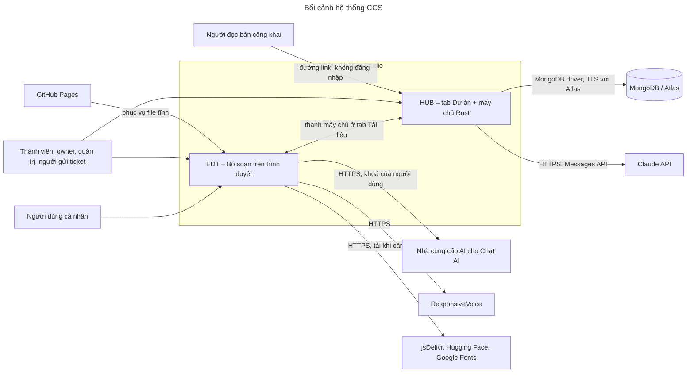

# Đặc tả yêu cầu hệ thống (SyRS) và chỉ mục SRS

| Thuộc tính | Giá trị |
|---|---|
| Mã tài liệu | CCS-SyRS-000 |
| Phiên bản | 0.1 |
| Ngày | 2026-11-18 |
| Trạng thái | Dự thảo – viết từ hệ thống đang chạy |
| Quy trình ISO/IEC/IEEE 12207 | 6.4.3 System/Software Requirements Definition |
| Chuẩn tham chiếu | ISO/IEC/IEEE 29148 §9.4 |
| Nguồn đã khảo sát | `README.md`, `desc.txt`, `backend/README.md`, `backend/docs/DECISIONS.md`, `backend/.env.example`, `backend/apps/server/src/app.rs`, `backend/crates/platform/src/config.rs`, `backend/crates/platform/src/mongo.rs`, `backend/crates/platform/src/outbox.rs`, `backend/crates/identity/src/service.rs`, `backend/crates/kernel/src/`, `backend/crates/documents/src/`, `backend/crates/tickets/src/ai.rs`, `backend/Dockerfile`, `backend/deploy/docker-compose.yml`, `index.html`, `sw.js`, `js/*.js` |
| Đơn vị ban hành | Nhóm phát triển ChillCat Studio |
| Tài liệu liên quan | ↑ [StRS-00](StRS-00_Yeu_cau_cac_ben_lien_quan.md) · ↓ [SRS-EDT](SRS-EDT_Bo_soan_tren_trinh_duyet.md) · [SRS-HUB](SRS-HUB_Lam_viec_nhom.md) · [SAD-00](../03_Kien_truc/SAD-00_Kien_truc_tong_the.md) · [ICD-00](../06_Giao_dien_tich_hop/ICD-00_Tong_quan_tich_hop.md) · ⇄ [RTM-00 §4](../00_Quan_ly_tai_lieu/RTM-00_Ma_tran_truy_vet.md) |

---

## 1. Mục tiêu

Nhìn hệ thống CCS – ChillCat Studio như một khối: nó phải làm những việc lớn nào, hệ thống con nào nhận việc nào, chất lượng chung phải đạt mức nào và nó nối ra bên ngoài ở đâu. Chi tiết từng việc nằm trong SRS của hệ thống con nhận việc đó (§3).

Tài liệu được viết lại từ hệ thống đang chạy ([CONV §5](../00_Quan_ly_tai_lieu/CONV_Quy_uoc_tai_lieu_va_ky_hieu.md)): mỗi việc lớn ghi chỗ trong mã hiện thực nó.

## 2. Phạm vi hệ thống

CCS gồm hai hệ thống con của cùng một sản phẩm ([CONV §3.1](../00_Quan_ly_tai_lieu/CONV_Quy_uoc_tai_lieu_va_ky_hieu.md)):

- **EDT – Bộ soạn trên trình duyệt:** ứng dụng web tĩnh (HTML, CSS, JavaScript thuần, không build) gồm các tab Tài liệu, Diagram, Thiết kế trang, Hướng dẫn, Cài đặt, khung Chat AI và giọng nói. Dữ liệu ở `localStorage` của trình duyệt; chạy offline nhờ service worker.
- **HUB – Làm việc nhóm:** tab **Dự án** trong cùng ứng dụng và máy chủ Rust trong `backend/` (một tiến trình phục vụ cả API `/api/v1` lẫn file giao diện), CSDL MongoDB.

### 2.1 Bối cảnh

### 2.2 Chế độ hoạt động

| Chế độ | Có gì | Cần gì |
|---|---|---|
| EDT một mình | Mọi tab trừ Dự án; dữ liệu ở trình duyệt | Trình duyệt; mạng chỉ cần khi tải lần đầu hoặc dùng dịch vụ ngoài |
| EDT + HUB cùng origin | Thêm tab Dự án; máy chủ phục vụ cả giao diện (`STATIC_DIR`) và API | Máy chủ HUB + MongoDB replica set hoặc Atlas; refresh token trong cookie HttpOnly |
| EDT + HUB khác origin | Giao diện ở tên miền khác (ví dụ GitHub Pages), API ở máy chủ | `CORS_ALLOWED_ORIGINS`; refresh token giữ trong `localStorage` (`js/api.js`) |
| HUB không AI / có AI | `AI_PROVIDER=none`: kiểm tra trùng bằng so khớp từ khoá, không gửi dữ liệu ra ngoài; `anthropic`: gọi Claude | `AI_API_KEY` khi dùng Claude |

### 2.3 Ngoài phạm vi

- Gửi e-mail: lời mời và thông báo chỉ hiện trong ứng dụng (không có mã gửi thư trong `backend/`).
- Đăng nhập một lần qua hệ thống định danh ngoài: chỉ có tài khoản e-mail + mật khẩu của HUB.
- Nhiều người cùng sửa một bản dự thảo: mỗi bản có đúng một người được chỉ định sửa.
- Sao lưu dữ liệu: thuộc hạ tầng (volume Docker, Atlas) – xem StR-29 ở §7.
- Ứng dụng di động riêng, tính phí.

## 3. Danh sách SRS

Dự án chỉ có một sản phẩm nên bỏ cột Sản phẩm ([CONV §3.2](../00_Quan_ly_tai_lieu/CONV_Quy_uoc_tai_lieu_va_ky_hieu.md)).

| Hệ thống con | Tài liệu | Module | Use case | FR | NFR | BR |
|---|---|---|---|---|---|---|
| EDT – Bộ soạn trên trình duyệt | [SRS-EDT](SRS-EDT_Bo_soan_tren_trinh_duyet.md) | `DOC`, `DGM`, `DSG`, `AIC`, `GDE`, `SET`, `VOI`, `PWA` | Đang lập – xem SRS-EDT §4 | Đang lập – SRS-EDT §5 | Đang lập – SRS-EDT §6 | Đang lập – SRS-EDT §7 |
| HUB – Làm việc nhóm | [SRS-HUB](SRS-HUB_Lam_viec_nhom.md) | `IDN`, `WSP`, `DOC`, `TRC`, `TKT`, `NTF`, `AUD`, `PLT` | Đang lập – xem SRS-HUB §4 | Đang lập – SRS-HUB §5 | Đang lập – SRS-HUB §6 | Đang lập – SRS-HUB §7 |

## 4. Việc lớn của hệ thống và hệ thống con đảm nhận

● chịu trách nhiệm chính · ○ có tham gia. Cột **Hiện thực bởi** ghi SRS và module nhận việc, kèm mã nguồn chính; mã `FR-…` cụ thể do SRS cấp và được gom ở [RTM-00](../00_Quan_ly_tai_lieu/RTM-00_Ma_tran_truy_vet.md).

| Mã | Việc lớn | EDT | HUB | Nhu cầu | Hiện thực bởi |
|---|---|---|---|---|---|
| SYS-F01 | Soạn và xem tài liệu Markdown: soạn trực quan và chế độ developer, mở / lưu file `.md`, cú pháp mở rộng (công thức, Mermaid, chú thích…), xuất HTML | ● | | StR-02 | SRS-EDT `DOC` – `js/docs.js`, `js/markdown.js`, `js/md-rich.js` |
| SYS-F02 | Thư viện mẫu tài liệu: chọn mẫu, gợi ý mẫu tiếp theo, điền mã dự án / hệ thống con / module / số quy trình | ● | ○ | StR-01 | SRS-EDT `DOC` – `js/doc-library.js`; SRS-HUB `DOC` – `backend/crates/documents/src/catalog.rs`, `template.rs#instantiate` |
| SYS-F03 | Vẽ diagram trên whiteboard (Flowchart, BPMN 2.0, UML, ERD), mẫu diagram, nhúng vào tài liệu dạng JSON + SVG, xuất JSON / SVG / PNG | ● | | StR-03 | SRS-EDT `DGM` – `js/editor.js`, `js/shapes.js`, `js/render.js`, `js/store.js`, `js/export.js` |
| SYS-F04 | Dịch Mermaid / PlantUML thành diagram của app, chạy offline | ● | | StR-03 | SRS-EDT `DGM` – `js/plantuml.js` |
| SYS-F05 | Thiết kế trang web bằng kéo thả, nhập trang HTML, xem thử, xuất file HTML | ● | | StR-04 | SRS-EDT `DSG` – `js/page-kit.js`, `js/page-editor.js`, `js/page-import.js` |
| SYS-F06 | Chat AI theo tab đang mở: nhiều nhà cung cấp, skill, effort / thinking, áp dụng kết quả và hoàn tác, copy context | ● | | StR-05 | SRS-EDT `AIC` – `js/ai.js`, `js/skill.js`, `js/ui.js` |
| SYS-F07 | Giọng nói: nhận dạng (trình duyệt hoặc offline), lệnh giọng nói, đọc phản hồi, rảnh tay | ● | | StR-06 | SRS-EDT `VOI` – `js/voice.js` |
| SYS-F08 | Chạy offline, cài như ứng dụng, tự lưu dữ liệu trong trình duyệt | ● | | StR-07 | SRS-EDT `PWA` – `sw.js`, `js/main.js`, `manifest.webmanifest` |
| SYS-F09 | Hướng dẫn sử dụng trong app và trang cài đặt chung | ● | | StR-08 | SRS-EDT `GDE` – `js/guide.js`; `SET` – `js/settings.js` |
| SYS-F10 | Tài khoản và phiên đăng nhập: đăng ký, đăng nhập, làm mới, đăng xuất, hồ sơ, đổi mật khẩu | | ● | StR-26 | SRS-HUB `IDN` – `backend/crates/identity/`, `js/api.js` |
| SYS-F11 | Workspace, group, hệ thống con, thành viên, lời mời, chuyển quyền owner, danh bạ dự án | | ● | StR-09 | SRS-HUB `WSP` – `backend/crates/workspaces/`, `js/hub.js` |
| SYS-F12 | Tính và kiểm tra quyền theo phạm vi (quyền người dùng, quyền tài liệu, kéo theo, không cấp quá quyền mình có) | | ● | StR-10, StR-30 | SRS-HUB `WSP` – `backend/crates/kernel/src/perms.rs`, `backend/crates/kernel/src/contracts/access.rs`, `backend/crates/workspaces/src/members.rs`; `DOC` – `backend/crates/documents/src/policy.rs` |
| SYS-F13 | Tài liệu theo loại mẫu: tạo, mã tài liệu tự sinh, chặn tạo trùng theo số bản, quan hệ ↑ ⇄, lưu trữ, xoá | | ● | StR-01, StR-16 | SRS-HUB `DOC` – `backend/crates/documents/src/service.rs#create`, `#add_link`, `#set_archived`, `#delete` |
| SYS-F14 | Vòng đời phiên bản: Dự thảo → Chờ duyệt → Đã duyệt → Đã phát hành → Thay thế; người được chỉ định sửa; kiểm tra khi chuyển trạng thái; đánh số và lịch sử thay đổi tự ghi | ○ | ● | StR-11, StR-12 | SRS-HUB `DOC` – `backend/crates/documents/src/lifecycle.rs`, `template.rs`, `js/hub-docs.js` |
| SYS-F15 | Soạn tài liệu của máy chủ ngay trong tab Tài liệu: thanh máy chủ, lưu có khoá lạc quan, kiểm tra mã khi soạn, chỉ đọc khi bản đã khoá | ○ | ● | StR-18 | SRS-HUB `DOC` – `js/hub-docs.js#HUB.renderDocBar`, `#HUB.saveServerDoc`; SRS-EDT `DOC` – `js/docs.js` |
| SYS-F16 | Mức bảo mật của bản phát hành và trang xem công khai không cần đăng nhập | | ● | StR-14, StR-15 | SRS-HUB `DOC` – `backend/crates/documents/src/policy.rs#can_view_released`, `integration.rs#public_document` |
| SYS-F17 | Nhận xét theo phiên bản: tạo, trả lời, sửa, xoá, đánh dấu đã giải quyết | | ● | StR-13 | SRS-HUB `DOC` – `backend/crates/documents/src/comments.rs` |
| SYS-F18 | Đọc mã truy vết, sổ mã của workspace, cảnh báo mã chưa có / đã bỏ / định nghĩa trùng, cờ Cần rà soát | | ● | StR-16, StR-17 | SRS-HUB `TRC` – `backend/crates/traceability/` |
| SYS-F19 | Ticket góp ý / báo lỗi: gửi, theo dõi, đổi trạng thái, giao người, đánh dấu trùng; quyền xem / xử lý ticket, uỷ quyền | | ● | StR-19, StR-20 | SRS-HUB `TKT` – `backend/crates/tickets/src/service.rs`, `js/hub-tickets.js` |
| SYS-F20 | AI kiểm tra trùng ticket và đề xuất sửa tài liệu, theo quyền của người được AI thay mặt; uỷ quyền AI tự chạy | | ● | StR-21 | SRS-HUB `TKT` – `backend/crates/tickets/src/runs.rs`, `ai.rs` |
| SYS-F21 | Thông báo trong ứng dụng từ sự kiện: tạo, đếm chưa đọc, đánh dấu đã đọc | | ● | StR-22 | SRS-HUB `NTF` – `backend/crates/notifications/`, `js/hub.js#poll` |
| SYS-F22 | Nhật ký thao tác theo workspace và toàn hệ thống | | ● | StR-23 | SRS-HUB `AUD` – `backend/crates/audit/` |
| SYS-F23 | Lưu trữ theo thời hạn và tự xoá: bản Thay thế 10 năm, nhật ký 2 năm, thông báo 180 ngày, phiên đã thu hồi | | ● | StR-24 | SRS-HUB `DOC` – `integration.rs#purge_expired_versions`; `AUD`, `NTF` – chỉ mục TTL; `IDN` – `#purge_revoked_sessions` |
| SYS-F24 | Quản trị tài khoản: danh sách, khoá / mở khoá, vai trò quản trị | | ● | StR-25 | SRS-HUB `IDN` – `backend/crates/identity/src/service.rs#admin_list`, `#admin_update` |
| SYS-F25 | Phục vụ giao diện và API trong một tiến trình, cấu hình bằng biến môi trường, kiểm tra sống / sẵn sàng, tác vụ định kỳ | ○ | ● | StR-27, StR-28 | SRS-HUB `PLT` – `backend/apps/server/src/app.rs`, `backend/crates/platform/src/config.rs` |

StR-29 (sao lưu và khôi phục) chưa có việc lớn tương ứng – hệ thống chưa làm (§7). StR-31, StR-32, StR-33 được đáp ứng bằng yêu cầu chất lượng ở §5. StR-34 thuộc quy trình quản lý thông tin của dự án ([LCP-00](../00_Quan_ly_tai_lieu/LCP-00_Ke_hoach_vong_doi_phan_mem.md)), không phải việc của hệ thống.

## 5. Yêu cầu chất lượng chung

| Mã | Loại | Yêu cầu | Đo bằng | Nhu cầu / ràng buộc | Hiện thực bởi | Hiện nay |
|---|---|---|---|---|---|---|
| SYS-N01 | Bảo mật – đặc quyền tối thiểu | Không ai có quyền mặc định theo vai trò ngoài mức tối thiểu: workspace owner chỉ xem + nhận xét tài liệu và không có quyền ticket cho tới khi tự cấp; quản trị hệ thống không mặc nhiên xem tài liệu / ticket; không ai cấp quá quyền mình có; mọi lần cấp quyền vào nhật ký | Kiểm thử quyền trên MongoDB thật (`backend/crates/workspaces/tests/permissions.rs`, `backend/crates/tickets/tests/tickets.rs`); dò nhật ký sau mỗi lần cấp | StR-10, StC-09 | SRS-HUB §6 – `backend/crates/kernel/src/perms.rs`, `backend/crates/workspaces/src/members.rs#check_change`, quyết định #2, #11 | Đủ |
| SYS-N02 | Bảo mật – xác thực và phiên | Access token JWT sống 15 phút, kiểm tra tại chỗ ở mọi module; refresh token xoay vòng mỗi lần dùng, dùng lại token cũ ⇒ thu hồi cả phiên; cookie HttpOnly `cc_refresh` (`Secure` khi `https`); mật khẩu băm Argon2id; 5 lần sai liên tiếp ⇒ khoá đăng nhập 5 phút; `JWT_SECRET` ít nhất 32 ký tự, bắt buộc ở `APP_ENV=prod` | `ACCESS_TOKEN_TTL_SECS=900`; bài kiểm thử `backend/crates/platform/src/jwt.rs`; smoke `backend/scripts/smoke.mjs` | StR-26 | SRS-HUB §6 – `backend/crates/identity/src/service.rs#login`, `#refresh`, `backend/crates/identity/src/password.rs`, `backend/crates/platform/src/jwt.rs` | Đủ |
| SYS-N03 | Bảo mật – cách ly dữ liệu theo quyền người xem | Không được xem thì trả `404` (không lộ là có); kết quả AI, thông báo, danh sách chỉ chứa dữ liệu người xem được phép thấy; AI không xem dữ liệu vượt quá quyền hiện hành của người được thay mặt | Ma trận quyền xem trong `backend/crates/documents/src/policy.rs` (kiểm thử); ứng viên / đề xuất ngoài quyền bị ẩn và chỉ ghi số lượng | StR-30, StC-07 | SRS-HUB §6 – `policy.rs#can_view`, `backend/crates/tickets/src/runs.rs`, quyết định #41 | Đủ |
| SYS-N04 | Bảo mật – nội dung chạy trong trình duyệt | HTML trong Markdown được làm sạch trước khi hiển thị; trang thiết kế / trang nhập chạy trong `iframe sandbox` không có `allow-same-origin`; thư viện CDN có mã toàn vẹn (SRI); khoá API AI chỉ lưu ở `localStorage` và chỉ gửi tới nhà cung cấp đã chọn; máy chủ gửi `X-Content-Type-Options`, `Referrer-Policy`, `X-Frame-Options` | Rà mã: `js/markdown.js#sanitize`, thuộc tính `sandbox` ở `js/page-editor.js`, `js/page-import.js`, `integrity` ở `js/md-rich.js`; tiêu đề phản hồi của máy chủ | StR-05, StR-30, StC-14 | SRS-EDT §6; SRS-HUB §6 – `backend/apps/server/src/app.rs#build` | Đủ theo thiết kế; rủi ro của việc giữ khoá trong `localStorage` đánh giá ở [ASM-00](../09_Danh_gia_hien_trang/ASM-00_Danh_gia_hien_trang.md) |
| SYS-N05 | Toàn vẹn dữ liệu | Thay đổi nhiều collection chạy trong transaction (read concern `snapshot`, write concern `majority`, tự thử lại khi lỗi tạm thời); sự kiện ghi vào outbox trong cùng transaction; lưu nội dung có khoá lạc quan (`revision`); chỉ mục duy nhất chặn tạo trùng tài liệu và hai bản đang soạn | Kiểm thử vòng đời `backend/crates/documents/tests/lifecycle.rs` (khoá lạc quan); lỗi `409` khi lưu đè | StR-11, StR-16, StC-02 | SRS-HUB §6 – `backend/crates/platform/src/mongo.rs#with_txn`, `backend/crates/platform/src/outbox.rs`, `backend/crates/documents/src/lifecycle.rs` | Đủ |
| SYS-N06 | Khả dụng | Khởi động lại máy chủ không mất phiên và dữ liệu; báo chưa sẵn sàng khi MongoDB không trả lời; tự thử lại đọc / ghi và transaction khi Atlas đổi primary | `docker compose down` / `up` giữ dữ liệu volume và phiên; `/readyz` trả `503` khi MongoDB không trả lời; ảnh Docker healthy sau khởi động (đo 16 giây ngày 2026-11-18) | StR-26, StR-28, StC-11 | SRS-HUB §6 – `backend/apps/server/src/app.rs#readyz`, `backend/crates/platform/src/mongo.rs#connect`, `backend/Dockerfile` | Đủ cho một máy; chưa có mục tiêu thời gian hoạt động |
| SYS-N07 | Hiệu năng | Chưa có chỉ tiêu đo được. Hiện có: nén gzip, giới hạn thân yêu cầu 16 MB (`REQUEST_BODY_LIMIT_MB`), tối đa 20 kết nối MongoDB (`MONGODB_MAX_POOL`), AI hết giờ sau 300 giây (`AI_TIMEOUT_SECS`); EDT chỉ tải thư viện CDN khi tài liệu cần | – | – (chưa có nhu cầu đo được) | SRS-EDT §6, SRS-HUB §6 | Chưa có chỉ tiêu |
| SYS-N08 | Khả năng tách dịch vụ | Mỗi module nghiệp vụ là một crate chỉ phụ thuộc `kernel` và `platform`; gọi module khác qua trait trong `kernel::contracts`; mỗi module sở hữu collection riêng (tách được CSDL bằng `MONGODB_DB_<MODULE>`); phản ứng giữa module qua sự kiện miền và outbox | Rà `Cargo.toml` của từng crate: không phụ thuộc crate nghiệp vụ khác; `apps/server` là nơi duy nhất nối trait với phần cài đặt | StR-31, StC-03 | SRS-HUB §6 – `backend/apps/server/src/app.rs#build`, `backend/crates/kernel/src/contracts/`, `backend/crates/kernel/src/events.rs` | Có nhưng chưa dùng (chưa tách dịch vụ nào) |
| SYS-N09 | Khả năng di chuyển sang Atlas | Cùng một bản build chạy với replica set tự quản hoặc MongoDB Atlas, chỉ đổi `MONGODB_URI`; dùng Stable API v1; chỉ mục tự tạo khi khởi động | Chạy kiểm thử và Docker với replica set một node; Atlas: chưa đo | StR-27, StC-02, StC-04 | SRS-HUB §6 – `backend/crates/platform/src/mongo.rs#connect`, `#ensure_indexes` | Một phần – chưa kiểm chứng trên Atlas thật |
| SYS-N10 | Lưu trữ theo thời hạn | Bản Thay thế giữ 10 năm kể từ lúc bị thay thế rồi tự xoá; nhật ký giữ 2 năm; thông báo 180 ngày; thời hạn đổi được bằng biến môi trường | `VERSION_RETENTION_YEARS=10`, `AUDIT_RETENTION_DAYS=730`; chỉ mục TTL có trên collection nhật ký, thông báo | StR-24, StC-08 | SRS-HUB §6 – `backend/crates/documents/src/integration.rs#purge_expired_versions`, `backend/crates/audit/src/lib.rs`, `backend/crates/notifications/src/lib.rs` | Đủ (mốc tính nhật ký chưa chốt) |
| SYS-N11 | Khả năng truy vết thao tác | Mọi thay đổi quyền, thành viên, trạng thái tài liệu, mức bảo mật, quyền ticket và xử lý ticket để lại một dòng nhật ký có người làm, thời điểm, đối tượng | Đếm sự kiện có cờ `audit` so với dòng nhật ký sinh ra | StR-23 | SRS-HUB §6 – `backend/crates/kernel/src/events.rs#audit`, `backend/crates/audit/src/lib.rs#record` | Đủ |
| SYS-N12 | Tiếng Việt | Giao diện, hướng dẫn, thông báo và mọi thông báo lỗi API (`message`) bằng tiếng Việt; mã lỗi máy đọc (`code`) giữ tiếng Anh | Rà phản hồi lỗi: `{ "error": { "code", "message" } }` | StR-33, StC-06 | SRS-EDT §6, SRS-HUB §6 – `backend/crates/platform/src/http.rs`, `js/api.js` | Đủ |
| SYS-N13 | Chạy offline (EDT) | Sau lần mở đầu qua `http(s)`, mọi tab trừ Dự án mở và dùng được khi mất mạng; dịch vụ ngoài (AI, giọng đọc online, thư viện CDN chưa tải) báo rõ khi không có mạng | Tắt mạng rồi mở lại app, soạn, tự lưu | StR-07 | SRS-EDT §6 – `sw.js` (network-first, cache-first cho CDN, bỏ qua `/api/`) | Đủ |
| SYS-N14 | Khả năng kiểm thử | Mỗi tầng có kiểm thử tự động chạy bằng một lệnh: đơn vị và tích hợp trên MongoDB thật (CSDL tạm tự xoá), HTTP đầu-cuối, giao diện Chrome headless | 2026-11-18: `cargo test --workspace` 49 bài đạt, clippy 0 cảnh báo; smoke 26/26; giao diện 25/25 và 40/40 | StR-32 | [STP-00](../07_Kiem_thu/STP-00_Ke_hoach_kiem_thu.md) – `backend/scripts/smoke.mjs`, `backend/scripts/e2e/` | Đủ |
| SYS-N15 | Không bước build, chạy trên trình duyệt phổ biến | Giao diện là file tĩnh chạy ngay trên Chrome / Edge / Firefox, kể cả mở bằng `file://` (khi đó mẫu tài liệu tải từ bản online); phục vụ được bằng bất kỳ web server tĩnh nào | Mở `index.html` trực tiếp; phục vụ bằng `npx serve .` | StC-05 | SRS-EDT §6 – `index.html`, `js/doc-library.js#fetchTemplate` | Đủ |
| SYS-N16 | Quan sát được | Log có cấu trúc (JSON khi `LOG_FORMAT=json`), mức log đặt bằng `RUST_LOG`; mỗi yêu cầu HTTP được ghi vết; tác vụ định kỳ và relay sự kiện ghi lỗi vào log | `docker compose logs -f app` | StR-28 | SRS-HUB §6 – `backend/apps/server/src/main.rs`, `backend/apps/server/src/app.rs#spawn_jobs` | Đủ |

StC-01 (máy chủ viết bằng Rust) và StC-10 (bộ tài liệu theo chuẩn ISO/IEC/IEEE) ràng buộc cách làm chứ không phải chất lượng của hệ thống; [SAD-00 §2](../03_Kien_truc/SAD-00_Kien_truc_tong_the.md) và [LCP-00](../00_Quan_ly_tai_lieu/LCP-00_Ke_hoach_vong_doi_phan_mem.md) dùng chúng.

## 6. Kết nối ra bên ngoài

Điểm tích hợp chi tiết (`I-nn`) do [ICD-00 §4](../06_Giao_dien_tich_hop/ICD-00_Tong_quan_tich_hop.md) cấp.

| Mã | Kết nối với | Hệ thống con | Chi tiết |
|---|---|---|---|
| SYS-I01 | **MongoDB** – replica set tự quản (Docker `mongo:8.0`, replica set `rs0`) hoặc **MongoDB Atlas** | HUB | Driver MongoDB chính thức; chuỗi kết nối `MONGODB_URI`, CSDL `MONGODB_DB`; transaction, `w=majority`, Stable API v1 – [ICD-00 §4](../06_Giao_dien_tich_hop/ICD-00_Tong_quan_tich_hop.md) |
| SYS-I02 | **Claude API** (Anthropic Messages API) cho kiểm tra trùng và đề xuất sửa tài liệu | HUB | HTTPS, chỉ khi `AI_PROVIDER=anthropic`; `AI_API_KEY`, `AI_MODEL`, `AI_BASE_URL`, `AI_TIMEOUT_SECS`, `AI_FALLBACKS`; trả JSON theo schema, thử lại khi 429 / 5xx / 529 – `backend/crates/tickets/src/ai.rs`, [ICD-00 §4](../06_Giao_dien_tich_hop/ICD-00_Tong_quan_tich_hop.md) |
| SYS-I03 | **Nhà cung cấp AI của Chat AI**: Google Gemini, OpenAI, Anthropic, OpenRouter, Groq, Cerebras, Mistral, Hugging Face, Ollama, LM Studio, máy chủ kiểu OpenAI tuỳ chỉnh | EDT | Gọi thẳng từ trình duyệt bằng khoá của người dùng (cần CORS phía nhà cung cấp); máy chạy cục bộ dùng địa chỉ máy chủ thay cho khoá – `js/ai.js#PROVIDERS`, [ICD-00 §4](../06_Giao_dien_tich_hop/ICD-00_Tong_quan_tich_hop.md) |
| SYS-I04 | **ResponsiveVoice** – giọng đọc online | EDT | SDK tải khi cần từ `cdn.responsivevoice.org`; giấy phép phi thương mại (StC-13); khoá chỉ chạy trên tên miền đã khai báo; lỗi thì chuyển sang `speechSynthesis` của trình duyệt – `js/voice.js`, [ICD-00 §4](../06_Giao_dien_tich_hop/ICD-00_Tong_quan_tich_hop.md) |
| SYS-I05 | **GitHub Pages** và tên miền `design.trungctr.com` | EDT | Phục vụ bản EDT công khai (nhánh `main`, thư mục `/`; StC-12); khi app mở bằng `file://`, mẫu tài liệu tải từ `https://design.trungctr.com/templates/` – `README.md` §Triển khai, `js/doc-library.js#fetchTemplate`, [ICD-00 §4](../06_Giao_dien_tich_hop/ICD-00_Tong_quan_tich_hop.md) |
| SYS-I06 | **CDN và kho mô hình**: jsDelivr (Mermaid, KaTeX, highlight.js, emoji, transformers.js), Hugging Face (mô hình nhận dạng giọng nói Moonshine), Google Fonts (font cho trang thiết kế) | EDT | HTTPS, chỉ tải khi cần; file CDN có số phiên bản và mã toàn vẹn, được cache riêng để dùng offline – `js/md-rich.js`, `js/voice.js`, `js/page-kit.js`, `sw.js`, [ICD-00 §4](../06_Giao_dien_tich_hop/ICD-00_Tong_quan_tich_hop.md) |
| SYS-I07 | **Trình duyệt**: `localStorage`, Cache Storage, service worker, Web Speech API (có thể gửi âm thanh tới máy chủ nhận dạng của hãng trình duyệt), micro, File System Access, cài đặt PWA | EDT, HUB (giao diện) | API của trình duyệt Chrome / Edge / Firefox – `js/main.js`, `sw.js`, `js/voice.js`, `js/docs.js`, `js/api.js`, [ICD-00 §4](../06_Giao_dien_tich_hop/ICD-00_Tong_quan_tich_hop.md) |

## 7. Vấn đề còn mở

- **Số lượng UC / FR / NFR / BR** ở §3 và mã `FR-…`, `NFR-…` ở cột "Hiện thực bởi" chưa điền được vì SRS-EDT, SRS-HUB đang lập; sẽ gom ở RTM-00.
- **StR-29 – sao lưu và khôi phục** chưa có việc lớn nào đáp ứng; chưa chốt có làm trong hệ thống hay giao cho hạ tầng.
- **SYS-N07 – hiệu năng** chưa có chỉ tiêu (thời gian phản hồi, số người dùng cùng lúc, kích thước tài liệu lớn nhất).
- **SYS-N06 – khả dụng** chưa có mục tiêu thời gian hoạt động; cách chạy hiện tại là một máy chủ, MongoDB một node khi dùng Docker.
- **SYS-N09** chưa kiểm chứng trên cụm MongoDB Atlas thật.
- **SYS-I03, SYS-I07:** Chat AI và nhận dạng giọng nói của trình duyệt gửi nội dung / âm thanh ra ngoài theo lựa chọn của người dùng; chưa có tài liệu nói rõ cho người dùng EDT dữ liệu nào rời máy **(suy luận)** – đánh giá ở ASM-00.
- Sơ đồ đang ở dạng Mermaid – đổi sang sơ đồ nhúng bằng ChillCat Studio trước khi phát hành 1.0.

## 8. Lịch sử thay đổi

| Phiên bản | Ngày | Mô tả | Người thực hiện |
|---|---|---|---|
| 0.1 | 2026-11-18 | Khởi tạo từ bộ mẫu, viết lại từ hệ thống đang chạy | Nhóm phát triển ChillCat Studio |
