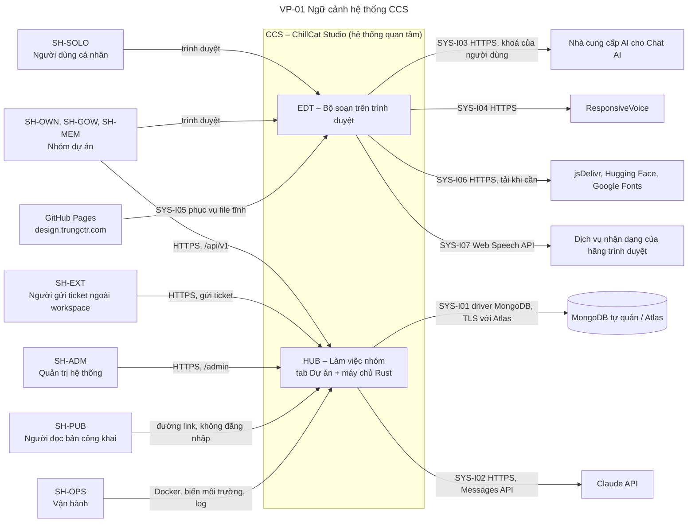
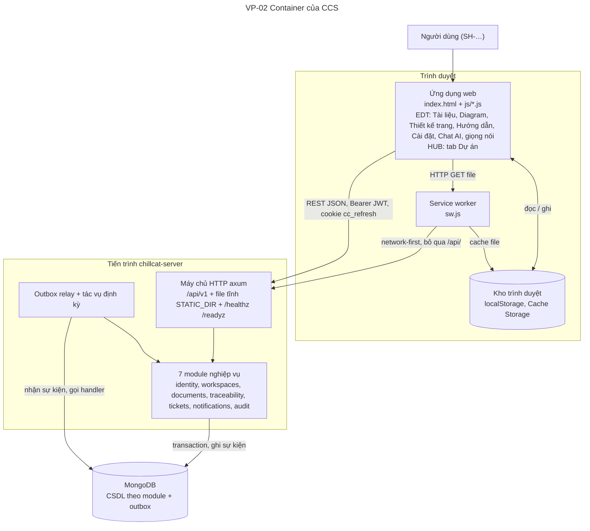
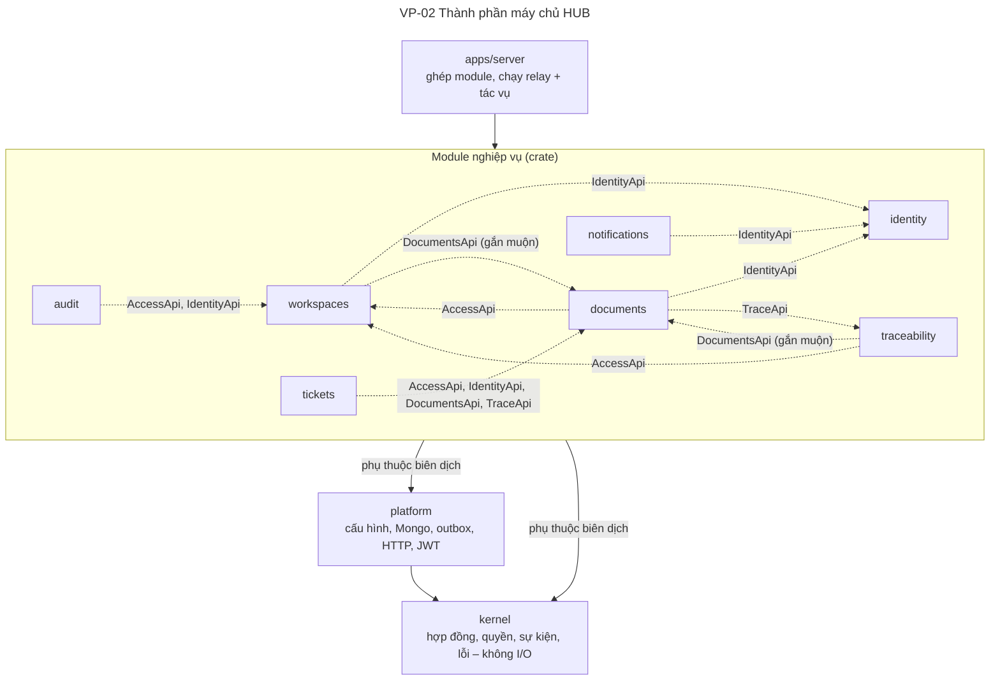
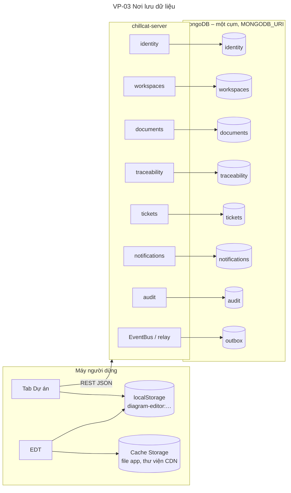
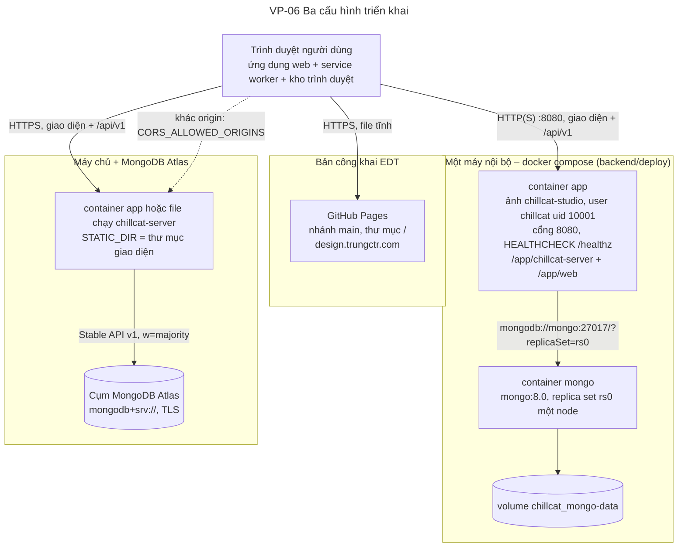
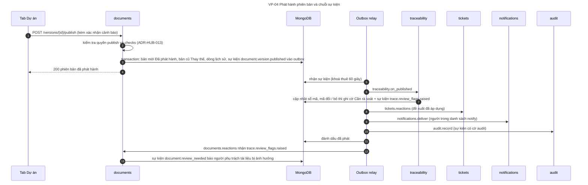
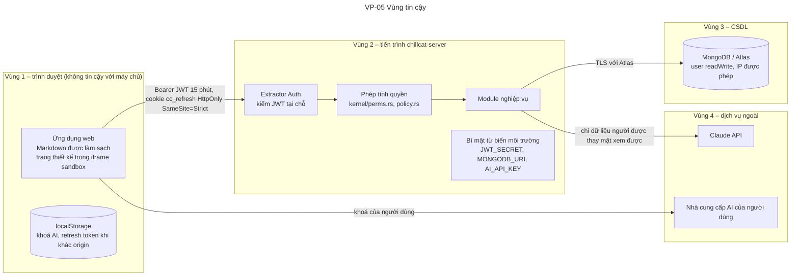
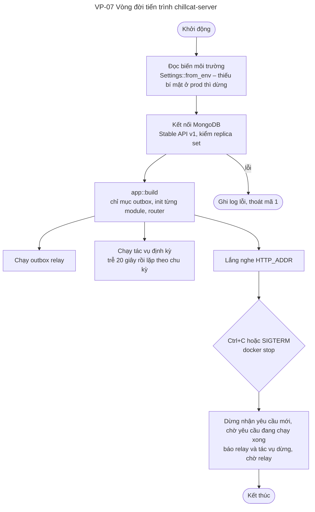
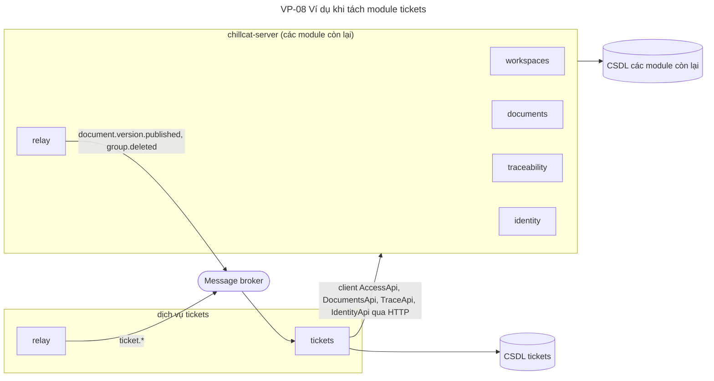

# Mô tả kiến trúc tổng thể (SAD) – CCS ChillCat Studio

| Thuộc tính | Giá trị |
|---|---|
| Mã tài liệu | CCS-SAD-000 |
| Phiên bản | 0.1 |
| Ngày | 2026-11-18 |
| Trạng thái | Dự thảo – viết từ hệ thống đang chạy |
| Quy trình ISO/IEC/IEEE 12207 | 6.4.4 Architecture Definition |
| Chuẩn tham chiếu | ISO/IEC/IEEE 42010:2022 (mô tả kiến trúc), C4 model (ký hiệu ngữ cảnh / container / thành phần / triển khai), UML 2.5 (sequence) |
| Nguồn đã khảo sát | `README.md`, `index.html`, `sw.js`, `manifest.webmanifest`, `js/*.js`, `CNAME`, `.nojekyll`, `backend/README.md`, `backend/docs/DECISIONS.md`, `backend/Cargo.toml`, `backend/crates/*/Cargo.toml`, `backend/apps/server/src/main.rs`, `backend/apps/server/src/app.rs`, `backend/crates/kernel/src/contracts/`, `backend/crates/kernel/src/perms.rs`, `backend/crates/kernel/src/events.rs`, `backend/crates/platform/src/config.rs`, `backend/crates/platform/src/mongo.rs`, `backend/crates/platform/src/outbox.rs`, `backend/crates/platform/src/http.rs`, `backend/crates/platform/src/module.rs`, `backend/crates/*/src/lib.rs`, `backend/crates/*/src/service.rs`, `backend/crates/documents/src/policy.rs`, `backend/crates/tickets/src/runs.rs`, `backend/crates/tickets/src/ai.rs`, `backend/Dockerfile`, `backend/deploy/docker-compose.yml`, `git log --oneline` |
| Đơn vị ban hành | Nhóm phát triển ChillCat Studio |
| Tài liệu liên quan | ↑ [SyRS-00](../02_Yeu_cau/SyRS-00_Yeu_cau_he_thong.md) · [StRS-00 §2, §4](../02_Yeu_cau/StRS-00_Yeu_cau_cac_ben_lien_quan.md) · [BMA-00](../01_Phan_tich_nghiep_vu/BMA-00_Tong_quan_nghiep_vu.md) · ↓ [ADR-00](ADR/ADR-00_So_dang_ky_quyet_dinh_nen_tang.md) · [ADR-HUB](ADR/ADR-HUB_So_dang_ky_quyet_dinh_kien_truc.md) · [SDD-EDT](../04_Thiet_ke_chi_tiet/SDD-EDT_Bo_soan_tren_trinh_duyet.md) · [SDD-HUB](../04_Thiet_ke_chi_tiet/SDD-HUB_Lam_viec_nhom.md) · [DBD-00](../05_Thiet_ke_du_lieu/DBD-00_Tong_quan_du_lieu.md) · [ERD-HUB](../05_Thiet_ke_du_lieu/ERD-HUB_CSDL_Lam_viec_nhom.md) · [ICD-00](../06_Giao_dien_tich_hop/ICD-00_Tong_quan_tich_hop.md) · [API-HUB](../06_Giao_dien_tich_hop/API-HUB_Lam_viec_nhom.md) · [DEP-00](../08_Trien_khai_van_hanh/DEP-00_Trien_khai_tong_the.md) · [OPS-00](../08_Trien_khai_van_hanh/OPS-00_So_tay_van_hanh.md) · ⇄ [RTM-00](../00_Quan_ly_tai_lieu/RTM-00_Ma_tran_truy_vet.md) · [ASM-00](../09_Danh_gia_hien_trang/ASM-00_Danh_gia_hien_trang.md) · [CMP-00](../09_Danh_gia_hien_trang/CMP-00_Danh_gia_tuan_thu_15289.md) |

---

## 1. Giới thiệu

### 1.1 Mục tiêu

Đọc tài liệu này trước SDD của từng hệ thống con: nó cho thấy hệ thống CCS – ChillCat Studio gồm những khối nào, ranh giới ở đâu, dữ liệu đi thế nào, chạy ở đâu và được bảo vệ ra sao.

Tài liệu là **mô tả kiến trúc** (architecture description – AD) theo ISO/IEC/IEEE 42010:2022: nó nêu bên liên quan và mối quan tâm của họ (§1.5), định nghĩa các viewpoint dùng để trả lời từng mối quan tâm (§1.6), trình bày một view cho mỗi viewpoint (§3–§8, §12), nối các phần tử với nhau (§13), ghi lý do kiến trúc (§14) và những chỗ chưa nhất quán đã biết (§15). Bảng tự kiểm theo chuẩn ở §16.

SAD chỉ giữ bức tranh tổng thể và **trỏ xuống** tài liệu chi tiết: danh sách CSDL ở DBD-00, collection ở ERD-HUB, ma trận tích hợp ở ICD-00, endpoint ở API-HUB, triển khai ở DEP-00, rủi ro ở ASM-00.

### 1.2 Ai đọc tài liệu này

| Ai đọc | Muốn biết | Đọc mục |
|---|---|---|
| SH-ADM | Ranh giới sản phẩm, chi phí, quyền của quản trị hệ thống | §3, §8, §14 |
| SH-OWN | Dữ liệu dự án được bảo vệ thế nào, giữ bao lâu, đi ra AI bên ngoài ra sao | §5, §8, §13.5 |
| SH-OPS | Triển khai, giám sát, khả năng mở rộng | §6, §9, §12.1 |
| SH-DEV | Trách nhiệm, sở hữu dữ liệu, tích hợp, cách tách dịch vụ | §4, §5, §7, §12.2, §13.3 |
| SH-AUD | Mô tả kiến trúc đáp ứng ISO/IEC/IEEE 42010 tới đâu | §1.4–§1.7, §13, §16 |

Mối quan tâm của các bên còn lại (SH-GOW, SH-MEM, SH-EXT, SH-PUB, SH-SOLO) ở bảng §1.5.

### 1.3 Các góc nhìn

Đi từ ngoài vào trong (ngữ cảnh rồi container và thành phần, theo mô hình C4), sau đó xem riêng từng nhóm mối quan tâm: dữ liệu, tương tác, bảo mật, triển khai, vận hành, khả năng tiến hoá, phát triển và tuân thủ. Mỗi góc nhìn là một **viewpoint** có mã `VP-nn` (§1.6); mỗi mục trình bày góc nhìn đó là **view** của nó và ghi rõ "View theo VP-nn" ở đầu mục (§1.7). Ký hiệu theo [CONV §7](../00_Quan_ly_tai_lieu/CONV_Quy_uoc_tai_lieu_va_ky_hieu.md).

### 1.4 Nhận diện mô tả kiến trúc và tổng quan

| Mục | Nội dung |
|---|---|
| Mô tả kiến trúc | CCS-SAD-000, phiên bản 0.1, ngày 2026-11-18, do Nhóm phát triển ChillCat Studio ban hành (bảng thuộc tính); lịch sử ở §18; thuật ngữ ở [GLOSSARY](../00_Quan_ly_tai_lieu/GLOSSARY_Thuat_ngu.md) |
| Hệ thống quan tâm | **CCS – ChillCat Studio**, bộ công cụ soạn tài liệu thiết kế phần mềm, gồm hai hệ thống con ([CONV §3.1](../00_Quan_ly_tai_lieu/CONV_Quy_uoc_tai_lieu_va_ky_hieu.md)): **EDT** – Bộ soạn trên trình duyệt; **HUB** – Làm việc nhóm (tab Dự án + máy chủ trong `backend/`) |
| Phiên bản hệ thống được mô tả | EDT: commit 750de89 cộng thay đổi chưa commit trong cây làm việc ngày 2026-11-18, service worker `VERSION = 'v14'`. HUB: workspace Cargo phiên bản 0.1.0 (`backend/Cargo.toml`), chưa nằm trong lịch sử git |
| Môi trường | Người dùng (SH-…, §1.5); trình duyệt Chrome / Edge / Firefox; GitHub Pages (`design.trungctr.com`); máy chủ nội bộ hoặc Docker; MongoDB replica set tự quản hoặc MongoDB Atlas; Claude API; nhà cung cấp AI do người dùng EDT chọn; CDN và kho mô hình; ResponsiveVoice – xem view ngữ cảnh §3. Chế độ hoạt động ở [SyRS-00 §2.2](../02_Yeu_cau/SyRS-00_Yeu_cau_he_thong.md) |
| Phạm vi của mô tả | Kiến trúc phần mềm của cả hai hệ thống con ở mức hệ thống, container và thành phần (crate Rust, nhóm file JS), cách triển khai và vận hành. Không gồm: thiết kế bên trong thành phần (SDD-EDT, SDD-HUB), cấu trúc collection (ERD-HUB), từng endpoint (API-HUB), hạ tầng mạng của tổ chức |
| Mục đích | Hiểu hệ thống trước khi sửa; làm căn cứ cho SDD, DEP-00, ICD-00; đánh giá rủi ro (ASM-00) và mức tuân thủ (CMP-00); quyết định khi nào và tách module nào thành dịch vụ |
| Chuẩn áp dụng | ISO/IEC/IEEE 42010:2022 – cấu trúc của mô tả kiến trúc; ISO/IEC/IEEE 12207:2017 quy trình 6.4.4 Architecture Definition; ISO/IEC/IEEE 15289:2019 – tài liệu thuộc loại hạng mục thông tin "description" ([LCP-00](../00_Quan_ly_tai_lieu/LCP-00_Ke_hoach_vong_doi_phan_mem.md)) |
| Khung mô tả và ngôn ngữ | Không tuyên bố theo một khung mô tả kiến trúc (architecture description framework) có tên. Viewpoint được định nghĩa ngay trong tài liệu này (§1.6); ký hiệu C4 (cấp 1–3 và triển khai) và UML sequence, vẽ tạm bằng Mermaid ([CONV §7.1](../00_Quan_ly_tai_lieu/CONV_Quy_uoc_tai_lieu_va_ky_hieu.md)) |
| Cách lập | Viết lại từ hệ thống đang chạy ([CONV §5](../00_Quan_ly_tai_lieu/CONV_Quy_uoc_tai_lieu_va_ky_hieu.md)): mỗi điều dựa vào vị trí trong mã; tự rút ra thì gắn **(suy luận)** |
| Bằng chứng hệ thống chạy đúng | Kiểm thử 2026-11-17/18: `cargo test --workspace` 49 bài đạt (unit + tích hợp trên MongoDB thật), clippy 0 cảnh báo; `backend/scripts/smoke.mjs` 26/26; giao diện Chrome headless 25/25 (một người) và 40/40 (nhóm hai người); Docker thật – ảnh 187 MB, app healthy sau 16 giây, `down` / `up` giữ dữ liệu – [STP-00](../07_Kiem_thu/STP-00_Ke_hoach_kiem_thu.md) |

**Tổng quan.** CCS là **một ứng dụng web** (một `index.html`) có hai phần. **EDT** chạy hoàn toàn trong trình duyệt: web tĩnh, JavaScript thuần không build, dữ liệu ở `localStorage`, chạy offline nhờ service worker, gọi AI thẳng từ trình duyệt. **HUB** thêm tab Dự án và một **máy chủ Rust** – một tiến trình monolith chia thành bảy module nghiệp vụ độc lập (crate), nối nhau qua hợp đồng trait và sự kiện ghi bằng transactional outbox vào **MongoDB** – sẵn sàng tách từng module thành dịch vụ riêng. Máy chủ phục vụ cả API lẫn file giao diện, chạy trong Docker trên một máy nội bộ, với MongoDB tự quản hoặc Atlas.

### 1.5 Bên liên quan và mối quan tâm

Bên liên quan lấy đúng mã của [StRS-00 §2](../02_Yeu_cau/StRS-00_Yeu_cau_cac_ben_lien_quan.md) (`SH-…`); tài liệu này không định nghĩa lại. Mối quan tâm (concern) được định nghĩa ở bảng dưới, mã `CN-nn`. Cột **Khía cạnh** gom các mối quan tâm theo đặc tính kiến trúc chúng chạm tới. Cột **Đóng khung bởi** ghi viewpoint trả lời mối quan tâm (§1.6, kiểm ở §13.2).

| Mã | Mối quan tâm | Câu hỏi kiến trúc phải trả lời | Khía cạnh | Căn cứ | Đóng khung bởi |
|---|---|---|---|---|---|
| CN-01 | Phân quyền và cách ly dữ liệu | Ai xem / làm được gì trên tài liệu, ticket của dự án? Người ngoài phạm vi có biết được dữ liệu tồn tại không? | Bảo mật, dữ liệu | StR-10, StR-14, StR-30; SYS-N01, SYS-N03 | VP-03, VP-05 |
| CN-02 | Chống leo thang đặc quyền | Lộ mật khẩu / token của người cấp cao thì thiệt hại tới đâu? Có ai tự nâng quyền mà không để dấu vết không? | Bảo mật | StR-10, StR-25; StC-09; SYS-N01, SYS-N11 | VP-05 |
| CN-03 | Toàn vẹn vòng đời tài liệu | Bản phát hành có đúng là bản đã duyệt? Có mất nội dung khi hai người lưu cùng lúc, khi máy chủ dừng giữa chừng? | Dữ liệu, hành vi | StR-11, StR-12, StR-18; SYS-N05 | VP-03, VP-04 |
| CN-04 | Truy vết giữa các tài liệu | Mã được định nghĩa ở đâu? Tài liệu nào bị ảnh hưởng khi một mã đổi hoặc bị bỏ? | Hành vi, dữ liệu | StR-16, StR-17; StC-10 | VP-03, VP-04 |
| CN-05 | Khả năng tách dịch vụ | Tách một module thành dịch vụ riêng phải sửa những gì, có phải viết lại không? | Cấu trúc, tiến hoá | StR-31; StC-03; SYS-N08 | VP-02, VP-04, VP-08 |
| CN-06 | Triển khai nội bộ hoặc Atlas | Hệ thống chạy ở đâu, cần những gì? Chuyển giữa MongoDB tự quản và Atlas thế nào? | Triển khai | StR-27, StR-28; StC-02, StC-04, StC-11, StC-12; SYS-N09 | VP-06, VP-08 |
| CN-07 | Vận hành, khả dụng và quan sát | Làm sao biết hệ thống còn sống / sẵn sàng? Khởi động lại có mất phiên, dữ liệu? Tác vụ nền chạy ở đâu, lỗi thì thấy ở đâu? Sao lưu thế nào? | Vận hành | StR-28, StR-29; SYS-N06, SYS-N16 | VP-06, VP-07 |
| CN-08 | Lưu trữ và xoá theo hạn | Dữ liệu nào giữ bao lâu, cái gì xoá nó, việc xoá có để lại dấu vết? | Dữ liệu, vận hành | StR-24; StC-08; SYS-N10 | VP-03, VP-07 |
| CN-09 | Hiệu năng và khả năng mở rộng | Khi số người dùng tăng thì nút thắt ở đâu? Chạy nhiều bản máy chủ song song được không? | Chất lượng | SYS-N07; StR-31 | VP-02, VP-07, VP-08 |
| CN-10 | Offline và dữ liệu cục bộ của EDT | Mất mạng thì còn dùng được gì? Dữ liệu cá nhân nằm ở đâu, có rời máy không? | Triển khai, dữ liệu | StR-07; StC-05; SYS-N13, SYS-N15 | VP-01, VP-03, VP-06 |
| CN-11 | Chi phí | Phải trả cho hạ tầng / dịch vụ nào? Cái gì là tuỳ chọn? | Kinh tế | StR-05; StC-04, StC-12, StC-13 | VP-01, VP-06 |
| CN-12 | Khả năng kiểm thử | Kiểm thử được ở những tầng nào, có chạy bằng một lệnh không? | Phát triển | StR-32; SYS-N14 | VP-02, VP-09 |
| CN-13 | Tuân thủ ISO | Kiến trúc và bộ tài liệu chứng minh được tới đâu theo ISO/IEC/IEEE 12207, 15289, 29148, 42010? | Quy trình | StR-34; StC-10 | VP-09 |
| CN-14 | Rò rỉ dữ liệu ra AI và dịch vụ ngoài | Dữ liệu nào rời máy người dùng / máy chủ, đi tới đâu, theo quyền của ai? | Bảo mật | StR-21, StR-30; StC-07, StC-13, StC-14; SYS-N03, SYS-N04 | VP-01, VP-05 |
| CN-15 | Xác thực và phiên | Đăng nhập, giữ phiên, thu hồi phiên ra sao? Module tách ra kiểm tra người gọi thế nào? | Bảo mật | StR-26; SYS-N02 | VP-05 |
| CN-16 | An toàn nội dung trong trình duyệt | Nội dung Markdown / HTML nhập vào có chạy được script đọc dữ liệu của app không? Thư viện tải từ CDN có bị tráo không? | Bảo mật | StR-02, StR-04; SYS-N04 | VP-05 |

**Bên liên quan × mối quan tâm** (● mối quan tâm chính · ○ có quan tâm). Mức quan tâm là đánh giá của nhóm phát triển từ StRS-00 §3 **(suy luận)**.

| Bên liên quan | CN-01 | CN-02 | CN-03 | CN-04 | CN-05 | CN-06 | CN-07 | CN-08 | CN-09 | CN-10 | CN-11 | CN-12 | CN-13 | CN-14 | CN-15 | CN-16 |
|---|---|---|---|---|---|---|---|---|---|---|---|---|---|---|---|---|
| SH-ADM | ○ | ● | | | | ○ | ○ | ○ | | | ● | | | ○ | ● | |
| SH-OWN | ● | ● | ○ | ○ | | | | ● | | | ● | | | ● | | |
| SH-GOW | ● | ○ | ● | ● | | | | | | | | | | ○ | | |
| SH-MEM | ○ | | ● | ● | | | | | ○ | ○ | | | | ○ | ○ | ○ |
| SH-EXT | ● | | | | | | | | | | | | | ○ | ○ | |
| SH-PUB | ○ | | | | | | | | ○ | | | | | | | |
| SH-SOLO | | | | | | | | | ○ | ● | ○ | | | ● | | ● |
| SH-OPS | | | | | | ● | ● | ○ | ● | | ○ | | | | ○ | |
| SH-DEV | | ○ | ○ | ○ | ● | | | | ○ | | | ● | | | | ○ |
| SH-AUD | | ○ | | ● | | | | ● | | | | | ● | | | |

### 1.6 Viewpoint

Mỗi viewpoint quy định một view phải trả lời mối quan tâm nào, cho ai, bằng loại mô hình (model kind) và ký hiệu nào, dựng ra sao và thế nào là hợp lệ. Các viewpoint được định nghĩa riêng cho mô tả này, không lấy từ thư viện viewpoint có sẵn; ký hiệu C4 và UML vẽ tạm bằng Mermaid (CONV §7).

| Mã | Viewpoint | Mối quan tâm đóng khung | Bên liên quan chính | Loại mô hình và ký hiệu | Phương pháp dựng | Quy tắc / điều kiện hợp lệ | View |
|---|---|---|---|---|---|---|---|
| VP-01 | Ngữ cảnh | CN-10, CN-11, CN-14 | SH-OWN, SH-ADM, SH-SOLO, SH-AUD | C4 cấp 1 (System Context): Mermaid `flowchart` + `subgraph` làm ranh giới; bảng dữ liệu rời hệ thống | Liệt kê người dùng (StRS-00 §2) và mọi lời gọi ra ngoài thấy trong mã (`fetch` trong `js/`, `reqwest` và driver MongoDB trong `backend/`) | Mỗi hệ thống ngoài ứng với đúng một `SYS-I` của SyRS-00 §6; mỗi nhóm người ứng với ít nhất một `SH`; nhãn đường nối ghi giao thức | §3 |
| VP-02 | Container và thành phần | CN-05, CN-09, CN-12 | SH-DEV, SH-OPS | C4 cấp 2 (container) và cấp 3 (thành phần = crate Rust / nhóm file JS): Mermaid `flowchart`; bảng trách nhiệm | Đọc `index.html` (thứ tự script), `Cargo.toml` của từng crate, `backend/apps/server/src/app.rs#build` | Container là đơn vị chạy hoặc lưu trữ riêng; crate nghiệp vụ chỉ phụ thuộc `kernel` và `platform`; đường gọi giữa crate nghiệp vụ chỉ qua trait trong `kernel::contracts` và chỉ `apps/server` nối | §4 |
| VP-03 | Thông tin và dữ liệu | CN-01, CN-03, CN-04, CN-08, CN-10 | SH-DEV, SH-OPS, SH-OWN | Bảng sở hữu dữ liệu (thành phần → kho → collection / khoá → thời hạn); Mermaid `flowchart`, kho là hình trụ | Đọc `collection("…")`, `Mongo::database("…")`, khoá `localStorage`, chỉ mục TTL trong mã | Mỗi collection có đúng một module ghi; không module nào đọc collection của module khác; mỗi kho ghi thời hạn lưu | §5 |
| VP-04 | Tương tác và sự kiện | CN-03, CN-04, CN-05 | SH-DEV | UML sequence (Mermaid `sequenceDiagram`, `autonumber`); bảng cách gọi nhau; bảng sự kiện → handler | Đọc `backend/crates/kernel/src/events.rs#kinds`, `interested_in` của từng `EventHandler`, trait trong `kernel::contracts` | Phản ứng giữa module chỉ đi qua sự kiện trong outbox; lời gọi đồng bộ giữa module chỉ qua trait; handler idempotent | §7 |
| VP-05 | Bảo mật và quyền | CN-01, CN-02, CN-14, CN-15, CN-16 | SH-OWN, SH-ADM, SH-GOW, SH-SOLO, SH-AUD | Mermaid `flowchart` vùng tin cậy (`subgraph` cho mỗi vùng); bảng khía cạnh bảo mật; bảng quyền → thao tác (§13.5) | Đọc `kernel/src/perms.rs`, `documents/src/policy.rs`, `workspaces/src/members.rs`, `identity/`, `js/markdown.js#sanitize`, thuộc tính `sandbox` | Mọi API cần đăng nhập đi qua extractor `Auth`; quyền mặc định tối thiểu (ADR-00-21); không được xem ⇒ `404` (ADR-HUB-005); bí mật chỉ nêu bằng tên biến môi trường | §8 |
| VP-06 | Triển khai | CN-06, CN-07, CN-10, CN-11 | SH-OPS, SH-ADM | C4 deployment: Mermaid `flowchart`, `subgraph` cho máy / vùng, CSDL là hình trụ; bảng giới hạn khi triển khai | Đọc `backend/Dockerfile`, `backend/deploy/docker-compose.yml`, `README.md` §Triển khai, `sw.js` | Mỗi container của view VP-02 nằm trên ít nhất một nút; cấu hình chỉ nêu tên biến | §6 |
| VP-07 | Vận hành | CN-07, CN-08, CN-09 | SH-OPS | Mermaid `flowchart` vòng đời tiến trình; bảng tác vụ nền, kiểm tra sức khoẻ, log, thời hạn | Đọc `backend/apps/server/src/main.rs`, `app.rs#spawn_jobs`, `jobs()` của từng module, chỉ mục TTL | Mỗi tác vụ nền có tên, chu kỳ, việc làm và cách biết khi lỗi | §12.1 |
| VP-08 | Khả năng tiến hoá | CN-05, CN-06, CN-09 | SH-DEV, SH-OPS | Bảng "đường nối hiện tại → cách thay khi tách"; Mermaid `flowchart` trạng thái sau khi tách một module | Đọc `kernel::contracts`, `Late`, `Mongo::database`, `EventBus`, `JwtVerifier` | Mỗi đường nối giữa module có một cách thay bằng lời gọi mạng / broker; trạng thái đích ghi **(suy luận)** vì chưa làm | §12.2 |
| VP-09 | Phát triển, kiểm thử và tuân thủ | CN-12, CN-13 | SH-DEV, SH-AUD | Bảng tầng kiểm thử → lệnh → kết quả; bảng chuẩn → tài liệu chứng minh | Đọc `backend/README.md` §Kiểm thử, `backend/scripts/`, `LCP-00` | Mỗi tầng kiểm thử chạy bằng một lệnh; mỗi chuẩn trỏ tới tài liệu chứng minh | §12.3 |

### 1.7 Danh mục view

Mỗi viewpoint chi phối đúng một view; mỗi view theo đúng một viewpoint.

| View | Theo viewpoint | Mục | Thành phần của view |
|---|---|---|---|
| Ngữ cảnh | VP-01 | §3 | Sơ đồ ngữ cảnh C4 cấp 1; bảng dữ liệu rời hệ thống |
| Container và thành phần | VP-02 | §4 | Sơ đồ container; sơ đồ thành phần máy chủ; bảng thành phần EDT |
| Ai làm gì, ai giữ dữ liệu nào | VP-03 | §5 | Bảng sở hữu dữ liệu; sơ đồ nơi lưu |
| Tích hợp, tương tác và sự kiện | VP-04 | §7 | Bảng cách gọi nhau; sequence phát hành tài liệu; bảng sự kiện → handler |
| Bảo mật | VP-05 | §8 | Sơ đồ vùng tin cậy; bảng khía cạnh bảo mật (bảng quyền → thao tác ở §13.5) |
| Triển khai | VP-06 | §6 | Sơ đồ ba cấu hình triển khai; bảng giới hạn |
| Vận hành | VP-07 | §12.1 | Sơ đồ vòng đời tiến trình; bảng tác vụ nền và thời hạn |
| Khả năng tiến hoá | VP-08 | §12.2 | Bảng đường nối; sơ đồ khi tách một module |
| Phát triển, kiểm thử và tuân thủ | VP-09 | §12.3 | Bảng tầng kiểm thử; bảng chuẩn → tài liệu |

§2 (tổng quan), §9 (chất lượng), §10 (điểm yếu), §11 (quyết định) là phần tổng hợp xuyên các view, không phải view.

## 2. Tổng quan kiến trúc

| Khối | Kiểu kiến trúc | Công nghệ | Chạy ở đâu |
|---|---|---|---|
| EDT – Bộ soạn trên trình duyệt | Ứng dụng web tĩnh chạy hoàn toàn phía trình duyệt (PWA); mỗi file JS là một IIFE gắn vào `window.DE` | HTML, CSS, JavaScript thuần (không build); service worker; `localStorage`, Cache Storage | Trình duyệt người dùng; file phục vụ từ GitHub Pages, từ máy chủ HUB, từ web server tĩnh bất kỳ hoặc `file://` |
| HUB – Làm việc nhóm (giao diện) | Một phần của cùng ứng dụng web (tab Dự án), gọi API REST JSON | `js/api.js`, `js/hub.js`, `js/hub-docs.js`, `js/hub-tickets.js`, phần tích hợp trong `js/docs.js` | Như EDT; cần máy chủ HUB (cùng origin hoặc CORS) |
| HUB – Làm việc nhóm (máy chủ) | Monolith chia module, sẵn sàng tách microservice; hợp đồng trait + sự kiện miền qua transactional outbox | Rust 1.85+, axum 0.8, tokio, tower-http, driver MongoDB 3.x, reqwest; 9 crate + `apps/server` | Một tiến trình `chillcat-server` trên máy chủ nội bộ hoặc container Docker; MongoDB replica set tự quản hoặc Atlas |

**Nguyên tắc kiến trúc:**

1. EDT dùng được một mình, không cần máy chủ; HUB là phần thêm vào cùng ứng dụng – ADR-00-01, ADR-00-07.
2. Giao diện không có bước build, mở được bằng `file://` – ADR-00-05, ADR-00-06.
3. Module máy chủ không phụ thuộc nhau; cần gì ở module khác thì gọi trait trong `kernel::contracts`; chỉ `apps/server` nối – ADR-00-16, ADR-HUB-001.
4. Mỗi module chỉ đọc / ghi collection của mình, trong CSDL tách được theo module – ADR-00-18.
5. Phản ứng giữa module đi qua sự kiện miền ghi vào outbox cùng transaction với thay đổi dữ liệu – ADR-00-17, ADR-HUB-024.
6. Đặc quyền tối thiểu; không được xem thì như không tồn tại (`404`) – ADR-00-21, ADR-HUB-005.
7. Dữ liệu ra AI bên ngoài chỉ trong quyền của người được thay mặt (HUB) hoặc theo lựa chọn của người dùng (EDT) – ADR-00-04.
8. Một bản build chạy được ở mọi nơi; cấu hình chỉ bằng biến môi trường – ADR-00-24, ADR-00-15.

Ràng buộc từ bên liên quan ([StRS-00 §4](../02_Yeu_cau/StRS-00_Yeu_cau_cac_ben_lien_quan.md)): StC-01, StC-02, StC-03, StC-04, StC-05, StC-11, StC-12 quyết định trực tiếp kiến trúc (ADR-00-14, ADR-00-15, ADR-00-16, ADR-00-19, ADR-00-05, ADR-00-23, ADR-00-13); StC-07, StC-09, StC-14 quyết định kiến trúc bảo mật (ADR-00-04, ADR-00-21, ADR-00-09); StC-08 quyết định cách xoá theo hạn (ADR-HUB-023); StC-06 quyết định hợp đồng lỗi (ADR-00-03); StC-10 và StC-13 được xét ở §12.3 và §3.

## 3. Ngữ cảnh (C4 – cấp 1)

**View theo VP-01.** Trả lời CN-10, CN-11, CN-14.

**Dữ liệu rời khỏi hệ thống** (CN-14) – chi tiết điểm tích hợp ở [ICD-00 §4](../06_Giao_dien_tich_hop/ICD-00_Tong_quan_tich_hop.md):

| Hệ thống ngoài | Kết nối | Dữ liệu gửi đi | Theo quyết định của ai | Tuỳ chọn? |
|---|---|---|---|---|
| Nhà cung cấp AI cho Chat AI | SYS-I03 | Nội dung tab đang mở (tài liệu, diagram, dự án trang), câu hỏi, skill prompt | Người dùng EDT chọn nhà cung cấp và bấm gửi (ADR-00-09) | Có – không đặt khoá thì không gửi |
| Claude API | SYS-I02 | Ticket và tài liệu mà người được AI thay mặt được xem | Cấu hình `AI_PROVIDER` của máy chủ + uỷ quyền / kích hoạt của người dùng (ADR-00-04, ADR-HUB-020) | Có – `AI_PROVIDER=none` |
| ResponsiveVoice | SYS-I04 | Câu phản hồi cần đọc thành tiếng | Người dùng chọn giọng đọc online; giấy phép phi thương mại (StC-13) | Có |
| Dịch vụ nhận dạng của hãng trình duyệt | SYS-I07 | Âm thanh từ micro (bộ nhận dạng của trình duyệt) | Người dùng bật micro; bộ Moonshine offline không gửi âm thanh đi | Có |
| jsDelivr, Hugging Face, Google Fonts | SYS-I06 | Chỉ yêu cầu tải thư viện / mô hình / font (không gửi nội dung tài liệu) **(suy luận)** | Tự động khi tài liệu / tính năng cần | Không tránh được nếu dùng cú pháp mở rộng |
| MongoDB / Atlas | SYS-I01 | Toàn bộ dữ liệu của HUB | Vận hành chọn nơi đặt CSDL | Không (HUB cần CSDL) |

**Chi phí** (CN-11): EDT không cần máy chủ (GitHub Pages miễn phí); HUB cần một máy chạy Docker và – nếu chọn – cụm Atlas; AI là tuỳ chọn ở cả hai phía (EDT: người dùng trả cho nhà cung cấp mình chọn, kể cả mô hình chạy trên máy; HUB: khoá `AI_API_KEY` của tổ chức). Giọng đọc online chỉ dùng phi thương mại (StC-13).

## 4. Container (C4 – cấp 2)

**View theo VP-02.** Trả lời CN-05, CN-09, CN-12.

### 4.1 Container

| Container | Trách nhiệm | Công nghệ | Nguồn |
|---|---|---|---|
| Ứng dụng web | Toàn bộ giao diện của EDT và tab Dự án; tự lưu vào trình duyệt; gọi AI, CDN, máy chủ HUB | HTML, CSS, 27 file JS thuần trên `window.DE` | `index.html`, `js/` |
| Service worker | Giữ bản sao file để chạy offline; cache riêng thư viện CDN có phiên bản; không cache API | `sw.js` | `sw.js` |
| Kho trình duyệt | Dữ liệu cá nhân của EDT, cài đặt, khoá AI, địa chỉ máy chủ, file ứng dụng | `localStorage`, Cache Storage | `js/main.js`, `js/api.js`, `sw.js` |
| Máy chủ HTTP | Định tuyến `/api/v1` tới module, phục vụ file tĩnh, tiêu đề bảo mật, nén, CORS, giới hạn thân yêu cầu | axum, tower-http | `backend/apps/server/src/app.rs#build` |
| Module nghiệp vụ | Logic của HUB – mỗi module một crate (§4.2) | Rust | `backend/crates/` |
| Outbox relay + tác vụ định kỳ | Phát sự kiện cho handler; xoá theo hạn; dọn phiên; đánh dấu lần chạy AI treo | tokio task | `backend/crates/platform/src/outbox.rs`, `backend/apps/server/src/app.rs#spawn_jobs` |
| MongoDB | Lưu dữ liệu của mọi module và outbox; transaction, chỉ mục, TTL | MongoDB 8.0 replica set hoặc Atlas | `backend/crates/platform/src/mongo.rs` |

### 4.2 Thành phần của máy chủ HUB (C4 – cấp 3)

Mũi tên liền: phụ thuộc lúc biên dịch (`[dependencies]` trong `Cargo.toml`). Mũi tên đứt: lời gọi qua trait, nhận dưới dạng `Arc<dyn …>` do `apps/server` truyền vào (`backend/apps/server/src/app.rs#build`). Module `tickets` gọi `AccessApi` của `workspaces`, `IdentityApi` của `identity`, `DocumentsApi` của `documents`, `TraceApi` của `traceability` (gộp một mũi tên cho gọn). Module không phụ thuộc biên dịch lẫn nhau; `documents`, `tickets` chỉ dùng crate nghiệp vụ khác ở `[dev-dependencies]` cho kiểm thử.

### 4.3 Thành phần của EDT

Nhóm file theo module của EDT ở [CONV §3.1](../00_Quan_ly_tai_lieu/CONV_Quy_uoc_tai_lieu_va_ky_hieu.md) (không chép lại). Về cấu trúc, các file xếp thành bốn tầng theo thứ tự nạp trong `index.html` **(suy luận từ thứ tự script và chú thích đầu file)**:

| Tầng | File | Vai trò |
|---|---|---|
| Lõi | `js/util.js`, `js/shapes.js`, `js/render.js`, `js/store.js` | Namespace `window.DE`, thư viện hình, vẽ SVG, mô hình JSON diagram + undo / redo |
| Dữ liệu và dịch vụ | `js/templates.js`, `js/help.js`, `js/skill.js`, `js/ai.js`, `js/voice.js`, `js/export.js`, `js/markdown.js`, `js/md-rich.js`, `js/plantuml.js`, `js/doc-library.js` | Mẫu diagram, trợ giúp, skill AI, gọi AI, giọng nói, xuất, Markdown, thư viện CDN, dịch Mermaid / PlantUML, mẫu tài liệu |
| Tab giao diện | `js/editor.js`, `js/ui.js`, `js/docs.js`, `js/guide.js`, `js/page-kit.js`, `js/page-editor.js`, `js/page-import.js`, `js/settings.js` | Whiteboard, khung chat, Tài liệu, Hướng dẫn, Thiết kế trang, Cài đặt |
| Tab Dự án (HUB) | `js/api.js`, `js/hub.js`, `js/hub-docs.js`, `js/hub-tickets.js` | Client API, khung tab Dự án, tài liệu / vòng đời / truy vết, ticket |
| Khởi động | `js/main.js` | Nạp dữ liệu đã lưu, tự lưu, đăng ký service worker |

Thiết kế bên trong từng container: [SDD-EDT](../04_Thiet_ke_chi_tiet/SDD-EDT_Bo_soan_tren_trinh_duyet.md), [SDD-HUB](../04_Thiet_ke_chi_tiet/SDD-HUB_Lam_viec_nhom.md).

## 5. Ai làm gì, ai giữ dữ liệu nào

**View theo VP-03.** Trả lời CN-01, CN-03, CN-04, CN-08, CN-10. Dự án chỉ có một sản phẩm nên bỏ cột Sản phẩm ([CONV §3.2](../00_Quan_ly_tai_lieu/CONV_Quy_uoc_tai_lieu_va_ky_hieu.md)); thêm cột thời hạn lưu cho CN-08.

| Thành phần | Làm gì | Dữ liệu được ghi | Giữ bao lâu | Tài liệu |
|---|---|---|---|---|
| EDT – các tab soạn (`DOC`, `DGM`, `DSG`) | Soạn tài liệu, diagram, trang; tự lưu | `localStorage` khoá `diagram-editor:…` (tài liệu, diagram, dự án trang) | Tới khi người dùng xoá dữ liệu trang | [SRS-EDT](../02_Yeu_cau/SRS-EDT_Bo_soan_tren_trinh_duyet.md), [SDD-EDT](../04_Thiet_ke_chi_tiet/SDD-EDT_Bo_soan_tren_trinh_duyet.md), [DBD-00](../05_Thiet_ke_du_lieu/DBD-00_Tong_quan_du_lieu.md) |
| EDT – Chat AI, Cài đặt, giọng nói (`AIC`, `SET`, `VOI`) | Cấu hình AI, giao diện, giọng nói | `localStorage` (cài đặt, khoá API AI) | Như trên | SRS-EDT, SDD-EDT |
| EDT – PWA (`PWA`) | Chạy offline | Cache Storage `diagram-editor-v14` (file app), `diagram-editor-cdn-v1` (thư viện CDN) | Cache app bị thay khi tăng `VERSION`; cache CDN giữ qua các lần nâng cấp | SDD-EDT |
| HUB – giao diện tab Dự án | Gọi API, giữ phiên phía trình duyệt | `localStorage` (`diagram-editor:server`, tài liệu máy chủ đang mở, refresh token khi khác origin); access token chỉ trong bộ nhớ | Tới khi đăng xuất / xoá dữ liệu trang | SRS-HUB, SDD-HUB |
| HUB – `identity` | Tài khoản, đăng nhập, phiên | CSDL `identity`: `users`, `sessions` | Phiên: TTL theo `expires_at` (`REFRESH_TOKEN_TTL_DAYS`), dọn phiên thu hồi 6 giờ một lần | [SRS-HUB](../02_Yeu_cau/SRS-HUB_Lam_viec_nhom.md), [SDD-HUB](../04_Thiet_ke_chi_tiet/SDD-HUB_Lam_viec_nhom.md), [ERD-HUB](../05_Thiet_ke_du_lieu/ERD-HUB_CSDL_Lam_viec_nhom.md) |
| HUB – `workspaces` | Workspace, group, hệ thống con, thành viên, lời mời, phép tính quyền | CSDL `workspaces`: `workspaces`, `groups`, `subsystems`, `memberships`, `invitations` | Lời mời hết hạn sau `INVITATION_TTL_DAYS` | SRS-HUB, SDD-HUB, ERD-HUB |
| HUB – `documents` | Tài liệu, phiên bản, vòng đời, mức bảo mật, quan hệ, nhận xét | CSDL `documents`: `documents`, `document_versions`, `document_reviews`, `comments`, `document_links` | Bản Thay thế: `VERSION_RETENTION_YEARS` (10 năm) kể từ lúc bị thay thế | SRS-HUB, SDD-HUB, ERD-HUB |
| HUB – `traceability` | Đọc mã truy vết, sổ mã, cờ Cần rà soát | CSDL `traceability`: `trace_occurrences`, `trace_elements`, `review_flags` | Chỉ mục của một phiên bản xoá cùng phiên bản đó | SRS-HUB, SDD-HUB, ERD-HUB |
| HUB – `tickets` | Ticket, quyền ticket, uỷ quyền, lần chạy AI, ứng viên trùng, đề xuất | CSDL `tickets`: `tickets`, `ticket_counters`, `ticket_grants`, `ticket_access_delegations`, `ticket_ai_delegations`, `ticket_ai_checks`, `ticket_duplicate_candidates`, `ticket_document_proposals`, `ticket_activity` | Không có thời hạn **(suy luận – không thấy TTL hay tác vụ xoá)** | SRS-HUB, SDD-HUB, ERD-HUB |
| HUB – `notifications` | Thông báo trong ứng dụng từ sự kiện | CSDL `notifications`: `notifications` | 180 ngày (TTL) | SRS-HUB, SDD-HUB, ERD-HUB |
| HUB – `audit` | Nhật ký thao tác từ sự kiện | CSDL `audit`: `audit_logs` | `AUDIT_RETENTION_DAYS` (730 ngày, TTL) | SRS-HUB, SDD-HUB, ERD-HUB |
| HUB – nền tảng (`platform`) | Outbox sự kiện | CSDL `outbox`: `outbox` | Sự kiện đã phát: 7 ngày (TTL); sự kiện hỏng giữ lại để kiểm tra | SDD-HUB, ERD-HUB |

Tên CSDL ở cột "Dữ liệu được ghi" là khoá module trong `Mongo::database(<khoá>)`: mặc định mọi khoá dùng chung CSDL `MONGODB_DB` (`chillcat`), đặt `MONGODB_DB_<MODULE>` thì khoá đó sang CSDL riêng (ADR-00-18).

Danh sách đầy đủ các CSDL và cách chúng trỏ sang nhau ở [DBD-00](../05_Thiet_ke_du_lieu/DBD-00_Tong_quan_du_lieu.md); từng collection ở [ERD-HUB §3](../05_Thiet_ke_du_lieu/ERD-HUB_CSDL_Lam_viec_nhom.md).

## 6. Triển khai

**View theo VP-06.** Trả lời CN-06, CN-07, CN-10, CN-11.

Bản công khai trên GitHub Pages có tab Dự án nhưng không có máy chủ cùng origin: người dùng phải nhập địa chỉ máy chủ ở tab Dự án, máy chủ phải bật `CORS_ALLOWED_ORIGINS`, và refresh token khi đó nằm ở `localStorage` (`js/api.js`).

| Giới hạn khi triển khai | Vì sao | Nguồn |
|---|---|---|
| MongoDB bắt buộc là replica set (kể cả một node) | Transaction cần replica set; máy chủ kiểm tra lúc khởi động và từ chối mongod đơn lẻ | `backend/crates/platform/src/mongo.rs#check_topology`; ADR-00-15 |
| Cấu hình compose là một máy, MongoDB một node: không dự phòng, không sao lưu | Compose dựng trọn bộ cho mạng nội bộ nhỏ; hệ thống không có chức năng sao lưu (StR-29) | `backend/deploy/docker-compose.yml` |
| Chạy nhiều bản máy chủ song song: relay an toàn (khoá thuê), nhưng mọi tác vụ định kỳ chạy ở mọi bản và lần chạy AI chỉ sống trong bản đã nhận yêu cầu **(suy luận – chưa kiểm)** | Không có cơ chế bầu chọn bản chạy tác vụ; tác vụ idempotent nên chạy trùng không sai dữ liệu | `backend/apps/server/src/app.rs#spawn_jobs`; `backend/crates/platform/src/outbox.rs` (`LEASE`); `backend/crates/tickets/src/runs.rs#spawn` |
| Tách CSDL theo module vẫn trong cùng một cụm | Mọi CSDL dùng chung một `Client` tạo từ một `MONGODB_URI` | `backend/crates/platform/src/mongo.rs#database`; ADR-00-18 |
| `JWT_SECRET` bắt buộc ở `APP_ENV=prod` (ảnh Docker đặt sẵn `APP_ENV=prod`) | Không có bí mật mặc định cho môi trường thật | `backend/crates/platform/src/config.rs#from_env`; `backend/Dockerfile` |
| Sửa mẫu tài liệu phải build lại ảnh | Mẫu được nhúng vào file chạy lúc biên dịch | `backend/crates/documents/src/catalog.rs`; ADR-00-02 |
| Bản EDT mới có thêm / bớt file phải sửa `PRECACHE`, tăng `VERSION` | Service worker giữ danh sách file viết tay | `sw.js`; ADR-00-08 |
| Trang GitHub Pages phục vụ mọi file ở thư mục gốc nhánh `main` | Cấu hình "Deploy from a branch" | `README.md` §Triển khai; CMP-00 (CR-23) |

Chi tiết ở [DEP-00](../08_Trien_khai_van_hanh/DEP-00_Trien_khai_tong_the.md) (cả hai hệ thống con triển khai theo DEP-00, không lập DEP riêng).

## 7. Tích hợp (tóm tắt)

**View theo VP-04.** Trả lời CN-03, CN-04, CN-05. Mã điểm tích hợp `I-nn` do [ICD-00 §4](../06_Giao_dien_tich_hop/ICD-00_Tong_quan_tich_hop.md) cấp; ở đây dẫn bằng kết nối `SYS-I` và endpoint.

| Cách gọi nhau | Ví dụ | Nhận xét |
|---|---|---|
| REST JSON đồng bộ, giao diện → máy chủ | `PUT /versions/{id}/content`, `POST /versions/{id}/publish` (danh sách ở [API-HUB §2](../06_Giao_dien_tich_hop/API-HUB_Lam_viec_nhom.md)) | `Authorization: Bearer`, lỗi theo ADR-00-03; `409` khi lệch `revision` (ADR-HUB-011); tab Dự án hỏi số thông báo chưa đọc mỗi 60 giây (`js/hub.js#poll`) |
| Lời gọi trait trong tiến trình, module → module | `DocumentsApi::published_content` (tickets → documents), `AccessApi::workspace_access` (documents → workspaces) | Đồng bộ, cùng tiến trình; nơi duy nhất cần thay khi tách dịch vụ (§12.2) |
| Sự kiện miền qua outbox | `document.version.published`, `trace.review_flags.raised`, `membership.removed`, `ticket.created` (danh sách ở [API-HUB §3](../06_Giao_dien_tich_hop/API-HUB_Lam_viec_nhom.md)) | Ghi cùng transaction; phát ít nhất một lần; handler idempotent (ADR-00-17, ADR-HUB-024) |
| HTTPS ra dịch vụ ngoài | Claude Messages API (SYS-I02); nhà cung cấp AI của Chat AI (SYS-I03); ResponsiveVoice (SYS-I04); CDN (SYS-I06) | Từ máy chủ: chỉ Claude. Từ trình duyệt: còn lại |
| Driver MongoDB | SYS-I01 | Stable API v1, `w=majority`, thử lại đọc / ghi |
| API của trình duyệt | `localStorage`, Cache Storage, service worker, Web Speech API, micro, File System Access (SYS-I07) | Chỉ EDT và phần giao diện của HUB |

**Chuỗi phản ứng khi phát hành một phiên bản** (CN-03, CN-04) – ví dụ tiêu biểu cho quy tắc "phản ứng qua sự kiện":

**Sự kiện → handler** (handler đăng ký qua `Module::event_handlers`):

| Handler | Module | Nghe sự kiện | Làm gì |
|---|---|---|---|
| `traceability.on_published` | traceability | `document.version.published` | Cập nhật sổ mã, sinh cờ Cần rà soát |
| `documents.reactions` | documents | `membership.removed`, `trace.review_flags.raised` | Chuyển quyền phụ trách (ADR-HUB-025); báo tài liệu cần rà soát |
| `tickets.reactions` | tickets | `ticket.created`, `group.deleted`, `document.version.published` | Chạy AI tự động theo uỷ quyền (ADR-HUB-020); dọn quyền ticket theo group; đánh dấu đề xuất đã áp dụng |
| `notifications.deliver` | notifications | Mọi sự kiện có danh sách `notify` | Tạo thông báo, chống trùng theo `(event_id, user_id)` |
| `audit.record` | audit | Mọi sự kiện có cờ `audit` | Ghi nhật ký, `_id` = `event.id` |

Ma trận đầy đủ ở [ICD-00 §4](../06_Giao_dien_tich_hop/ICD-00_Tong_quan_tich_hop.md).

## 8. Bảo mật

**View theo VP-05.** Trả lời CN-01, CN-02, CN-14, CN-15, CN-16.

| Khía cạnh | EDT – Bộ soạn trên trình duyệt | HUB – Làm việc nhóm |
|---|---|---|
| Xác thực người dùng | Không có tài khoản; dữ liệu là của người dùng trên máy của họ | JWT access 15 phút + refresh token xoay vòng, Argon2id, khoá đăng nhập 5 phút sau 5 lần sai – ADR-00-20, SYS-N02; mã cách xác thực do [ICD-00 §3](../06_Giao_dien_tich_hop/ICD-00_Tong_quan_tich_hop.md) cấp |
| Phân quyền | Không áp dụng | Quyền tài liệu theo phạm vi (hợp workspace ∪ group + kéo theo), thứ hạng phạm vi, quyền ticket tách riêng, đặc quyền tối thiểu – ADR-00-21, ADR-HUB-006, ADR-HUB-007, ADR-HUB-019, SYS-N01; bảng quyền → thao tác ở §13.5 |
| Cách ly dữ liệu | Không áp dụng (một người) | Không được xem ⇒ `404`; danh sách, thông báo, kết quả AI lọc theo người xem – ADR-HUB-005, ADR-HUB-020, ADR-HUB-026, SYS-N03 |
| Dữ liệu ra ngoài | Người dùng chọn nhà cung cấp AI, giọng đọc, nhận dạng – ADR-00-09 | Chỉ Claude, chỉ khi `AI_PROVIDER=anthropic`, trong quyền người được thay mặt – ADR-00-04, ADR-00-22 |
| Nội dung trong trình duyệt | HTML trong Markdown được làm sạch (`js/markdown.js#sanitize`); trang thiết kế / trang nhập chạy trong `iframe sandbox` không có `allow-same-origin`; thư viện CDN có SRI – SYS-N04 | Máy chủ gửi `X-Content-Type-Options: nosniff`, `Referrer-Policy: same-origin`, `X-Frame-Options: SAMEORIGIN`; API `Cache-Control: no-store` |
| Bí mật và cấu hình | Khoá API AI ở `localStorage` | Chỉ biến môi trường (`JWT_SECRET`, `MONGODB_URI`, `AI_API_KEY`, `BOOTSTRAP_ADMIN_PASSWORD`); `.env` không vào ngữ cảnh build Docker – ADR-00-24 |
| Nhật ký kiểm toán | Không có | Sự kiện có cờ `audit` → `audit_logs` (theo workspace và toàn hệ thống), giữ `AUDIT_RETENTION_DAYS` – SYS-N11 |
| Tiến trình và container | Không áp dụng | Ảnh chạy bằng người dùng không phải root, chỉ mở cổng 8080 – ADR-00-23 |

Điểm yếu đã biết và thứ tự xử lý ở [ASM-00 §3](../09_Danh_gia_hien_trang/ASM-00_Danh_gia_hien_trang.md).

## 9. Chất lượng: mục tiêu và cách đạt

| Thuộc tính | Yêu cầu (SYS-N) | Cách đạt | Còn thiếu |
|---|---|---|---|
| Bảo mật – đặc quyền tối thiểu | SYS-N01 | ADR-00-21, ADR-HUB-006, ADR-HUB-007, ADR-HUB-019; kiểm thử `backend/crates/workspaces/tests/permissions.rs`, `backend/crates/tickets/tests/tickets.rs` | – |
| Bảo mật – xác thực và phiên | SYS-N02 | ADR-00-20 | Access token đã cấp còn hiệu lực tới khi hết hạn sau thu hồi phiên **(suy luận)** |
| Bảo mật – cách ly dữ liệu | SYS-N03 | ADR-HUB-005, ADR-HUB-020; ma trận quyền xem trong `backend/crates/documents/src/policy.rs` | – |
| Bảo mật – nội dung trong trình duyệt | SYS-N04 | §8; ADR-00-12 | Khoá AI và refresh token khác origin ở `localStorage` (đánh giá ở ASM-00) |
| Toàn vẹn dữ liệu | SYS-N05 | Transaction + outbox (ADR-00-17, ADR-HUB-003); khoá lạc quan (ADR-HUB-011); một bản đang soạn (ADR-HUB-010) | Xoá theo hạn không chạy trong transaction (ADR-HUB-023) |
| Khả dụng | SYS-N06 | Phiên và dữ liệu sống qua khởi động lại; `/readyz`; driver tự thử lại khi đổi primary | Không có mục tiêu thời gian hoạt động; compose một máy, MongoDB một node; không có sao lưu (StR-29) |
| Hiệu năng | SYS-N07 | Nén gzip, giới hạn thân 16 MB, pool 20 kết nối, AI hết giờ 300 giây, thư viện CDN tải khi cần | Chưa có chỉ tiêu, chưa đo tải |
| Khả năng tách dịch vụ | SYS-N08 | ADR-00-16, ADR-00-17, ADR-00-18, ADR-HUB-001; §12.2 | Chưa tách thử module nào |
| Di chuyển sang Atlas | SYS-N09 | ADR-00-15, ADR-00-24 | Chưa kiểm chứng trên cụm Atlas thật |
| Lưu trữ theo thời hạn | SYS-N10 | ADR-HUB-023 | Mốc tính nhật ký chưa chốt; việc xoá không ghi nhật ký |
| Truy vết thao tác | SYS-N11 | Cờ `audit` trên sự kiện → `audit.record` (ADR-HUB-024) | Xoá theo hạn không để lại dòng nhật ký |
| Tiếng Việt | SYS-N12 | ADR-00-03 | – |
| Offline (EDT) | SYS-N13 | ADR-00-07, ADR-00-08, ADR-00-12 | Tab Dự án không dùng được offline (chủ đích) |
| Khả năng kiểm thử | SYS-N14 | §12.3 | – |
| Không bước build | SYS-N15 | ADR-00-05, ADR-00-06 | – |
| Quan sát được | SYS-N16 | ADR-00-25 | Không có số đo (metrics); sự kiện hỏng chỉ thấy trong log / outbox |

## 10. Điểm yếu kiến trúc

1. **Một máy, không dự phòng, không sao lưu** – cấu hình Docker có MongoDB một node; hệ thống không có chức năng sao lưu / khôi phục (StR-29, SYS-N06).
2. **Lần chạy AI không bền qua lần khởi động lại** – chạy bằng `tokio::spawn` trong tiến trình; dừng giữa chừng thì chỉ được đánh dấu thất bại sau tối đa khoảng 20 phút (ADR-HUB-021).
3. **Chạy nhiều bản máy chủ chưa được kiểm** – tác vụ định kỳ chạy ở mọi bản, không bầu chọn **(suy luận)** (§6).
4. **Tách CSDL theo module vẫn chung một cụm** cho tới khi tách tiến trình (ADR-00-18).
5. **Sự kiện hỏng không có cảnh báo** – handler lỗi quá 8 lần thì sự kiện được đánh dấu hỏng, chỉ thấy trong log và collection `outbox` (ADR-00-17).
6. **Bí mật phía trình duyệt nằm trong `localStorage`** – khoá AI của EDT, refresh token khi giao diện khác origin (ADR-00-07, ADR-00-20).
7. **Xoá theo hạn không để lại dấu vết** và không chạy trong transaction (ADR-HUB-023).
8. **Chưa có chỉ tiêu hiệu năng** – không biết giới hạn số người dùng, kích thước tài liệu; tìm kiếm ticket dùng chỉ mục `$text` (SYS-N07).

Danh sách đầy đủ, mức rủi ro và thứ tự xử lý ở [ASM-00](../09_Danh_gia_hien_trang/ASM-00_Danh_gia_hien_trang.md).

## 11. Quyết định kiến trúc

- Quyết định cấp nền tảng, gồm cả quyết định của EDT: [ADR-00](ADR/ADR-00_So_dang_ky_quyet_dinh_nen_tang.md) – ADR-00-01 … ADR-00-25.
- Quyết định của hệ thống con HUB: [ADR-HUB](ADR/ADR-HUB_So_dang_ky_quyet_dinh_kien_truc.md) – ADR-HUB-001 … ADR-HUB-026; phần còn lại của 46 quyết định cho điểm đặc tả còn ngỏ ở `backend/docs/DECISIONS.md`.
- EDT không có sổ ADR riêng (cắt giảm – [LCP-00](../00_Quan_ly_tai_lieu/LCP-00_Ke_hoach_vong_doi_phan_mem.md)).
- Lý do kiến trúc theo từng mối quan tâm, kèm phương án bị loại: §14.

## 12. Các view bổ sung

### 12.1 Vận hành

**View theo VP-07.** Trả lời CN-07, CN-08, CN-09.

| Tác vụ nền | Module | Chu kỳ | Việc làm | Lỗi thì |
|---|---|---|---|---|
| Outbox relay | platform | Liên tục; dò lại mỗi 400 ms khi rảnh | Phát sự kiện cho handler, thử lại với thời gian chờ tăng dần, tối đa 8 lần | Ghi log; quá số lần thì đánh dấu `failed_at` |
| `documents.purge_expired_versions` | documents | 24 giờ | Xoá tối đa 500 bản Thay thế quá hạn cùng nhận xét, lượt duyệt, chỉ mục truy vết | Ghi log, lần sau chạy lại |
| `identity.purge_sessions` | identity | 6 giờ | Dọn phiên đã thu hồi | Ghi log |
| `tickets.fail_stuck_checks` | tickets | 5 phút | Đánh dấu thất bại lần chạy AI treo quá 15 phút | Ghi log |
| Chỉ mục TTL | MongoDB | Do MongoDB tự chạy | Xoá nhật ký, thông báo, phiên hết hạn, sự kiện đã phát (§5) | – |

| Điểm quan sát | Cách dùng | Nguồn |
|---|---|---|
| `GET /healthz` | Tiến trình còn sống; dùng cho `HEALTHCHECK` của Docker | `backend/apps/server/src/app.rs#build`, `backend/Dockerfile` |
| `GET /readyz` | MongoDB trả lời ping (`503` nếu không) | `backend/apps/server/src/app.rs#readyz` |
| `GET /api/v1/meta` | Phiên bản, chế độ AI, có cho đăng ký không | `backend/apps/server/src/app.rs#meta_info` |
| Log | `RUST_LOG`, `LOG_FORMAT=json` (ảnh Docker bật sẵn); `docker compose logs -f app` | `backend/apps/server/src/main.rs#main` |
| Sao lưu | **Chưa có** – dữ liệu ở volume `chillcat_mongo-data` hoặc trên Atlas (StR-29) | `backend/deploy/docker-compose.yml` |

Quy trình vận hành ở [OPS-00](../08_Trien_khai_van_hanh/OPS-00_So_tay_van_hanh.md).

### 12.2 Khả năng tiến hoá

**View theo VP-08.** Trả lời CN-05, CN-06, CN-09. Chưa module nào được tách; cột "Khi tách" là cách làm theo `backend/README.md` §Kiến trúc và chú thích mã, chưa được thực hiện **(suy luận về trạng thái đích)**.

| Đường nối giữa module | Trong monolith hiện nay | Khi tách một module thành dịch vụ |
|---|---|---|
| Lời gọi đồng bộ (`IdentityApi`, `AccessApi`, `DocumentsApi`, `TraceApi`) | `Arc<dyn …>` cài trong cùng tiến trình, nối ở `app.rs#build` | Thay bằng client HTTP / gRPC cài cùng trait, cũng nối ở `app.rs#build` |
| Gắn muộn `Late<dyn DocumentsApi>` | Cắt vòng gọi lúc khởi tạo | Không còn cần khi bên gọi và bên được gọi ở hai tiến trình |
| Sự kiện miền (`EventBus`, relay) | Outbox trong MongoDB, relay gọi handler trong tiến trình | Relay đẩy sự kiện ra message broker; dịch vụ nhận đọc từ broker |
| Dữ liệu (`Mongo::database`) | CSDL chung hoặc `MONGODB_DB_<MODULE>` trong cùng cụm | CSDL / cụm riêng của dịch vụ (cần URI riêng – chưa có cấu hình) |
| Xác thực (`JwtVerifier`) | Kiểm JWT tại chỗ, khoá `JWT_SECRET` dùng chung | Mỗi dịch vụ tự kiểm JWT; chỉ `identity` ký |
| Router, chỉ mục, tác vụ (`Module`) | Gộp vào một router ở `app.rs#build` | Dịch vụ dựng router / chỉ mục / tác vụ từ đúng module đó |

### 12.3 Phát triển, kiểm thử và tuân thủ

**View theo VP-09.** Trả lời CN-12, CN-13.

| Tầng kiểm thử | Lệnh | Phạm vi | Kết quả 2026-11-17/18 |
|---|---|---|---|
| Đơn vị + tích hợp (MongoDB thật, CSDL tạm tự xoá) | `cargo test --workspace` | Hàm thuần (`perms.rs`, `policy.rs`, `parser.rs`, `jwt.rs`…) và dịch vụ trên MongoDB | 49 bài đạt; `cargo clippy` 0 cảnh báo; rustfmt sạch |
| HTTP đầu-cuối | `node scripts/smoke.mjs <url>/api/v1` | Máy chủ đang chạy, qua API | 26/26 |
| Giao diện | `node ui.mjs`, `node ui-team.mjs` (`backend/scripts/e2e/`) | Chrome headless: một người; nhóm hai người từ mời tới xử lý ticket và khởi động lại container | 25/25 và 40/40 |
| Đóng gói | `docker compose up -d --build` | Ảnh thật, dữ liệu qua `down` / `up` | Ảnh 187 MB, healthy sau 16 giây |

Kiến trúc giúp kiểm thử: `kernel` không có I/O nên phép tính quyền kiểm được bằng hàm thuần; `app::build` dùng chung cho `main` và kiểm thử đầu-cuối; relay có `drain()` để kiểm thử phát hết sự kiện. Kế hoạch và bộ kiểm thử ở [STP-00](../07_Kiem_thu/STP-00_Ke_hoach_kiem_thu.md).

| Chuẩn | Tài liệu chứng minh |
|---|---|
| ISO/IEC/IEEE 12207:2017 | [LCP-00](../00_Quan_ly_tai_lieu/LCP-00_Ke_hoach_vong_doi_phan_mem.md) (bảng cắt giảm 30 quy trình) |
| ISO/IEC/IEEE 15289:2019 | [CONV](../00_Quan_ly_tai_lieu/CONV_Quy_uoc_tai_lieu_va_ky_hieu.md), [DOC-REG](../00_Quan_ly_tai_lieu/DOC-REG_So_dang_ky_tai_lieu.md), [CMP-00](../09_Danh_gia_hien_trang/CMP-00_Danh_gia_tuan_thu_15289.md) |
| ISO/IEC/IEEE 29148 | [StRS-00](../02_Yeu_cau/StRS-00_Yeu_cau_cac_ben_lien_quan.md), [SyRS-00](../02_Yeu_cau/SyRS-00_Yeu_cau_he_thong.md), [SRS-EDT](../02_Yeu_cau/SRS-EDT_Bo_soan_tren_trinh_duyet.md), [SRS-HUB](../02_Yeu_cau/SRS-HUB_Lam_viec_nhom.md) |
| ISO/IEC/IEEE 42010:2022 | Tài liệu này (§16), [ADR-00](ADR/ADR-00_So_dang_ky_quyet_dinh_nen_tang.md), [ADR-HUB](ADR/ADR-HUB_So_dang_ky_quyet_dinh_kien_truc.md) |
| Truy vết hai chiều | [RTM-00](../00_Quan_ly_tai_lieu/RTM-00_Ma_tran_truy_vet.md); HUB tự đọc mã truy vết (ADR-HUB-016, ADR-HUB-017) |

## 13. Tương ứng giữa các phần tử của mô tả kiến trúc

### 13.1 Quy tắc tương ứng

Các quy tắc dưới đây nối phần tử của view này với phần tử của view khác và với tài liệu tầng trên / dưới. Hiện được kiểm **bằng tay** khi sửa tài liệu; nơi gom mối nối là [RTM-00 §5](../00_Quan_ly_tai_lieu/RTM-00_Ma_tran_truy_vet.md).

1. **Mối quan tâm ↔ viewpoint ↔ view:** mỗi `CN` được ít nhất một `VP` đóng khung (§13.2); mỗi `VP` chi phối đúng một view (§1.7).
2. **Crate ↔ module ↔ dữ liệu ↔ API:** mỗi crate nghiệp vụ ứng với đúng một module của HUB ([CONV §3.1](../00_Quan_ly_tai_lieu/CONV_Quy_uoc_tai_lieu_va_ky_hieu.md)), một khoá `Mongo::database(<khoá>)`, một tập collection chỉ crate đó ghi, một nhóm endpoint do router của crate đăng ký và một nhóm FR của module đó ở [SRS-HUB §5](../02_Yeu_cau/SRS-HUB_Lam_viec_nhom.md) (§13.3).
3. **Container ↔ nút triển khai:** mỗi container ở view VP-02 nằm trên ít nhất một nút của view VP-06 (§13.4).
4. **Quyền ↔ thao tác:** mỗi thao tác ghi của API được bảo vệ bằng ít nhất một quyền; quyền mặc định theo ADR-00-21 (§13.5).
5. **Kết nối ngoài:** mỗi đường ra ngoài ở view VP-01 ứng với đúng một `SYS-I` (§3).
6. **Sự kiện:** module phát sự kiện là module sở hữu dữ liệu vừa đổi; handler thuộc module khác, hoặc chính module đó cho việc chạy nền của nó (§7).
7. **Quyết định ↔ mối quan tâm:** mỗi lý do ở §14 dẫn tới ít nhất một quyết định `ADR-…` và một `CN`.

### 13.2 Mối quan tâm ↔ viewpoint

| Viewpoint | CN-01 | CN-02 | CN-03 | CN-04 | CN-05 | CN-06 | CN-07 | CN-08 | CN-09 | CN-10 | CN-11 | CN-12 | CN-13 | CN-14 | CN-15 | CN-16 |
|---|---|---|---|---|---|---|---|---|---|---|---|---|---|---|---|---|
| VP-01 | | | | | | | | | | ● | ● | | | ● | | |
| VP-02 | | | | | ● | | | | ● | | | ● | | | | |
| VP-03 | ● | | ● | ● | | | | ● | | ● | | | | | | |
| VP-04 | | | ● | ● | ● | | | | | | | | | | | |
| VP-05 | ● | ● | | | | | | | | | | | | ● | ● | ● |
| VP-06 | | | | | | ● | ● | | | ● | ● | | | | | |
| VP-07 | | | | | | | ● | ● | ● | | | | | | | |
| VP-08 | | | | | ● | ● | | | ● | | | | | | | |
| VP-09 | | | | | | | | | | | | ● | ● | | | |

Mọi cột có ít nhất một ●: mỗi mối quan tâm được ít nhất một viewpoint đóng khung.

### 13.3 Crate ↔ module ↔ dữ liệu ↔ endpoint

Tất cả crate chạy trong cùng container "Module nghiệp vụ" của tiến trình `chillcat-server` (§4.1). Endpoint tính từ `/api/v1` trừ khi ghi khác; danh sách đủ ở [API-HUB §2](../06_Giao_dien_tich_hop/API-HUB_Lam_viec_nhom.md); collection ở [ERD-HUB §3](../05_Thiet_ke_du_lieu/ERD-HUB_CSDL_Lam_viec_nhom.md); FR ở [SRS-HUB §5](../02_Yeu_cau/SRS-HUB_Lam_viec_nhom.md).

| Crate | Module (FR ở SRS-HUB §5) | Khoá CSDL | Collection | Nhóm endpoint | Phát sự kiện | Handler / tác vụ |
|---|---|---|---|---|---|---|
| `identity` | `IDN` | `identity` | `users`, `sessions` | `/auth/register`, `/auth/login`, `/auth/refresh`, `/auth/logout`, `/me`, `/me/password`, `/users/lookup`, `/admin/users` | `user.*` | Tác vụ `identity.purge_sessions` |
| `workspaces` | `WSP` | `workspaces` | `workspaces`, `groups`, `subsystems`, `memberships`, `invitations` | `/workspaces`, `/workspaces/directory`, `/workspaces/{ws}/…` (groups, subsystems, members, invitations, transfer), `/groups/{id}`, `/subsystems/{id}`, `/memberships/{id}`, `/invitations/{id}`, `/me/invitations` | `workspace.*`, `group.*`, `subsystem.*`, `invitation.*`, `membership.*` | – |
| `documents` | `DOC` | `documents` | `documents`, `document_versions`, `document_reviews`, `comments`, `document_links` | `/document-types`, `/workspaces/{ws}/documents`, `/documents/{id}/…`, `/versions/{id}/…`, `/comments/{id}/…`, `/links/{id}`, `/public/documents/{id}` | `document.*`, `comment.*` | `documents.reactions`; tác vụ `documents.purge_expired_versions` |
| `traceability` | `TRC` | `traceability` | `trace_occurrences`, `trace_elements`, `review_flags` | `/workspaces/{ws}/trace/elements`, `/workspaces/{ws}/trace/flags`, `/trace/flags/{id}/resolve` | `trace.*` | `traceability.on_published` |
| `tickets` | `TKT` | `tickets` | `tickets`, `ticket_counters`, `ticket_grants`, `ticket_access_delegations`, `ticket_ai_delegations`, `ticket_ai_checks`, `ticket_duplicate_candidates`, `ticket_document_proposals`, `ticket_activity` | `/workspaces/{ws}/tickets`, `/workspaces/{ws}/ticket-access`, `/workspaces/{ws}/ticket-grants`, `/workspaces/{ws}/ticket-delegations`, `/workspaces/{ws}/ticket-ai-delegation`, `/me/tickets`, `/tickets/{id}/…`, `/ticket-candidates/{id}/decision`, `/ticket-proposals/{id}/…`, `/ticket-grants/{id}`, `/ticket-delegations/{id}` | `ticket.*` | `tickets.reactions`; tác vụ `tickets.fail_stuck_checks` |
| `notifications` | `NTF` | `notifications` | `notifications` | `/me/notifications`, `/me/notifications/unread-count`, `/me/notifications/read-all`, `/me/notifications/{id}/read` | – | `notifications.deliver` |
| `audit` | `AUD` | `audit` | `audit_logs` | `/workspaces/{ws}/audit`, `/admin/audit` | – | `audit.record` |
| `kernel`, `platform`, `apps/server` | `PLT` | `outbox` | `outbox` | `/api/v1/meta`, `/healthz`, `/readyz` (ngoài `/api/v1`), file tĩnh | – | Outbox relay |

**Module EDT ↔ container ↔ kho ↔ kết nối ngoài** (file của từng module ở CONV §3.1):

| Module EDT | Container | Kho dữ liệu | Kết nối ngoài |
|---|---|---|---|
| `DOC` | Ứng dụng web | `localStorage` | SYS-I05 (mẫu khi mở bằng `file://`), SYS-I06 |
| `DGM` | Ứng dụng web | `localStorage` | – |
| `DSG` | Ứng dụng web (trang chạy trong `iframe sandbox`) | `localStorage` | SYS-I06 (Google Fonts) |
| `AIC` | Ứng dụng web | `localStorage` (cài đặt, khoá AI) | SYS-I03 |
| `GDE` | Ứng dụng web | – | – |
| `SET` | Ứng dụng web | `localStorage` | – |
| `VOI` | Ứng dụng web (Moonshine trong Web Worker) | Cache của trình duyệt cho mô hình **(suy luận)** | SYS-I04, SYS-I06, SYS-I07 |
| `PWA` | Service worker | Cache Storage | SYS-I05 |

### 13.4 Container ↔ nút triển khai

| Container (§4.1) | Bản công khai (GitHub Pages) | Một máy nội bộ (compose) | Máy chủ + Atlas | Máy phát triển |
|---|---|---|---|---|
| Ứng dụng web | GitHub Pages → trình duyệt | `/app/web` trong container `app` → trình duyệt | `STATIC_DIR` của máy chủ, hoặc web server / reverse proxy riêng | Gốc repo (`STATIC_DIR=..`) hoặc `file://` |
| Service worker | Trình duyệt (chỉ khi `http(s)`) | Trình duyệt | Trình duyệt | Trình duyệt (không khi `file://`) |
| Kho trình duyệt | Trình duyệt | Trình duyệt | Trình duyệt | Trình duyệt |
| Máy chủ HTTP + module nghiệp vụ | Không có | Container `app` | Container `app` hoặc file chạy `chillcat-server` | `cargo run -p chillcat-server` |
| Outbox relay + tác vụ định kỳ | Không có | Trong container `app` | Trong cùng tiến trình | Trong cùng tiến trình |
| MongoDB | Không có | Container `mongo` + volume `chillcat_mongo-data` | Cụm Atlas | Replica set một node cổng 27117 (`backend/scripts/dev-mongo.ps1`) |

### 13.5 Quyền ↔ thao tác

Quyền tài liệu (`DocPerm`) và quyền người dùng (`UserPerm`) lưu theo từng `membership`; quyền tài liệu hiệu lực tính theo ADR-HUB-006. Điều kiện đầy đủ theo trạng thái phiên bản ở `backend/crates/documents/src/policy.rs#capabilities`; quy tắc nghiệp vụ ở [SRS-HUB §7](../02_Yeu_cau/SRS-HUB_Lam_viec_nhom.md).

| Quyền / vai trò | Thao tác được phép | Endpoint chính | Mặc định cho ai | Nguồn |
|---|---|---|---|---|
| `view` | Xem tài liệu, bản dự thảo / chờ duyệt trong phạm vi; bản phát hành theo mức bảo mật | `GET /documents/{id}`, `GET /versions/{id}` | Thành viên mới; workspace owner (mọi nơi) | `kernel/src/perms.rs` (`DEFAULT_MEMBER`, `WORKSPACE_OWNER`); `policy.rs#can_view` |
| `comment` | Nhận xét, trả lời, giải quyết nhận xét | `POST /versions/{id}/comments`, `POST /comments/{id}/resolve` | Thành viên mới; workspace owner | `documents/src/comments.rs` |
| `create` | Tạo tài liệu trong group | `POST /workspaces/{ws}/documents` | Thành viên mới (trong group) | `documents/src/service.rs#create` |
| `edit` | Sửa nội dung khi là người được chỉ định sửa; sửa thuộc tính, quan hệ; tạo phiên bản mới | `PUT /versions/{id}/content`, `PATCH /documents/{id}`, `POST /documents/{id}/links`, `POST /documents/{id}/versions` | Thành viên mới | `policy.rs#capabilities` |
| `submit` | Gửi duyệt (phải là người được chỉ định sửa hoặc group owner) | `POST /versions/{id}/submit` | Thành viên mới | ADR-HUB-009 |
| `approve` | Xem bản chờ duyệt / đã duyệt; Trả lại; Mở lại để sửa | `POST /versions/{id}/reject`, `POST /versions/{id}/reopen` | Không ai | ADR-HUB-009 |
| `publish` | Phát hành; Mở lại; đổi mức bảo mật; lưu trữ | `POST /versions/{id}/publish`, `PATCH /documents/{id}`, `POST /documents/{id}/archive` | Không ai | `policy.rs#capabilities` |
| Group owner | Duyệt; đổi người được chỉ định sửa; lưu trữ; xoá tài liệu chưa từng phát hành; mời, loại, chỉnh quyền trong group | `POST /versions/{id}/approve`, `PUT /versions/{id}/editor`, `DELETE /documents/{id}`, `POST /workspaces/{ws}/invitations`, `PATCH /memberships/{id}` | Người được chỉ định quản lý group | ADR-HUB-009; `perms.rs` (`UserPerms::GROUP_OWNER`) |
| Workspace owner | Xem + nhận xét tài liệu mọi nơi; mọi quyền người dùng (`assign_owner`, `remove_owner`, `invite`, `kick`, `manage_perms`); chuyển quyền owner; quyết định cấp quyền ticket và uỷ quyền quyết định. **Không** có quyền tạo / sửa / duyệt / phát hành tài liệu và **không** có quyền ticket cho tới khi tự cấp | `POST /workspaces/{ws}/transfer`, `PUT /groups/{id}/owner`, `POST /workspaces/{ws}/ticket-grants`, `POST /workspaces/{ws}/ticket-delegations` | Người tạo / người nhận chuyển quyền workspace | ADR-00-21; `perms.rs` (`UserPerms::WORKSPACE_OWNER`) |
| Ticket `view` | Xem ticket trong phạm vi được cấp | `GET /workspaces/{ws}/tickets`, `GET /tickets/{id}` | Không ai | ADR-HUB-019 |
| Ticket `process` (cần cả `view`) | Đổi trạng thái, giao người, đánh dấu trùng, chạy AI, quyết định ứng viên / đề xuất, uỷ quyền AI tự chạy | `POST /tickets/{id}/status`, `…/assign`, `…/duplicate`, `…/ai/duplicates`, `…/ai/proposals`, `PUT /workspaces/{ws}/ticket-ai-delegation` | Không ai | ADR-HUB-019, ADR-HUB-020 |
| Người được uỷ quyền quyết định ticket | Cấp / thu hồi quyền xem và / hoặc xử lý ticket theo phạm vi uỷ quyền | `POST /workspaces/{ws}/ticket-grants`, `DELETE /ticket-grants/{id}` | Không ai (workspace owner uỷ quyền) | `tickets/src/service.rs` (`TicketAccess::can_decide`) |
| Người đã đăng nhập bất kỳ | Gửi ticket cho một dự án trong danh bạ; xem ticket mình gửi; nhận / từ chối lời mời; tạo workspace (theo `WORKSPACE_CREATION`) | `POST /workspaces/{ws}/tickets`, `GET /me/tickets`, `GET /workspaces/directory`, `POST /invitations/{id}/accept` | Mọi tài khoản | `tickets/src/service.rs#create`; quyết định #12 |
| `system_role = admin` | Danh sách / khoá / mở khoá tài khoản, đổi vai trò quản trị, nhật ký hệ thống; **không** mặc nhiên xem tài liệu / ticket | `GET /admin/users`, `PATCH /admin/users/{id}`, `GET /admin/audit` | Người đăng ký đầu tiên hoặc `BOOTSTRAP_ADMIN_EMAIL` | ADR-00-21; `kernel/src/auth.rs` |
| Không đăng nhập | Đọc bản phát hành mức Công khai; đăng ký, đăng nhập | `GET /public/documents/{id}`, `POST /auth/register`, `POST /auth/login` | Mọi người | `documents/src/integration.rs#public_document` |

## 14. Lý do kiến trúc

Mỗi dòng nêu cách kiến trúc trả lời một mối quan tâm, quyết định chứa lý do đầy đủ, phương án bị loại và cái giá phải trả. Phương án bị loại phần lớn do nhóm lập tài liệu rút ra **(suy luận)** – xem [ADR-00 §1](ADR/ADR-00_So_dang_ky_quyet_dinh_nen_tang.md).

| Mối quan tâm | Kiến trúc trả lời bằng | Quyết định | Phương án bị loại | Đánh đổi |
|---|---|---|---|---|
| CN-01 | Quyền theo phạm vi tính bằng hàm thuần trong `kernel`; mọi truy vấn lọc theo người xem; `404` thay cho `403` khi không được xem | ADR-HUB-005, ADR-HUB-006, ADR-HUB-008, ADR-HUB-026 | `403` cho mọi trường hợp; quyền group ghi đè quyền workspace | Giao diện không phân biệt "không có" với "không được xem" |
| CN-02 | Đặc quyền tối thiểu; thứ hạng phạm vi; không cấp quá quyền mình có; quyền ticket tách riêng; mọi lần cấp vào nhật ký | ADR-00-21, ADR-HUB-007, ADR-HUB-019 | Owner / quản trị toàn quyền theo mặc định | Owner phải tự cấp quyền trước khi xử lý ticket – chủ đích an ninh |
| CN-03 | Transaction + outbox; khoá lạc quan; một bản đang soạn; máy chủ tự ghi bảng thuộc tính và lịch sử | ADR-00-17, ADR-HUB-003, ADR-HUB-010, ADR-HUB-011, ADR-HUB-012 | Kiểm tra-rồi-ghi; ghi đè lần cuối thắng; khoá bi quan | Cần replica set; người dùng phải tải lại khi gặp `409` |
| CN-04 | Bộ đọc mã ở máy chủ; sổ mã cập nhật khi phát hành; cờ Cần rà soát lan qua sự kiện; kiểm tra chặn / cảnh báo | ADR-HUB-013, ADR-HUB-014, ADR-HUB-016, ADR-HUB-017, ADR-HUB-018 | Cập nhật sổ mã theo bản nháp; một mức kiểm tra | Định nghĩa phụ thuộc vị trí (ô đầu dòng / tiêu đề) – người viết phải theo CONV |
| CN-05 | Crate độc lập, hợp đồng trait, sự kiện outbox, CSDL tách theo module, một nơi ghép | ADR-00-16, ADR-00-17, ADR-00-18, ADR-HUB-001, ADR-HUB-002 | Microservice ngay; monolith không ranh giới | Cần gắn muộn cho vòng gọi; phản ứng giữa module có độ trễ |
| CN-06 | Một bản build; cấu hình bằng biến môi trường; driver hướng Atlas; Docker không root; compose một máy | ADR-00-15, ADR-00-19, ADR-00-23, ADR-00-24 | Cài trực tiếp; cấu hình trong ảnh; CSDL quan hệ | Bắt buộc replica set kể cả máy phát triển |
| CN-07 | `/healthz`, `/readyz`, log JSON; phiên và dữ liệu ở CSDL nên sống qua khởi động lại; dừng êm | ADR-00-20, ADR-00-23, ADR-00-25 | Phiên trong bộ nhớ; số đo kiểu Prometheus (chưa làm) | Không có sao lưu, không có số đo |
| CN-08 | Tác vụ định kỳ cho bản Thay thế; chỉ mục TTL cho nhật ký, thông báo, phiên, outbox; thời hạn qua biến môi trường | ADR-HUB-023 | TTL cho cả phiên bản | Việc xoá không ghi nhật ký; thông báo cố định 180 ngày |
| CN-09 | Một tiến trình bất đồng bộ (tokio), pool kết nối, nén; relay có khoá thuê nên chạy được nhiều bản; tách dịch vụ khi cần | ADR-00-14, ADR-00-16, ADR-00-17 | Microservice ngay để mở rộng | Chưa có chỉ tiêu; tác vụ định kỳ chưa bầu chọn bản chạy |
| CN-10 | Web tĩnh không build, dữ liệu trong trình duyệt, service worker network-first, thư viện CDN cache riêng | ADR-00-05, ADR-00-07, ADR-00-08, ADR-00-12 | Lưu trên máy chủ; cache-first cả app | Không đồng bộ giữa máy; tab Dự án cần mạng |
| CN-11 | EDT trên hosting tĩnh miễn phí; HUB một máy + tuỳ chọn Atlas; AI tuỳ chọn ở cả hai phía | ADR-00-09, ADR-00-13, ADR-00-22, ADR-00-23 | Proxy AI phía máy chủ cho EDT | Người dùng EDT tự trả AI; giọng đọc online chỉ phi thương mại |
| CN-12 | `kernel` không I/O; `app::build` dùng chung cho kiểm thử; CSDL tạm theo bài; relay `drain()` | ADR-00-16, ADR-HUB-002 | – | Kiểm thử tích hợp cần MongoDB replica set chạy sẵn |
| CN-13 | Bộ mẫu chung cho EDT và HUB; HUB kiểm vòng đời và truy vết theo CONV; AD theo 42010 | ADR-00-02, ADR-HUB-015, ADR-HUB-016 | Mỗi bên giữ bản mẫu riêng | Sửa mẫu phải build lại máy chủ |
| CN-14 | EDT: người dùng chọn nhà cung cấp, gọi thẳng; HUB: chỉ Claude, theo quyền người được thay mặt, ẩn kết quả ngoài quyền người xem, có chế độ không AI | ADR-00-04, ADR-00-09, ADR-00-22, ADR-HUB-020, ADR-HUB-022 | Tài khoản AI hệ thống đọc toàn dự án; duyệt từng lần gửi | Hai người xem cùng kết quả AI có thể thấy khác nhau |
| CN-15 | JWT ngắn hạn kiểm tại chỗ + refresh token xoay vòng trong cookie HttpOnly | ADR-00-20 | Phiên tra cứu ở mọi yêu cầu; token dài hạn ở `localStorage` | Access token còn sống tới hết hạn sau khi thu hồi phiên **(suy luận)** |
| CN-16 | Làm sạch HTML, `iframe sandbox`, SRI, tiêu đề bảo mật | ADR-00-12, ADR-00-19 | Tải thư viện không SRI | Lần đầu dùng cú pháp mở rộng cần mạng |

## 15. Điểm chưa nhất quán đã biết

| # | Giữa | Điểm chưa nhất quán | Xử lý trong mô tả này |
|---|---|---|---|
| 1 | Chú thích `backend/crates/kernel/src/contracts/mod.rs` ↔ `backend/apps/server/src/app.rs#build` | Bảng trong chú thích ghi `DocumentsApi` chỉ do `tickets` gọi, `IdentityApi` do `workspaces`, `documents`, `tickets` gọi; thực tế `workspaces`, `traceability` cũng gọi `DocumentsApi` (gắn muộn) và `notifications`, `audit` cũng gọi `IdentityApi`. Chú thích của `Late` chỉ nêu cặp documents ↔ traceability | Sơ đồ §4.2 theo `app.rs#build` (mã); ADR-HUB-001 ghi "Khác ở chú thích" |
| 2 | `backend/README.md` §Điểm cuối chính ↔ `backend/crates/identity/src/http.rs` | Endpoint `GET /users/lookup` có trong mã nhưng không có trong bảng của README | §13.3 theo mã |
| 3 | `README.md` §Cấu trúc mã nguồn ↔ `js/ai.js#PROVIDERS` | README ghi `js/ai.js` gọi "Gemini / OpenAI / Claude"; mã có 11 nhà cung cấp | ADR-00-09 theo mã |
| 4 | `README.md` (đoạn đầu) ↔ `js/md-rich.js`, `js/voice.js` | README nói "không phụ thuộc thư viện ngoài"; mã tải Mermaid, KaTeX, highlight.js, emoji, transformers.js từ CDN khi cần. StC-05 đã ghi rõ "không bắt buộc" | ADR-00-12 ghi theo StC-05 |
| 5 | `backend/docs/DECISIONS.md` #30 ↔ `backend/crates/audit/src/lib.rs#record` | Quyết định ghi thời hạn nhật ký tính "từ lúc ghi"; mã đặt `created_at` (trường của TTL) bằng thời điểm xảy ra sự kiện `occurred_at`, sớm hơn lúc ghi một khoảng bằng độ trễ của relay **(suy luận: chênh lệch không đáng kể)** | ADR-HUB-023 ghi theo quyết định; nêu ở đây |
| 6 | Mã `CN-nn`, `VP-nn` của tài liệu này ↔ [CONV §3.4](../00_Quan_ly_tai_lieu/CONV_Quy_uoc_tai_lieu_va_ky_hieu.md) và `backend/crates/traceability/src/parser.rs#code_regex` | Hai loại mã mới chưa được khai báo ở CONV §3.4 và bộ đọc mã của HUB chưa nhận, nên HUB không kiểm định nghĩa trùng hay tham chiếu tới chúng | Ghi ở §17 |
| 7 | Sơ đồ của tài liệu này ↔ [CONV §7.1](../00_Quan_ly_tai_lieu/CONV_Quy_uoc_tai_lieu_va_ky_hieu.md) | Sơ đồ vẽ tạm bằng Mermaid; bản phát hành chỉ được giữ sơ đồ nhúng | Ghi ở §17 |
| 8 | Mẫu `templates/03_Kien_truc/SAD-00_Kien_truc_tong_the.md` ↔ tài liệu này | Mẫu ghi ISO/IEC/IEEE 42010 nhưng chưa có phần tử của mô tả kiến trúc; tài liệu này thêm §1.4–§1.7, §12–§16 và dời *Vấn đề còn mở*, *Lịch sử thay đổi* xuống cuối | Đánh giá ở [CMP-00](../09_Danh_gia_hien_trang/CMP-00_Danh_gia_tuan_thu_15289.md) (CR-18) |

## 16. Tự kiểm tuân thủ ISO/IEC/IEEE 42010:2022

Ghi theo **tên yêu cầu**, không theo số điều khoản – theo hiểu biết của nhóm về cấu trúc chuẩn, như cách làm của [CMP-00 §3.1](../09_Danh_gia_hien_trang/CMP-00_Danh_gia_tuan_thu_15289.md). Khi đánh giá chính thức cần đối chiếu bản chuẩn gốc.

| Yêu cầu của chuẩn | Nội dung đòi hỏi (tóm tắt) | Mục trong SAD | Mức | Ghi chú |
|---|---|---|---|---|
| Nhận diện mô tả kiến trúc và thông tin bổ sung | Định danh, phiên bản, ngày, đơn vị ban hành, phạm vi, ngữ cảnh, thuật ngữ, tham chiếu, lịch sử | Bảng thuộc tính, §1.4, §18; GLOSSARY | Đạt | – |
| Nhận diện thực thể quan tâm và môi trường | Hệ thống được mô tả, ranh giới, môi trường và tương tác với môi trường | §1.4, §3 | Đạt | – |
| Tổng quan kiến trúc | Mô tả khái quát hệ thống và các nguyên tắc chính | §1.4 (Tổng quan), §2 | Đạt | – |
| Bên liên quan | Nhận diện bên liên quan của hệ thống | §1.5 (mã SH của StRS-00) | Đạt | Không định nghĩa lại |
| Mối quan tâm | Nhận diện mối quan tâm của bên liên quan | §1.5 (CN-01 … CN-16) | Đạt | – |
| Gắn mối quan tâm với bên liên quan | Xét từng mối quan tâm đối với từng bên liên quan | §1.5 (bảng bên liên quan × mối quan tâm) | Đạt | Mức quan tâm là suy luận |
| Khía cạnh kiến trúc và góc nhìn của bên liên quan (khái niệm của bản 2022) | Gom mối quan tâm theo đặc tính kiến trúc; nhìn hệ thống theo vị trí của từng bên liên quan | §1.2, §1.5 (cột Khía cạnh) | Một phần | Chỉ gom nhóm; không mô hình hoá riêng từng khía cạnh |
| Viewpoint | Mỗi viewpoint nêu mối quan tâm được đóng khung, bên liên quan, loại mô hình, phương pháp, quy ước | §1.6 (VP-01 … VP-09) | Đạt | Viewpoint tự định nghĩa trong tài liệu |
| Mỗi mối quan tâm được đóng khung | Mỗi mối quan tâm được ít nhất một viewpoint đóng khung | §13.2 | Đạt | – |
| View | Mỗi view theo đúng một viewpoint; mỗi viewpoint có đúng một view | §1.7, §3–§8, §12 | Đạt | – |
| Thành phần của view và loại mô hình | Mô hình trong view tuân theo loại mô hình (model kind) và ký hiệu viewpoint quy định | Sơ đồ và bảng trong §3–§8, §12 | Một phần | Sơ đồ C4 phác bằng Mermaid `flowchart`, chưa đổi sang sơ đồ nhúng |
| Tương ứng và phương pháp tương ứng | Ghi mối tương ứng giữa các phần tử của mô tả và quy tắc / phương pháp tương ứng | §13.1–§13.5 | Đạt | Kiểm bằng tay, chưa tự động |
| Quyết định và lý do kiến trúc | Ghi lý do cho các quyết định, gồm phương án đã cân nhắc, nối với mối quan tâm | §14, ADR-00, ADR-HUB | Một phần | Phương án bị loại phần lớn là suy luận |
| Điểm chưa nhất quán đã biết | Ghi các điểm chưa nhất quán đã biết trong mô tả | §15 | Đạt | – |
| Khung mô tả / ngôn ngữ mô tả kiến trúc | Khi tuyên bố theo một khung hay ngôn ngữ có tên thì phải đáp ứng điều kiện của nó | §1.4 | Không áp dụng | Không tuyên bố theo khung / ngôn ngữ có tên |

Tổng hợp: 11 Đạt · 3 Một phần · 1 Không áp dụng.

## 17. Vấn đề còn mở

- **CONV §3.4 cần khai báo hai loại mã mới** do tài liệu này định nghĩa: `CN-nn` – mối quan tâm (định nghĩa tại SAD-00 §1.5) và `VP-nn` – viewpoint (định nghĩa tại SAD-00 §1.6), tham chiếu tại SAD-00 §13–§14, ADR-00, ADR-HUB. Bộ đọc mã của HUB (`backend/crates/traceability/src/parser.rs#code_regex`, `KINDS`) cũng chưa nhận hai loại này (§15 dòng 6).
- **Sơ đồ đang ở dạng Mermaid** – đổi sang sơ đồ nhúng bằng ChillCat Studio trước khi phát hành 1.0.
- **SRS-EDT, SRS-HUB đang lập**: §13.3 mới nối tới nhóm FR theo module, chưa nối tới mã `FR-…` cụ thể; §13.5 chưa dẫn được mã `BR-…`.
- **ICD-00, API-HUB chưa lập**: §7, §8 chưa dẫn được mã điểm tích hợp `I-nn` và cách xác thực `AUTH-n`.
- **ASM-00 chưa lập**: §8, §9, §10 chưa dẫn được mã rủi ro `SEC-nn`.
- **CN-09 – hiệu năng** chỉ được trả lời bằng cơ chế, chưa có chỉ tiêu (SYS-N07) và chưa đo tải.
- **Chưa kiểm**: chạy trên cụm Atlas thật (SYS-N09); chạy nhiều bản máy chủ song song (§6); tách CSDL bằng `MONGODB_DB_<MODULE>` khi có dữ liệu thật; tách một module thành dịch vụ (§12.2).
- **Sao lưu và khôi phục** (StR-29) chưa có trong hệ thống, chưa chốt ai chịu trách nhiệm.
- **Bảng bên liên quan × mối quan tâm** là đánh giá của nhóm phát triển, chưa hỏi từng bên liên quan.
- **Khía cạnh kiến trúc và góc nhìn của bên liên quan** của ISO/IEC/IEEE 42010:2022 mới áp dụng ở mức gom nhóm (§16); cần đối chiếu bản chuẩn gốc.
- **Mã HUB chưa nằm trong lịch sử git** (`backend/`, `js/api.js`, `js/hub*.js`): phiên bản hệ thống được mô tả ở §1.4 chưa ghim được bằng commit (CMP-00, CR-23).
- **Thời hạn của dữ liệu ticket** (`tickets`, `ticket_activity`, lần chạy AI…) – không thấy TTL hay tác vụ xoá; chưa rõ là chủ đích hay thiếu.

## 18. Lịch sử thay đổi

| Phiên bản | Ngày | Mô tả | Người thực hiện |
|---|---|---|---|
| 0.1 | 2026-11-18 | Khởi tạo từ bộ mẫu, viết lại từ hệ thống đang chạy | Nhóm phát triển ChillCat Studio |
