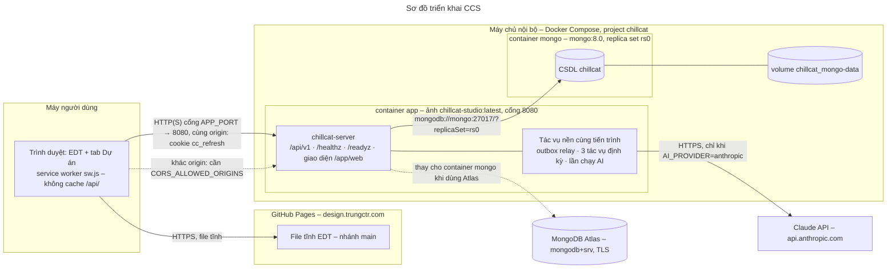
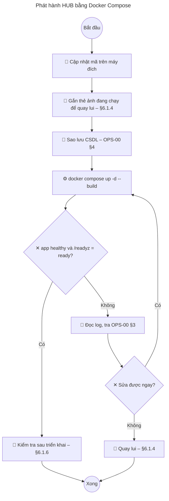

# Hướng dẫn triển khai tổng thể

| Thuộc tính | Giá trị |
|---|---|
| Mã tài liệu | CCS-DEP-000 |
| Phiên bản | 0.1 |
| Ngày | 2026-11-18 |
| Trạng thái | Dự thảo – viết từ hệ thống đang chạy |
| Quy trình ISO/IEC/IEEE 12207 | 6.4.10 Transition · 6.4.12 Operation |
| Chuẩn tham chiếu | ISO/IEC/IEEE 15289 (hạng mục thông tin loại *procedure*) |
| Hệ thống con | EDT – Bộ soạn trên trình duyệt · HUB – Làm việc nhóm (không hệ thống con nào có hạ tầng riêng nên không lập DEP theo hệ thống con – lý do ở [LCP-00 §3.3](../00_Quan_ly_tai_lieu/LCP-00_Ke_hoach_vong_doi_phan_mem.md)) |
| Nguồn đã khảo sát | `backend/README.md`, `backend/Dockerfile`, `backend/Dockerfile.dockerignore`, `backend/deploy/docker-compose.yml`, `backend/deploy/.env.example`, `backend/.env.example`, `backend/Cargo.toml`, `backend/.gitignore`, `backend/scripts/dev-mongo.ps1`, `backend/scripts/smoke.mjs`, `backend/scripts/e2e/` (`README.md`, `ui.mjs`, `ui-team.mjs`), `backend/apps/server/src/main.rs`, `backend/apps/server/src/app.rs`, `backend/crates/platform/src/config.rs`, `backend/crates/platform/src/mongo.rs`, `backend/crates/platform/src/outbox.rs`, `backend/crates/platform/src/module.rs`, `backend/crates/{identity,documents,tickets}/src/lib.rs` (`Job::new`), `backend/crates/audit/src/lib.rs`, `sw.js`, `js/api.js`, `README.md` §Triển khai, `CNAME`, `.nojekyll` |
| Đơn vị ban hành | Nhóm phát triển ChillCat Studio |
| Tài liệu liên quan | ↑ [SAD-00 §6](../03_Kien_truc/SAD-00_Kien_truc_tong_the.md) · [STP-00 §7–§8](../07_Kiem_thu/STP-00_Ke_hoach_kiem_thu.md) · [DBD-00](../05_Thiet_ke_du_lieu/DBD-00_Tong_quan_du_lieu.md) · [StRS-00 §3–§4](../02_Yeu_cau/StRS-00_Yeu_cau_cac_ben_lien_quan.md) (StR-27, StR-28, StC-02, StC-04, StC-11, StC-12) · [SyRS-00 §5–§6](../02_Yeu_cau/SyRS-00_Yeu_cau_he_thong.md) (SYS-N06, SYS-N09, SYS-N16, SYS-I01, SYS-I05) · [BMA-00 §5](../01_Phan_tich_nghiep_vu/BMA-00_Tong_quan_nghiep_vu.md) (BP-42) · ↓ [OPS-00](OPS-00_So_tay_van_hanh.md) · ⇄ [ICD-00 §2](../06_Giao_dien_tich_hop/ICD-00_Tong_quan_tich_hop.md) · [LCP-00 §2.3, §4](../00_Quan_ly_tai_lieu/LCP-00_Ke_hoach_vong_doi_phan_mem.md) · [ASM-00 §9](../09_Danh_gia_hien_trang/ASM-00_Danh_gia_hien_trang.md) |

> Biến môi trường chỉ được nhắc bằng tên; giá trị nằm trong file `.env` không commit (`backend/deploy/.env` khi chạy Docker, `backend/.env` trên máy phát triển) hoặc trong môi trường của máy chủ, không nằm ở đây.

---

**Mục đích và phạm vi.** Thủ tục đưa CCS lên từng môi trường: dựng ảnh, cấu hình, triển khai lần đầu, nâng cấp, quay lui, chuyển sang MongoDB Atlas, kiểm tra sau triển khai. Phạm vi gồm máy chủ HUB (`backend/`) cùng giao diện nó phục vụ, và bản EDT công khai trên GitHub Pages. Việc hằng ngày sau khi hệ thống đã chạy (theo dõi, tác vụ định kỳ, sao lưu, sự cố `OP-nn`) nằm ở [OPS-00](OPS-00_So_tay_van_hanh.md). Người đọc chính: SH-OPS, SH-DEV. Thuật ngữ (replica set, outbox, kiểm tra sống / sẵn sàng…) ở [GLOSSARY](../00_Quan_ly_tai_lieu/GLOSSARY_Thuat_ngu.md).

**Hiện trạng (2026-11-18).** HUB đã chạy trên Docker thật trong đợt kiểm thử 2026-11-17/18 ([STP-00](../07_Kiem_thu/STP-00_Ke_hoach_kiem_thu.md)) nhưng chưa có bản triển khai đang dùng thật **(suy luận)**, chưa có CI, chưa có tag git; mã `backend/` chưa nằm trong lịch sử git. Các số đo thời gian và bộ nhớ trong tài liệu lấy từ đợt kiểm thử đó.

## 1. Môi trường

| Môi trường | EDT – Bộ soạn trên trình duyệt | HUB – Làm việc nhóm | Dữ liệu |
|---|---|---|---|
| Local – máy phát triển (Windows) | Mở `index.html` bằng `file://`, hoặc web server tĩnh bất kỳ (`npx serve .`); hoặc để chính máy chủ HUB phục vụ (`STATIC_DIR=..` trong `backend/.env`) | `powershell -ExecutionPolicy Bypass -File backend/scripts/dev-mongo.ps1` (tải MongoDB 8.0 + mongosh vào `backend/.dev/`, chạy replica set một node `rs0` ở cổng 27117, chỉ nghe 127.0.0.1) → `copy backend\.env.example backend\.env` → `cargo run -p chillcat-server` (cổng 8080, `APP_ENV=dev`) | `backend/.dev/data` (bị `backend/.gitignore` loại); kiểm thử tích hợp dùng CSDL tạm tự xoá |
| Staging – Docker Compose nội bộ (thử nghiệm) | Ảnh `chillcat-studio` phục vụ giao diện từ `/app/web` | Thư mục `backend/deploy/`: `docker compose up -d --build` → container `mongo` (`mongo:8.0`, replica set `rs0`) + `app`; cấu hình ở `backend/deploy/.env` | Volume `chillcat_mongo-data`. Chưa có máy thử nghiệm cố định: đợt kiểm thử 2026-11-17/18 dùng máy ảo 4 CPU / 4 GB RAM và Docker Desktop trên máy phát triển |
| Production – nội bộ, MongoDB đi kèm | Như Staging | Cùng bộ compose trên máy chủ của tổ chức; `PUBLIC_BASE_URL` là địa chỉ người dùng mở (HTTPS cần reverse proxy phía trước – §4) | Volume `chillcat_mongo-data`; **hệ thống không tự sao lưu** ([OPS-00 §4](OPS-00_So_tay_van_hanh.md)) |
| Production – MongoDB Atlas | Như Staging | Chỉ container `app` (`docker compose up -d --build --no-deps app`) hoặc file chạy `chillcat-server`; `MONGODB_URI=mongodb+srv://…` (§6.1.5) | Cụm Atlas (SYS-I01); chưa kiểm chứng trên Atlas thật (SYS-N09) |
| Production – EDT công khai | GitHub Pages, nhánh `main`, thư mục `/`, tên miền `design.trungctr.com` (SYS-I05, StC-12) | Không có máy chủ. Tab Dự án chỉ dùng được khi người dùng trỏ tới một máy chủ HUB có `CORS_ALLOWED_ORIGINS` chứa origin này | `localStorage`, Cache Storage trên trình duyệt người dùng ([DBD-00 §3](../05_Thiet_ke_du_lieu/DBD-00_Tong_quan_du_lieu.md)) |

## 2. Bố trí trên máy chủ / cụm

Ngữ cảnh build là **gốc repo** (ảnh cần cả giao diện và `templates/`), nên máy chạy `docker compose … --build` phải có trọn bản sao repo, không chỉ `backend/`.

```text
<thư mục repo>/
├── index.html, manifest.webmanifest, sw.js, robots.txt, sitemap.xml, llms.txt, og-image.png
├── css/  js/  icons/                 # giao diện – chép vào ảnh ở /app/web
├── templates/                        # mẫu tài liệu – chép vào /app/web/templates VÀ nhúng vào file chạy (include_str!)
└── backend/
    ├── Dockerfile                    # 2 tầng: rust:1-bookworm (build) → debian:bookworm-slim (chạy)
    ├── Dockerfile.dockerignore       # loại .git, **/node_modules, backend/target, backend/.dev, **/.env, desc.txt
    ├── .env                          # CHỈ cho máy phát triển (cargo run) – Compose không đọc file này
    └── deploy/
        ├── docker-compose.yml        # project "chillcat": dịch vụ mongo + app, volume mongo-data
        ├── .env.example
        └── .env                      # cấu hình triển khai, có JWT_SECRET – không commit

Trong ảnh chillcat-studio:latest (người dùng chillcat, uid 10001)
/app/chillcat-server                  # file chạy, mẫu tài liệu đã nhúng
/app/web/                             # STATIC_DIR: giao diện tĩnh + templates/

Docker
volume chillcat_mongo-data            # gắn vào /data/db của container mongo
```

### 2.1 Sơ đồ triển khai

Góc nhìn kiến trúc đầy đủ (container, trách nhiệm, dữ liệu) ở [SAD-00 §6](../03_Kien_truc/SAD-00_Kien_truc_tong_the.md). Sơ đồ dưới chỉ vẽ phần cần để triển khai.



## 3. Các tiến trình chạy

| Tiến trình | Thư mục | Cổng | Lệnh chạy | Số bản | Giới hạn bộ nhớ / CPU | Ghi chú |
|---|---|---|---|---|---|---|
| `app` – `chillcat-server` (Docker) | `/app` trong ảnh; build từ gốc repo | 8080 trong container → `${APP_PORT:-8080}` trên máy | `docker compose up -d --build` trong `backend/deploy/` (`CMD ["/app/chillcat-server"]`) | 1 | Không đặt giới hạn; đo lúc rỗi ~3 MB RAM | HUB. `restart: unless-stopped`; `HEALTHCHECK` 30 s; chạy bằng người dùng `chillcat` (không phải root); chỉ khởi động khi `mongo` healthy |
| `mongo` (Docker) | volume `chillcat_mongo-data` → `/data/db` | 27017, chỉ trong mạng compose (không mở ra máy) | `mongod --replSet rs0 --bind_ip_all` | 1 (replica set một node) | Không đặt giới hạn; đo lúc rỗi ~116 MB RAM | HUB. Healthcheck 10 s: lần đầu tự `rs.initiate` (host `mongo:27017`), sau đó chỉ kiểm có primary ghi được |
| `chillcat-server` (máy phát triển) | `backend/` | 8080 (`HTTP_ADDR=127.0.0.1:8080`) | `cargo run -p chillcat-server` | 1 | – | Đọc `backend/.env` (`dotenvy`, `main.rs#main`) |
| `mongod` (máy phát triển) | `backend/.dev/` (`data/`, `log/`) | 27117, chỉ 127.0.0.1 | `backend/scripts/dev-mongo.ps1` (dừng: `-Stop`) | 1 | WiredTiger cache 0,5 GB | Lần đầu tải MongoDB 8.0 (kiểm SHA-256) và mongosh |
| EDT tĩnh | gốc repo | 443 (GitHub Pages) | Đẩy nhánh `main` | – | – | EDT; xem §6.2 |

### 3.1 Tác vụ nền trong cùng tiến trình

Không có tiến trình worker riêng: không cần triển khai thêm gì. `main.rs#run` khởi chạy các việc nền trong cùng tiến trình với API (`app.rs#spawn_jobs`, `OutboxRelay::run`).

| Tác vụ | Chu kỳ | Việc | Nguồn |
|---|---|---|---|
| Outbox relay | Liên tục; rỗi thì dò lại mỗi 400 ms hoặc ngay khi có sự kiện mới | Nhận sự kiện chưa phát trong collection `outbox` (khoá thuê 60 s để nhiều tiến trình không phát trùng), gọi handler của các module (thông báo, nhật ký, cờ Cần rà soát, phản ứng ticket…), đánh dấu đã phát. Lỗi ⇒ thử lại, chờ tăng dần (tối đa 5 phút); quá 8 lần ⇒ đánh dấu hỏng và giữ lại | `backend/crates/platform/src/outbox.rs#run`, `#dispatch_next` |
| `documents.purge_expired_versions` | 24 giờ | Xoá bản Thay thế quá `VERSION_RETENTION_YEARS` (tối đa 500 bản mỗi lượt) cùng nhận xét, lượt duyệt, chỉ mục truy vết của chúng | `backend/crates/documents/src/lib.rs#jobs`, `integration.rs#purge_expired_versions` |
| `identity.purge_sessions` | 6 giờ | Xoá phiên đã thu hồi quá 7 ngày | `backend/crates/identity/src/lib.rs#jobs`, `service.rs#purge_revoked_sessions` |
| `tickets.fail_stuck_checks` | 5 phút | Lần chạy AI còn `pending` quá 15 phút ⇒ thất bại, ticket trở về trạng thái trước, cho chạy lại | `backend/crates/tickets/src/lib.rs#jobs`, `runs.rs#fail_stuck_checks` |
| Lần chạy AI của ticket | Theo yêu cầu (ticket mới có uỷ quyền AI, hoặc bấm nút) | Tác vụ tokio riêng trong cùng tiến trình; khởi động lại giữa chừng ⇒ lần chạy treo tới khi `tickets.fail_stuck_checks` xử lý | `backend/crates/tickets/src/runs.rs#spawn` |

- Mỗi tác vụ định kỳ là một vòng lặp riêng, chạy lần đầu **20 giây sau khi khởi động** rồi lặp theo chu kỳ, nên mỗi lần khởi động lại cũng là một lần chạy **(suy luận)** từ `app.rs#spawn_jobs`. Lỗi chỉ ghi log `Tác vụ định kỳ lỗi` (kèm `job`), không dừng tiến trình.
- Việc xoá theo chỉ mục TTL (nhật ký, thông báo, phiên, outbox đã phát) do MongoDB tự làm, không thuộc tiến trình này – liệt kê ở [OPS-00 §2](OPS-00_So_tay_van_hanh.md).
- Chạy nhiều bản `app` trên cùng CSDL: outbox có khoá thuê nên không phát trùng; tác vụ định kỳ sẽ chạy trên mọi bản (các lệnh xoá lặp lại vô hại) **(suy luận)**. Chưa thử – compose chỉ chạy một bản.

## 4. Đường dẫn nào đi tới đâu

| Đường dẫn | Tới | Môi trường | Ghi chú |
|---|---|---|---|
| `/api/v1/…` | `chillcat-server` :8080 – router API của 7 module và `GET /api/v1/meta` | Mọi môi trường có HUB | `Cache-Control: no-store`; thân yêu cầu tối đa `REQUEST_BODY_LIMIT_MB`; đường không có ⇒ `404 route.not_found`. Danh sách endpoint: [API-HUB §2](../06_Giao_dien_tich_hop/API-HUB_Lam_viec_nhom.md); tổng quan dịch vụ: [ICD-00 §2](../06_Giao_dien_tich_hop/ICD-00_Tong_quan_tich_hop.md) |
| `/api/v1/public/documents/{id}` | `chillcat-server`, không cần đăng nhập | Như trên | Bản phát hành mức Công khai (SH-PUB) |
| `/healthz` | `chillcat-server` – trả `ok` | Như trên | Không chạm CSDL; `HEALTHCHECK` của ảnh gọi đường này |
| `/readyz` | `chillcat-server` – ping MongoDB | Như trên | `200 ready` hoặc `503 mongo unavailable` (`app.rs#readyz`) |
| `/` và mọi đường khác | `ServeDir(STATIC_DIR)`: `/app/web` trong ảnh, `..` (gốc repo) trên máy phát triển | Như trên | Thư mục trả `index.html`; bỏ trống `STATIC_DIR` ⇒ chỉ phục vụ API (`app.rs#build`) |
| `https://design.trungctr.com/…` | GitHub Pages | EDT công khai | Không có `/api/`. Tab Dự án đặt địa chỉ máy chủ ở giao diện (`js/api.js#API.setBase`); máy chủ phải có origin này trong `CORS_ALLOWED_ORIGINS` |
| Reverse proxy (tuỳ chọn) | Chuyển `/api/` (và `/healthz`, `/readyz`) tới máy chủ, giao diện phục vụ nơi khác | Production | Cách `backend/README.md` §Triển khai nêu; repo chưa có cấu hình proxy mẫu. Máy chủ chỉ nói HTTP (`axum::serve` trên `TcpListener`, `main.rs#run`): muốn `https://` phải có proxy TLS phía trước |

Mọi phản hồi có `X-Content-Type-Options: nosniff`, `Referrer-Policy: same-origin`, `X-Frame-Options: SAMEORIGIN` và nén gzip khi trình duyệt chấp nhận (`app.rs#build`). Service worker bỏ qua `/api/`, `/healthz`, `/readyz` – không cache, không trả bản cũ (`sw.js`, sự kiện `fetch`).

## 5. Biến môi trường (chỉ tên)

Đọc ở `backend/crates/platform/src/config.rs#from_env` (trừ `RUST_LOG`, `LOG_FORMAT` ở `main.rs`). Giá trị rỗng hoặc chỉ có khoảng trắng coi như không đặt. Cấu hình sai ⇒ tiến trình dừng ngay khi khởi động với thông báo `Cấu hình không hợp lệ: <BIẾN> …` ([OPS-00 §3](OPS-00_So_tay_van_hanh.md), OP-05).

Cột **Ảnh / compose**: giá trị mà ảnh (`ENV` trong `backend/Dockerfile`) hoặc `backend/deploy/docker-compose.yml` đặt sẵn; "không truyền" = compose không chuyển biến này vào container.

| Nhóm | Biến | Mặc định trong mã | Ảnh / compose | Bắt buộc khi | Ý nghĩa | Dùng ở |
|---|---|---|---|---|---|---|
| Chạy | `APP_ENV` | `dev` | Ảnh: `prod` | – | `dev` / `prod`; `prod` bắt buộc `JWT_SECRET` | HUB |
| Chạy | `HTTP_ADDR` | `127.0.0.1:8080` | Ảnh: `0.0.0.0:8080` | – | Địa chỉ lắng nghe | HUB |
| Chạy | `PUBLIC_BASE_URL` | `http://` + `HTTP_ADDR` (`0.0.0.0` đổi thành `localhost`) | Compose: `http://localhost:8080` | Người dùng mở bằng địa chỉ khác `localhost` | Dựng link lời mời, link công khai; trả ở `/api/v1/meta`; bắt đầu bằng `https://` ⇒ cookie `cc_refresh` có cờ `Secure` | HUB |
| Chạy | `STATIC_DIR` | Không có (chỉ API) | Ảnh: `/app/web`; `backend/.env.example`: `..` | Cần phục vụ giao diện | Thư mục giao diện tĩnh | HUB, EDT |
| Chạy | `CORS_ALLOWED_ORIGINS` | Rỗng (chỉ cùng origin) | Compose: rỗng | Giao diện ở origin khác (GitHub Pages) | Danh sách origin, cách nhau dấu phẩy | HUB ↔ EDT |
| Chạy | `REQUEST_BODY_LIMIT_MB` | 16 | Không truyền | – | Giới hạn thân yêu cầu API | HUB |
| Chạy | `TZ` | – | Ảnh: `Asia/Ho_Chi_Minh` | – | Múi giờ hệ điều hành trong container | HUB |
| CSDL | `MONGODB_URI` | Không có | Compose: `mongodb://mongo:27017/?replicaSet=rs0` | **Luôn** | Chuỗi kết nối; phải là replica set hoặc Atlas (`mongo.rs#check_topology`) | HUB – SYS-I01 |
| CSDL | `MONGODB_DB` | `chillcat` | Compose: `chillcat` | – | CSDL dùng chung cho mọi module | HUB |
| CSDL | `MONGODB_DB_<MODULE>` | Không có | Không truyền | – | Tách CSDL theo module: `IDENTITY`, `WORKSPACES`, `DOCUMENTS`, `TRACEABILITY`, `TICKETS`, `NOTIFICATIONS`, `AUDIT`, `OUTBOX` | HUB – SYS-N08 |
| CSDL | `MONGODB_MAX_POOL` | 20 | Không truyền | – | Số kết nối tối đa | HUB |
| CSDL | `MONGODB_SERVER_SELECTION_TIMEOUT_SECS` | 10 | Không truyền | – | Thời gian chờ tìm được máy MongoDB trước khi báo lỗi | HUB |
| CSDL | `MONGODB_AUTO_INIT_REPLICA_SET` | `false` | Không truyền | – (chỉ máy phát triển) | Tự `replSetInitiate` khi mongod chưa khởi tạo replica set | HUB |
| Đăng nhập | `JWT_SECRET` | Ở `dev`: khoá tạm ngẫu nhiên mỗi lần khởi động | Compose: **bắt buộc** (`${JWT_SECRET:?…}`) | `APP_ENV=prod` và mọi lần chạy compose; ít nhất 32 ký tự | Khoá ký và kiểm access token (HS256) | HUB – SYS-N02 |
| Đăng nhập | `ACCESS_TOKEN_TTL_SECS` | 900 | Không truyền | – | Thời hạn access token | HUB |
| Đăng nhập | `REFRESH_TOKEN_TTL_DAYS` | 30 | Không truyền | – | Thời hạn phiên (refresh token) | HUB |
| Đăng nhập | `AUTH_ALLOW_REGISTRATION` | `true` | Compose: `true` | – | Cho tự đăng ký tài khoản | HUB |
| Đăng nhập | `BOOTSTRAP_ADMIN_EMAIL`, `BOOTSTRAP_ADMIN_PASSWORD` | Không có | Compose: rỗng | Chỉ có tác dụng khi đặt cả hai và chưa có quản trị viên nào | Tạo / nâng quản trị viên đầu tiên ([OPS-00 §1.1](OPS-00_So_tay_van_hanh.md)) | HUB |
| Workspace | `WORKSPACE_CREATION` | `all` | Compose: `all` | – | `all` (mọi người) / `admin` – ai được tạo workspace | HUB |
| AI | `AI_PROVIDER` | `none` | Compose: `none` | – | `none` (so khớp từ khoá, không gửi dữ liệu ra ngoài) / `anthropic` | HUB |
| AI | `AI_API_KEY` | Không có | Compose: rỗng | `AI_PROVIDER=anthropic` | Khoá Claude API | HUB – SYS-I02 |
| AI | `AI_MODEL` | `claude-opus-5-5` | Compose: `claude-opus-5-5` | – | Model dùng cho kiểm tra trùng, đề xuất tài liệu | HUB |
| AI | `AI_BASE_URL` | `https://api.anthropic.com` | Không truyền | – | Đổi khi đi qua proxy nội bộ | HUB |
| AI | `AI_TIMEOUT_SECS` | 300 | Không truyền | – | Thời gian chờ một lời gọi AI | HUB |
| AI | `AI_FALLBACKS` | `true` | Compose: `true` | – | Chạy lại trên model dự phòng khi bị bộ lọc an toàn từ chối | HUB |
| Lưu trữ | `AUDIT_RETENTION_DAYS` | 730 | Không truyền | – | Thời hạn chỉ mục TTL `audit_ttl` (đổi sau khi đã tạo chỉ mục: OP-19) | HUB |
| Lưu trữ | `VERSION_RETENTION_YEARS` | 10 | Không truyền | – | Thời hạn giữ bản Thay thế | HUB |
| Lưu trữ | `INVITATION_TTL_DAYS` | 14 | Không truyền | – | Hiệu lực lời mời | HUB |
| Log | `RUST_LOG` | `info,tower_http=info,mongodb=warn` | Compose: cùng giá trị | – | Mức log theo cú pháp `EnvFilter` | HUB – SYS-N16 |
| Log | `LOG_FORMAT` | Văn bản | Ảnh: `json` | – | `json` ⇒ log JSON một dòng mỗi bản ghi | HUB – SYS-N16 |
| Chỉ compose | `APP_PORT` | – | Compose: 8080 | – | Cổng trên máy chủ ánh xạ vào 8080 của container | HUB |
| Chỉ build | `CARGO_BUILD_JOBS` | – (cargo tự chọn) | Build arg, rỗng | Máy ít RAM | Số tiến trình `rustc` song song khi build ảnh (§6.1.1) | HUB |

**Biến "không truyền" không tới được máy chủ khi chạy compose.** Compose chỉ dùng `backend/deploy/.env` để thay các chỗ `${…}` trong `docker-compose.yml`; file compose không có `env_file:`, nên đặt `AUDIT_RETENTION_DAYS`, `AI_TIMEOUT_SECS`, `MONGODB_MAX_POOL`… trong `.env` không có tác dụng. Muốn đổi thì thêm dòng vào khối `environment:` của dịch vụ `app`, hoặc chạy ảnh bằng `docker run -e <BIẾN>`.

## 6. Quy trình phát hành

Không có CI (repo không có `.github/`), không có registry ảnh, không có tag git: mọi bước chạy tay trên máy đích. Chưa quy định ai duyệt một lần phát hành (§8). Kiểm thử trước khi phát hành theo [STP-00 §7](../07_Kiem_thu/STP-00_Ke_hoach_kiem_thu.md); nhận diện phiên bản theo [LCP-00 §4.2](../00_Quan_ly_tai_lieu/LCP-00_Ke_hoach_vong_doi_phan_mem.md).



### 6.1 HUB – Làm việc nhóm

#### 6.1.1 Dựng ảnh

- **Lệnh:** qua compose (`build.context: ../..`, `dockerfile: backend/Dockerfile`), hoặc từ gốc repo `docker build -f backend/Dockerfile -t chillcat-studio .`.
- **Tầng build** (`rust:1-bookworm`): chép `backend/` và `templates/` (mẫu được nhúng vào file chạy), chạy `cargo build --release --locked -p chillcat-server` – đúng phiên bản trong `Cargo.lock`.
- **Cache BuildKit:** `RUN --mount=type=cache` cho `/usr/local/cargo/registry`, `/usr/local/cargo/git` và `/src/backend/target`, nên sửa mã chỉ biên dịch lại crate bị đổi. `docker builder prune` xoá cache này ⇒ lần build sau như build đầu.
- **`CARGO_BUILD_JOBS`:** build arg, nếu có thì thành `--jobs N`. Đặt trong `backend/deploy/.env` (compose chuyển thành build arg). Máy ít RAM đặt `2`.
- **Tầng chạy** (`debian:bookworm-slim`): chỉ thêm `ca-certificates`, `tzdata`; tạo người dùng `chillcat`; chép file chạy và giao diện.
- **Profile release** (`backend/Cargo.toml`): `lto = "thin"`, `codegen-units = 4`, `strip = "debuginfo"` – bước link là bước lâu nhất khi build lại.

| Trường hợp | Số đo (2026-11-17/18) | Ghi chú |
|---|---|---|
| Build lần đầu, cache trống | ~17 phút | Máy ảo 4 CPU / 4 GB RAM |
| Build lại sau khi đổi mã Rust | ~11 phút | Chủ yếu là bước link bản release |
| Build lại khi chỉ đổi giao diện (`index.html`, `css/`, `js/`, `icons/`…) | ~16 giây | Tầng build còn nguyên; chỉ các lớp `COPY` của tầng chạy |
| Build lại khi đổi `templates/` | Như đổi mã Rust **(suy luận)** | `templates/` được chép vào tầng build ⇒ biên dịch lại và link lại |
| Kích thước ảnh | 187 MB | |
| Từ `up` tới `app` healthy | ~16 giây | |
| RAM lúc rỗi | `app` ~3 MB, `mongo` ~116 MB | |

Ảnh nền `rust:1-bookworm`, `debian:bookworm-slim`, `mongo:8.0` là thẻ trôi: hai lần build cách nhau có thể dùng ảnh nền khác nhau ([LCP-00 §4.1](../00_Quan_ly_tai_lieu/LCP-00_Ke_hoach_vong_doi_phan_mem.md)).

#### 6.1.2 Triển khai lần đầu (Docker Compose, MongoDB đi kèm)

1. Máy đích có Docker Engine + Compose v2 và trọn bản sao repo. Máy ít RAM: đọc §6.1.1 trước.
2. `cd backend/deploy` rồi chép `.env.example` thành `.env` (`copy .env.example .env` trong PowerShell, `cp` trong bash).
3. Sửa `.env`: đặt `JWT_SECRET` (ít nhất 32 ký tự ngẫu nhiên; lệnh sinh chuỗi ghi sẵn trong `.env.example`), `PUBLIC_BASE_URL`, `APP_PORT`; tuỳ chọn `BOOTSTRAP_ADMIN_EMAIL` + `BOOTSTRAP_ADMIN_PASSWORD`, `AUTH_ALLOW_REGISTRATION`, `WORKSPACE_CREATION`, `AI_PROVIDER` + `AI_API_KEY`, `CARGO_BUILD_JOBS`. Để trống `MONGODB_URI` để dùng container `mongo`.
4. Kiểm shell hiện tại **không** có biến trùng tên với `.env`, đặc biệt `MONGODB_URI` của máy phát triển: PowerShell `Get-ChildItem Env:MONGODB*`, bash `env | grep MONGODB`. Có thì bỏ: `Remove-Item Env:MONGODB_URI` / `unset MONGODB_URI` (OP-04).
5. `docker compose up -d --build`. Lần đầu: container `mongo` tự khởi tạo replica set `rs0` qua healthcheck; `app` đợi `mongo` healthy rồi mới chạy; máy chủ tự tạo chỉ mục khi khởi động.
6. Kiểm tra theo §6.1.6.
7. Tạo quản trị viên đầu tiên **ngay** (nếu không dùng `BOOTSTRAP_ADMIN_*`): người đăng ký đầu tiên trên hệ thống trống là quản trị – đăng ký trước khi mở cho người khác và trước khi chạy bất kỳ script thử nào ([OPS-00 §1.1](OPS-00_So_tay_van_hanh.md)).
8. Đặt lịch sao lưu theo [OPS-00 §4](OPS-00_So_tay_van_hanh.md) – hệ thống không tự sao lưu.

**Không dùng Docker:** `cargo build --release -p chillcat-server` → `backend/target/release/chillcat-server` (mẫu tài liệu đã nhúng). Đặt cạnh thư mục giao diện, trỏ `STATIC_DIR` tới đó, đặt biến môi trường như §5 (nên đặt `APP_ENV=prod`, `HTTP_ADDR`, `LOG_FORMAT=json`). Repo không có file dịch vụ (systemd, Windows service) cho cách chạy này.

#### 6.1.3 Nâng cấp

1. Đọc thay đổi của bản mới (hiện chưa có ghi chú phát hành – §8).
2. Giữ ảnh đang chạy để quay lui: `docker tag chillcat-studio:latest chillcat-studio:truoc-nang-cap`.
3. Sao lưu CSDL ([OPS-00 §4](OPS-00_So_tay_van_hanh.md)).
4. Cập nhật mã nguồn trên máy đích (gốc repo).
5. Trong `backend/deploy/`: `docker compose up -d --build`. Compose dựng ảnh mới, thay container `app`; `mongo` giữ nguyên khi cấu hình của nó không đổi. Dịch vụ gián đoạn từ lúc container cũ dừng tới lúc container mới healthy (~16 giây cộng thời gian dừng) **(suy luận)**.
6. Kiểm tra theo §6.1.6; theo dõi log vài phút đầu (`docker compose logs -f app`).
7. Người dùng nhận giao diện mới ở lần tải trang kế tiếp (service worker network-first). Đổi danh sách file giao diện thì phải cập nhật `sw.js` (§6.2).

Chỉ đổi cấu hình trong `.env` (không đổi mã): `docker compose up -d` – compose tạo lại `app` khi giá trị môi trường đổi.

#### 6.1.4 Quay lui

**Hạn chế:** ảnh chỉ có thẻ `chillcat-studio:latest`, không có registry; `backend/` chưa nằm trong git nên không dựng lại được bản mã cũ. Quay lui chỉ dựa vào ảnh cũ còn trên máy. Các bước dưới **chưa diễn tập**.

1. Có thẻ từ bước 2 của §6.1.3: `docker tag chillcat-studio:truoc-nang-cap chillcat-studio:latest` rồi `docker compose up -d --no-build --force-recreate app`.
2. Quên gắn thẻ: sau khi build, ảnh cũ thành ảnh lơ lửng (`<none>`) cho tới khi bị `docker image prune` xoá **(suy luận)**. Tìm bằng `docker images --filter dangling=true` (đối chiếu cột thời điểm tạo), gắn lại `docker tag <IMAGE ID> chillcat-studio:latest`, rồi chạy như bước 1.
3. CSDL: chỉ mục và trường do bản mới thêm vẫn ở lại; bản cũ thường vẫn chạy được nếu bản mới không đổi dạng dữ liệu **(suy luận)**. Nếu không, khôi phục bản sao lưu lấy ở bước 3 của §6.1.3 – mất dữ liệu ghi sau thời điểm đó.
4. EDT: hoàn tác commit trên nhánh `main`; GitHub Pages phát hành lại.

#### 6.1.5 Chuyển sang MongoDB Atlas

1. Trên Atlas: tạo cụm (M10 trở lên cho môi trường chính thức, M0 dùng thử được – `backend/README.md` §MongoDB Atlas); **Database Access**: người dùng chỉ có `readWrite` trên CSDL `chillcat` (và các CSDL `MONGODB_DB_*` nếu tách); **Network Access**: thêm IP công khai hoặc VPC của máy chạy `app` (thiếu ⇒ OP-03).
2. Có dữ liệu cũ trong container: chuyển bằng `mongodump` / `mongorestore` theo [OPS-00 §4.3](OPS-00_So_tay_van_hanh.md) (chưa diễn tập).
3. Trong `backend/deploy/.env`: `MONGODB_URI=mongodb+srv://<người dùng>:<mật khẩu>@<cụm>.mongodb.net/?retryWrites=true&w=majority` (dạng `+srv` tự bật TLS); giữ `MONGODB_DB`.
4. `docker compose up -d --build --no-deps app`. `--no-deps` để compose không kéo container `mongo` lên theo `depends_on`. Dừng container `mongo` cũ bằng `docker compose stop mongo`; giữ volume tới khi chắc chắn không cần quay lại.
5. Kiểm tra theo §6.1.6: log `Đã kết nối MongoDB`, `/readyz` trả `ready`. Chỉ mục được tạo trên Atlas ngay lần khởi động đầu, mang tên rõ ràng (`users_email`, `audit_ttl`…) để dễ đối chiếu.
6. Từ đây luôn dùng `--no-deps app`: chạy `docker compose up -d` không kèm tham số sẽ khởi động lại container `mongo` không dùng tới **(suy luận)**.

Máy chủ nối Atlas bằng Stable API v1, ghi `w=majority`, bật `retryWrites` / `retryReads`, tự thử lại transaction khi Atlas đổi primary (`backend/crates/platform/src/mongo.rs#connect`, `#with_txn`). Không dùng compose: `docker run -d -p 8080:8080 -e MONGODB_URI -e JWT_SECRET -e PUBLIC_BASE_URL chillcat-studio` – ghi `-e <BIẾN>` không kèm giá trị để Docker lấy giá trị từ môi trường của shell, chuỗi kết nối không lọt vào lịch sử lệnh.

#### 6.1.6 Kiểm tra sau triển khai

PowerShell 5.1: `curl` là bí danh của `Invoke-WebRequest`; dùng `curl.exe` hoặc `Invoke-RestMethod <địa chỉ>`.

| # | Kiểm tra | Lệnh | Đạt khi |
|---|---|---|---|
| 1 | Container | `docker compose ps` | `app` và `mongo` ở trạng thái `Up … (healthy)` |
| 2 | Sống | `curl -s http://localhost:8080/healthz` | `ok` |
| 3 | Sẵn sàng | `curl -s http://localhost:8080/readyz` | `ready` (HTTP 200). `503 mongo unavailable` ⇒ OP-07 |
| 4 | Thông tin bản chạy | `curl -s http://localhost:8080/api/v1/meta` | JSON có `name` = `ChillCat Studio`, `version` đúng bản vừa phát hành (`0.1.0`), `api` = `v1`, `registration`, `workspace_creation`, `ai` (`keyword` / `claude`), `ai_model`, `public_base_url` khớp cấu hình |
| 5 | Log khởi động | `docker compose logs app` | Có `Đã kết nối MongoDB`, 7 dòng `Đã nạp module`, `Outbox relay bắt đầu`, `ChillCat Studio đang chạy`; không có `Không khởi động được máy chủ` |
| 6 | Đầu-cuối HTTP | `node backend/scripts/smoke.mjs http://localhost:8080/api/v1` (Node 18+) | 26/26 dòng `OK`. Script **tạo hai tài khoản, một workspace, tài liệu, ticket thử**: chỉ chạy trên máy thử nghiệm; trên hệ thống trống, tài khoản thử đầu tiên sẽ thành quản trị |
| 7 | Giao diện | Trong `backend/scripts/e2e/`: `npm install`; đặt `CHROME_PATH`; `node ui.mjs http://localhost:8080/ ./shots`; `node ui-team.mjs http://localhost:8080/ ./shots ../../deploy` | 25/25 và 40/40. Tham số thứ ba của `ui-team.mjs` khởi động lại container `app` và kiểm phiên, dữ liệu còn nguyên. Cũng tạo dữ liệu thử |
| 8 | Bằng mắt | Mở `PUBLIC_BASE_URL` → tab **Dự án** (`Alt+4`) | Đăng nhập được, không có lỗi trong console |

Kết quả đợt 2026-11-17/18 (smoke 26/26, giao diện 25/25 và 40/40, `down` / `up` giữ dữ liệu volume): [STP-00](../07_Kiem_thu/STP-00_Ke_hoach_kiem_thu.md).

| Lưu ý | Chi tiết |
|---|---|
| Compose đặt ở `backend/deploy/`, không ở `backend/` | Compose tự đọc file `.env` cạnh `docker-compose.yml`. Đặt ở `backend/` thì nó đọc nhầm `backend/.env` của máy phát triển (có `MONGODB_URI` trỏ `127.0.0.1:27117`) |
| Biến của shell ghi đè `.env` | Đã gặp: shell còn `MONGODB_URI` của máy phát triển ⇒ container `app` nối vào `127.0.0.1:27117` (chính nó) và không khởi động được. Bỏ biến trước khi chạy compose (OP-04). Áp dụng cho mọi biến khác, kể cả `JWT_SECRET` |
| Docker Desktop sập khi build | Đã gặp: máy 8 GB RAM chỉ còn trống ~1,5 GB, các `rustc` song song làm Docker Desktop sập. Đặt `CARGO_BUILD_JOBS=2` trong `backend/deploy/.env` (OP-11) |
| `HEALTHCHECK` dùng bash `/dev/tcp` | Ảnh `debian:bookworm-slim` không có `curl` / `wget`. Healthcheck mở TCP tới `127.0.0.1:8080` bằng bash, gửi `GET /healthz`, tìm chữ `ok`. Đổi sang `curl` thì phải cài thêm gói vào ảnh |
| Service worker không cache `/api/` | `sw.js` bỏ qua `/api/`, `/healthz`, `/readyz`: dữ liệu riêng của người dùng không nằm trong Cache Storage và không bao giờ trả bản cũ |
| Biến "không truyền" | Đặt trong `backend/deploy/.env` cũng không tới container (§5) |
| `docker compose down -v` | Xoá volume `chillcat_mongo-data` – mất toàn bộ dữ liệu. Dừng bình thường dùng `docker compose down` |
| Script thử tạo dữ liệu | `smoke.mjs`, `ui.mjs`, `ui-team.mjs` tạo tài khoản và workspace thật trên máy chủ được trỏ tới |

### 6.2 EDT – Bộ soạn trên trình duyệt

Đẩy (push) nhánh `main` là phát hành: GitHub Pages (Deploy from a branch: `main`, thư mục `/`) tự đưa lên. Không có bước duyệt riêng.

| Lưu ý | Chi tiết |
|---|---|
| `CNAME` | Lưu tên miền `design.trungctr.com` của GitHub Pages – không xoá |
| `.nojekyll` | File rỗng – không xoá. Thiếu nó, GitHub Pages chạy Jekyll, đổi các file `.md` thành `.html` và app không tải được mẫu tài liệu |
| DNS | Cloudflare: bản ghi `CNAME design → trungctr.github.io`, chế độ **DNS only**; bật **Enforce HTTPS** trong Settings → Pages |
| Thêm / bớt file giao diện | Cập nhật `PRECACHE` và tăng `VERSION` trong `sw.js` (hiện `v14`); cập nhật `<lastmod>` trong `sitemap.xml` khi nội dung trang đổi |
| `PRECACHE` phải khớp file có thật | Lúc cài, service worker nạp cả danh sách bằng `cache.addAll`; thiếu một file (404) thì lần cài thất bại và người dùng giữ service worker cũ **(suy luận)**. Tại 2026-11-18 `PRECACHE` đã có `js/api.js`, `js/hub.js`, `js/hub-docs.js`, `js/hub-tickets.js` trong khi các file này chưa được commit: phải commit cùng lúc với `sw.js` |
| Thư viện CDN | Cache riêng `diagram-editor-cdn-v1`, giữ qua các lần nâng cấp; URL có số phiên bản nên không cần làm mới |

## 7. Đổi cấu trúc CSDL khi phát hành

| Hệ thống | Cách làm | Ai chạy, khi nào | Quay lại thế nào |
|---|---|---|---|
| HUB (`chillcat`, hoặc các CSDL `MONGODB_DB_<MODULE>`) | Không có công cụ migration. MongoDB không có lược đồ cố định; mỗi module tạo chỉ mục của mình khi khởi động (`Module::init` → `backend/crates/platform/src/mongo.rs#ensure_indexes`, idempotent, tên chỉ mục cố định). Trường mới xuất hiện khi được ghi | Máy chủ tự chạy mỗi lần khởi động | Chỉ mục do bản mới tạo vẫn ở lại khi quay lui **(suy luận)**; dữ liệu đã đổi dạng thì khôi phục bản sao lưu ([OPS-00 §4](OPS-00_So_tay_van_hanh.md)) |
| HUB – đổi tuỳ chọn của chỉ mục đã có (ví dụ `AUDIT_RETENTION_DAYS` đổi thời hạn của `audit_ttl`) | MongoDB từ chối tạo chỉ mục cùng tên khác tuỳ chọn ⇒ máy chủ không khởi động **(suy luận, chưa thử)** | Người vận hành, trước khi khởi động với giá trị mới: sửa chỉ mục bằng `collMod` (OP-19) | Đặt lại giá trị cũ |
| EDT (`localStorage`, Cache Storage) | Không có CSDL máy chủ; khoá `diagram-editor:…` ở trình duyệt. Cache của service worker đổi tên theo `VERSION`; cache cũ bị xoá khi bản mới kích hoạt (`sw.js`, sự kiện `activate`) | Tự động trên trình duyệt người dùng | Hoàn tác commit |

`VERSION_RETENTION_YEARS` được tính trong mã lúc chạy tác vụ (không phải chỉ mục) nên đổi lúc nào cũng được. Danh sách CSDL và ai được đổi cấu trúc: [DBD-00 §3](../05_Thiet_ke_du_lieu/DBD-00_Tong_quan_du_lieu.md); collection và chỉ mục: [ERD-HUB §3](../05_Thiet_ke_du_lieu/ERD-HUB_CSDL_Lam_viec_nhom.md).

## 8. Vấn đề còn mở

- **Quay lui chưa có nền tảng:** không CI, không registry, không tag git, ảnh chỉ có thẻ `latest`, `backend/` chưa nằm trong git. Quy trình §6.1.4 chưa diễn tập. Kế hoạch gắn thẻ ảnh theo phiên bản ở [LCP-00 §4](../00_Quan_ly_tai_lieu/LCP-00_Ke_hoach_vong_doi_phan_mem.md).
- HUB chưa có bản triển khai chính thức; chưa có môi trường thử nghiệm cố định; chưa quy định ai duyệt một lần phát hành; chưa có ghi chú phát hành.
- **Atlas** chưa kiểm chứng trên cụm thật (SYS-N09); việc chuyển dữ liệu từ container sang Atlas chưa diễn tập.
- **Dừng tiến trình:** `main.rs#run` chỉ chờ Ctrl+C (SIGINT). `docker stop` gửi SIGTERM; tiến trình là PID 1 trong container và không bắt SIGTERM nên có thể bị Docker buộc dừng sau 10 giây thay vì dừng êm **(suy luận, chưa đo)**. Sự kiện đã nằm trong `outbox` nên không mất; lần chạy AI dở dang được OP-08 xử lý.
- Biến "không truyền" (§5) không đổi được qua `backend/deploy/.env` – cách cấu hình này chưa được ghi ở `backend/README.md`.
- Đổi `AUDIT_RETENTION_DAYS` sau khi chỉ mục đã có (§7, OP-19) chưa thử.
- Chạy nhiều bản `app` trên cùng CSDL chưa thử (§3.1).
- Không có file dịch vụ cho cách chạy không dùng Docker, không có cấu hình reverse proxy / TLS mẫu.
- Container không có giới hạn bộ nhớ / CPU; log của container không có giới hạn kích thước (compose không khai `logging:`) **(suy luận)**.
- `PRECACHE` trong `sw.js` đang liệt kê bốn file chưa commit (§6.2).
- Liên kết tới [SAD-00 §6](../03_Kien_truc/SAD-00_Kien_truc_tong_the.md) viết khi SAD-00 đang được lập song song – kiểm lại số mục khi SAD-00 xong.
- Sơ đồ đang ở dạng Mermaid – đổi sang sơ đồ nhúng bằng ChillCat Studio trước khi phát hành 1.0.

## 9. Lịch sử thay đổi

| Phiên bản | Ngày | Mô tả | Người thực hiện |
|---|---|---|---|
| 0.1 | 2026-11-18 | Khởi tạo từ bộ mẫu, viết lại từ hệ thống đang chạy | Nhóm phát triển ChillCat Studio |
